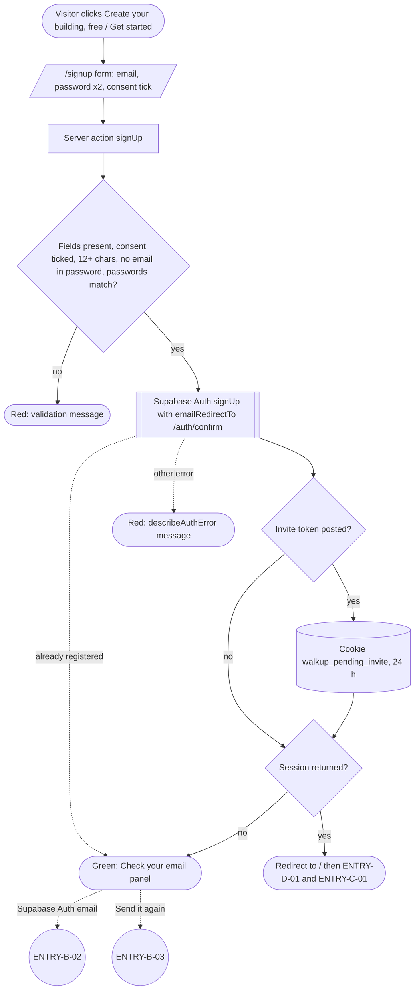

# Walkup: Workflow Diagram Guide

A complete inventory of every workflow, process and feature in the Walkup app, written so that someone who has never seen the code can draw a workflow diagram for each one.

- **Source:** traced from the code at commit `87a7606` (October 21, 2026), including migrations through `0083`.
- **Scope:** the Walkup app only (`~/Projects/walkup`).
- **Size:** about 450 workflows in 5 parts, in the order a new building meets them: the landing page, signing up, two-step sign-in (MFA), creating the building, giving people access, then everything inside the app.
- **Paths:** file paths are relative to the repository root (for example `src/app/signup/page.tsx`).

---

## Contents

- [How to use this guide](#how-to-use-this-guide)
  - [What each workflow entry contains](#what-each-workflow-entry-contains)
  - [Diagram notation](#diagram-notation)
  - [Swimlanes](#swimlanes)
  - [Roles and role groups](#roles-and-role-groups)
  - [Gates every signed-in workflow passes through](#gates-every-signed-in-workflow-passes-through)
  - [Rules that shape many diagrams](#rules-that-shape-many-diagrams)
  - [Worked example: ENTRY-B-01 Sign up](#worked-example-entry-b-01-sign-up)
  - [Suggested order of work](#suggested-order-of-work)
- [Part 1: Getting in (ENTRY)](#part-1-getting-in-entry)
  - [1.1 Public site (signed-out visitor)](#11-public-site-signed-out-visitor)
  - [1.2 Account creation and sign-in](#12-account-creation-and-sign-in)
  - [1.3 Two-step sign-in (MFA) and session](#13-two-step-sign-in-mfa-and-session)
  - [1.4 Request routing](#14-request-routing)
  - [1.5 Onboarding (new association)](#15-onboarding-new-association)
  - [1.6 Invites, email preferences, access ended, leaving](#16-invites-email-preferences-access-ended-leaving)
- [Part 2: Setting up the building and access (SETUP)](#part-2-setting-up-the-building-and-access-setup)
  - [2.1 Building profile and facts](#21-building-profile-and-facts)
  - [2.2 Units](#22-units)
  - [2.3 People](#23-people)
  - [2.4 Invites](#24-invites)
  - [2.5 Spreadsheet import](#25-spreadsheet-import)
  - [2.6 People & Access page](#26-people--access-page)
  - [2.7 Outside roles](#27-outside-roles)
  - [2.8 Owner finances toggle](#28-owner-finances-toggle)
  - [2.9 Account](#29-account)
  - [2.10 Billing (Walkup's own fee)](#210-billing-walkups-own-fee)
  - [2.11 Platform admin](#211-platform-admin)
  - [2.12 Navigation](#212-navigation)
- [Part 3: Running the building day to day (OPS)](#part-3-running-the-building-day-to-day-ops)
  - [3.1 Dashboard](#31-dashboard)
  - [3.2 Announcements](#32-announcements)
  - [3.3 Repairs hub and problem lists](#33-repairs-hub-and-problem-lists)
  - [3.4 One problem](#34-one-problem)
  - [3.5 Upkeep](#35-upkeep)
  - [3.6 Contractors](#36-contractors)
  - [3.7 Bills](#37-bills)
  - [3.8 Find a contractor](#38-find-a-contractor)
  - [3.9 Emergency info](#39-emergency-info)
  - [3.10 Owner portal](#310-owner-portal)
  - [3.11 System: badges and cron](#311-system-badges-and-cron)
- [Part 4: Money (MONEY)](#part-4-money-money)
  - [4.1 Bank connection (Plaid)](#41-bank-connection-plaid)
  - [4.2 Bank feed: categorizing and posting](#42-bank-feed-categorizing-and-posting)
  - [4.3 Ledger, financial statements, budget](#43-ledger-financial-statements-budget)
  - [4.4 HOA dues](#44-hoa-dues)
  - [4.5 Email from Walkup](#45-email-from-walkup)
  - [4.6 Owner side](#46-owner-side)
  - [4.7 Home dashboard money cards](#47-home-dashboard-money-cards)
- [Part 5: Records: taxes, insurance and documents (RECORDS)](#part-5-records-taxes-insurance-and-documents-records)
  - [5.1 Taxes](#51-taxes)
  - [5.2 Insurance](#52-insurance)
  - [5.3 Documents](#53-documents)
  - [5.4 Shared AI usage limits](#54-shared-ai-usage-limits)
- [Appendix A: Known gaps and likely bugs found while tracing](#appendix-a-known-gaps-and-likely-bugs-found-while-tracing)
- [Appendix B: Diagram checklist](#appendix-b-diagram-checklist)

---

## How to use this guide

Draw **one diagram per workflow ID**. Each ID is unique across the guide and starts with its part:

| Prefix | Part | What it covers |
|---|---|---|
| `ENTRY-` | 1 | Public site, sign-up, sign-in, MFA, request routing, creating the association, the app tour, invites, unsubscribe, access ended, closing an account |
| `SETUP-` | 2 | Building profile, units, people, invites (board side), spreadsheet import, People & Access, outside roles, owner finances toggle, Your account, billing, platform admin, navigation |
| `OPS-` | 3 | Dashboard, announcements, repairs and problems, upkeep, contractors, bills, Find a contractor, emergency info, owner portal, badges and cron |
| `MONEY-` | 4 | Bank connection (Plaid), bank feed, ledger and statements, budget, HOA dues, email from Walkup, owner finances, home money cards |
| `RECORDS-` | 5 | Taxes, insurance, documents, AI usage limits |

After the prefix, the letter group names the area within the part (for example `ENTRY-C-` is MFA, `MONEY-D-` is HOA dues). The letters restart in each part, so always use the full ID.

### What each workflow entry contains

Every entry uses the same fields. Each field maps to a part of the diagram:

| Field in the entry | What to draw |
|---|---|
| **Actors / roles** | One swimlane per actor. Name the role exactly (see [Roles](#roles-and-role-groups)). |
| **Entry point** | The **start** oval: the route, button or trigger that begins the flow. Put the route or button label inside it. |
| **Preconditions** | A guard diamond right after the start. The "no" branch goes to a red end state, or to an off-page connector for the workflow that handles it (usually `ENTRY-D-01` routing). |
| **Steps** | Process boxes in order. A step that calls a database function (RPC), trigger or external service goes in that system's lane. Nested bullets inside a step are sub-steps, so draw them as a sub-process or a group box. |
| **Decision points** | Diamonds. Label each branch with the condition. |
| **Data written or read** | Data-store cylinders (tables, views, storage buckets, cookies), joined to the step with a dashed line. Use a solid arrow into the cylinder for a write and out of it for a read. |
| **Emails / notifications / external services** | The External lane: Supabase Auth, Plaid, Stripe, Resend, Anthropic, Google Places. A `mailto` draft is **not** an email Walkup sends: draw it as the user's own mail client in the user's lane. |
| **End states** | **End** ovals: green for success, red for errors. Quoted messages are the exact text the user sees, so copy them into the oval or a note. |
| **Related workflows** | Off-page connectors labeled with the other ID. |

Some entries also contain a **Note**. A Note marks behavior that looks unintended. Draw what the code does today and attach the note as a comment. All Notes are collected in Appendix A.

### Diagram notation

| Shape | Meaning |
|---|---|
| Rounded oval, green | Start, or a successful end |
| Rounded oval, red | An error or refusal end state (the exact message) |
| Rectangle | A step the user, browser or server takes |
| Rectangle with double side bars | A sub-process that has its own diagram (label it with that ID) |
| Diamond | A decision or guard |
| Cylinder | A table, view, storage bucket or cookie |
| Parallelogram | Data the user enters or a file they upload or download |
| Envelope | An email Walkup sends (Resend or Supabase Auth) |
| Clock | A scheduled job (cron) or a time-based trigger (expiry, idle timeout) |
| Circle with an ID | Off-page connector to another workflow |
| Dashed arrow | Something that happens later or asynchronously (webhook, cron, email delivery) |

Any tool works (Lucidchart, Miro, draw.io, Figma, Whimsical). If you want diagrams that live in the repo, use Mermaid flowcharts. The worked example below is in Mermaid.

### Swimlanes

Use these lanes, top to bottom, and drop the ones a workflow doesn't touch:

1. **Actor lane(s):** the person doing it (a visitor, a board admin, an owner, an accountant, and so on). Use more than one when the flow hands off between people, such as a board member preparing an email batch and a board admin approving it.
2. **Browser:** pages, forms, client-side checks, cookies, downloads.
3. **Walkup server:** the proxy (`src/proxy.ts`), server components and server actions, API routes.
4. **Database:** Supabase Postgres: row-level security (RLS), RPCs (`SECURITY DEFINER` functions), triggers, views.
5. **External services:** Supabase Auth, Plaid, Stripe, Resend, Anthropic, Google Places.
6. **Scheduled jobs:** daily cron routes and expiry checks.

### Roles and role groups

**Roles** (`role_grants.role`):

| Role | Who it is |
|---|---|
| `board_admin` | A board member who can also manage access, billing, the bank connection and send email |
| `board_member` | A board member without the admin powers |
| `accountant` | The association's outside accountant. Read-only for most money, can upload tax and accounting documents. Access ends after 90 days unless renewed |
| `owner` | A unit owner. Sees their own unit, shared documents and announcements |
| `property_manager` | An outside manager who handles repairs. Timed access (90 days) |
| `attorney` | An outside attorney. Sees only what is shared with them. Timed access |
| `observer` | Read-only outside helper. Timed access |
| Platform admin | Walkup staff (`/admin`). Not a building role |

**Duties and positions:** Treasurer and Secretary are duties (`has_duty`) that unlock books and records work. President and Vice President are board positions (title only). Board positions have terms (default 2 years).

**Role groups used in the entries:**

- **Board:** `board_admin` and `board_member`.
- **Manage:** Board plus `property_manager`.
- **Financial:** Board plus `accountant`.
- **staffView:** Board, `accountant` or `property_manager`.
- **canReport:** Board, `owner` or `property_manager`.
- **Outside roles' home pages:** a property manager lands on `/repairs`, an attorney on `/documents`, an observer on `/owner`.

### Gates every signed-in workflow passes through

These run before almost every workflow inside the app. Draw them **once** as their own diagrams, then start every other diagram with an off-page connector "passed the gates (ENTRY-D-01)" instead of redrawing them:

1. **`ENTRY-D-01` Proxy routing order:** public pages pass; signed-out users go to `/login`; a login without MFA goes to enrolment (`ENTRY-C-01`) or the challenge (`ENTRY-C-03`); a login with no person record goes to `/onboarding` (`ENTRY-E-01`) or its pending invite (`ENTRY-F-01`). The database enforces MFA as well (`session_is_aal2()`), so a token without the second step reads nothing even if the proxy were bypassed.
2. **`ENTRY-C-07` Idle timeout** (12 hours).
3. **`ENTRY-D-02` and `SETUP-N-02` Landing page by role.** A login whose roles have all ended sees "Your access has ended" (`ENTRY-F-08`).
4. **`SETUP-N-01` Sidebar by role** and **`SETUP-N-03` Pages that answer BoardOnly or Restricted:** the page-level role checks.
5. **Row-level security:** even when a page opens, the database decides which rows a role can read or write. When an entry says a read "returns no rows" for a role, draw that as a branch.
6. **`ENTRY-C-06` Confirm sign-in:** a fresh two-step code within 15 minutes before any access change.
7. **Billing:** trial and plan state (`SETUP-BL-01` to `SETUP-BL-07`, `OPS-D-12`).

### Rules that shape many diagrams

- **Walkup never moves money.** Dues payments, bills and expenses are *recorded*, never processed. No diagram should show Walkup paying or charging anyone except Walkup's own subscription through Stripe.
- **Email Walkup sends needs a board admin's approval.** Dues reminders, statements, late fee notices and announcement emails are prepared as a batch, reviewed, then approved by a board admin before the sender loop runs (`MONEY-E-05` to `MONEY-E-08`). Everything else is a `mailto` draft the user sends from their own mail client.
- **Supabase Auth sends its own emails** (confirmation, password reset). Draw those in the External lane as Supabase Auth, not Resend.
- **Timed access ends by itself.** Accountant and outside-role grants expire after 90 days (`SETUP-O-05`). Invites for anyone but an owner need an email address, expire after 3 days and only work for that email.
- **AI features are metered.** Every AI call passes the daily quota check in `RECORDS-X-01`. Draw it as a sub-process with its own error end states.

### Worked example: ENTRY-B-01 Sign up

From the entry in Part 1, the diagram looks like this. Validation failures are collapsed into one red end state with the messages listed in a note, which keeps the diagram readable.

Things to notice:

- "Already registered" deliberately ends on the same "Check your email" screen as success, so the form can't be used to find out who has an account. Draw it that way; it is not a bug.
- No `associations`, `persons` or `role_grants` row exists yet. The building is created later in `ENTRY-E-01`.

### Suggested order of work

1. **Journey map first.** One overview diagram that links the big steps: `ENTRY-A-01` landing → `ENTRY-B-01` sign up → `ENTRY-B-02` confirm → `ENTRY-C-01` MFA enrolment → `ENTRY-C-02` recovery codes → `ENTRY-E-01` create the association → `ENTRY-E-04` tour → `ENTRY-E-06` setup guide → `SETUP-U-` units → `SETUP-P-` people → `SETUP-IM-` import → `SETUP-I-` invites → `ENTRY-F-01` to `ENTRY-F-03` the invitee's side → `SETUP-A-` People & Access → the day-to-day parts.
2. **The gates** listed above.
3. **One overview per section** (for example "HOA dues"), showing how its workflows connect, with each box an off-page connector to the detailed diagram.
4. **The detailed diagrams**, working through Appendix B and ticking each ID off.

A few workflows appear from two sides. For example, `ENTRY-F-05` (the board creating an invite) and the `SETUP-I-` invite workflows describe the same feature from Part 1's and Part 2's angle. Draw it once and cross-link the IDs.

---

# Part 1: Getting in (ENTRY)

The public site, creating a login, confirming the email, two-step sign-in (MFA), how every request is routed, creating the association, the first-login tour and setup guide, and the invitee's side of invites.

## 1.1 Public site (signed-out visitor)

### ENTRY-A-01 Browse the landing page
- **Actors / roles:** Signed-out visitor. Search engines and AI crawlers read the same HTML.
- **Entry point (route, button or trigger):** `GET /`, handled by `src/app/page.tsx`, which renders `<Landing>` from `src/components/landing/landing.tsx`.
- **Preconditions:** No session. A signed-in visitor gets the Dashboard at the same URL, or is redirected to their role's home (see ENTRY-D-02).
- **Steps:**
  1. The proxy (ENTRY-D-01) treats `/` as public and lets the request through.
  2. `generateMetadata()` calls `getUser()`. With no user it returns the SEO title/description, a canonical `/`, OpenGraph and Twitter cards.
  3. `HomePage()` calls `getUser()`. With no user it renders `<Landing nonce=…>`. The nonce comes from the `x-nonce` header so the JSON-LD `<StructuredData>` script can run under the CSP.
  4. `isBare("/", false)` is true, so `AppFrame` draws no sidebar, top bar or footer.
  5. The sections render in this order:
     - Sticky header: Features `#features`, Pricing `#pricing`, FAQ `#faq`, "Sign in" → `/login`, "Get started" → `/signup` (`data-cta="header"`).
     - Hero: "Create your building, free" → `/signup` (`data-cta="hero"`), "See how it works" → `#how-it-works`, the `pricingWords().heroNote` line, and `<HeroSlideshow>` (auto-advances, pauses on hover/focus, has a pause button and previous/next).
     - Problem section (six cards).
     - Features: six cards, "Create your building, free" (`data-cta="features"`), and "See every feature" → `/features` (`data-cta="features-more"`).
     - How it works: `<HowItWorksTimeline>` with five steps, then CTA (`data-cta="how-it-works"`).
     - Founder section.
     - Trust section: six cards and "Read how Walkup protects your data" → `/security`.
     - Who it's for: fit/non-fit lists, with the state waitlist form (ENTRY-A-02) inside.
     - Pricing: `PLANS` (Starter $19, Building $39, Association $59; yearly = 10 × monthly), the founding offer (first 25 associations get a free first year), and the free setup call.
     - FAQ: three groups of `
`, with "Learn more" links and an "Email hello@walkuphoa.com" mailto.
     - Final CTA: "Create your building, free" (`data-cta="final"`) and "Book a 15-minute walkthrough" → `bookingHref` (the booking URL, or a `mailto:` sales address while `BOOKING_URL` is still a "TODO" placeholder).
     - Footer: Sign in, Create an account, Security, Privacy Policy, Terms of Service, Policies, Contact (mailto).
- **Decision points:**
  - Signed in → Dashboard or role home instead of the landing page.
  - `paidPlansLive()` (billing enabled AND a live Stripe key) → "14-day free trial" wording; otherwise "Free during early access" wording.
  - `DUES_PAYMENTS_ENABLED` (false) → trust card says bank access is read-only and adds the "collects owner payments (coming soon)" non-fit line.
  - `TESTIMONIAL` set → a quote is shown.
- **Data written or read:** None from the database. Reads env vars for pricing wording. Uses the CSP nonce header.
- **Emails / notifications / external services:** None. Booking link is external or a mailto.
- **End states:** The visitor reaches `/signup`, `/login`, `/features`, a trust/legal page, or the mail client. No error states.
- **Related workflows:** ENTRY-A-02, ENTRY-A-03, ENTRY-A-04, ENTRY-B-01, ENTRY-B-04, ENTRY-D-01, ENTRY-D-02.

### ENTRY-A-02 Join the state waitlist (outside Illinois)
- **Actors / roles:** Signed-out visitor (anon role). A signed-in user can also call it.
- **Entry point:** The `WaitlistForm` ("Outside Illinois? Leave your email…", "Notify me" button) in the "Who is Walkup built for?" section of `/`. Files: `src/components/landing/waitlist-form.tsx` and `src/components/landing/waitlist-actions.ts`.
- **Preconditions:** None.
- **Steps:**
  1. The visitor enters an email, picks a state from `WAITLIST_STATES`, and clicks "Notify me".
  2. Server action `joinWaitlist`:
     - Trims the email and upper-cases the state.
     - Checks the email against `/^[^@\s]+@[^@\s]+\.[a-z]{2,}$/i` and a 254-character limit.
     - Checks the state is in `WAITLIST_STATES`.
  3. It hashes the IP from `x-forwarded-for` or `x-real-ip` with SHA-256 over `ip|YYYY-MM-DD`. The raw IP is never stored.
  4. It calls RPC `join_state_waitlist(p_email, p_state, p_ip_hash)` (migration 0049, SECURITY DEFINER, executable by anon). The function:
     - Re-validates the email.
     - Requires a two-letter state that is not `IL`.
     - Discards a malformed hash.
     - Rejects if the same hash has 5 or more sign-ups in the last hour, or the table has 200 or more sign-ups in the last hour (`hint = 'rate_limited'`).
     - Runs `insert … on conflict (lower(email), state_code) do nothing`.
  5. Success shows: "Thanks. We'll email you when Walkup is ready in {State}."
- **Decision points:**
  - Bad email → error.
  - State missing or not in the list → error.
  - Same email + state already on the list → silently ignored, success shown (so it does not reveal who signed up).
  - Rate limit → error.
  - SQL `check_violation` (23514) → the SQL message is shown, capitalised.
- **Data written or read:** `public.state_waitlist` (email, state_code, ip_hash, created_at). RLS is on with no policies; the only writer is the RPC.
- **Emails / notifications / external services:** None. A platform admin reads the list by SQL.
- **End states:**
  - Success message as above.
  - "Enter a valid email address."
  - "Choose your state."
  - "Lots of sign-ups just now. Please try again in an hour."
  - "Enter a valid email address." / "Choose your state." (the SQL check messages, capitalised).
  - "That didn't go through. Please try again in a minute."
- **Related workflows:** ENTRY-A-01. Address entry with a non-IL state in onboarding (ENTRY-E-02).

### ENTRY-A-03 Explore the features page
- **Actors / roles:** Visitor, signed in or out.
- **Entry point:** `GET /features` (`src/app/features/page.tsx`), linked from "See every feature" on `/`.
- **Preconditions:** None. Public path and bare path.
- **Steps:**
  1. The page renders its own header (Home, Pricing `/#pricing`, FAQ `/#faq`, Sign in, Get started `data-cta="features-header"`).
  2. `<FeaturesExplorer categories={CATEGORIES}>` renders the categories from `src/lib/features/catalog.ts`: Financial management, HOA dues and reminders, Tax prep support, Insurance, Repairs and upkeep, Contractors, Documents, Building and people, Owner portal, Security and trust, Your account.
  3. The visitor can:
     - Type in the search box (with a clear button).
     - Filter by "Who is it for".
     - Expand or collapse all cards, or one card at a time.
     - Jump to an area from the sticky nav (`#cat-…`), which highlights the area on screen.
     - Use "Clear filters".
  4. Bottom CTAs: `/signup` and `/#pricing`. Footer links go to Home, Security, Privacy, Terms and Contact.
- **Decision points:**
  - A search or filter that matches nothing → "Try a shorter word, or clear the filters to see everything." with a "Clear filters" button.
  - A signed-in AAL1 user, or one with no person row, is redirected by the proxy first (ENTRY-D-01).
- **Data written or read:** Static catalog only.
- **Emails / notifications / external services:** None.
- **End states:** Feature information shown, or the visitor goes to `/signup` or `/#pricing`.
- **Related workflows:** ENTRY-A-01, ENTRY-B-01.

### ENTRY-A-04 Read trust and legal pages
- **Actors / roles:** Visitor, signed in or out.
- **Entry point:** `/security`, `/privacy`, `/terms`, `/policies`, `/policies/access-controls`, `/policies/vulnerability-management`, `/policies/data-retention`. Linked from the landing footer, the app footer, the signup consent checkbox (`/terms` and `/privacy` open in new tabs), and `/account` (Privacy tab).
- **Preconditions:** None. These are public paths (prefix match, so the `/policies/*` sub-pages are covered).
- **Steps:**
  1. The visitor opens a page. All are static: no database reads and no forms.
  2. Page sections:
     - **`/security`:** Who can see what; Two-factor authentication; Bank connections; Encryption; Audit trail; Access reviews and removal; Keeping software patched; Service providers (links to Supabase, Vercel, Plaid, Stripe, Resend, Anthropic); Email from Walkup; If something goes wrong; Reporting a vulnerability (`#reporting`, mailto SECURITY_EMAIL); Questions.
     - **`/privacy`:** What we collect; Why; Who we share it with; How long we keep it; Your rights; Children's privacy; Changes; Contact.
     - **`/terms`:** sections 1 to 13 (last updated 2026-10-17), with mailto support and contact.
     - **`/policies`:** an index of six policies.
     - **Sub-pages:** Access Controls (v1.1), Vulnerability and Patch Management, Data Retention and Deletion.
- **Decision points:**
  - Signed out → the page renders with no sidebar.
  - Signed in and fully set up → it renders inside the app frame.
  - Signed in at AAL1, or with no person row → the proxy redirects to MFA or onboarding (these paths are not exempt).
  - Signed in with access ended → the layout shows the AccessEnded card instead of the page (ENTRY-F-08).
- **Data written or read:** None.
- **Emails / notifications / external services:** mailto links only.
- **End states:** The page is shown. No error states.
- **Related workflows:** ENTRY-B-01 (consent), ENTRY-F-09 (account closing links), ENTRY-D-01.

### ENTRY-A-05 Machine-readable files (sitemap, robots, manifest, share images, security.txt)
- **Actors / roles:** Crawlers, link-preview bots, browsers installing the PWA, security researchers.
- **Entry point:** `/sitemap.xml` (`src/app/sitemap.ts`), `/robots.txt` (`src/app/robots.ts`), `/manifest.webmanifest` (`src/app/manifest.ts`), `/opengraph-image`, `/twitter-image`, `/.well-known/security.txt` (`src/app/.well-known/security.txt/route.ts`).
- **Preconditions:** None. These are public paths. `.txt` files are excluded from the proxy matcher entirely.
- **Steps:**
  1. **Sitemap** lists `/`, `/features`, `/signup`, `/login`, `/security`, `/privacy`, `/terms`, `/policies`. `/` has priority 1 and changes weekly; `/signup` 0.8; `/features` 0.7; the rest 0.4.
  2. **Robots** allows `/`, `/signup`, `/security`, `/privacy`, `/policies`. It disallows `/login`, `/account/`, `/admin/`, `/api/`, `/auth/`, `/onboarding`, `/invite/`, and points to the sitemap.
  3. **Manifest:** name "Walkup", `start_url "/"`, standalone, theme `#1B2A41`.
  4. **security.txt** (RFC 9116): Contact, Expires (`SECURITY_TXT_EXPIRES`), Canonical, and Policy `/security#reporting`.
- **Decision points:** None.
- **Data written or read:** None.
- **Emails / notifications / external services:** None.
- **End states:** The file is served.
- **Related workflows:** ENTRY-A-01, ENTRY-A-04.

---

## 1.2 Account creation and sign-in

### ENTRY-B-01 Sign up (create a login)
- **Actors / roles:** New user (prospective board admin).
- **Entry point:** `/signup` (`src/app/signup/page.tsx` and `signup-form.tsx`), reached from any "Create your building, free" or "Get started" CTA. AuthShell step 0 of 3 ("1. Create your account"). Server action `signUp` in `src/app/login/actions.ts`.
- **Preconditions:** Signed out. A signed-in user who opens `/signup` is redirected by the proxy to MFA, onboarding or `/`.
- **Steps:**
  1. The user enters email, password (min 12, show/hide eye), confirm password, and ticks "I agree to the Terms of Service and the Privacy Policy" (`privacy_consent`; both links open in new tabs). The subtitle is `pricingWords().signupSubtitle`.
  2. `signUp` checks, in this order:
     - email and password present;
     - consent ticked;
     - length ≥ `MIN_PASSWORD` (12);
     - password does not contain the email's local part (only when that part is ≥ 4 characters);
     - the two passwords match.
  3. It builds `emailRedirectTo = {origin}/auth/confirm?next=/` (or `next=/invite/<token>` for invites, see ENTRY-F-01).
  4. It calls `supabase.auth.signUp({ email, password, options: { emailRedirectTo } })`.
  5. If an `invite_token` was posted, it sets the `walkup_pending_invite` cookie (httpOnly, lax, 24 h). That only happens on the invite form.
  6. If Supabase returned a session (confirm-email is off) → `redirect("/")` (or to the invite), and proxy routing continues (ENTRY-D-01 → ENTRY-C-01).
  7. Otherwise the form is replaced by "Check your email": "If {email} isn't already registered, a confirmation link is on its way. Open it on this device…". It has a "Sign in" link and "Nothing after a few minutes? Check spam, or Send it again" (ENTRY-B-03).
- **Decision points:**
  - Each validation failure returns its own message.
  - `user_already_exists` or "already registered" → the same "Check your email" screen, so the form cannot be used to find out which emails have accounts.
  - Other Supabase errors are turned into words by `describeAuthError` (see end states).
  - Confirm-email off → straight to MFA enrolment. On → wait for the email (ENTRY-B-02).
- **Data written or read:**
  - Supabase `auth.users`. No `associations`, `persons` or `role_grants` row is created at this step.
  - Cookie `walkup_pending_invite` (invite only).
  - Consent is not persisted anywhere; it is only checked.
- **Emails / notifications / external services:** Supabase Auth sends the sign-up confirmation email through the project's SMTP.
- **End states:**
  - Success: the "Check your email" panel, or a redirect.
  - "Email and password are both required."
  - "You need to agree to the Terms of Service and Privacy Policy to create an account."
  - "Password must be at least 12 characters. A few random words works well."
  - "Don't use your email address in your password."
  - "Those passwords don't match."
  - "Too many sign-up emails were requested just now. Wait a few minutes and try again."
  - "That email address doesn't look valid. Check it for typos and try again."
  - "That password is too easy to guess. Use at least 8 characters, ideally a mix of words, numbers and symbols."
  - "New sign-ups are switched off right now. Email support@walkuphoa.com and we'll get you set up."
  - "We couldn't send your confirmation email, so the account wasn't created. This is a problem on our side, not yours. Try again in a few minutes, and if it keeps happening email support@walkuphoa.com ({status} {code})."
  - Any other raw Supabase message followed by `({status} {code})`.
- **Related workflows:** ENTRY-B-02, ENTRY-B-03, ENTRY-C-01, ENTRY-F-01, ENTRY-D-01.

### ENTRY-B-02 Confirm email via the emailed link (`/auth/confirm`)
- **Actors / roles:** New user, or a user resetting a password.
- **Entry point:** The link in a Supabase Auth email, which lands on `GET /auth/confirm` (`src/app/auth/confirm/route.ts`). `/auth` is public.
- **Preconditions:** A sign-up, resend or reset email was sent.
- **Steps:**
  1. The route reads `code`, `token_hash`, `type` and `next`. `next` passes through `safeNext()`, which accepts only same-site plain paths and falls back to `/`.
  2. If `code` is present (default template, PKCE): `exchangeCodeForSession(code)`.
     - Success → redirect to `next`.
     - Failure (usually the link was opened in a different browser than the one that started the flow) → `/login?notice=reset_other_browser` if `next === "/reset-password"`, otherwise `/login?notice=confirmed_elsewhere`.
  3. Else if `token_hash` and `type` are present (custom template): `verifyOtp({ type, token_hash })`. Success → redirect to `next`.
  4. Anything else, or a verifyOtp failure → `/login?error=confirmation_failed`.
  5. After the redirect the proxy (ENTRY-D-01) routes the new session. Sign-up goes to `/account/mfa` (ENTRY-C-01). An invite sign-up has `next=/invite/<token>` but is still sent to MFA first. A reset goes to ENTRY-B-06.
- **Decision points:** code vs token_hash; same browser vs different browser; `next` value.
- **Data written or read:** Supabase auth session cookies. PKCE verifier cookie (in the original browser only).
- **Emails / notifications / external services:** Supabase Auth verify endpoint.
- **End states:**
  - Signed in and redirected to `next`.
  - On `/login`: "Your email is confirmed. Sign in to keep going."
  - On `/login`: "That reset link was opened in a different browser. Ask for a new one from this browser, or sign in here if you remember your password."
  - On `/login`: "That confirmation link didn't work. It may have expired. Try signing up again."
- **Related workflows:** ENTRY-B-01, ENTRY-B-03, ENTRY-B-04, ENTRY-B-05/ENTRY-B-06, ENTRY-C-01, ENTRY-F-01.
- **Edge case:** the pending-invite cookie lives only in the browser that signed up. If confirmation finishes in another browser, the user lands on `/onboarding` instead of the invite and must reopen the invite link.

### ENTRY-B-03 Resend the confirmation email
- **Actors / roles:** New user whose email is not confirmed yet.
- **Entry point:** The "Send it again" button (`ResendLink`, `src/components/auth/resend-link.tsx`). It appears:
  - on the `/signup` "Check your email" panel;
  - inside the `/login` error when Supabase returns `email_not_confirmed`.
- **Preconditions:** An email address is known.
- **Steps:**
  1. Click → `resendConfirmation(email)`.
  2. Empty email → error.
  3. Otherwise `supabase.auth.resend({ type: "signup", email, options: { emailRedirectTo: …/auth/confirm?next=/ } })`.
  4. The result is shown inline.
- **Decision points:** Success or error. The resent link always uses `next=/`, even for an invite sign-up; the 24 h invite cookie still routes the user to the invite.
- **Data written or read:** None in the app.
- **Emails / notifications / external services:** Supabase Auth confirmation email.
- **End states:**
  - "Sent. Check your inbox."
  - "Enter your email first."
  - Any `describeAuthError` message (see ENTRY-B-01).
- **Related workflows:** ENTRY-B-01, ENTRY-B-02, ENTRY-B-04.

### ENTRY-B-04 Sign in with email and password (`/login`)
- **Actors / roles:** Any user with a login.
- **Entry point:** `/login` (`src/app/login/page.tsx` and `login-form.tsx`). Also reached by the proxy's unauthenticated redirect and by sign-out. Server action `signIn`.
- **Preconditions:** Signed out. A signed-in user who opens `/login` is redirected by the proxy.
- **Steps:**
  1. The page shows one banner, depending on the query string:
     - `?error=confirmation_failed` → red banner.
     - `?notice=confirmed_elsewhere` → green banner.
     - `?notice=reset_other_browser` → amber banner.
     - `?notice=idle` → amber banner "You were signed out after 12 hours of inactivity. Sign in again to pick up where you left off."
  2. The user enters email and password. Links: "Forgot password?" → `/forgot-password`; "New to Walkup? Create an account, free" → `/signup`.
  3. `signIn`: both fields are required, then `signInWithPassword`.
  4. Success → `revalidatePath("/", "layout")` and `redirect("/")`. The proxy then sends an AAL1 session to `/login/mfa-challenge` (ENTRY-C-03), or to `/account/mfa` if no factor is enrolled (ENTRY-C-01).
- **Decision points:**
  - `email_not_confirmed` (only returned when the password was right) → message plus the "Send it again" link.
  - Every other failure → one generic message, so the form does not reveal whether an account exists.
  - The original deep link is not preserved. The proxy's redirect to `/login` carries no `next`, so the user lands on `/`, then their role home.
- **Data written or read:** Supabase auth session cookies.
- **Emails / notifications / external services:** Supabase Auth.
- **End states:**
  - Redirect to `/`, then the MFA challenge.
  - "Email and password are both required."
  - "Your email isn't confirmed yet. Open the link we sent you, or send a new one."
  - "Those credentials were not accepted."
- **Related workflows:** ENTRY-B-03, ENTRY-B-05, ENTRY-C-01, ENTRY-C-03, ENTRY-C-07, ENTRY-D-01.

### ENTRY-B-05 Forgot password: request a reset link
- **Actors / roles:** User who cannot sign in.
- **Entry point:** `/forgot-password` (`src/app/forgot-password/*`), from "Forgot password?" on `/login`. Server action `requestPasswordReset`.
- **Preconditions:** Signed out. Signed-in users are redirected away by the proxy.
- **Steps:**
  1. The user enters an email and clicks "Send reset link".
  2. Empty email → error.
  3. Otherwise `resetPasswordForEmail(email, { redirectTo: {origin}/auth/confirm?next=/reset-password })`.
  4. The "Check your email" panel appears whether or not the account exists: "If {email} has a Walkup account, a reset link is on its way. Open it in this browser."
- **Decision points:** Only a 429 or a 5xx error is shown. Every other result answers the same way, so the form does not reveal who has an account.
- **Data written or read:** None in the app.
- **Emails / notifications / external services:** Supabase Auth recovery email.
- **End states:**
  - The "Check your email" panel.
  - "Enter the email you signed up with."
  - "Too many sign-up emails were requested just now. Wait a few minutes and try again." (this sign-up wording is reused for reset requests)
  - "We couldn't send your confirmation email…" (on 5xx).
- **Related workflows:** ENTRY-B-02, ENTRY-B-06.

### ENTRY-B-06 Reset password via the link (with the two-step code in between)
- **Actors / roles:** User who requested a reset.
- **Entry point:** The reset email link → `/auth/confirm?…&next=/reset-password` → `/reset-password` (`src/app/reset-password/*`). Server action `updatePassword`.
- **Preconditions:** A valid reset link opened in the same browser. `/reset-password` is not a public path, so a signed-out request is sent to `/login`.
- **Steps:**
  1. `/auth/confirm` exchanges the code and redirects to `/reset-password`. The session is AAL1.
  2. The proxy:
     - Verified factor exists → redirect to `/login/mfa-challenge?next=/reset-password` (the only place the proxy adds `next`).
     - No factor → `/account/mfa`.
  3. The user enters the TOTP code (ENTRY-C-03) and `verifyChallenge` redirects to `safeNext(next)`, which is `/reset-password`.
  4. The page calls `getUser()`; no user → `redirect("/forgot-password")`. It shows "Choose a new password", "For {email}."
  5. The user enters a new password (min 12) and confirms it.
  6. `updatePassword` checks length and that the passwords match, then calls `updateUser({ password })`.
  7. Success → `redirect("/")`.
- **Decision points:**
  - Link opened in another browser → ENTRY-B-02 `reset_other_browser` notice.
  - No factor → enrolment first. Afterwards "Continue to Walkup" goes to `/`, so the reset page is not revisited; the user can change the password later in Account (ENTRY-B-07).
- **Data written or read:** Supabase auth user password; session.
- **Emails / notifications / external services:** Supabase Auth.
- **End states:**
  - Redirect to `/`.
  - "Password must be at least 12 characters. A few random words works well."
  - "Those passwords don't match."
  - "That's your current password. Choose a new one."
  - "Enter your two-step code first, then set your new password." (`insufficient_aal`)
  - Any raw Supabase message.
- **Related workflows:** ENTRY-B-02, ENTRY-B-05, ENTRY-C-03, ENTRY-C-01, ENTRY-B-07.

### ENTRY-B-07 Change password while signed in (Account, Sign-in and security)
- **Actors / roles:** Any fully signed-in member.
- **Entry point:** `/account?tab=security`, the "Password" card (`ChangePasswordForm` in `src/app/account/account-forms.tsx`). Server action `changePassword` in `src/app/account/actions.ts`.
- **Preconditions:** AAL2 session with a person row. `/account` returns `<ViewerUnavailable>` ("We couldn't load this page…") if `getViewer()` is null.
- **Steps:**
  1. The user enters the new password twice (min 12).
  2. Length and match are checked, then `updateUser({ password })`.
  3. On success the form is cleared and a status message shown. The user stays signed in.
- **Decision points:** Error codes map to specific messages (below).
- **Data written or read:** Supabase auth password.
- **Emails / notifications / external services:** Supabase Auth.
- **End states:**
  - "Password changed. Use it the next time you sign in."
  - "Use at least 12 characters. A few random words works well."
  - "Those passwords don't match."
  - "That's your current password. Choose a new one."
  - "Sign in again with your two-step code, then change your password."
  - "That password is too easy to guess or has appeared in a data breach. Choose another."
  - "For safety, sign out and back in, then change your password."
  - "Couldn't change your password. Try again."
- **Related workflows:** ENTRY-B-06, ENTRY-C-09.

### ENTRY-B-08 Development one-click sign-in (non-production only)
- **Actors / roles:** Developer.
- **Entry point:** The "Sign in as dev user" panel on `/login` (`dev-sign-in.tsx`). It renders only when `devAuthAvailable()` is true: `NODE_ENV !== "production"` AND both `DEV_AUTH_EMAIL` and `DEV_AUTH_PASSWORD` are set.
- **Preconditions:** A local or dev build with those env vars.
- **Steps:** Click → `devSignIn()` → a real `signInWithPassword` with the env credentials → `redirect("/")` → the normal MFA routing.
- **Decision points:** Not available → error. Sign-in failure → error.
- **Data written or read:** Session cookies.
- **Emails / notifications / external services:** Supabase Auth.
- **End states:**
  - Redirect to `/`.
  - "Development sign-in is not available in this environment."
  - "Development sign-in failed: {message}"
- **Related workflows:** ENTRY-B-04, ENTRY-C-03.

---

## 1.3 Two-step sign-in (MFA) and session

### ENTRY-C-01 Enrol an authenticator (forced MFA setup, `/account/mfa`)
- **Actors / roles:** Every signed-in user with no verified TOTP factor. MFA is required for all roles and cannot be turned off.
- **Entry point:** The proxy redirects any non-exempt path to `/account/mfa` when `aal.nextLevel !== "aal2"`. Page: `src/app/account/mfa/page.tsx`. Form: `mfa-setup-form.tsx`. Action: `verifyEnrollment` in `actions.ts`. AuthShell step 1 ("2. Secure it").
- **Preconditions:** Signed in (AAL1). The path is MFA-exempt.
- **Steps:**
  1. The page calls `mfa.listFactors()`.
  2. If a verified TOTP factor exists:
     - Created less than 10 minutes ago → show the "completed" state ("Two-step sign-in is on." and "Continue to Walkup"). This keeps the recovery codes on screen after the re-render.
     - Older → `redirect("/")`.
  3. Otherwise it unenrols every stale unverified TOTP factor (Supabase caps how many one account can hold).
  4. It calls `mfa.enroll({ factorType: "totp", friendlyName: "Walkup YYYY-MM-DD" })`.
  5. The page shows the QR code (data URI), "Can't scan? Enter this key manually: {secret}", and a 6-digit code field. Footer: "Back to sign in" (ENTRY-C-08).
  6. The user scans with an authenticator app (the page names Apple Passwords, Google Authenticator, 1Password and Authy), enters the code, and clicks "Verify and continue".
  7. `verifyEnrollment`: `mfa.challenge({ factorId })` then `mfa.verify(...)`. Success raises the session to AAL2 with a fresh `totp` amr timestamp.
  8. It immediately calls `issueRecoveryCodes()`:
     - `makeCodeSet()` creates 10 codes of 10 characters (alphabet without look-alikes), formatted `XXXXX-XXXXX`, with a scrypt salt and hash each.
     - RPC `mfa_recovery_set_codes(p_salts, p_hashes)`. It requires `session_is_aal2()` and `mfa_totp_age_seconds()` ≤ 900 s, replaces any earlier codes, and clears the lockout row.
  9. The codes are shown once (ENTRY-C-02). "Continue to Walkup" runs `router.push("/")` and refresh, and the proxy routes on to onboarding, a pending invite, or the Dashboard.
- **Decision points:**
  - Enrol call fails → error page.
  - Wrong code → retry.
  - Codes could not be saved → the user is still enrolled; an error is shown with "Continue to Walkup".
  - Back to sign in → sign out.
- **Data written or read:**
  - `auth.mfa_factors` (via Supabase).
  - `public.mfa_recovery_codes` (salt and hash only).
  - `public.mfa_recovery_lockouts` (deleted).
  - Session cookies (AAL2).
- **Emails / notifications / external services:** Supabase Auth MFA.
- **End states:**
  - Codes panel (ENTRY-C-02), then Continue.
  - "Couldn't start two-step sign-in" with the Supabase message or "Try refreshing the page.", plus a "Try again" link.
  - "Enter the 6-digit code from your authenticator app."
  - The raw challenge error, or "Couldn't start verification. Try again."
  - "That code wasn't accepted. Check the time on your phone and try again."
  - After success but with code failure: "Enter a fresh code from your authenticator app and try again." or "Couldn't save your recovery codes. Try again.", followed by "You can make them any time under Account, Sign-in and security."
- **Related workflows:** ENTRY-C-02, ENTRY-C-04, ENTRY-C-05, ENTRY-D-01, ENTRY-E-01, ENTRY-F-02.

### ENTRY-C-02 Recovery codes shown once (copy, download, acknowledge)
- **Actors / roles:** User who just enrolled (ENTRY-C-01) or regenerated codes (ENTRY-C-05).
- **Entry point:** `RecoveryCodesPanel` (`src/components/auth/recovery-codes-panel.tsx`).
- **Preconditions:** The server action just returned the plaintext codes. They exist only in component props.
- **Steps:**
  1. Warning: "Store these somewhere safe. This is the only time they are shown…"
  2. A grid of 10 codes.
  3. "Copy codes" writes the codes, newline-separated, to the clipboard. The label changes to "Copied"; on a clipboard failure it silently stays "Copy codes".
  4. "Download as a text file" downloads `walkup-recovery-codes.txt` built by `codesFileText()` (header, created date, instructions, codes).
  5. The "I have saved these codes somewhere safe." checkbox enables the done button: "Continue to Walkup" during enrolment, "Done" in Account.
- **Decision points:** The done button is disabled until the box is ticked. Leaving the page drops the codes for good.
- **Data written or read:** Nothing is stored in the browser. A Blob URL is used for the download.
- **Emails / notifications / external services:** None.
- **End states:** The user continues; the codes cannot be shown again (only regenerated, ENTRY-C-05).
- **Related workflows:** ENTRY-C-01, ENTRY-C-05, ENTRY-C-04.

### ENTRY-C-03 Two-step code at sign-in (`/login/mfa-challenge`)
- **Actors / roles:** Any user with a verified factor whose session is AAL1.
- **Entry point:** The proxy redirects when `nextLevel = aal2` and `currentLevel ≠ aal2`. Page: `src/app/login/mfa-challenge/page.tsx`. Action: `verifyChallenge`.
- **Preconditions:** Password sign-in done (ENTRY-B-04, ENTRY-B-02 or ENTRY-B-06).
- **Steps:**
  1. The page lists factors. No verified TOTP factor → `redirect("/account/mfa")`.
  2. It shows "Enter your code" with a 6-digit field; `next` is passed through `safeNext`.
  3. "Verify" → `verifyChallenge`: `mfa.challenge` then `mfa.verify`.
  4. Success → `redirect(safeNext(next))`, which is `/` unless `next` was set (only `/reset-password` sets it).
  5. Other options: "Lost your authenticator? Use a recovery code" (ENTRY-C-04); "Back to sign in" (ENTRY-C-08).
- **Decision points:** Wrong code → retry. The app keeps no lockout for TOTP codes; only Supabase's own rate limits apply. The 5-attempt lockout belongs to recovery codes (ENTRY-C-04).
- **Data written or read:** Session upgraded to AAL2 (amr `totp` timestamp).
- **Emails / notifications / external services:** Supabase Auth MFA.
- **End states:**
  - Redirect to `/` or `next`.
  - "Enter the 6-digit code from your authenticator app."
  - The raw challenge error, or "Couldn't start verification. Try again."
  - "That code wasn't accepted."
- **Related workflows:** ENTRY-B-04, ENTRY-B-06, ENTRY-C-04, ENTRY-C-08, ENTRY-D-01, ENTRY-D-02.

### ENTRY-C-04 Lost authenticator: redeem a recovery code (removes the factor, forces re-enrolment)
- **Actors / roles:** User at the challenge page without their authenticator.
- **Entry point:** "Lost your authenticator? Use a recovery code" on `/login/mfa-challenge`. Action `redeemRecoveryCode` in `src/app/login/mfa-challenge/actions.ts`. SQL in `0078_mfa_recovery_codes.sql`.
- **Preconditions:** AAL1 session; codes were issued earlier.
- **Steps:**
  1. The form explains the code works once and the current authenticator will be removed. The user enters a code like `ABCDE-12345` and clicks "Use recovery code". "Back to the authenticator code" returns to ENTRY-C-03.
  2. `normalizeCode()` upper-cases, strips spaces and hyphens, and requires exactly 10 characters from the allowed alphabet.
  3. `getUser()`; no user → error.
  4. RPC `mfa_recovery_status()` returns `{ total, remaining, locked_until }`. If `locked_until` is set → error. If `remaining` is 0 → error.
  5. RPC `mfa_recovery_salts()` returns the unused salts (none while locked).
  6. `digestsFor(code, salts)` computes one scrypt digest per salt in the app.
  7. RPC `mfa_recovery_redeem(p_digests)`, locking the user's lockout row:
     - Locked → `{ ok: false, reason: "locked" }`.
     - An expired lock resets the count.
     - Match → mark the code `used_at`, `delete from auth.mfa_factors where user_id = caller`, reset the lockout, return `{ ok: true }`.
     - No match → increment the failed count. At the 5th failure it locks for 15 minutes and resets the count; otherwise it returns `attempts_left = 5 − failed`.
  8. On ok: `supabase.auth.signOut({ scope: "others" })` ends every other session (the lost device may be one of them), then `redirect("/account/mfa")`. The user enrols a new authenticator and gets a fresh set of 10 codes (ENTRY-C-01).
- **Decision points:** Bad shape; session expired; locked; no codes left; wrong code (attempts left); fifth wrong code (lock); success.
- **Data written or read:** `public.mfa_recovery_codes` (`used_at`), `public.mfa_recovery_lockouts`, `auth.mfa_factors` (deleted), other sessions revoked.
- **Emails / notifications / external services:** None. Support is by email.
- **End states:**
  - Redirect to `/account/mfa`.
  - "That isn't the right shape for a recovery code. They look like ABCDE-12345."
  - "Your sign-in expired. Sign in again."
  - "Too many wrong codes. Try again in {n} minute(s)." (from the status check)
  - "This account has no recovery codes left. Email support@walkuphoa.com and we will help you back in."
  - "Couldn't check that code. Try again."
  - "That recovery code wasn't accepted. {n} attempt(s) left before a 15 minute pause."
  - "Too many wrong codes. Try again in {n} minutes." (from redeem)
- **Related workflows:** ENTRY-C-03, ENTRY-C-01, ENTRY-C-05. Moving the factor to a new phone while the old one still works has no self-serve flow; the Security tab tells the user to email support.

### ENTRY-C-05 Make new recovery codes (Account, Sign-in and security)
- **Actors / roles:** Any fully signed-in member.
- **Entry point:** The `/account?tab=security` "Recovery codes" card (`src/app/account/recovery-codes-card.tsx`). Action `regenerateRecoveryCodes` in `src/app/account/recovery-actions.ts`.
- **Preconditions:** AAL2.
- **Steps:**
  1. The card shows status from `mfa_recovery_status`: "You have no recovery codes yet." / "You have used all of your recovery codes." / "{remaining} of {total} recovery codes left."
  2. The user enters a code from the authenticator app and clicks "Make recovery codes" or "Make new recovery codes".
  3. `verifyTotpCode` runs listFactors, challenge and verify, which refreshes the amr timestamp.
  4. `issueRecoveryCodes` → `mfa_recovery_set_codes` (fresh ≤ 15 minutes) replaces the old set and clears the lockout.
  5. The panel shows the codes once (ENTRY-C-02) with "Done".
- **Decision points:** Bad or wrong code; no factor; the database refuses (not fresh).
- **Data written or read:** `public.mfa_recovery_codes` (replaced), `public.mfa_recovery_lockouts` (cleared).
- **Emails / notifications / external services:** None.
- **End states:**
  - Codes panel.
  - "Enter the 6-digit code from your authenticator app."
  - "No authenticator app is set up on this account."
  - "Couldn't start verification. Try again."
  - "That code wasn't accepted."
  - "Enter a fresh code from your authenticator app and try again."
  - "Couldn't save your recovery codes. Try again."
- **Related workflows:** ENTRY-C-01, ENTRY-C-02, ENTRY-C-04.

### ENTRY-C-06 Confirm sign-in (fresh code within 15 minutes) before access changes
- **Actors / roles:** Board admin (mostly) changing who has access.
- **Entry point:** A gated server action returns `FRESH_SIGNIN_MESSAGE`: "For safety, confirm your sign-in before changing who has access. Open /confirm-sign-in, enter a code from your authenticator app, then try again." The user opens `/confirm-sign-in` (`src/app/confirm-sign-in/*`). No button links to it; the message names the path.
- **Preconditions:** AAL2 with a person row (the proxy requires both). The last `totp` amr timestamp is more than 15 minutes old.
- **Steps:**
  1. A gated action calls `freshSignInError()`, which reads the `amr` claim via `getClaims`. `isFreshSignIn` requires a totp entry ≤ `FRESH_SIGNIN_MS` (15 minutes) old and not more than 60 s in the future. The gated actions are:
     - `createInvite`;
     - `syncPersonRoles` (only when roles actually change);
     - `extendAccountantAccess`;
     - `changeBoardPosition` and `endBoardPosition` (`/access`);
     - `shareWithAttorney` and `removeAttorneyShare`.
     - At the database level, `mfa_recovery_set_codes` has the same 900 s check.
     - `createOwnerInvite` (person-bound "Invite to sign in") is not gated.
  2. The user opens `/confirm-sign-in?next=…`. The page says "Changing who has access to your association needs a recent code…".
  3. The user enters a 6-digit code → `confirmSignIn` → `verifyTotpCode`.
  4. Success → `redirect(safeNext(next, "/building"))`. The user retries the original action within 15 minutes.
- **Decision points:** Code errors; a fresh session lets the action proceed.
- **Data written or read:** Session amr refreshed.
- **Emails / notifications / external services:** Supabase Auth MFA.
- **End states:**
  - Redirect to `next`, or `/building` by default.
  - "Enter the 6-digit code from your authenticator app."
  - "No authenticator app is set up on this account."
  - "Couldn't start verification. Try again."
  - "That code wasn't accepted."
- **Related workflows:** ENTRY-F-05 (invite creation), role and board changes (other area), ENTRY-C-03.

### ENTRY-C-07 Idle timeout (12 hours)
- **Actors / roles:** Any signed-in user. Triggered by the system on their next request.
- **Entry point:** `updateSession()` in `src/lib/supabase/proxy.ts`, using `src/lib/security/session-policy.ts`.
- **Preconditions:** A session exists.
- **Steps:**
  1. On every proxied request with a user, the proxy reads the cookie `walkup.activity` (epoch ms; must be 10–15 digits and not more than 60 s in the future).
  2. `idleDecision`:
     - No valid cookie → stamp.
     - 12 hours or more since last activity → expire.
     - 60 s or more → re-stamp (at most once a minute).
     - Otherwise keep.
  3. Stamp sets the cookie (httpOnly, lax, 30-day maxAge) on the response. It is re-applied if a token refresh replaces the response.
  4. Expire:
     - Calls `supabase.auth.signOut()`. With no scope, Supabase defaults to `global`, which revokes all of this user's sessions.
     - If the path is public and not `/`, `/login`, `/signup` or `/forgot-password`, the page stays where it is, now signed out.
     - Otherwise it redirects to `/login?notice=idle`.
     - It deletes the `walkup.activity` and `walkup.member` cookies.
  5. A signed-out request that still carries an activity cookie has it deleted.
- **Decision points:** Expire vs stamp vs keep; stay-put public path vs login redirect.
- **Data written or read:** Cookies `walkup.activity` and `walkup.member`; Supabase session.
- **Emails / notifications / external services:** None.
- **End states:** `/login` with "You were signed out after 12 hours of inactivity. Sign in again to pick up where you left off.", or a public page now signed out.
- **Related workflows:** ENTRY-B-04, ENTRY-D-01, ENTRY-C-08.

### ENTRY-C-08 Sign out
- **Actors / roles:** Any signed-in user, including a half-signed-in user on the MFA pages.
- **Entry point:** Server action `signOut` (`src/app/login/actions.ts`), reached from:
  - top bar "Sign out";
  - `/account?tab=security` "Sign out here";
  - "Back to sign in" on `/account/mfa` and `/login/mfa-challenge` (`BackToSignIn`);
  - the "Sign out" button on the AccessEnded card.
- **Preconditions:** A session exists.
- **Steps:** `supabase.auth.signOut()` (no scope, so Supabase's default `global` applies: every session for this login ends, despite the "Sign out here" label) → `revalidatePath("/", "layout")` → `redirect("/login")`.
- **Decision points:** None in the code.
- **Data written or read:** Supabase auth cookies cleared. `walkup.activity` is dropped by the proxy on the next signed-out request. `walkup.member` is not deleted here; it is keyed by user id, so it is harmless.
- **Emails / notifications / external services:** Supabase Auth.
- **End states:** `/login`.
- **Related workflows:** ENTRY-C-07, ENTRY-C-09, ENTRY-F-08.

### ENTRY-C-09 Sign out of other devices
- **Actors / roles:** Any fully signed-in member.
- **Entry point:** "Sign out of other devices" (`SignOutOthersButton`) in `/account?tab=security`, card "Signed-in devices". Action `signOutOtherDevices`.
- **Preconditions:** AAL2.
- **Steps:** `supabase.auth.signOut({ scope: "others" })` → `revalidatePath("/account")` → inline status.
- **Decision points:** Error or success.
- **Data written or read:** Other refresh tokens revoked.
- **Emails / notifications / external services:** Supabase Auth.
- **End states:**
  - "Signed out everywhere else. This browser stays signed in."
  - "Couldn't sign out your other devices. Try again."
- **Related workflows:** ENTRY-C-08, ENTRY-C-04 (which does the same automatically).

---

## 1.4 Request routing

### ENTRY-D-01 Proxy routing order (runs before every rendered route)
- **Actors / roles:** Every request, signed in or out.
- **Entry point:** `src/proxy.ts` (Next 16 "proxy") calls `updateSession()` in `src/lib/supabase/proxy.ts`. The matcher covers everything except `_next/static`, `_next/image`, `favicon.ico`, and files ending in svg/png/jpg/jpeg/gif/webp/txt.
- **Preconditions:** None.
- **Steps:**
  1. Generate a CSP nonce, build the CSP (frame-ancestors self only for `/documents/<id>/preview`), set the `x-nonce` and CSP request headers, and later the CSP response header. Set the `x-walkup-path` header.
  2. `supabase.auth.getClaims()` verifies and refreshes the token. `user` is the `sub` claim.
  3. If there is a user, run the idle check (ENTRY-C-07); it may sign out and return early.
  4. **No user:**
     - Public path → pass through. Public means exactly `/`, or a path starting with one of: `/features`, `/sitemap.xml`, `/opengraph-image`, `/twitter-image`, `/manifest.webmanifest`, `/.well-known/security.txt`, `/api/cron`, `/api/plaid/webhook`, `/api/email/webhook`, `/api/stripe/webhook`, `/unsubscribe`, `/login`, `/signup`, `/forgot-password`, `/auth`, `/invite`, `/security`, `/privacy`, `/terms`, `/policies`.
     - Otherwise → redirect to `/login`, with the query string kept but no return path.
  5. **User:** `mfa.getAuthenticatorAssuranceLevel()`.
     - `nextLevel ≠ aal2` → `mfaTarget = /account/mfa`.
     - Else `currentLevel ≠ aal2` → `mfaTarget = /login/mfa-challenge`.
     - Else none.
  6. If there is no `mfaTarget` and the `walkup.member` cookie ≠ user.id: query `persons` by `auth_user_id`.
     - None → `needsOnboarding`.
     - Found → set the `walkup.member` cookie (30 days), which skips this query on later requests.
  7. `onboardingTarget` = `/invite/<walkup_pending_invite cookie>` if that cookie is present, otherwise `/onboarding`.
  8. Path is `/login`, `/signup` or `/forgot-password` → redirect to `mfaTarget`, else `onboardingTarget` if onboarding is needed, else `/`.
  9. Path starts with `/unsubscribe/` → pass (no MFA or onboarding check).
  10. `mfaTarget` set and path not in [`/account/mfa`, `/login/mfa-challenge`] → redirect to `mfaTarget` (query cleared). The challenge redirect adds `?next=/reset-password` when coming from `/reset-password`. Public pages such as `/`, `/privacy` and `/invite/…` are not exempt, so an AAL1 user is always sent to MFA first.
  11. No `mfaTarget`, onboarding needed, and path not starting with `/onboarding`, `/invite` or `/api/address` → redirect to `onboardingTarget`.
  12. Pass through. The page does its own checks.
- **Behind the redirects:**
  - Real enforcement is in the database. `session_is_aal2()` (0025) is built into `has_role_in`, `owned_unit_ids` and `current_person_id`, so an AAL1 token reads nothing even if the proxy were bypassed.
  - The onboarding redirect is a convenience: pages show "No association is visible to you." otherwise.
- **Decision points:** Listed in the steps above.
- **Data written or read:** `persons` (own row; the select is allowed at AAL1); cookies `walkup.activity`, `walkup.member`, `walkup_pending_invite`; Supabase auth cookies.
- **Emails / notifications / external services:** Supabase Auth (claims and AAL).
- **End states:** Pass through, or a redirect to `/login`, `/account/mfa`, `/login/mfa-challenge`, `/onboarding`, `/invite/<token>` or `/`.
- **Edge case:** `walkup.member` is not re-checked for 30 days. If a person's record is redacted (ENTRY-F-09) the user is not redirected to onboarding until the cookie expires or is cleared by an idle timeout.
- **Related workflows:** ENTRY-C-01, ENTRY-C-03, ENTRY-C-07, ENTRY-E-01, ENTRY-F-01, ENTRY-F-02, ENTRY-D-02.

### ENTRY-D-02 After sign-in: app frame and landing page by role
- **Actors / roles:** Any fully signed-in user.
- **Entry point:**
  - `src/app/layout.tsx` (the root layout).
  - `src/components/app-frame.tsx`.
  - `src/lib/bare-paths.ts`.
  - `src/app/page.tsx` (`/`).
  - `homePathFor` in `src/lib/access/outside-roles.ts`.
- **Preconditions:** The proxy has passed the request.
- **Steps:**
  1. The layout reads claims. If there is a user it loads:
     - the association (`associations` limit 1);
     - the uncategorized bank-transaction count;
     - own `persons` row;
     - own `role_grants` where `revoked_at` is null. It then filters `expires_on ≥ today` (UTC date) and picks `tourRole = topRole(...)`, using the order board_admin > board_member > accountant > property_manager > attorney > observer > owner.
  2. `accessEnded` = (claims `aal == aal2`) AND (person row exists) AND (no active role). If true → ENTRY-F-08.
  3. If there is an association and a role, it loads portal counts (`announcements_unread`, `owned_unit_ids`, `owner_finances_enabled`) and the repairs badge.
  4. `AppFrame` decides on the client whether the page is bare.
     - Bare when the path is in `BARE_PATHS` (`/login`, `/signup`, `/forgot-password`, `/reset-password`, `/account/mfa`, `/confirm-sign-in`, `/onboarding`, `/unsubscribe`, `/features`), when the user is signed out at `/`, or when the page renders a `BareMarker` (AuthShell does).
     - Otherwise it shows the Sidebar, AppTour, TopBar and footer.
     - Leaving a bare page for an app page triggers one `router.refresh()`.
  5. `/` (`HomePage`): `getViewer()` (RPC `viewer_context`).
     - If the viewer is not staff (not board and not accountant) → `redirect(viewer.homePath)`: property_manager → `/repairs`; attorney → `/documents`; observer and owner → `/owner`.
     - Board and accountant stay on the Dashboard.
- **Decision points:** Bare vs framed; access ended; role-based home.
- **Data written or read:** `associations`, `bank_transactions` (count), `persons`, `role_grants`, RPCs `announcements_unread`, `owned_unit_ids`, `owner_finances_enabled`, `viewer_context`, plus `tickets`, `upkeep_tasks`, `ticket_events` and `unit_owners` for the badge.
- **Emails / notifications / external services:** None.
- **End states:** The Dashboard or role home, with chrome, or the AccessEnded card.
- **Related workflows:** ENTRY-E-04, ENTRY-E-06, ENTRY-F-08.

---

## 1.5 Onboarding (new association)

### ENTRY-E-01 Create the association (`/onboarding`)
- **Actors / roles:** Signed-in, MFA-verified user with no `persons` row. They become board_admin.
- **Entry point:** The proxy redirects to `/onboarding` (`src/app/onboarding/page.tsx` and `create-building-form.tsx`). Action `createBuilding` in `src/app/onboarding/actions.ts`. AuthShell step 2 ("3. Set up your building").
- **Preconditions:** AAL2 and no person row anywhere. The page itself checks `getUser()` (none → `/login`) and the `persons` row (exists → `/`).
- **Steps:**
  1. The form asks for:
     - "Your name" (`full_name`);
     - "Association's legal name" ("as on the declaration");
     - Address via `AddressField` (ENTRY-E-02): street, then city/state/ZIP, plus hidden county;
     - "Short name" (`display_name`, prefilled from the picked street if empty).
  2. "Create my building" → `createBuilding` validates:
     - legal name and short name present;
     - state matches `^[A-Z]{2}$`;
     - name present;
     - street present;
     - city present;
     - ZIP matches `^\d{5}(-\d{4})?$`.
     - Then `getUser()`.
  3. It calls RPC `create_association_and_owner(p_legal_name, p_display_name, p_state_code, p_full_name, p_email = user.email)` (the 0029 version, SECURITY DEFINER). See ENTRY-E-03 for everything it writes.
  4. If an association id came back, it runs an RLS update of `associations` with `street_address`, `city`, `postal_code`, `county`. Errors are ignored; the address can be added later under Building & Owners.
  5. `revalidatePath("/", "layout")` → `redirect("/")` → the Dashboard as board_admin. The first-login tour (ENTRY-E-04) and the setup guide (ENTRY-E-06) start there.
- **Decision points:**
  - Validation failures.
  - The RPC raises `23505` (already belongs to a building) → mapped message.
  - Any other RPC error → raw message (e.g. "not authenticated", or a seed authorization error).
  - Non-IL state → allowed, with a warning in the address field.
  - A pending-invite cookie user can still reach `/onboarding` (exempt path) and create a building instead.
- **Data written or read:** See ENTRY-E-03. The client also updates `associations` address columns.
- **Emails / notifications / external services:** Address autocomplete providers (ENTRY-E-02).
- **End states:**
  - Redirect to the Dashboard.
  - "Legal name and display name are both required."
  - "State must be a two-letter code, like IL."
  - "Your name is required."
  - "Enter the building's street address."
  - "Enter the city."
  - "Enter a 5-digit ZIP code, like 60647."
  - "Not signed in."
  - "This account already belongs to a building."
  - Any raw RPC error message.
- **Related workflows:** ENTRY-C-01, ENTRY-D-01, ENTRY-E-02, ENTRY-E-03, ENTRY-E-04, ENTRY-E-06.

### ENTRY-E-02 Address autocomplete during onboarding
- **Actors / roles:** Onboarding user.
- **Entry point:** `AddressField` (`src/components/auth/address-field.tsx`) calls `GET /api/address?q=` and `?id=` (`src/app/api/address/route.ts`, with `src/lib/address/suggest.ts`).
- **Preconditions:** Signed in. `/api/address` is onboarding-exempt but not public; signed out it redirects to `/login`, and the route also returns 401.
- **Steps:**
  1. The user types a street. After 4 or more characters and a 250 ms debounce, the client fetches `/api/address?q=…`. Only the latest request updates the list.
  2. The route:
     - checks `getUser()`;
     - rate-limits to 30 calls a minute per user (in-memory per instance);
     - calls `suggestAddresses(q.slice(0,120))`: Google Places Autocomplete if `GOOGLE_PLACES_KEY` is set, otherwise (or on a Google error) Photon/OpenStreetMap, biased to Chicago, US only, matching the typed house number, at most 6 results.
  3. Picking a suggestion: Photon results carry their parts; Google results call `/api/address?id=placeId` → `googleResolve`. The city/state/ZIP/county boxes are filled and the form's `onPick` pre-fills the short name.
  4. Keyboard: arrows, Enter, Escape. Clicking outside closes the list.
  5. "Can't find it? Enter the city, state and ZIP yourself" reveals the manual boxes. State defaults to IL.
- **Decision points:**
  - Provider error → `{ suggestions: [], unavailable: true }` → a hint.
  - Rate-limited → 429.
  - Bad place id → 400.
  - Unresolvable id → 404.
  - State ≠ IL → warning.
- **Data written or read:** None. External providers only.
- **Emails / notifications / external services:** Google Places API (New), Photon (komoot).
- **End states:**
  - Fields filled.
  - "Looking…"
  - "Suggestions aren't available right now. Type the address in the boxes below."
  - API errors: "Sign in first." (401), "Too many lookups. Wait a minute." (429), "Couldn't load that address." (400/404).
  - Non-IL warning: "Walkup supports Illinois associations today. You can still set up your building, but Illinois-specific tax filings won't apply to {ST}."
- **Related workflows:** ENTRY-E-01, ENTRY-A-02.

### ENTRY-E-03 What creating an association writes (system: triggers, seeds, trial start)
- **Actors / roles:** System, inside `create_association_and_owner` (SECURITY DEFINER, `search_path=''`).
- **Entry point:** The ENTRY-E-01 RPC call. Migrations 0027 and 0029 (function), 0020/0079 (category trigger), 0005 (seed functions), 0062/0064 (billing trigger).
- **Preconditions:** `auth.uid()` is not null, and there is no `persons` row with that `auth_user_id`.
- **Steps (one transaction):**
  1. Uid null → raise `42501` "not authenticated".
  2. Person row exists → raise `23505` "this account already belongs to a building".
  3. `INSERT associations (legal_name, display_name, state_code)`. AFTER INSERT triggers fire:
     - `associations_seed_document_categories` → `tg_seed_document_categories()` inserts 17 system `document_categories` from `document_category_defaults()` (0079 list): insurance, tax_form, financial_statement (all_owners), invoice, receipt, bank_statement, governing (all_owners), minutes (all_owners), contract, correspondence, legal_notice, permit, maintenance, unit_record, vendor_document, other, unit_owner_upload. All others are board_only.
     - `billing_on_association_insert` → `INSERT billing_accounts (association_id, trial_ends_at = now() + 14 days)` (0064 changed this from 30 days).
  4. `INSERT persons (association_id, full_name, email = auth email, auth_user_id)`.
  5. `INSERT role_grants (…, role 'board_admin', granted_by = uid)`, with no expiry.
  6. `seed_default_funds()` (requires `has_role_in(board_admin)`, which passes in the same transaction at AAL2) → funds Operating (operating) and Reserve (reserve, restricted).
  7. `seed_chart_of_accounts()` (same check) → accounts:
     - 1000 Operating Cash, 1010 Reserve Cash (the only cash accounts);
     - 1200, 1250, 1500 (assets);
     - 2000, 2100 (liabilities);
     - 3000, 3100 (equity);
     - 4000, 4010, 4020 (exempt income), 4090 Assessments Written Off;
     - 4100–4130 (non-exempt income);
     - 5000–5080 (exempt expenses), 5900 Income Tax Expense.
  8. `INSERT fiscal_years` for the current calendar year (Jan 1 – Dec 31, label = year).
  9. Return the association id.
- **Decision points:** The two guard raises. Any seed failure rolls back everything.
- **Data written or read:** `associations`, `document_categories`, `billing_accounts`, `persons`, `role_grants`, `funds`, `accounts`, `fiscal_years`. Audit triggers apply where defined.
- **Emails / notifications / external services:** None. No Stripe customer is created for the trial.
- **End states:** The association exists with a 14-day trial. The trial shows on the Dashboard only when billing is enabled and it is in its last 7 days (`billingNotice`).
- **Related workflows:** ENTRY-E-01, ENTRY-E-06, the billing area.

### ENTRY-E-04 First-login app tour (automatic)
- **Actors / roles:** Any signed-in user whose auth `user_metadata.tour_completed_at` is not set. The steps depend on role.
- **Entry point:** `<AppTour role={tourRole} stateCode autoStart={!user.user_metadata?.tour_completed_at}>`, mounted by the layout via AppFrame (not on bare pages). Files: `src/components/tour/app-tour.tsx`, `src/lib/tour/steps.ts`, `src/app/tour-actions.ts`.
- **Preconditions:**
  - The user has a `tourRole` (an active grant).
  - They are on their "home": `pathname === "/"`, or role is owner and `pathname === "/owner"`.
  - In practice it auto-starts for board_admin, board_member and accountant (Dashboard `/`) and for owners (`/owner`).
  - It does not auto-start for property_manager (lands on `/repairs`), attorney (`/documents`) or observer (lands on `/owner`, but only the owner role counts `/owner` as home). These roles can still start it from Help (ENTRY-E-05).
- **Steps:**
  1. 700 ms after the home page paints, `start()` runs once per mount.
  2. If the sidebar is in rail mode it switches to expanded and remembers to restore it. It drops any step whose `data-tour` target is not on screen. On a phone, every step is a centred card.
  3. Steps by role:
     - **board_admin / board_member:** Welcome, Dashboard, Announcements, Bank Feed & Transactions, Financial Statements, Budget & Spending, HOA Dues, Taxes, Insurance (names Illinois law only when state is IL or unset), Building & Owners, Repairs & Upkeep, Find a Contractor, Documents, Your account (board wording). Finish: "You're ready" for admins ("Go to the checklist"), "That's the tour" for members.
     - **accountant:** Welcome, Financial Statements, Budget, Taxes, Insurance (read-only), Documents, Your account, Finish.
     - **property_manager:** Welcome, Announcements, Repairs (manager), Building & Owners (manager), Documents (manager), Your account, Finish.
     - **attorney:** Welcome, Documents (attorney), Collections, Your account, Finish.
     - **observer:** Welcome, Home, Announcements, Repairs (read-only), Budget, Finances, Insurance summary, Your building, Documents, Your account, Finish.
     - **owner:** Welcome, Home, Statement, How to pay, Announcements, Repairs (owner), Insurance (owner), Your building, Your account, Finish.
  4. Controls:
     - First button "Show me around", then "Next"; last button "Done" (or "Go to the checklist" for an admin).
     - "Back".
     - "Skip tour" (hidden on the last step).
     - Keys: Escape skips, Right/Left arrows move. Focus lands on the main button.
  5. Finish or skip → restore the sidebar mode → `completeTour()`:
     - `auth.getUser()`; if already completed, do nothing;
     - `updateUser({ data: { tour_completed_at: now } })`, then `refreshSession()` so a reload does not restart it.
     - Admin "Go to the checklist" scrolls to `#setup-guide`, or pushes `/` if that element is absent.
- **Decision points:** Role; on-home check; phone; rail mode; missing targets; admin finish vs others.
- **Data written or read:** Supabase auth `user_metadata.tour_completed_at`. It is per login, not per building. No table.
- **Emails / notifications / external services:** None.
- **End states:** The tour completes or is skipped and is not shown automatically again. No error message: `completeTour` failures are silent.
- **Related workflows:** ENTRY-E-05, ENTRY-E-06, ENTRY-D-02.

### ENTRY-E-05 Replay the tour from Help
- **Actors / roles:** Any signed-in user with a role.
- **Entry point:** Top bar "Help" opens the "How Walkup works" dialog (`src/components/sidebar/top-bar.tsx`). "Take the tour" dispatches the `walkup:start-tour` window event.
- **Preconditions:** A framed (non-bare) page.
- **Steps:**
  1. Open Help. The dialog shows a short list, "Download the full walkthrough" (`/walkthrough.txt`), "Take the tour" and "Got it".
  2. "Take the tour" closes the dialog and fires the event. AppTour's listener runs `start()` on any page.
  3. The tour runs as in ENTRY-E-04, and `completeTour()` runs again (a no-op if already set).
- **Decision points:** A role with no steps → nothing happens.
- **Data written or read:** As in ENTRY-E-04.
- **Emails / notifications / external services:** None.
- **End states:** The tour is shown.
- **Related workflows:** ENTRY-E-04.

### ENTRY-E-06 Dashboard setup guide (view, tick by hand, skip for now, Your list)
- **Actors / roles:** Board admin (full control). Board member (read-only: no ticks and no "Skip for now"). The accountant does not see it.
- **Entry point:** The Dashboard `/` To-do card renders `<SetupGuidePanel>` (`src/components/home/setup-guide-panel.tsx`), with logic in `src/lib/home/setup-guide.ts`. Actions `dismissSetupGuide` and `setSetupStepOverride` are in `src/app/home-actions.ts`.
- **Preconditions:**
  - `showSetupGuide` = isBoard AND not `isSetupComplete` AND `associations.setup_dismissed_at` is null.
  - `readOnly` = not board_admin.
- **Steps:**
  1. `buildSetupGuide(...)` works out every step from real rows, then `applySetupOverrides(association.setup_overrides)` applies manual ticks.
  2. Sections and steps (informational steps are marked "automatic" and do not count toward the total):
     - **Building & Owners:** profile (needs EIN, city, county and incorporation date); board_contact (`board_contact_email`); import_units (informational); units; owners (every unit has a current owner); people (another person with an active grant); invites (any invite); first_announcement (informational).
     - **Finances & Dues:** import_opening (informational); bank (active connection); sync (synced); backlog (synced and 0 uncategorized); import_history (informational); statements (informational; posted entries); budget (budget lines); dues_payment (payee, account or Zelle); email_sending (informational); dues_schedule (assessment schedules).
     - **Taxes & Insurance:** ein; tax (computed filing or forms started); insurance (an active policy); insurance_owner_summary (published).
     - **Building upkeep:** upkeep_schedule; emergency_info (2 or more filled); vendors; w9 (every used vendor has a W-9 or is exempt); documents (a governing AND an insurance document).
  3. The header shows a completion ring, "{pct}% set up" or "Required setup is done", and "{done} of {total} required steps". The next step is expanded with numbered instructions and a Go button to its `href`. An expand icon opens a dialog with every step.
  4. Admin ticks a step's checkbox → `setSetupStepOverride(key, mode)`. The mode is `auto` if the wanted state equals the derived state, otherwise `done` or `not_done`. Steps changed by hand show "· Marked by hand". `associations.setup_overrides` is updated (RLS: board_admin only).
  5. Admin clicks "Skip for now" → `dismissSetupGuide()` → `associations.setup_dismissed_at = now()`, shared by every admin. The guide is replaced by `<YourList>`, which shows the remaining open steps and board tasks. It reappears only if `setup_dismissed_at` is cleared by hand in the database.
  6. When every non-informational step is done the guide disappears and YourList shows.
- **Decision points:** Board vs accountant; admin vs member (read-only); complete vs dismissed; manual override vs data.
- **Data written or read:** `associations.setup_dismissed_at`, `associations.setup_overrides`. It reads many tables: units, unit_owners, persons, role_grants, invites, bank_connections, bank_transactions, journal entries, budget lines, assessment schedules, tax filings and forms, insurance policies, upkeep tasks, emergency info, vendors, documents, import_batches, email settings.
- **Emails / notifications / external services:** None.
- **End states:**
  - Step ticked or unticked; guide hidden.
  - Errors: "Couldn't change that step." (bad key or mode); "No association is visible to you."; "Couldn't save that. Try again." (shown as a tooltip and red border on the checkbox); "Only a board admin can change setup steps."; "Only a board admin can hide the setup guide."; the raw DB error on dismiss.
- **Related workflows:** ENTRY-E-01, ENTRY-E-03, ENTRY-E-04 (admin finish "Go to the checklist"), ENTRY-F-05.

---

## 1.6 Invites, email preferences, access ended, leaving

### ENTRY-F-01 Open an invite link while signed out: sign up from the invite
- **Actors / roles:** An invitee with no Walkup login. Role per invite: board_admin, board_member, accountant, property_manager, attorney, observer or owner.
- **Entry point:** `/invite/[token]` (`src/app/invite/[token]/page.tsx` and `invite-signup-form.tsx`). The link reaches the invitee by a board member copying it ("Copy link") or through a mailto draft (ENTRY-F-05). Walkup sends no invite email itself.
- **Preconditions:** Signed out. `/invite` is public.
- **Steps:**
  1. `getUser()` is null, so the page shows "You've been invited / Create an account to join." It does not preview the building or role (`invites_select` requires `is_board`) and does not validate the token.
  2. The form: email, password, confirm password, Terms/Privacy consent, and a hidden `invite_token`. "Create account and join" → `signUp` (same as ENTRY-B-01, with the invite token).
  3. `emailRedirectTo = /auth/confirm?next=/invite/<token>` and the `walkup_pending_invite = <token>` cookie (24 h) is set, except when the address already exists (that path returns "check email" before setting the cookie).
  4. With confirm-email on: "Check your email for a confirmation link. It'll bring you right back here to finish joining." There is no resend link on this panel. With it off: `redirect("/invite/<token>")`.
  5. Confirmation link → ENTRY-B-02 → `/invite/<token>`. The proxy sends the AAL1 user to `/account/mfa` (ENTRY-C-01). "Continue to Walkup" goes to `/`. The proxy sees no person row and the cookie, so it redirects to `/invite/<token>` (ENTRY-F-02).
- **Decision points:**
  - The same validations and messages as ENTRY-B-01. The client sets `minLength=8` on this form, but the server still enforces 12.
  - Confirm-email on vs off.
  - Confirmation in a different browser → no cookie there → `/onboarding`; the user must reopen the invite link.
  - Existing account → "check email" (they should sign in instead).
- **Data written or read:** `auth.users`, cookie `walkup_pending_invite`.
- **Emails / notifications / external services:** Supabase Auth confirmation email.
- **End states:** The "Check your email" panel, or redirect; all ENTRY-B-01 error messages.
- **Related workflows:** ENTRY-B-01, ENTRY-B-02, ENTRY-C-01, ENTRY-D-01, ENTRY-F-02, ENTRY-F-03.

### ENTRY-F-02 Redeem a generic invite (signed in, MFA'd, no building yet)
- **Actors / roles:** An invitee with a login, at AAL2, and no `persons` row.
- **Entry point:** `/invite/[token]` ("Join this building / One more step: confirm your name."), via `RedeemInviteForm`. Action `redeemInvite` in `src/app/invite/[token]/actions.ts`. RPC `redeem_invite` (latest definition in 0075).
- **Preconditions:** The proxy has passed (AAL2; `/invite` is onboarding-exempt). The page found no `persons` row for this user.
- **Steps:**
  1. The user enters "Your name" (hint: "If the board already entered you, your name comes from their records.") and clicks "Join".
  2. `redeemInvite` requires token and name, then calls `rpc("redeem_invite", { p_token, p_full_name })`. The RPC:
     - not authenticated → `42501`;
     - looks up the invite by token: missing → "this invite link is not valid"; `redeemed_at` set → "this invite link has already been used"; `expires_at ≤ now()` → "this invite link has expired";
     - caller already has a person row → `23505` "this account already belongs to a building";
     - `person_id` set → the person-bound branch (ENTRY-F-03);
     - generic branch:
       - if the role is not owner, the caller's `auth.users.email` must equal `invites.email` (trimmed, case-insensitive), otherwise `42501` "sign in with the email address this invite was sent to";
       - `INSERT persons (association_id, full_name = p_full_name, email = invites.email, auth_user_id)`;
       - `INSERT role_grants (role = invite role, granted_by = invites.created_by, expires_on = current_date + 90 for accountant, property_manager, attorney and observer; null for board roles and owner)`;
     - `UPDATE invites SET redeemed_at = now(), redeemed_by = uid`.
  3. On success: delete the `walkup_pending_invite` cookie, `revalidatePath("/", "layout")`, `redirect("/")`.
  4. The proxy sets `walkup.member`. `/` sends the user to their role home (ENTRY-D-02); the tour starts for board, accountant and owner roles (ENTRY-E-04).
- **Decision points:**
  - Expiry depends on how the invite was made: owner invites keep the column default of 7 days; every other role is capped at 3 days by the `tg_invite_staff_rules` BEFORE INSERT trigger, which also requires an email for non-owner invites.
  - Email must match for every non-owner role.
  - A generic owner invite creates a new, empty person with no unit link.
- **Data written or read:** `invites` (read and update, audited by `audit_invites`), `persons` (insert), `role_grants` (insert), `auth.users` (email check), cookies.
- **Emails / notifications / external services:** None.
- **End states:**
  - Redirect to `/`, then the role home.
  - "Missing invite."
  - "Your name is required."
  - "This account already belongs to a building." (any `23505`)
  - Raw RPC text in lower case: "this invite link is not valid", "this invite link has already been used", "this invite link has expired", "sign in with the email address this invite was sent to", "not authenticated".
- **Related workflows:** ENTRY-F-01, ENTRY-F-03, ENTRY-F-04, ENTRY-F-05, ENTRY-D-02, ENTRY-E-04, ENTRY-F-08 (timed roles lapse after 90 days).

### ENTRY-F-03 Redeem a person-bound owner invite ("claim your record")
- **Actors / roles:** An owner the board already entered (a `persons` row with no login) who received an "Invite to sign in" link.
- **Entry point:** The same page, form, action and RPC as ENTRY-F-02. The invite has `person_id` set (created by `createOwnerInvite` in `src/app/building/owner-invite-actions.ts`, or by `createInvite` with "Person" chosen).
- **Preconditions:**
  - The invite role is owner. `tg_invite_person_guard` (0054/0074) enforces this at creation, and only a board admin can make one for a person who holds a non-owner role.
  - The invitee is signed in, at AAL2, with no person row of their own.
- **Steps:**
  1. The user enters a name and clicks "Join". `redeem_invite` runs the same token, expiry and already-member checks as ENTRY-F-02, then:
     - `SELECT … FOR UPDATE` the target person in the invite's association; not found → "this invite link is not valid";
     - person already has `auth_user_id` → `23505` "this person already has an account";
     - person email set and ≠ the caller's auth email → `42501` "sign in with the email address the board has on file for you to use this link";
     - `UPDATE persons SET auth_user_id = uid` (`p_full_name` is ignored; the board's name stays);
     - `INSERT role_grants (owner) ON CONFLICT DO UPDATE SET revoked_at = null, revoked_by = null, expires_on = null` (revives a revoked owner grant);
     - mark the invite redeemed.
  2. Cookie cleared → `/` → `/owner` (owner home) → owner tour.
- **Decision points:** Person missing; already linked; email mismatch (only checked if the board has an email on file); success.
- **Data written or read:** `invites`, `persons` (`auth_user_id`), `role_grants`, `auth.users`.
- **Emails / notifications / external services:** None at redemption. The board may have sent the link through its own mail app.
- **End states:**
  - Redirect to `/owner`.
  - "This account already belongs to a building." This is also what the user sees for "this person already has an account", because both are `23505`.
  - "sign in with the email address the board has on file for you to use this link"
  - The not valid / used / expired messages from ENTRY-F-02.
- **Related workflows:** ENTRY-F-02, ENTRY-F-05.

### ENTRY-F-04 Invite opened by a login that already belongs to a building
- **Actors / roles:** Signed-in, MFA'd user with a `persons` row.
- **Entry point:** `/invite/[token]`.
- **Preconditions:** AAL2, person row exists.
- **Steps:** The page finds the person row and shows "This account already belongs to a building": "Walkup only supports one building per login right now. Sign in with a different account to accept this invite, or ask whoever sent it to add you to your existing building instead." No form.
- **Decision points:** AAL1 users never reach this page; they are sent to MFA first.
- **Data written or read:** `persons` (read).
- **Emails / notifications / external services:** None.
- **End states:** The informational page.
- **Related workflows:** ENTRY-F-02, ENTRY-C-08 (sign out and use another account).

### ENTRY-F-05 Create or revoke an invite (board side; sets the role, email and expiry that ENTRY-F-01 to ENTRY-F-03 depend on)
- **Actors / roles:** Board admin (any role). Board member (owner invites only; RLS `invites_insert` from 0060).
- **Entry point:**
  - `/building`, "Generate an invite" (`src/app/building/generate-invite-form.tsx`, action `createInvite` in `src/app/building/actions.ts`).
  - A person row's "Invite to sign in" (`invite-to-sign-in.tsx`, action `createOwnerInvite`).
  - An invite row's "Copy link" and revoke (`invite-row.tsx`, action `deleteInvite`).
- **Preconditions:** Board role at AAL2. `createInvite` also needs a fresh sign-in (ENTRY-C-06); `createOwnerInvite` does not.
- **Steps:**
  1. Generate: choose a role (admins see all seven; members see Owner only).
     - Email is required for non-owner roles ("required: they must sign in with it") and optional for owner ("just a label").
     - For owner, optionally pick an existing person ("Create a new person" is the default).
     - "Create invite link" → `createInvite` validates, resolves the association, `getUser`, `freshSignInError`, then `INSERT invites (association_id, role, email, person_id?, created_by)`.
     - Triggers: `tg_invite_staff_rules` (non-owner: email required, `expires_at = least(default 7d, now + 3d)`); `tg_invite_person_guard` (person in the same association, owner role only, admin-only for people holding staff roles).
  2. Invite to sign in: `createOwnerInvite(personId)` checks the viewer is board, the person exists in the association and has no login, then inserts an owner invite with `person_id` and the person's email, returning the token. The UI shows "Invite made. It works once and expires in 7 days.", "Copy link" (`{origin}/invite/<token>`), and a `DraftEmail` (mailto) with the invite subject and body.
  3. The invite list shows each row's status: "Joined {date}", "Expired", or "Expires {date}", with "Copy link" while live. Revoke → `deleteInvite` (RLS: board_admin only, 0075).
- **Decision points:** Role; email required; person-bound; fresh sign-in; RLS outcome.
- **Data written or read:** `invites` (audited), `persons` (read).
- **Emails / notifications / external services:** No automatic email. The board sends the link through a mailto draft or copy and paste.
- **End states:**
  - Success (form closes), or a link shown.
  - "Choose a role."
  - "Enter the email address this person will sign in with. The link only works for that email."
  - "Choose someone from the list, or leave it blank."
  - "No association is visible to you."
  - "Not signed in."
  - The fresh sign-in message (ENTRY-C-06).
  - Raw DB errors (e.g. "an invite for anyone but an owner needs the email address it is for", "an invite for an existing person can only grant the owner role", "only a board admin can invite someone who already holds a board or accountant role", "person belongs to a different association", or an RLS violation).
  - From Invite to sign in: "Only the board can send invites.", "Couldn't find that person.", "Please sign in again.", "That person already has a login.", "Couldn't create the invite. Try again."
  - From revoke: a raw error, or "That invite is already gone, or only a board admin can remove it."
- **Related workflows:** ENTRY-C-06, ENTRY-F-01, ENTRY-F-02, ENTRY-F-03, ENTRY-E-06 (the invites step).

### ENTRY-F-06 Manage email choices from an unsubscribe link (`/unsubscribe/[token]`)
- **Actors / roles:** An email recipient, usually an owner, signed in or out. The token is the whole credential.
- **Entry point:** The link at the bottom of an association email from the Walkup outbox → `/unsubscribe/<token>` (`src/app/unsubscribe/[token]/page.tsx` and `unsubscribe-form.tsx`). Action `saveEmailChoices` in `src/app/unsubscribe/actions.ts`. Helpers in `src/lib/email-outbox/unsubscribe.ts`. SQL in 0055.
- **Preconditions:**
  - `/unsubscribe` is public and always reachable: the proxy skips the MFA and onboarding checks.
  - The page has `robots noindex` and `referrer: no-referrer`.
- **Steps:**
  1. The page checks `isValidToken` (96 lowercase hex characters). It then calls RPC `email_preference_for_token(p_token)` (anon-callable, read-only), which returns the association name, a masked email (`a***@x.com`), `dues_reminders`, `statements`, `announcements` and `unsubscribed_all`. Opening the page never changes anything.
  2. It shows "Email from {association}", "This applies to {masked}", three checkboxes ("Dues reminders and late fee notices", "Statements", "Announcements") and "Stop all email from {association}". Ticking "Stop all" disables the three but keeps their values in hidden inputs. The note reads "You'll still get account emails (sign-in links) and anything the board sends from its own email."
  3. "Save" → `saveEmailChoices` re-validates the token and re-reads the current state. `unsubscribeResult()` works out the changes:
     - If "stop all" changed: one change with scope `all`.
     - Otherwise one change for each of the three that differs.
  4. For each change, RPC `email_unsubscribe(p_token, p_scope, p_subscribe)`, which locks the row, updates the flag(s) and `updated_at`, and logs `email_log_event(... 'unsubscribed' | 'resubscribed', scope)`.
  5. The message is shown inline.
- **Decision points:** Invalid token; RPC error; stop-all toggled; individual toggles; no change.
- **Data written or read:** `email_preferences` (token, flags), `email_log`, `persons`, `associations` (read).
- **Emails / notifications / external services:** None. This affects future outbox sends.
- **End states:**
  - "You're unsubscribed from all email from {assoc} through Walkup."
  - "Saved. You'll get the kinds of email you have switched on."
  - "You're unsubscribed from {list}. You won't get those from {assoc} through Walkup."
  - "Saved."
  - Page states: "This link isn't valid" with "This link isn't valid. It may have been copied wrongly. Open the latest email and use the link at the bottom."; "Something went wrong" with "We couldn't load your email choices. Reload the page, or try again in a minute."
  - Save errors: the invalid-link text above, or "Something went wrong. Try again."
- **Edge case:** a signed-in user whose access has ended sees the AccessEnded card instead of this page, because the layout replaces all children (ENTRY-F-08).
- **Related workflows:** ENTRY-F-07. Account > Notifications (signed-in equivalent through `set_my_email_preferences` and `my_email_preferences`). ENTRY-F-09 (the export includes these choices).

### ENTRY-F-07 One-click unsubscribe from the inbox (RFC 8058)
- **Actors / roles:** The recipient's mail provider (Gmail etc.) acting on their "Unsubscribe" press.
- **Entry point:** `POST /unsubscribe/<token>/one-click` (`src/app/unsubscribe/[token]/one-click/route.ts`), named in the `List-Unsubscribe-Post` header.
- **Preconditions:** None. The route uses an anon client with no session and no cookies.
- **Steps:**
  1. If the token is valid → `email_unsubscribe(token, 'all', false)`.
  2. It always answers 200 `{ ok: true }` (so a guessed token reveals nothing), except a database error → 500.
  3. `GET` on the same URL (a scanner or a click) → 303 redirect to `/unsubscribe/<token>`, changing nothing.
- **Decision points:** Valid token; DB error; GET vs POST.
- **Data written or read:** `email_preferences.unsubscribed_all = true`, `email_log`.
- **Emails / notifications / external services:** Mail provider.
- **End states:** 200 `{ ok: true }`; 500 "Could not save that. Try again."; 303 to the page.
- **Related workflows:** ENTRY-F-06.

### ENTRY-F-08 "Your access has ended" (a login with no active role)
- **Actors / roles:** A person whose every grant is revoked or expired: an accountant or outside helper after 90 days, a former owner, or someone whose role a board admin removed.
- **Entry point:** The root layout (`src/app/layout.tsx`) renders `<AccessEnded>` (`src/components/access-ended.tsx`) in place of every page's content.
- **Preconditions:**
  - claims `aal == aal2`;
  - own `persons` row exists;
  - no `role_grants` row with `revoked_at` null and (`expires_on` null or ≥ today UTC) for a known role.
- **How grants end:**
  - `has_role_in` treats an expired `expires_on` as inactive immediately.
  - The daily cron (`/api/cron/sync-bank-feeds`, 18:00 UTC in `vercel.json`) runs `deprovision_stale_access()`, which stamps `revoked_at` on expired grants and on owner grants of people who no longer own a unit.
  - Closing an ownership (`unit_owners` effective_to update or delete) fires the trigger `unit_owners_deprovision` (0075), which ends a former owner's access straight away.
- **Steps:**
  1. Every framed page shows the card "Your access has ended": "You're signed in, but you no longer have an active role in this building. A board admin can bring it back." There is a "Sign out" button. The `boardContact` "Ask:" line is never filled by the layout.
  2. The sidebar navigation is empty (`accessEnded` → empty nav).
  3. "Sign out" → ENTRY-C-08.
- **Decision points:**
  - A board admin can restore access: `extendAccountantAccess` gives a timed role another 90 days and revives a system-revoked grant; a role checkbox; or a new invite.
  - MFA pages are unaffected (AAL1).
- **Data written or read:** `role_grants`, `persons` (read).
- **Emails / notifications / external services:** None.
- **End states:** The card, then sign out.
- **Related workflows:** ENTRY-C-08, ENTRY-F-02 (90-day grants), ENTRY-F-05, ENTRY-D-02.

### ENTRY-F-09 Close your account and download your details
- **Actors / roles:** Any fully signed-in member. Support staff carry out the removal. The board admin runs the in-app redaction.
- **Entry point:** `/account?tab=privacy` (`src/app/account/sections/privacy-tab.tsx`), "Download your details" → `GET /account/export` (`src/app/account/export/route.ts`), and the "Close your account" card.
- **Preconditions:** AAL2 and a viewer. The tab (old aliases `data`, `plan`, `preferences` still work) shows for everyone.
- **Steps:**
  1. "What Walkup keeps about you" lists what is stored.
  2. "Download your details" → the export route: `getViewer()` (none → 401 JSON). It reads through RLS:
     - `persons` (name, email, created_at);
     - `person_contact_details` (phone, mailing_address);
     - auth claims email;
     - owned units (`loadOwnedUnits`);
     - RPC `my_email_preferences`.
     It returns `walkup-my-details.json` (exported_at, association, sign_in_email, person, roles, units_owned, email_choices) with no-store caching.
  3. If the user can read financials, the "The association's records" card links to `/financial-statements` and `/documents`.
  4. "Close your account": board admins are first told to make sure another board admin is set up under Building & Owners. Closing is by email: a mailto to support@walkuphoa.com with subject "Close my Walkup account ({association})". The page says it is done within 30 days and links the Privacy Policy and Data Retention Policy.
  5. Removal is done outside the app by support. In the app, a board admin can run `redactPerson` → RPC `redact_person`. Its guards: board admin; not yourself; access revoked first; owns no unit; not the recorded tax accountant. It then:
     - sets the name to "Former member" and clears email and `auth_user_id`;
     - clears `person_contact_details` (since 0082);
     - runs `email_redact_person` (outbox, log, preferences, suppressions);
     - nulls `invites.email`;
     - scrubs `audit_log`.
     The login still exists but has no person row, so the proxy would send it to `/onboarding` (once the `walkup.member` cookie is gone).
- **Decision points:** Board admin warning; financial-reader card; export auth.
- **Data written or read:** Export reads `persons`, `person_contact_details`, `unit_owners`/units and `email_preferences`. Redaction writes `persons`, `person_contact_details`, `email_*`, `invites` and `audit_log`.
- **Emails / notifications / external services:** mailto to support.
- **End states:**
  - JSON download.
  - 401 `{"error":"Please sign in again."}`
  - The mail client opens.
  - Redaction errors are raw messages: "person not found", "not authorized to remove personal data for this association", "you can't remove your own personal data from here", "revoke this person's access before removing their personal data", "this person still owns a unit — record the ownership change first", "this person is recorded as your tax accountant — choose another accountant first".
- **Related workflows:** ENTRY-F-08, ENTRY-A-04, ENTRY-D-01, ENTRY-F-06.

# Part 2: Setting up the building and access (SETUP)

The building profile, units, people, invites (board side), spreadsheet import, People & Access, outside roles, the owner finances toggle, Your account, Walkup's own billing, platform admin and navigation.

## 2.1 Building profile and facts

### SETUP-B-01 Open Building & Owners (role routing)
- Actors / roles: board admin, board member, property manager, accountant, owner, observer, attorney.
- Entry point (route, button or trigger): sidebar "Building & Owners", which goes to `/building` (optionally `?unit=<id>`). Source: src/app/building/page.tsx
- Preconditions: signed in at aal2 (MFA). The `associations` row must be visible.
- Steps:
  1. The server reads `associations` (first row).
  2. If there is no row, the page renders Restricted "building settings".
  3. It calls RPC `has_role_in(assoc, [board_admin, board_member])`.
  4. If the viewer is not board, it calls `getViewer()` (RPC `viewer_context`).
  5. For board viewers it loads in parallel: `units`, `persons`, `role_grants`, current `unit_owners`, `ownership_amendments` with lines, `invites`, `access_reviews` (latest 5), `insurance_building_facts`, live `insurance_policies`. It also loads past `unit_owners`, `association_tax_ids.ein` and `person_contact_details` (via `loadAllContactDetails`).
  6. For board admins it also calls RPC `owner_finances_enabled`.
  7. It renders the cards: Association summary, Units and people (roster, Others on file, Ownership shares and history, Sign-in invites). Admins also get Access review, Share with an attorney, and Finances page for owners.
- Decision points:
  - Board: full page.
  - Not board and holds `property_manager`: ManagerBuildingView (read-only, see SETUP-O-01).
  - Not staff (owner, observer, attorney with no staff role): BoardOnly "Building & Owners" / "It is where the board manages units, owners and who can sign in." with the link "See your building" to `/owner/building`.
  - Otherwise (accountant): Restricted "building settings" plus an "About the building" card linking to `/insurance` and `/repairs/emergency-info`.
  - Board admin only: the "Import from a spreadsheet" link, Access review, Attorney shares and the Owner finances card. The "Add Documents" button (links to `/documents`) shows for any board member.
  - `?unit=` matching a unit id opens that unit's card on arrival.
- Data written or read: read only.
- Emails / notifications / external services: none.
- End states: the page renders, or Restricted, BoardOnly, or the manager view.
- Related workflows: SETUP-B-02, SETUP-U-01..SETUP-U-12, SETUP-P-01..SETUP-P-09, SETUP-I-01..SETUP-I-04, SETUP-A-07, SETUP-O-01, SETUP-O-02, SETUP-F-01, SETUP-N-03.

### SETUP-B-02 Edit the association profile and building facts (single Save)
- Actors / roles:
  - Board admin: profile fields and insurance facts.
  - Board member: insurance facts only.
- Entry point: Association summary card, "Edit" button or a field's pencil icon, then "Save". Server action `saveAssociationSummary`. Sources: src/app/building/association-summary.tsx and src/app/building/actions.ts
- Preconditions: board. The form posts `_profile=1` only when the viewer can edit the profile (admin), and `_keys` (the fact field list) when they can edit facts (board).
- Steps:
  1. The user clicks Edit. The card turns into inputs.
  2. Optional: "Upload policy" opens ImportUploader (mode policy). "Use it" pre-fills replacement cost from the in-force master policy's building limit (shown only when the limit is above 0 and differs from the saved estimate).
  3. On Save, if `_profile=1` the server runs `updateAssociationProfile`:
     1. Validate the fields.
     2. Read the old address. If the address changed, clear the coordinates and, when a Google key exists and a street is set, call `geocode()` and insert into `google_api_calls` (kind geocode). Geocode failure is logged; the address saves without coordinates.
     3. `update associations` (legal_name, display_name, state_code, county, city, street_address, postal_code, lat/long, year_built, construction_type, stories, roof_replaced_year, incorporated_on, fiscal_year_end_month, capitalization_threshold (default 2500), capitalization_threshold_source, board_contact_name/email/phone).
     4. `upsert association_tax_ids (association_id, ein, updated_at)`.
  4. If `_keys` is set, the server runs `saveBuildingFacts`, which updates `insurance_building_facts`.
  5. It revalidates `/building`, `/` and `/tax`.
- Decision points:
  - Profile refused: stop before saving the facts.
  - Profile saved but facts failed: compound message.
  - Address changed: re-geocode.
- Data written or read: `associations`, `association_tax_ids` (RLS: read board+accountant, write board admin, audited), `google_api_calls`, `insurance_building_facts`.
- Emails / notifications / external services: Google Geocoding.
- End states:
  - Success: the card closes.
  - Errors:
    - "Years must be four digits, like 1924."
    - "Stories must be a whole number."
    - "Choose a construction type from the list."
    - "The board contact's name must be 120 characters or fewer."
    - "Enter a real email address for the board contact, like board@example.com."
    - "The board contact's phone number must be 40 characters or fewer."
    - "Legal name and display name are required."
    - "State must be a two-letter code, like IL."
    - "Fiscal year end month must be between 1 and 12."
    - "The capitalization threshold must be zero or more."
    - "No association is visible to you."
    - "Only a board admin can edit the association's profile." (0 rows updated)
    - EIN upsert raw DB message.
    - "The profile was saved, but the insurance details were not: <reason>"
    - Facts errors: "Answer at least one question.", "Only a board member can change these facts.", "<label>: use a four-digit year.", "Stories: use a whole number from 1 to 200.", "Walkup couldn't save these facts. Try again."
- Related workflows: SETUP-B-03, SETUP-B-04, SETUP-N-03 (the Taxes tab reads the EIN, state and fiscal year).

### SETUP-B-03 Set the board contact
- Actors / roles: board admin.
- Entry point: Association summary Edit, board contact fields (part of SETUP-B-02).
- Preconditions: board admin.
- Steps: same as SETUP-B-02. The values are written to `associations.board_contact_*`.
- Decision points: validation through `validateBoardContact`.
- Data written or read: `associations.board_contact_name/email/phone`. These are read by `getViewer().boardContact`.
- Emails / notifications / external services: none sent. The contact name signs the owner invite email draft (SETUP-I-01).
- End states: as SETUP-B-02 (the three contact errors).
- Related workflows:
  - SETUP-AC-02: the "Your board contact" card, and "Ask {name} to change it".
  - SETUP-BL-01: "Ask {name}."
  - SETUP-I-01: the email signature.
  - BoardOnly pages show the contact.

### SETUP-B-04 Building map image
- Actors / roles: any signed-in member viewing the Association card.
- Entry point: `GET /api/building/map`. Source: src/app/api/building/map/route.ts
- Preconditions: a Google key is configured and the association has a street address.
- Steps:
  1. Read the association address under RLS.
  2. Fetch a Google Static Map with a pin.
  3. Stream the PNG with a private 1-day cache.
- Decision points: no key, no street, or a Google failure returns 404 (the card hides the photo).
- Data written or read: reads `associations`.
- Emails / notifications / external services: Google Static Maps.
- End states: an image, or 404.
- Related workflows: SETUP-B-02.

---

## 2.2 Units

### SETUP-U-01 Add a unit (with its people)
- Actors / roles: board admin and board member. Only an admin sees the role checkboxes.
- Entry point: Units and people card header, "Add a unit", then the form, then "Add it". Action `addUnitWithPerson`. Sources: src/app/building/add-unit-form.tsx and src/app/building/people-fields.tsx
- Preconditions: board.
- Steps:
  1. Enter the unit fields: label (required), unit_type (Commercial / Residential / Residential - Penthouse / Other), floor (-5..200, which also sets sort_order), square footage, bedrooms, bathrooms (split into full/half), notes (≤1000).
  2. The People section starts with one "Someone new" entry. For each entry:
     - Choose "Someone new" (name, email, phone, address, role boxes with Owner pre-checked for admins) or "Someone already on file" (person picker).
     - "They own this unit" (checked by default) and "Owner since" (today by default).
     - "Add another person" or "Remove" entries. With zero people the form says "No one is in this unit. It is saved as vacant."
  3. The server runs `parsePeople`, then inserts into `units`.
  4. For each new or linked entry (`addPeopleToUnit`), in order:
     1. New person: `insert persons (full_name, email)`.
     2. Phone or address given: `upsert person_contact_details` (`saveContactDetails`).
     3. Roles submitted: `syncPersonRoles` (SETUP-P-03).
     4. Owns: `insert unit_owners (effective_from = since)`.
  5. Revalidates `/building`, `/`, `/tax`, `/repairs` and `/dues`.
- Decision points:
  - Each write is separate. A failure after the unit insert keeps the earlier writes and returns "<label> was added, but …".
  - Role changes need a fresh sign-in (SETUP-P-03).
- Data written or read: `units`, `persons`, `person_contact_details`, `role_grants`, `unit_owners`.
- Emails / notifications / external services: none.
- End states:
  - Success: the form closes.
  - Validation errors:
    - "Give the unit a label, like “Unit 4”."
    - "Unrecognized role."
    - "Missing person."
    - "Every person needs a name."
    - "Enter the date they left the unit."
    - "Choose who to add, or remove that entry."
    - "Enter the date they became the owner."
    - "Give each new person a name, or remove that entry."
    - "Choose who is in this unit."
    - "The same person is listed twice."
  - Save errors:
    - "No association is visible to you."
    - "A unit named “X” already exists." (23505)
    - Unit insert raw message, or "Couldn't add the unit."
  - Partial saves:
    - "X was added, but <name> couldn't be saved: someone with that email is already on file. Choose them from the list instead."
    - "X was added, but <name> couldn't be saved: <msg>"
    - "X was added, but <name> was saved, but their phone and address couldn't be saved: <msg> You can add them on their row."
    - "X was added, but <name>'s role couldn't be saved: <msg> You can set it on their row."
    - "X was added, but <name> couldn't be recorded as an owner: <msg> Use Edit on the unit to add them."
- Related workflows: SETUP-P-03, SETUP-U-02, SETUP-U-09, IM-* (bulk alternative).

### SETUP-U-02 Edit a unit and everyone in it
- Actors / roles: board admin and board member. Role boxes are admin only. Some removals are admin only.
- Entry point: unit card "Edit", then a single form, then "Save". Action `saveUnitAndPeople`. Source: src/app/building/unit-card.tsx
- Preconditions: board. The unit exists.
- Steps:
  1. `update units` with the fields.
  2. For each current resident:
     - Marked "Take X off this unit" with a "Left the unit on" date (default today; Undo available before saving):
       - If the row's `effective_from` is earlier than the end date, update `unit_owners.effective_to`. Ending today is stored as yesterday; past and future dates are stored as typed.
       - Otherwise, delete the `unit_owners` row (board admin only by RLS).
     - Otherwise:
       1. `update persons (full_name, email)`.
       2. `saveContactDetails` (both blank deletes the row).
       3. If roles were submitted, `syncPersonRoles`.
  3. Add new or linked people as in SETUP-U-01.
  4. Revalidate.
- Decision points:
  - End-date versus delete, depending on the ownership start.
  - Ending a row fires the trigger `unit_owners_deprovision` (SETUP-U-09).
  - Failures stop the run and keep earlier saves.
- Data written or read: `units`, `unit_owners`, `persons`, `person_contact_details`, `role_grants`.
- Emails / notifications / external services: none.
- End states:
  - Success: the form closes.
  - Errors:
    - "Missing unit."
    - "Give the unit a label, like “Unit 4”."
    - The parsePeople errors listed in SETUP-U-01.
    - "No association is visible to you."
    - "A unit named “X” already exists."
    - Raw DB message.
    - "Only the board can edit units."
  - Partial ("The unit's details were saved, but …"):
    - "<name> couldn't be removed from the unit: <msg | only the board can change ownership.>"
    - "that person's ownership starts on or after that date, so only a board admin can remove it[: msg | .]"
    - "<name>'s email is already used by someone else on file."
    - "<name> couldn't be saved: <msg>"
    - "<name> couldn't be saved: only the board can edit contact details."
    - "<name>'s name and email were saved, but their phone and address couldn't be saved: <msg>"
    - "<name>'s role couldn't be saved: <msg>"
    - "The unit and the other changes were saved, but <SETUP-U-01 problem>"
- Related workflows: SETUP-U-01, SETUP-U-09, SETUP-P-03, SETUP-P-08.

### SETUP-U-03 Add a person to a specific unit
- Actors / roles: board.
- Entry point: expanded unit card, "Add a person", then AddPersonForm (fixed unit), then "Add them". Action `addPerson`. Source: src/app/building/add-person-form.tsx
- Preconditions: board.
- Steps:
  1. Name (required), email, phone, address, role boxes (admin) and "Owner of <unit> since" date.
  2. `insert persons`.
  3. `saveContactDetails` if a phone or address was given.
  4. `syncPersonRoles` if roles were submitted.
  5. `insert unit_owners`.
- Decision points: steps run in order; later failures report a partial save.
- Data written or read: `persons`, `person_contact_details`, `role_grants`, `unit_owners`.
- Emails / notifications / external services: none.
- End states:
  - Success: the form closes.
  - Errors:
    - "Give this person a name."
    - "Unrecognized role."
    - "Enter the date they became the owner."
    - "No association is visible to you."
    - "Someone with that email is already on file."
    - "Couldn't add the person."
  - Partial ("<name> was added, but …"):
    - "their phone and address couldn't be saved: <msg> You can add them on their row."
    - "their role couldn't be saved: <msg> You can set it on their row."
    - "they couldn't be put in the unit: <msg> Use Edit on the unit to add them."
- Related workflows: SETUP-P-01 (same action without a unit), SETUP-P-03.

### SETUP-U-04 Delete a unit
- Actors / roles: board admin.
- Entry point: expanded unit card, "Delete unit", then "Confirm delete". Action `deleteUnit`.
- Preconditions: board admin (units delete RLS).
- Steps: `delete units where id`, then revalidate `/building`, `/` and `/repairs`.
- Decision points: a foreign key violation (charges, payments, history) refuses the delete.
- Data written or read: `units`.
- Emails / notifications / external services: none.
- End states:
  - Success: the unit disappears.
  - Errors:
    - "This unit has charges, payments, or other history on record and can't be deleted." (23503)
    - Raw DB message.
    - "Only a board admin can delete a unit."
- Related workflows: SETUP-U-01.

### SETUP-U-05 Unused legacy ownership actions (for completeness)
- Actors / roles: none (there is no UI).
- Entry point: server actions `changeUnitOwner` (insert the new owner, then close the previous row the day before), `endUnitOwnership` (set `effective_to`), `updateUnit` and `addUnit`. All are in src/app/building/actions.ts. No component imports them; ownership changes now go through SETUP-U-02 and SETUP-IM-04.
- Preconditions: none.
- Steps: none reachable.
- Decision points: none.
- Data written or read: none.
- Emails / notifications / external services: none.
- End states: messages defined but never shown: "Choose a unit and a person.", "Enter the date this takes effect.", "Missing record.", "Only the board can change unit ownership.", the warning "The new owner is recorded, but the previous owner's record couldn't be closed out: …"
- Related workflows: SETUP-U-02.

### SETUP-U-06 Delete a mistaken ownership record
- Actors / roles: board admin.
- Entry point: "Ownership shares and history", then "Owner records", then "Delete" on a record, then "Confirm delete". Action `deleteUnitOwner`. Source: src/app/building/owner-records.tsx
- Preconditions: board admin (`unit_owners_delete` RLS, 0030).
- Steps:
  1. The confirm text reads "Deletes the record as if it never happened."
  2. `delete unit_owners`.
  3. The trigger `unit_owners_deprovision` runs `deprovision_stale_access(assoc)`.
  4. Revalidate `/building`, `/` and `/delinquency`.
- Decision points: deprovisioning revokes an owner role only when the person has an ended ownership row and no current one. Deleting someone's only row does not revoke their owner role.
- Data written or read: `unit_owners`, `role_grants` (revoked_at).
- Emails / notifications / external services: none.
- End states:
  - Success.
  - Errors: raw DB message, or "Only a board admin can remove an ownership record."
- Related workflows: SETUP-U-02 (the correct way to record a sale), SETUP-U-09, SETUP-P-07.

### SETUP-U-07 Record an ownership-percentage change (amendment)
- Actors / roles: board.
- Entry point: "Ownership shares and history", "Record an ownership change", then the form, then "Record it". Action `recordOwnershipAmendment`. Source: src/app/building/ownership-amendment-form.tsx
- Preconditions: board; at least one unit.
- Steps:
  1. Effective date, recorded document ref, reason, and a percentage per unit (prefilled from the latest split). A live total is shown.
  2. "Record it" is disabled unless the total is 100.
  3. The server checks the sum, then calls RPC `record_ownership_amendment` (inserts `ownership_amendments` and lines).
  4. Revalidate.
- Decision points: the RPC requires `is_board` and a line for every unit.
- Data written or read: `ownership_amendments`, `ownership_amendment_lines`.
- Emails / notifications / external services: none.
- End states:
  - Success: the history shows it as "Current". The unit chips show the share.
  - Errors:
    - "Enter the date this amendment takes effect."
    - "No association is visible to you."
    - "Add units before recording ownership."
    - "Percentages must add up to 100. They currently total N."
    - RPC raw: "not authorized to record an ownership amendment for this association", "an ownership amendment needs at least one line", "an ownership amendment must cover every unit: …"
- Related workflows: SETUP-U-08, SETUP-IM-05 (an import creates an amendment), Tax (1120-H).

### SETUP-U-08 Delete an ownership amendment
- Actors / roles: board admin.
- Entry point: History, "Delete", then "Confirm delete". Action `deleteOwnershipAmendment`. Source: src/app/building/amendment-history.tsx
- Preconditions: board admin (config-table delete RLS).
- Steps:
  1. The confirm text depends on the case: "Removes the only recorded split, so units will show no share." (only one), "The shares go back to the previous split." (newest), or "Removes it from the history."
  2. `delete ownership_amendments` (the lines cascade).
  3. Revalidate `/building` and `/tax`.
- Decision points: as the confirm text above.
- Data written or read: `ownership_amendments`. The audit log keeps a record.
- Emails / notifications / external services: none.
- End states:
  - Success.
  - Errors: "Choose a change to delete.", "Couldn't delete that. Try again.", "Only a board admin can delete an ownership change."
- Related workflows: SETUP-U-07, SETUP-IM-09 (undo refuses when a later amendment exists).

### SETUP-U-09 Former owner loses access on sale (automatic)
- Actors / roles: system (trigger and cron).
- Entry point:
  - The trigger `unit_owners_deprovision` (0075) fires after an update of `effective_to` or a delete on `unit_owners`.
  - The daily cron `/api/cron/sync-bank-feeds` (vercel.json: 18:00 UTC) calls `deprovision_stale_access(null)`.
  - Recording an access review also runs it (SETUP-A-07).
- Preconditions: an ownership row has ended.
- Steps: `deprovision_stale_access` does two things, each with `revoked_at = now()` and `revoked_by = null`:
  1. Revoke every grant whose `expires_on` is before today.
  2. Revoke the owner grant of anyone who has an ended ownership (`effective_to < today`) and no current one.
- Decision points:
  - Ended today in the UI (stored as yesterday): revoked immediately by the trigger.
  - A future end date: revoked by the first cron run after that date.
  - Still owns another unit: kept.
- Data written or read: `role_grants`.
- Emails / notifications / external services: none.
- End states: the owner role is revoked. The person then sees "Your access has ended" (SETUP-O-05) if they hold no other role.
- Related workflows: SETUP-U-02, SETUP-U-06, SETUP-IM-05 (replace owners), SETUP-A-07, SETUP-P-08 (the system revocation is exempt from the last-admin rule).

### SETUP-U-10 Board adds, lists and removes unit documents (any unit)
- Actors / roles: board (add and remove any). Owners use their own card elsewhere.
- Entry point:
  - The roster's "Add a unit document" disclosure: unit picker, kind picker, upload.
  - An expanded unit card's "Documents for this unit": kind picker, upload, list with Remove.
  - Sources: src/app/building/unit-documents-panel.tsx and src/app/building/unit-documents-actions.ts
- Preconditions: board (the card section renders only when canEdit).
- Steps:
  1. Choose the unit (picker variant) and the kind: HO6 insurance certificate, Lease, Proof of ownership, Other.
  2. DirectUpload with purpose `unit_document`:
     1. `createUploadTarget`, then `createUnitDocumentTarget` (the DB checks owner or board).
     2. Upload to Storage `documents`.
     3. `registerUpload`, then `registerUnitDocument`, then RPC `register_unit_document` (category `unit_owner_upload`, label = kind).
  3. The picker variant shows "Added for <unit>. Open that unit to see it."
  4. The card variant reloads the list via `listUnitDocuments`, which calls RPC `unit_owner_documents`.
  5. Remove: "Remove this document? The board can still restore it.", then "Remove" or "Keep it". Action `removeUnitDocument`, RPC `remove_unit_document` (soft delete).
- Decision points:
  - Board can remove any document. An owner can remove only their own, within 30 days (hint `window_closed`).
  - Limits: 100 documents per unit, 20 per day.
- Data written or read: Storage `documents`, `documents` (`restricted_to_unit_id`), audit.
- Emails / notifications / external services: owner uploads produce a board "New from owners" notice (elsewhere).
- End states:
  - Success.
  - Errors:
    - "You can't add documents for this unit."
    - "This unit already has 100 uploaded documents. Remove one first."
    - "You've added 20 documents today. Try again tomorrow."
    - "That upload doesn't belong here."
    - The not-finished, too-big, contents-mismatch and could-not-save messages.
    - List: "Couldn't load this unit's documents. Try again." (with a "Try again" button), "Nothing added for this unit yet."
    - Remove: "Couldn't remove the document. Try again.", "You can only remove a document within 30 days of adding it. Ask the board to remove it.", "You can't remove this document."
- Related workflows: Documents page, owner unit documents card.

### SETUP-U-11 Unit property manager and main contact (per-unit contact, not a login)
- Actors / roles: board (is_board RLS).
- Entry point: HOA Dues (`/dues`), unit card, "Property manager" panel: "Add a property manager" / "Edit" / "Remove"; then the "Main contact" toggle (Owner | Property manager). Actions `savePropertyManager`, `setMainContact`, `removePropertyManager` in src/app/dues/actions.ts
- Preconditions: board. Choosing the manager as main contact requires the manager to have an email.
- Steps:
  1. Save: validate.
  2. If a manager already exists: `update persons (name, email)`, `saveContactDetails` (phone only, keepAddress), `update unit_property_managers.company`. A blank email resets `main_contact` to owner.
  3. If none exists: `insert persons`, `saveContactDetails`, `insert unit_property_managers (main_contact = owner)`.
  4. Main contact: `update unit_property_managers.main_contact`.
  5. Remove: `delete unit_property_managers` (the person stays on file).
- Decision points:
  - Without an email the manager cannot be the main contact.
  - Walkup's own emails for the unit go to the main contact (0066 `email_contact_person`).
- Data written or read: `persons`, `person_contact_details`, `unit_property_managers` (audited).
- Emails / notifications / external services: changes who receives Walkup's dues reminder and statement emails for that unit.
- End states:
  - Save errors:
    - "Choose the unit."
    - "Enter the manager's name."
    - "That name is too long."
    - "Enter a valid email address, or leave it blank."
    - "That phone number is too long."
    - "That company name is too long."
    - "No association is visible to you."
    - "Only a board member can change a manager."
    - "Only a board member can add a manager."
    - "Couldn't add the manager."
    - "The manager was added, but the phone number couldn't be saved: <msg>"
  - Main contact errors:
    - "Choose the owner or the property manager."
    - "Add a property manager first."
    - "Add the manager's email address first. Without it Walkup has nowhere to send."
    - "Only a board member can change the main contact."
  - Remove error: "Only a board member can remove a manager."
  - The form note says "The manager has no sign-in. Nothing goes to them until you make them the main contact below."
- Related workflows: SETUP-O-01 (a property manager role with a login is different), SETUP-P-07 (an assignment blocks deleting a former member), the manager view shows "Unit's own property manager".

### SETUP-U-12 Browse the units roster
- Actors / roles: board.
- Entry point: Units and people card. Source: src/app/building/units-roster.tsx
- Preconditions: at least one unit.
- Steps:
  1. A cross-section drawing (2 to 6 units) beside the list. Hovering a floor highlights its row and shows details. Clicking a floor opens that unit.
  2. Expand or Collapse per unit (one open at a time).
  3. The expanded view shows notes, residents with role pills and contact, "Invite to sign in" for residents with no login, unit documents, "Add a person" and "Delete unit".
- Decision points:
  - All floors set: units on the same floor share a row.
  - Any floor missing: one row per unit.
  - The ownership share chip appears when an amendment exists.
- Data written or read: read only.
- Emails / notifications / external services: none.
- End states: n/a.
- Related workflows: SETUP-U-01..SETUP-U-04, SETUP-U-10, SETUP-I-01.

---

## 2.3 People

### SETUP-P-01 Add someone not in a unit
- Actors / roles: board. Roles are admin only; a non-admin sees "A board admin can give them a role once they are added."
- Entry point: "Others on file", "Add someone not in a unit", then AddPersonForm, then "Add them". Action `addPerson` (no unit_id).
- Preconditions: board.
- Steps: as SETUP-U-03 without the ownership insert.
- Decision points: as SETUP-U-03.
- Data written or read: `persons`, `person_contact_details`, `role_grants`.
- Emails / notifications / external services: none.
- End states: as SETUP-U-03.
- Related workflows: SETUP-P-03. "Others on file" lists everyone not currently in a unit, excluding people whose only role is Owner.

### SETUP-P-02 Edit a person
- Actors / roles:
  - Board member: name, email, phone, address.
  - Board admin: also the "Access" role boxes.
- Entry point: a person row's "Edit", then "Save". Action `updatePerson`. Source: src/app/building/person-row.tsx
- Preconditions: board.
- Steps:
  1. `update persons (full_name, email)`. Trigger `tg_persons_self_edit_guard` (non-board cannot change name or email; only an admin can change `auth_user_id`).
  2. `saveContactDetails` (both blank deletes the row).
  3. If `roles_submitted=1` (admin form), `syncPersonRoles`.
- Decision points: the `roles_submitted` sentinel keeps a board member's save from wiping roles.
- Data written or read: `persons`, `person_contact_details`, `role_grants`.
- Emails / notifications / external services: none.
- End states:
  - Success: the row closes.
  - Errors:
    - "Missing person."
    - "Give this person a name."
    - "No association is visible to you."
    - "Someone with that email is already on file."
    - Raw DB message.
    - "You're not on the board, so you can't edit this person."
    - "Only the board can edit phone numbers and addresses. Owners change their own under Your account." (42501)
    - "Name and email were saved, but their phone and address couldn't be saved: <msg>"
    - Role errors (SETUP-P-03).
- Related workflows: SETUP-P-03, SETUP-P-04, SETUP-AC-02.

### SETUP-P-03 Give or remove roles (role checkboxes)
- Actors / roles: board admin.
- Entry point: role boxes in SETUP-P-02, SETUP-U-01, SETUP-U-02, SETUP-U-03 and SETUP-P-01. Helper `syncPersonRoles` in src/app/building/actions.ts
- Preconditions:
  - Board admin (`role_grants` insert/update RLS).
  - Any actual change needs a two-step code entered in the last 15 minutes (`freshSignInError` reads the JWT amr).
  - Roles: board_admin "full read/write"; board_member "full read, limited write"; accountant "financials, expires after 90 days"; property_manager "repairs, units and people, read-only elsewhere, expires after 90 days"; attorney "only the legal documents you share, expires after 90 days"; observer "what an owner sees plus the finances summary, expires after 90 days"; owner "read-only, own unit".
- Steps:
  1. Validate the roles.
  2. Read the active grants (`revoked_at` null).
  3. If anything changed, check for a fresh sign-in.
  4. For each newly checked role, upsert `role_grants` (granted_on today, granted_by user, `expires_on` = today+90 for accountant/property_manager/attorney/observer, otherwise null; clear revoked fields).
  5. For each unchecked role, update `revoked_at = now()` and `revoked_by = user`.
- Decision points:
  - No change: no fresh-sign-in needed and no writes.
  - An unchanged role keeps its original dates.
  - Outside roles must have an end date (constraint `role_grants_outside_role_ends`).
  - Revoking or changing the last signed-in board admin is refused by `tg_keep_one_board_admin` (SETUP-P-08).
- Data written or read: `role_grants` (audited; there is no delete policy; revocation is a timestamp).
- Emails / notifications / external services: none.
- End states:
  - "Unrecognized role."
  - "No association is visible to you."
  - "Not signed in."
  - "For safety, confirm your sign-in before changing who has access. Open /confirm-sign-in, enter a code from your authenticator app, then try again."
  - "A building needs at least one board admin who can sign in. Make someone else an admin first."
  - Raw DB messages.
- Related workflows: SETUP-P-05, SETUP-P-08, SETUP-A-02, SETUP-A-08, SETUP-O-01..SETUP-O-04.

### SETUP-P-04 Who reads and writes phone and mailing address (rule workflow)
- Actors / roles: board (read and write), the person themselves (read, and write via SETUP-AC-02), property manager (read). Accountant, other owners, observer and attorney: no direct access.
- Entry point: any people form, ManagerBuildingView, Account Profile.
- Preconditions: none.
- Steps:
  1. Phone and address live in `person_contact_details` (0082). The `persons.phone` and `persons.mailing_address` columns were dropped.
  2. Guard `tg_person_contact_details_guard`: the association comes from the person; the row can't move to another person.
  3. RLS: select = is_board OR property_manager OR self; insert/update/delete = is_board.
- Decision points: an attorney reads owner contact details only through `attorney_shared_owners` for shared units.
- Data written or read: `person_contact_details` (audited).
- Emails / notifications / external services: none.
- End states: reads come back empty for people without access.
- Related workflows: SETUP-P-02, SETUP-AC-02, SETUP-O-01, SETUP-O-02, SETUP-P-06.

### SETUP-P-05 Extend timed access by 90 days
- Actors / roles: board admin.
- Entry point:
  - The person row line "<Role> access ends <date>.", then "Extend 90 days" (Building & Owners).
  - People & Access, "Everyone with access", "Extend 90 days" (shown for anyone holding accountant, property_manager, attorney or observer).
  - Action `extendAccountantAccess`.
- Preconditions: board admin and a fresh sign-in.
- Steps: `update role_grants set expires_on = today+90, revoked_at = null, revoked_by = null where person_id and role in TIMED_ROLES and (revoked_at is null or revoked_by is null)`.
- Decision points: this also restores access the daily cleanup ended (`revoked_by` null). It does not restore a role a person deliberately unchecked.
- Data written or read: `role_grants`.
- Emails / notifications / external services: none.
- End states:
  - Success.
  - Errors: "Missing person.", the fresh-sign-in message, "Couldn't extend that. Try again.", "Only a board admin can extend access."
- Related workflows: SETUP-U-09, SETUP-O-05, SETUP-A-04.

### SETUP-P-06 Remove personal data (redact)
- Actors / roles: board admin.
- Entry point: person row "Remove personal data" (tooltip: clears name, email, phone and address here and in the audit log; history stays as "Former member"), then "Permanently remove". RPC `redact_person`.
- Preconditions:
  - Board admin.
  - The button shows only for someone with no active roles, not currently in a unit, and not already redacted.
- Steps:
  1. The RPC checks admin.
  2. It refuses for self.
  3. It refuses if there are active grants or current ownership.
  4. It sets `persons.full_name = 'Former member'`, `email = null`, `auth_user_id = null`.
  5. It deletes `person_contact_details` and scrubs their audit history.
  6. It calls `email_redact_person`.
  7. It nulls matching `invites.email` and scrubs the invite audit rows.
  8. It scrubs the person audit rows.
- Decision points: as the preconditions.
- Data written or read: `persons`, `person_contact_details`, `invites`, `audit_log`, email tables.
- Emails / notifications / external services: none.
- End states (raw): "person not found", "not authorized to remove personal data for this association", "you can't remove your own personal data from here", "revoke this person's access before removing their personal data", "this person still owns a unit — record the ownership change first".
- Related workflows: SETUP-P-07, SETUP-P-03 (revoke first), SETUP-U-02 (end ownership first).

### SETUP-P-07 Delete a former member
- Actors / roles: board admin.
- Entry point: person row (name "Former member", no email, no roles, not in a unit), "Delete former member", then "Delete for good". Action `deleteFormerMember`, RPC `delete_former_member`.
- Preconditions: already redacted (SETUP-P-06).
- Steps:
  1. The RPC checks admin.
  2. It requires the redacted state (no contact details row with values).
  3. It checks for active access.
  4. It counts references in: unit_owners, unit_property_managers, tickets, ticket_comments, ticket_board_details, email_outbox, email_log, announcement_reads, board_tasks, insurance_owner_requests, invites, saved_views.
  5. With no references, it deletes `role_grants`, `email_preferences` and `persons`.
- Decision points: any reference refuses with a counted, located list.
- Data written or read: as above.
- Emails / notifications / external services: none.
- End states:
  - Success.
  - Errors:
    - "Choose someone to delete."
    - "Only a board admin can delete a former member."
    - 22023 messages: "that person isn't on file", "remove this person's personal data first; only a former member can be deleted", "this person still has access; revoke it first", "this former member is still used in: N ownership records (Building & Owners, Owner records); … . Resolve what you can, or leave them: they keep that history attributed to someone.", "something in Walkup still refers to this person, so they can't be deleted"
    - "Couldn't delete that. Try again."
- Related workflows: SETUP-P-06, SETUP-U-06.

### SETUP-P-08 Last-admin protections
- Actors / roles: system triggers.
- Entry point:
  - `role_grants_keep_one_admin` (before update or delete on `role_grants`, 0065).
  - `persons_keep_admin_login` (before update of `auth_user_id`, 0075).
- Preconditions: none.
- Steps:
  - Grant change: if the old row was an active board_admin and the new one is not (and this is not a system revocation with `revoked_by` null, and the association is not being deleted), require another active admin grant whose person has a login.
  - Login removal: if the person is an active admin and no other admin with a login exists, refuse.
- Decision points: daily cleanup (`revoked_by` null) is exempt.
- Data written or read: `role_grants`, `persons`.
- Emails / notifications / external services: none.
- End states: "A building needs at least one board admin who can sign in. Make someone else an admin first." and "This login belongs to the last board admin who can sign in. Make someone else an admin first." (23514)
- Related workflows: SETUP-P-03, SETUP-AC-12 (the privacy tab warns admins), SETUP-P-06.

### SETUP-P-09 Daily deprovisioning cron
- Actors / roles: system (service role).
- Entry point: `GET /api/cron/sync-bank-feeds` at 18:00 UTC daily. Source: src/app/api/cron/sync-bank-feeds/route.ts
- Preconditions: cron auth.
- Steps: after the bank syncs, call `deprovision_stale_access(null)` (all associations).
- Decision points: see SETUP-U-09.
- Data written or read: `role_grants`.
- Emails / notifications / external services: none.
- End states: JSON with a `deprovisioned` count, or an error.
- Related workflows: SETUP-U-09, SETUP-O-05, SETUP-P-05.

---

## 2.4 Invites

### SETUP-I-01 Invite an existing person to sign in (owner invite)
- Actors / roles: board.
- Entry point: "Invite to sign in" on:
  - unit card residents with no login;
  - "Others on file" rows with no login who are an owner or in a unit;
  - the import done page (SETUP-IM-08).
  - Action `createOwnerInvite`. Sources: src/app/building/invite-to-sign-in.tsx and src/app/building/owner-invite-actions.ts
- Preconditions: `viewer.isBoard`; the person has no `auth_user_id`.
- Steps:
  1. Read the person.
  2. `insert invites (role owner, person_id, email = person.email, created_by)`. Triggers:
     - `tg_invite_person_guard`: same association; owner role only; a non-admin cannot invite someone who already holds a non-owner role.
     - `tg_invite_staff_rules`: no-op for owner.
     - The default expiry is 7 days.
  3. Show "Invite made. It works once and expires in 7 days.", the URL `<origin>/invite/<token>` and "Copy link" (shows "Copied" for 2 seconds).
  4. DraftEmail: to = person email; subject "Your <association> page on Walkup"; body greets the first name, explains the link (works once, 7 days, two-step setup) and signs with the board contact name or "The board". Options: open in the mail app, Gmail or Outlook, or copy.
- Decision points: a person without an email gets an empty To field.
- Data written or read: `invites` (audited).
- Emails / notifications / external services: Walkup sends nothing; the board sends from their own mail app (mailto or Gmail/Outlook compose).
- End states:
  - Success: the link and draft are shown.
  - Errors:
    - "Only the board can send invites." (also when the DB raises 42501, including the board-member-inviting-staff case)
    - "Couldn't find that person."
    - "Please sign in again."
    - "That person already has a login."
    - "Couldn't create the invite. Try again."
- Related workflows: SETUP-I-05, SETUP-IM-08.

### SETUP-I-02 Generate an invite link (any role)
- Actors / roles:
  - Board admin: any role.
  - Board member: Owner only (0060 RLS).
- Entry point: Building & Owners, "Sign-in invites", "Generate an invite", then "Create invite link"; the same form appears on People & Access, "Invites". Action `createInvite`. Source: src/app/building/generate-invite-form.tsx
- Preconditions: board and a fresh sign-in (15 minutes).
- Steps:
  1. Choose the role. Options: "Board admin: full read/write", "Board member: …", "Accountant: … ends after 90 days", "Property manager: …", "Attorney: …", "Observer: …", "Owner: read-only, own unit".
  2. Enter the email. It is required for every role except owner ("required: they must sign in with it"); for owner it is "optional, just a label".
  3. For the owner role, optionally pick an existing person with no login ("Create a new person" is the default).
  4. `insert invites`. The trigger `tg_invite_staff_rules` makes non-owner invites need an email and expire in at most 3 days.
  5. The form closes. The invite appears in the list (SETUP-I-03).
- Decision points:
  - Owner with a person: redemption claims that record.
  - Owner without a person: redemption creates a new person.
  - Staff role: the email must match at redemption.
- Data written or read: `invites`.
- Emails / notifications / external services: none (copy the link from the list).
- End states:
  - "Choose a role."
  - "Enter the email address this person will sign in with. The link only works for that email."
  - "Choose someone from the list, or leave it blank."
  - "No association is visible to you."
  - "Not signed in."
  - The fresh-sign-in message.
  - Raw DB message (RLS or trigger), for example "an invite for anyone but an owner needs the email address it is for", "only a board admin can invite someone who already holds a board or accountant role", "an invite for an existing person can only grant the owner role".
- Related workflows: SETUP-I-03, SETUP-I-05, SETUP-O-01..SETUP-O-04.

### SETUP-I-03 Invite list: status and copy link
- Actors / roles: board.
- Entry point: the Sign-in invites list (Building & Owners) and the People & Access Invites card (last 30). Source: src/app/building/invite-row.tsx
- Preconditions: board (`invites_select` is_board).
- Steps: each row shows the role, email and status: "Joined" (with the redeemed date), "Expired", or "Pending" (with "Expires <date>"). Pending, unexpired rows have "Copy link".
- Decision points: the badge shows "N waiting" for pending, unexpired invites.
- Data written or read: reads `invites`.
- Emails / notifications / external services: none.
- End states: n/a.
- Related workflows: SETUP-I-04.

### SETUP-I-04 Revoke an invite
- Actors / roles: board admin (0075 `invites_delete`).
- Entry point: invite row "Revoke", then "Confirm revoke". Action `deleteInvite`.
- Preconditions: the invite is not yet redeemed.
- Steps: `delete invites`, then revalidate.
- Decision points: none.
- Data written or read: `invites` (audited, which feeds the SETUP-A-08 feed).
- Emails / notifications / external services: none.
- End states: success; raw DB message; or "That invite is already gone, or only a board admin can remove it."
- Related workflows: SETUP-I-02.

### SETUP-I-05 Redeem an invite (recipient)
- Actors / roles: invitee (no account yet, or signed in with no building).
- Entry point: `/invite/<token>` (public path). Sources: src/app/invite/[token]/page.tsx, actions.ts, and src/app/login/actions.ts
- Preconditions: the token is valid.
- Steps:
  1. Not signed in: "You've been invited" with the signup form (`signUp` with `invite_token`). Supabase signUp sends the confirmation email (redirect to `/invite/<token>`) and sets a 1-day `PENDING_INVITE_COOKIE`. If a session is returned, redirect to `/invite/<token>`.
  2. The proxy forces MFA enrollment (`/account/mfa`, SETUP-AC-08), then sends the user to `/invite/<token>` (pending cookie) instead of onboarding.
  3. Signed in and already has a `persons` row: "This account already belongs to a building" (one building per login).
  4. Otherwise: "Join this building" form (full name), then `redeemInvite`, then RPC `redeem_invite`:
     1. Validate the token, that it is not used, and not expired.
     2. Refuse if the user already has a person.
     3. Person-bound invite: lock the person; refuse if it already has a login; require the auth email to equal the person's email (if one is on file); set `auth_user_id`; upsert an owner grant (clear revoke and expiry).
     4. Otherwise: for non-owner roles, require the auth email to equal the invite email. Insert a person (name and the invite email) and a role grant (expires today+90 for accountant, property_manager, attorney and observer).
     5. Mark the invite redeemed.
  5. Delete the cookie and redirect to `/`. Root routing then sends the user to their home (SETUP-N-02).
- Decision points: person-bound versus new-person invites; email match; role expiry.
- Data written or read: `invites`, `persons`, `role_grants`.
- Emails / notifications / external services: Supabase auth confirmation email.
- End states:
  - Signup errors: "Email and password are both required.", "You need to agree to the Terms of Service and Privacy Policy to create an account.", "Password must be at least N characters…", "Don't use your email address in your password.", "Those passwords don't match.", or the check-email state.
  - Redeem errors:
    - "Missing invite."
    - "Your name is required."
    - "This account already belongs to a building." (23505, also for "this person already has an account")
    - Raw: "this invite link is not valid", "this invite link has already been used", "this invite link has expired", "sign in with the email address the board has on file for you to use this link", "sign in with the email address this invite was sent to", "not authenticated".
- Related workflows: SETUP-I-01, SETUP-I-02, SETUP-AC-08, SETUP-N-02.

---

## 2.5 Spreadsheet import

### SETUP-IM-01 Open the import start page
- Actors / roles:
  - Board admin: full.
  - Board member: history only.
  - Others: BoardOnly.
- Entry point: Building & Owners "Import from a spreadsheet" (admin), or an empty-units link, to `/building/import`. Source: src/app/building/import/page.tsx
- Preconditions: none beyond the role.
- Steps:
  1. `importViewer()` (`has_role_in` / `is_board`).
  2. Admin: `cancelStaleImports` (`import_cancel` on batches older than 14 days in uploaded/validated status).
  3. Load the last 60 `import_batches` and creator names.
  4. Admin also loads documents titled "Import: …" (uploads with no batch yet).
  5. Render the start cards for admins: Units and owners; Contractors; Opening balances (Account balances / What each unit owed); Past transactions. Each has CSV and Excel template links. Suggested order: units and owners, contractors, opening balances, then transactions.
  6. Render "Unfinished uploads" (admin) and "Past imports".
- Decision points: board member sees "Importing is for board admins." and no Undo.
- Data written or read: `import_batches`, `documents`, `persons`.
- Emails / notifications / external services: none.
- End states:
  - "We couldn't load your imports. Reload the page."
  - Non-board: BoardOnly "Importing" / "Only a board admin can bring in spreadsheets."
- Related workflows: SETUP-IM-02..SETUP-IM-10.

### SETUP-IM-02 Download a template
- Actors / roles: board admin.
- Entry point: CSV or Excel links, which call `GET /building/import/template/<kind>?format=csv|xlsx`. Source: src/app/building/import/template/[kind]/route.ts
- Preconditions: admin.
- Steps: read funds, units and active asset/liability/equity accounts (excluding 1200 and 1250), then build the file with building-specific dropdowns.
- Decision points: an unknown kind returns 404.
- Data written or read: reads.
- Emails / notifications / external services: none.
- End states: file download; or JSON errors "There is no template with that name.", "No association is visible to you.", "Importing is for board admins." (403).
- Related workflows: SETUP-IM-03.

### SETUP-IM-03 Upload a file
- Actors / roles: board admin.
- Entry point: a start card, then `/building/import/new?kind=<kind>`, then "Choose a file". Source: src/app/building/import/new/upload-step.tsx
- Preconditions: admin.
- Steps:
  1. DirectUpload (purpose document, category other, .csv/.xlsx, 1 file, 5 MB, up to 5,000 rows).
  2. Optional checkbox "Keep a copy of this file in Documents (board only)".
  3. `markImportUpload`: retitle to "Import: <file>" only if the document is fresh (under 24 hours), untitled and unlinked.
  4. Redirect to `?kind&doc[&keep=1]`.
- Decision points: a pre-existing document is never marked or removable by the wizard.
- Data written or read: Storage, `documents`.
- Emails / notifications / external services: none.
- End states: errors "We couldn't find that upload. Upload the file again.", "Something went wrong. Nothing was imported.", "Only a board admin can import."
- Related workflows: SETUP-IM-04, SETUP-IM-10, SETUP-IM-11.

### SETUP-IM-04 Match columns and start the import
- Actors / roles: board admin.
- Entry point: `/building/import/new?kind&doc`, "Match your columns". Sources: src/app/building/import/new/page.tsx and mapping-step.tsx
- Preconditions: the file parses.
- Steps:
  1. `loadAndParse`. On failure show the error and RemoveAndRetry (SETUP-IM-11).
  2. `detectColumns`: auto-match by name or values (pills "Matched by name" / "Guess"). Sensitive columns are excluded and listed as "Not imported" ("These columns are left out and never stored.").
  3. Per Walkup field, choose a column or "Not in my file". Required fields per kind:
     - units_owners: Unit.
     - transactions: Date, Description, Category, and Amount or Deposits+Withdrawals.
     - opening_accounts: Account, Fund, Debit or Credit.
     - opening_units: Unit, Amount owed.
     - contractors: Name.
  4. Date format (mdy/dmy/ymd) with a "Read as" preview.
  5. Units_owners with ownership %: note "Ownership must cover every unit and add up to 100."
  6. Optional "Suggest with AI" (`suggestColumnMapping`; sends only column names and masked cells). "Use" applies suggestions only to empty or weak slots. The panel discloses "What was sent".
  7. Keep-copy checkbox.
  8. "Continue", which calls `startImport`:
     1. zod-validate the request and check admin.
     2. Re-parse; check columns (exist, used once, not sensitive) and required fields.
     3. `buildStagedRows`.
     4. RPC `import_start` (refuses an already-imported file hash or more than 5 open batches).
     5. `import_stage_rows` in chunks of 500.
     6. `initialOptions`, then `import_set_options`.
     7. Purge the upload unless keeping a copy.
     8. `import_validate`.
  9. Redirect to `/building/import/<batchId>`. "Cancel" removes the upload and returns to `/building/import`.
- Decision points:
  - Already imported: show "You imported this file on <date>. See that import" (link to `?step=done`).
  - Any failure after start: `import_cancel` and purge.
- Data written or read: `import_batches`, `import_rows`, `documents`, `ai_*` usage.
- Emails / notifications / external services: AI provider (optional).
- End states:
  - Parse errors:
    - "That file is larger than 5 MB. Split it, or remove columns you don't need."
    - "Upload a .csv or .xlsx file. Older .xls and macro files (.xlsm) are not supported: open the file and Save As .xlsx or .csv."
    - "That doesn't look like a spreadsheet. Try saving it again as .xlsx or .csv."
    - "That spreadsheet is unusually large inside. Save a plain copy and try again."
    - "We couldn't find a header row and data. The first row should be the column names."
    - "That file has N rows. Walkup imports up to 5,000 at a time. Split it by year."
    - "That file has N columns. Remove the ones you don't need and try again."
  - Start errors:
    - "Something about that request was not right. Start the import again."
    - "Something about that request was not right. Match the columns again."
    - "Match X and Y to continue."
    - "We didn't find any rows with data in the columns you matched."
    - "You imported this file before."
    - "Finish or cancel an earlier import first."
    - "Only a board admin can import."
    - "Something went wrong. Nothing was imported."
  - AI: "AI help isn't available on this account. Match by hand.", plus AI reason text.
- Related workflows: SETUP-IM-05.

### SETUP-IM-05 Step 1 "Your books" (options)
- Actors / roles: board admin.
- Entry point: `/building/import/<id>?step=options` (default). Steps bar: 1 Your books, 2 Fix problems, 3 Preview, 4 Done. Source: src/app/building/import/[batchId]/options-panel.tsx
- Preconditions: the batch is uploaded or validated (re-validated on load if uploaded).
- Steps (each change calls `saveImportOptions`, which runs `import_set_options` then `import_validate`). Summary strip: "N ready · N need a fix · N already imported · N skipped". Batch errors are shown at the top. The options depend on the kind:
  - Units and owners:
    - "Owners took ownership on" date.
    - "If a unit already has a different owner": "Stop and show me" or "Replace the current owner" (the old record ends the day before).
    - Dues frequency (Monthly/Quarterly/Once a year) and "Starting" date (blank means the first of next month), when dues are mapped.
    - Ownership percentages: "Split equally" (`splitSharesEqually`) or "Leave percentages out for now".
    - "Reason for the ownership record" (default "Imported from a spreadsheet").
  - Transactions:
    - Bank or cash account; default Fund plus a fund map.
    - Category map to accounts; "Create" a new category (`createImportCategory`: name, income/expense, and a required tax-exempt answer).
    - The confirmation checkbox "I've checked that each category is matched to the right account."
    - Payee to contractor map.
  - Opening balances (accounts and units):
    - "as of" date; if no fiscal year covers it, "Add <year>" (`ensureFiscalYear`).
    - Units: income account, AR account, fund.
  - Then "Continue" (to Fix) or "Save and finish later".
- Decision points: batch errors block the commit:
  - "Choose the bank or cash account these transactions went through."
  - "Choose the fund these transactions belong to."
  - "Confirm that each category is matched…"
  - "Enter the date these balances are as of."
  - "No fiscal year covers that date. Add the year first."
  - "That fiscal year is closed, so nothing can be added to it."
  - "There are already entries on or before that date…"
  - Income/AR/fund missing messages.
  - "Enter the date these owners took ownership (use the earliest date you are sure of)."
  - "Choose how often the dues amount is paid."
  - Unit "X" has two different ownership percentages.
  - "Give an ownership percentage for every unit, or for none…"
  - "Ownership percentages add up to N, not 100."
  - "Debits are X and credits are Y. They must be equal…"
  - "An opening balance needs at least two lines."
- Data written or read: `import_batches.options`, `import_rows`, `accounts` (new category), `fiscal_years`.
- Emails / notifications / external services: none.
- End states:
  - "We couldn't find that import."
  - "One of those answers was not valid. Check it and try again."
  - "There are no units in this file."
  - "Some of your existing units are not in this file, so the shares would not add up. Add them to the file, or leave percentages out for now."
  - "Say whether this counts toward your tax-exempt activity."
  - "Give the category a name of 1 to 80 characters, and say whether it is money in or money out."
  - "That year is out of range."
  - "Add this fiscal year by hand: your year does not end in December."
  - "That year overlaps a fiscal year you already have. Add it by hand."
  - "there is no room for another … category"
- Related workflows: SETUP-IM-06.

### SETUP-IM-06 Step 2 "Fix problems"
- Actors / roles: board admin.
- Entry point: `?step=fix&tab=fix|ready|already|skipped&page=n` (50 per page). Source: src/app/building/import/[batchId]/fix-table.tsx
- Preconditions: open batch.
- Steps:
  1. Per row: status pill ("Needs a fix" / "Ready" / "Already imported" / "Skipped"), "Skip this row" or "Include again" (`setRowDecision`).
  2. Edit fields and "Save fix" (`fixImportRow`, which normalizes and calls `import_update_row`, then re-validates). Transactions duplicates offer "This is a second, separate transaction".
  3. "Skip all N rows with problems", then "Yes, skip them" (`skipProblemRows`).
  4. "Download problems CSV": `GET /building/import/<id>/errors.csv` (template columns plus Problem; formula-safe; BOM; filename walkup-import-problems.csv).
  5. "Go to the preview" or "Preview what is ready".
- Decision points: row error codes and messages for units_owners: "Every row needs a unit.", "Unit names can be at most 60 characters.", "An owner needs a name.", "That does not look like an email address.", "Ownership must be a number above 0 and at most 100.", "Dues must be an amount above 0.", and owner_conflict "This unit already has a different owner. Use Change owner on Building Info, or turn on "replace the current owner"." Other kinds use the date/amount/category/fund/unit/payee/account codes.
- Data written or read: `import_rows`.
- Emails / notifications / external services: none.
- End states:
  - "We couldn't find that row."
  - "One of those values was not valid."
  - "this import is closed" (raw sentence)
  - GENERIC_IMPORT_ERROR
  - errors.csv 403/404 JSON
  - "No problems. Go to the preview." (good answer)
- Related workflows: SETUP-IM-07.

### SETUP-IM-07 Step 3 Preview and commit, or cancel
- Actors / roles: board admin.
- Entry point: `?step=preview`. CommitBar: "Import N <things>", "Back", "Cancel import". Source: src/app/building/import/[batchId]/commit-bar.tsx
- Preconditions: no batch errors and at least 1 ok row (otherwise the button is disabled; "Fix the problems at the top first.").
- Steps:
  1. `commitImport(batchId, digest)`, which calls RPC `import_commit`. The digest must match, otherwise preview_stale. For units_owners, per ok row:
     1. Find or create the unit (sort_order max+1).
     2. If an owner name is given: match an existing person by email or insert a person (contact details to `person_contact_details`).
     3. If replace_owners: end other current owners the day before the start (recorded in `closed_links`).
     4. Insert `unit_owners` if they are not already current.
     5. If a dues amount is given: insert `assessment_schedules` ("<unit> dues", fixed_per_unit, operating fund, start date) when there is no open schedule.
     6. After the rows: one ownership amendment through `record_ownership_amendment` unless percentages are skipped.
     7. Clear the raw and PII mapped data.
     8. Status committed. No role grants and no logins are created.
     - Other kinds: transactions become `record_expense` or `post_journal_entry`; opening_accounts become one entry; opening_units become `record_assessment_charge` per unit; contractors become `vendors` (existing names are marked duplicate).
  2. Success: redirect to `?step=done`.
  3. Cancel: `cancelImport` (`import_cancel`), back to `/building/import`. A kept copy stays in Documents.
- Decision points:
  - preview_stale: re-validate and refresh; "Something changed since the preview. We refreshed it. Check it and import again."
  - 23505: already imported, with a "See that import" link.
- Data written or read: `units`, `persons`, `person_contact_details`, `unit_owners`, `assessment_schedules`, `ownership_amendments`, ledger tables, `vendors`, `import_*`.
- Emails / notifications / external services: none.
- End states:
  - "Something changed since the preview (a unit, a year, an account). Review the preview again."
  - "Fix the problems at the top of the preview first."
  - "There is nothing to import."
  - "This file was already imported."
  - "That fiscal year is closed. Skip those rows or choose another date."
  - "Only a board admin can import."
  - GENERIC_IMPORT_ERROR
  - Cancel: "only an import that has not been committed can be cancelled" (raw sentence).
- Related workflows: SETUP-IM-08, SETUP-U-09 (replace owners triggers deprovisioning).

### SETUP-IM-08 Done page and invite list after import
- Actors / roles: board admin.
- Entry point: `?step=done`, or any committed or undone batch.
- Preconditions: committed batch.
- Steps:
  1. "Imported N <things>" plus a per-kind sentence. Units_owners: "Units, owners and dues plans are on Building & Owners. No one was charged and no logins were made."
  2. Transactions also get the warning about the 60% and 90% tax tests.
  3. Units_owners: list people created by this batch who have an email and no login, in the card "Invite N owners to sign in" ("Walkup sends nothing"). Each person has SETUP-I-01.
  4. Next-step links per kind (e.g. "Review Building & Owners", "Import transactions", "See the trial balance", "See contractors", "See Financial Statements", "Check the Taxes page"), "Undo this import" and "Done".
- Decision points: an undone batch shows "This import was undone…"; a cancelled batch shows "This import is finished. It was cancelled, and nothing was imported."
- Data written or read: reads `import_rows.created_person_id`, `persons`, `associations`.
- Emails / notifications / external services: mailto drafts only.
- End states: n/a.
- Related workflows: SETUP-I-01, SETUP-IM-09.

### SETUP-IM-09 Undo an import
- Actors / roles: board admin.
- Entry point: Past imports "Undo" or done page "Undo this import". Confirm text: "This reverses the entries. Both stay in the ledger history. Undo?", then "Yes, undo" or "Keep it". Action `undoImport`, RPC `import_undo`.
- Preconditions: committed batch.
- Steps for units_owners:
  1. Refuse if a later amendment exists; otherwise delete the import's amendment.
  2. In reverse order, delete the created unit_owners, schedules, persons and units.
  3. Restore the `closed_links` effective_to values.
  4. Status undone.
  - Other kinds reverse their entries, charges or vendors.
- Decision points: an in-use dependency refuses.
- Data written or read: as created.
- Emails / notifications / external services: none.
- End states:
  - Success: "Undone. Nothing from this import is counted any more…"
  - Errors: "A fiscal year these entries are in has closed, so they can no longer be reversed.", "Only a board admin can import.", plus the in_use sentences: "a later ownership amendment exists; undo is not possible", "something now depends on these units or owners (a charge or a repair); remove that first", "a payment has been applied…", "one of these is used elsewhere…", "a contractor from this import is already used…", and "only a committed import can be undone".
- Related workflows: SETUP-IM-07.

### SETUP-IM-10 Unfinished uploads and batches
- Actors / roles: board admin.
- Entry point: the start page's "Unfinished uploads" card. Source: src/app/building/import/unfinished.tsx
- Preconditions: open batches or marked uploads.
- Steps:
  - Batch: "Continue" (to the batch) or "Remove" (`cancelImport`).
  - Upload: choose "What is in this file" (kind), then "Continue" (to the mapping) or "Remove" (`removeUnfinishedUpload`, which purges the document and storage).
- Decision points: batches are auto-cancelled after 14 days.
- Data written or read: `import_batches`, `documents`, Storage.
- Emails / notifications / external services: none.
- End states: "We couldn't remove that file. Remove it from Documents."; import error messages.
- Related workflows: SETUP-IM-01.

### SETUP-IM-11 Unreadable file: remove and retry
- Actors / roles: board admin.
- Entry point: a parse failure on `/building/import/new`, then "Remove this file and upload another". Source: src/app/building/import/new/remove-and-retry.tsx
- Preconditions: none.
- Steps: `removeUnfinishedUpload`, then go to `?kind=<kind>`.
- Decision points: a document that was not marked as an import upload is not removable.
- Data written or read: `documents`.
- Emails / notifications / external services: none.
- End states: "We couldn't remove that file. Remove it from Documents."
- Related workflows: SETUP-IM-03.

---

## 2.6 People & Access page

### SETUP-A-01 Open People & Access
- Actors / roles:
  - Board admin: everything.
  - Board member: read view, and owner invites only.
- Entry point: sidebar "People & Access", which goes to `/access`. Source: src/app/access/page.tsx
- Preconditions: `viewer.isBoard`.
- Steps:
  1. Load persons, active grants, open `board_positions`, invites (30), access reviews (5), and for admins `audit_log` (80 rows from role_grants, invites, board_positions, unit_owners).
  2. Render the cards: Board and officers; Everyone with access beyond owners; Invites; See what a role sees; for admins also Access review and Recent access activity.
- Decision points: non-board gets BoardOnly "People & Access" / "It is where the board manages who can see what."
- Data written or read: reads.
- Emails / notifications / external services: none.
- End states: n/a.
- Related workflows: SETUP-A-02..SETUP-A-09.

### SETUP-A-02 Change of board (give a position)
- Actors / roles: board admin.
- Entry point: "Board and officers" card action "Change of board", then the form, then "Make the change". Action `changeBoardPosition`, RPC `change_board_position`. Source: src/app/access/change-board-form.tsx
- Preconditions: board admin and a fresh sign-in.
- Steps:
  1. Position: President / Vice President / Secretary / Treasurer / Director.
  2. Person: board members listed first; others marked "(not on the board yet)".
  3. "Term ends" (default today+730).
  4. Checkbox "End the previous holder's board access too".
  5. The RPC:
     1. Check admin, position, person in the building, and that the term ends today or later.
     2. If the person is not on the board, upsert a `board_member` grant.
     3. For officer positions (not director), end the previous holder (`ended_at = today`). If the checkbox is on and the old holder has no other open position, revoke their board_member grant.
     4. If the person already holds the position, only update term_end; otherwise insert `board_positions`.
  6. Revalidate `/access`, `/building` and `/`.
- Decision points:
  - Director positions allow many holders.
  - Officer positions allow one holder.
  - The checkbox revokes board_member only; an admin role must be changed on the roster.
- Data written or read: `role_grants`, `board_positions` (guard: the holder must be board; audited).
- Emails / notifications / external services: none. The position shows on the owner-facing building page (board_roster).
- End states:
  - "Choose a position."
  - "Choose a person."
  - "Enter the term end as a date."
  - The fresh-sign-in message.
  - "No association is visible to you."
  - "Only a board admin can change the board." (42501, also "that person is not in this building")
  - "The term has to end in the future."
  - "That change isn't allowed."
  - "Couldn't save that. Try again."
- Related workflows: SETUP-A-03, SETUP-A-09, SETUP-P-03.

### SETUP-A-03 Step down (end a position without a successor)
- Actors / roles: board admin.
- Entry point: "Step down" on an officer or director row, then the browser confirm "<Name> steps down as <Position>? The position will be empty until you fill it." Action `endBoardPosition`, RPC `end_board_position`.
- Preconditions: admin and a fresh sign-in.
- Steps: set `ended_at = greatest(today, term_start)`.
- Decision points: the role is not changed.
- Data written or read: `board_positions`.
- Emails / notifications / external services: none.
- End states: "Missing position.", the fresh-sign-in message, "Only a board admin can change the board.", "Couldn't save that. Try again."
- Related workflows: SETUP-A-02.

### SETUP-A-04 Everyone with access beyond owners
- Actors / roles: board (view); admin (extend).
- Entry point: card on `/access`.
- Preconditions: none.
- Steps: list people with any non-owner active role and the roles' end dates (warning style when 14 days or fewer remain). Admin sees "Extend 90 days" for timed roles (SETUP-P-05).
- Decision points: none.
- Data written or read: reads `role_grants`.
- Emails / notifications / external services: none.
- End states: "No one yet."
- Related workflows: SETUP-P-05; roles are changed on Building & Owners (SETUP-P-03).

### SETUP-A-05 Invites card
- Same as SETUP-I-02, SETUP-I-03 and SETUP-I-04 (reused components; last 30 invites; hint "A link only works for the email it was made for (board and helper roles) and ends in 3 days; owner links last 7.").

### SETUP-A-06 Role preview ("See what a role sees")
- Actors / roles: board.
- Entry point: select a role in the card. Source: src/app/access/role-preview.tsx
- Preconditions: none.
- Steps: show the tabs from `navFor(role)` and the `PREVIEW_NOTES` text.
- Decision points: only board_admin, board_member, accountant and owner are offered (notes for the outside roles exist but are not listed).
- Data written or read: none.
- Emails / notifications / external services: none.
- End states: n/a.
- Related workflows: SETUP-N-01.

### SETUP-A-07 Record an access review
- Actors / roles: board admin.
- Entry point: Access review card (on `/building` and `/access`), "Record an access review", notes, then "I've reviewed everyone's access". Action `recordAccessReview`, RPC `record_access_review`. Source: src/app/building/access-review-card.tsx
- Preconditions: admin.
- Steps:
  1. The RPC runs `deprovision_stale_access(assoc)`.
  2. It inserts `access_reviews` with the notes, a snapshot of active grants and the revoked count.
- Decision points: the status banner shows "No access review has been recorded yet.", "Last reviewed N days ago. A review is due every 90 days." (overdue), or "Last reviewed … Next one due in N days." The Dashboard reminder is "Access review" / "First access review".
- Data written or read: `role_grants`, `access_reviews` (admin-read only).
- Emails / notifications / external services: none.
- End states:
  - "Review recorded. N lapsed grant(s) was/were revoked."
  - Errors: "No association is visible to you." and raw "not authorized to record an access review for this association".
- Related workflows: SETUP-U-09, SETUP-P-09.

### SETUP-A-08 Recent access activity feed
- Actors / roles: board admin.
- Entry point: card on `/access`.
- Preconditions: none.
- Steps: `describeAccessEvent` turns audit rows into sentences:
  - "<who> gave <person> the <role> role", "ended …'s <role> access", "restored …"
  - "created a/an <role> invite for <target>", "revoked the <role> invite…", "<email> joined as <role>"
  - "made <person> <position>", "<person> stepped down as <position>", "set …'s term as <pos> to end <date>"
  - "recorded <person> as an owner", "<person>'s ownership was ended as of <date>"
  - The actor is "Walkup" for system actions.
- Decision points: up to 25 items are shown.
- Data written or read: reads `audit_log`.
- Emails / notifications / external services: none.
- End states: "Nothing yet."
- Related workflows: SETUP-P-03, I-*, SETUP-A-02, SETUP-U-02.

### SETUP-A-09 Treasurer and Secretary duties
- Actors / roles: Treasurer or Secretary (board members holding the position); board admin (has all duties).
- Entry point: `has_duty(assoc, 'books' | 'records')` in RLS and functions (0076).
- Preconditions: an open position with an unexpired term; the holder is still board.
- Steps:
  - 'books' (Treasurer): insert/update `bank_transactions`, categorization rules, `bank_account_funds`, post and unpost bank transactions, create expense accounts.
  - 'records' (Secretary): approve announcement email batches (`email_approve_batch`).
- Decision points: not covered are connecting the bank, roles, billing, or other email approval.
- Data written or read: as listed.
- Emails / notifications / external services: email approval sends emails (outside this area).
- End states: the DB refuses without the duty.
- Related workflows: SETUP-A-02.

---

## 2.7 Outside roles

### SETUP-O-01 Property manager (login role)
- Actors / roles: board admin (gives it); property manager.
- Entry point: invite with role Property manager (SETUP-I-02, email required, 3-day link) or the role checkbox (SETUP-P-03).
- Preconditions: admin, fresh sign-in.
- Steps:
  1. A grant with `expires_on` today+90.
  2. The manager signs in; `/` redirects to `/repairs`.
  3. Sidebar: Announcements; Building: Repairs & Upkeep, Building & Owners, Documents.
  4. `/building` shows ManagerBuildingView: "Behind on dues" (RPC `manager_unit_standing`; overdue, oldest first), and per unit the owners with mailto/tel/address, the unit's own property manager (SETUP-U-11) and a standing pill. Read-only; "Back to Repairs & Upkeep".
  5. Documents: categories maintenance, permit, vendor_document, contract, insurance, unit_record.
  6. Repairs via `can_manage_repairs`.
- Decision points: an owner page without a unit shows OutsideNoUnit with links (Repairs & Upkeep, Building & Owners, Announcements, Documents).
- Data written or read: reads `units`, `unit_owners`, `persons`, `person_contact_details`, `unit_property_managers`.
- Emails / notifications / external services: none.
- End states: "Dues standing couldn't be loaded. Reload the page."; "No current owner on file."; "No contact details on file."
- Related workflows: SETUP-O-05, SETUP-P-05, SETUP-U-11 (different concept).

### SETUP-O-02 Attorney: access and shares
- Actors / roles: board admin; attorney.
- Entry point:
  - Give the role: invite (role Attorney) or the checkbox.
  - Building & Owners, "Share with an attorney" card. Actions `shareWithAttorney` and `removeAttorneyShare`. Sources: src/app/building/attorney-shares-panel.tsx and attorney-share-actions.ts
- Preconditions: admin; a fresh sign-in for share changes; the attorney holds a live attorney grant.
- Steps:
  1. The panel lists attorneys (active, unexpired grants) with their email and "access ends <date>".
  2. Per attorney, the chips show the current shares with × to remove.
  3. Choose "Whole building (documents that belong to no unit)" or a unit, then "Share".
  4. This inserts `attorney_shares` (unit_id or null). The guard checks association, unit and attorney role, and sets created_by.
  5. Attorney side: `/` redirects to `/documents`. Sidebar "Shared with you": Documents, Collections.
     - Documents: legal_notice, contract and correspondence only for shared unit or building scope (`attorney_can_read_document`).
     - `/collections`: shared units' standing and owners (`attorney_shared_units` / `attorney_shared_owners`, including contact details).
- Decision points: with nothing shared the panel says "Nothing shared yet, so they can open nothing but what every owner can."; with no attorneys "No attorney has access yet. Invite one under Sign-in invites (role Attorney, with their email), then share what they may see here." Shares are inert once the grant ends.
- Data written or read: `attorney_shares` (audited).
- Emails / notifications / external services: none.
- End states:
  - "Choose an attorney and what to share."
  - The fresh-sign-in message.
  - "No association is visible to you."
  - "That is already shared with this attorney."
  - "Only a board admin can share with an attorney."
  - "Only someone who holds the attorney role can be given a share."
  - "Couldn't share that. Try again."
  - Remove: "Choose a share to remove.", "Couldn't remove that. Try again.", "That share is already gone, or only a board admin can remove it."
  - Non-attorney on `/collections`: BoardOnly "Collections".
- Related workflows: SETUP-O-05, SETUP-P-05.

### SETUP-O-03 Observer
- Actors / roles: board admin; observer.
- Entry point: invite (role Observer) or the checkbox.
- Preconditions: admin, fresh sign-in.
- Steps:
  1. A 90-day grant. `/` redirects to `/owner`, which shows OutsideNoUnit (links Announcements, Finances, Budget, Documents) unless they also own a unit.
  2. Sidebar: the owner navigation without "My unit", with Finances always shown (`owner_finances_enabled` is true for an observer regardless of the toggle).
- Decision points: none.
- Data written or read: reads.
- Emails / notifications / external services: none.
- End states: n/a.
- Related workflows: SETUP-F-01, SETUP-O-05.

### SETUP-O-04 Accountant (timed staff role)
- Actors / roles: board admin; accountant.
- Entry point: invite (role Accountant) or the checkbox.
- Preconditions: admin, fresh sign-in.
- Steps: a 90-day grant; the accountant stays on the Dashboard `/`; staff navigation without Building & Owners, Find a Contractor and People & Access; read-only financials.
- Decision points: `/building` shows Restricted plus "About the building".
- Data written or read: reads.
- Emails / notifications / external services: none.
- End states: n/a.
- Related workflows: SETUP-P-05, SETUP-O-05.

### SETUP-O-05 Timed access ends
- Actors / roles: system; the affected person.
- Entry point: `expires_on` passes. The DB treats the grant as inactive immediately; the cron, or an access review, stamps `revoked_at`.
- Preconditions: none.
- Steps:
  1. The layout finds no active role at aal2 (`accessEnded`).
  2. The sidebar is emptied and every page is replaced by "Your access has ended": "You're signed in, but you no longer have an active role in this building. A board admin can bring it back." with a "Sign out" button.
- Decision points: a board admin's "Extend 90 days" restores access, including system-revoked grants.
- Data written or read: `role_grants`.
- Emails / notifications / external services: none.
- End states: as above.
- Related workflows: SETUP-P-05, SETUP-P-09, SETUP-U-09.

---

## 2.8 Owner finances toggle

### SETUP-F-01 Show or hide the Finances page for owners
- Actors / roles: board admin.
- Entry point: Building & Owners, "Finances page for owners" card, "Show the Finances page to owners" or "Hide the Finances page from owners". When on, a "See what owners see" link goes to `/owner/finances`. Action `setOwnerFinancesEnabled`, RPC `set_owner_finances_enabled`. Source: src/app/building/owner-finances-card.tsx
- Preconditions: board admin. The default is off.
- Steps:
  1. The RPC checks admin and updates `associations.owner_finances_enabled`.
  2. Revalidate `/building` and the root layout.
  3. Owners' sidebar gains or loses "Finances" after Budget (layout calls `owner_finances_enabled`).
- Decision points: an observer always sees it. Owners see summary totals only (`owner_finances_summary`).
- Data written or read: `associations`.
- Emails / notifications / external services: none.
- End states: "Couldn't change that. Try again."; "Only a board admin can change this." The copy alternates between the "Owners can't see…" and "Owners can see a simple summary…" texts.
- Related workflows: SETUP-O-03, SETUP-N-01.

---

## 2.9 Account

### SETUP-AC-01 Open Your account
- Actors / roles: every signed-in role.
- Entry point: the top-right profile button goes to `/account?tab=…`. Aliases: plan becomes billing, preferences becomes notifications, data becomes privacy. Source: src/app/account/page.tsx
- Preconditions: a viewer exists (otherwise ViewerUnavailable).
- Steps:
  1. Header: initials, name, email, association, role pills, and "Get help" (mailto support).
  2. Tabs: Profile; Your units (only if they own units); Sign-in and security; Plan and billing (board only, with a dot labelled "needs attention" from `billingNotice`); Notifications; Privacy and data.
  3. Each tab loads only its own data.
- Decision points: an unknown or hidden tab falls back to Profile.
- Data written or read: reads.
- Emails / notifications / external services: none.
- End states: n/a.
- Related workflows: SETUP-AC-02..SETUP-AC-12, SETUP-BL-01.

### SETUP-AC-02 Edit own phone and mailing address (update_my_profile)
- Actors / roles: any person with a person record.
- Entry point: Profile tab, "Your details", ProfileForm, "Save". Action `updateMyProfile`. Source: src/app/owner/actions.ts
- Preconditions: signed in.
- Steps:
  1. zod `parseProfile`: phone up to 40 characters, digits and `+ ( ) - x` only; address up to 300 characters; control characters stripped.
  2. RPC `update_my_profile`: the person comes from the session; both blank deletes the `person_contact_details` row, otherwise upsert.
  3. Revalidate `/owner/profile`, `/owner` and `/account`.
- Decision points:
  - Name and email are read-only. Board: "Name or email wrong? Edit yourself under Building & Owners." Others: "Ask <contact> to change it."
  - Roles card text: "You have no active role here. Ask the board if that's a mistake." Admin: "You give and take away roles under Building & Owners." Others: "Roles are given by a board admin, such as <contact>."
  - Non-board viewers see a "Your board contact" card.
- Data written or read: `person_contact_details`.
- Emails / notifications / external services: none.
- End states:
  - "Saved."
  - "Please sign in again."
  - "Fix the highlighted fields." with field errors "Use digits, spaces and + ( ) - only." and "Keep the address under 300 characters."
  - "You can only change your own details."
  - "Couldn't save that. Try again."
  - RPC raw: "phone number is too long", "mailing address is too long".
- Related workflows: SETUP-P-04, SETUP-B-03.

### SETUP-AC-03 Your units tab
- Actors / roles: anyone who owns a unit.
- Entry point: `?tab=units`.
- Preconditions: they own a unit.
- Steps:
  1. Per unit, `loadSummary` (`unit_statement_summary`) gives a headline, a standing pill (Past due / Payment due / Paid up / Paid ahead / No charges yet), next payment, last payment and open charges.
  2. Buttons: "See statement" (`/owner/statement/<id>`), "How to pay" (`/owner/pay`), "Report a problem" (`/repairs/report`).
- Decision points: "We couldn't load this unit's balance just now. Reload the page in a minute." or "Nothing to show for this unit yet."
- Data written or read: reads.
- Emails / notifications / external services: none.
- End states: n/a.
- Related workflows: the owner portal.

### SETUP-AC-04 Security tab: status
- Actors / roles: all.
- Entry point: `?tab=security`.
- Preconditions: none.
- Steps:
  1. "Your sign-in at a glance": Password "Set", Two-step "On", Last signed in.
  2. Two-step card: "On, with an authenticator app, since <date>." It cannot be turned off; lost phone means a recovery code; moving to a new phone means emailing support.
  3. Recovery codes card (SETUP-AC-06), Password card (SETUP-AC-05), Signed-in devices (SETUP-AC-07).
  4. Data: `auth.mfa.listFactors`, `auth.getUser`, RPC `mfa_recovery_status`.
- Decision points: none.
- Data written or read: reads.
- Emails / notifications / external services: none.
- End states: n/a.
- Related workflows: SETUP-AC-05..SETUP-AC-08.

### SETUP-AC-05 Change password
- Actors / roles: all.
- Entry point: Security, "Change password". Action `changePassword`. Source: src/app/account/actions.ts
- Preconditions: an aal2 session.
- Steps: validate, then `supabase.auth.updateUser({ password })`. The form resets on success.
- Decision points: Supabase error codes map to the messages below.
- Data written or read: auth.users.
- Emails / notifications / external services: Supabase Auth.
- End states:
  - "Password changed. Use it the next time you sign in."
  - "Use at least N characters. A few random words works well."
  - "Those passwords don't match."
  - "That's your current password. Choose a new one."
  - "Sign in again with your two-step code, then change your password."
  - "That password is too easy to guess or has appeared in a data breach. Choose another."
  - "For safety, sign out and back in, then change your password."
  - "Couldn't change your password. Try again."
- Related workflows: SETUP-AC-04.

### SETUP-AC-06 Make or regenerate recovery codes
- Actors / roles: all.
- Entry point: Security, "Recovery codes", authenticator code, then "Make recovery codes" or "Make new recovery codes". Action `regenerateRecoveryCodes`. Sources: src/app/account/recovery-actions.ts and src/lib/security/mfa-server.ts
- Preconditions: a verified TOTP factor.
- Steps:
  1. `verifyTotpCode` (challenge and verify).
  2. `issueRecoveryCodes`: make 10 codes, then RPC `mfa_recovery_set_codes` with salts and hashes. The DB requires TOTP within the last 900 seconds and exactly 10 codes, and replaces the old set.
  3. RecoveryCodesPanel shows the codes once, with "Done".
- Decision points: status text "You have no recovery codes yet.", "You have used all of your recovery codes.", or "N of M recovery codes left."
- Data written or read: `mfa_recovery_codes`.
- Emails / notifications / external services: none.
- End states:
  - "Enter the 6-digit code from your authenticator app."
  - "No authenticator app is set up on this account."
  - "Couldn't start verification. Try again."
  - "That code wasn't accepted."
  - "Enter a fresh code from your authenticator app and try again."
  - "Couldn't save your recovery codes. Try again."
- Related workflows: SETUP-AC-08; recovery-code sign-in (`mfa_recovery_redeem`, with lockout) on the challenge page.

### SETUP-AC-07 Sign out of other devices, or sign out here
- Actors / roles: all.
- Entry point: Security, "Signed-in devices". Action `signOutOtherDevices` (scope others). "Sign out here" calls the `signOut` action.
- Preconditions: none.
- Steps: `supabase.auth.signOut({ scope: "others" })`.
- Decision points: none.
- Data written or read: auth sessions.
- Emails / notifications / external services: Supabase Auth.
- End states: "Signed out everywhere else. This browser stays signed in." or "Couldn't sign out your other devices. Try again."
- Related workflows: none.

### SETUP-AC-08 Forced MFA enrollment
- Actors / roles: every new account.
- Entry point: the proxy redirects to `/account/mfa` whenever there is no verified TOTP factor. Source: src/app/account/mfa/page.tsx
- Preconditions: signed in at aal1.
- Steps:
  1. If a verified factor exists and was enrolled within 10 minutes, show the completed state; if older, redirect to `/`.
  2. Unenroll stale unverified factors, then `mfa.enroll` (TOTP).
  3. Show the QR code and secret, then the code.
  4. `verifyEnrollment` (challenge and verify), then `issueRecoveryCodes`. Show the codes once.
- Decision points: if the recovery codes fail, the user is still enrolled and can make codes from Security.
- Data written or read: auth factors, `mfa_recovery_codes`.
- Emails / notifications / external services: Supabase Auth.
- End states:
  - "Enter the 6-digit code from your authenticator app."
  - Challenge error raw message, or "Couldn't start verification. Try again."
  - "That code wasn't accepted. Check the time on your phone and try again."
  - The page "Couldn't start two-step sign-in" with "Try again".
- Related workflows: SETUP-I-05, SETUP-AC-06.

### SETUP-AC-09 Notifications: email preferences
- Actors / roles: all.
- Entry point: `?tab=notifications`, "Email from your association", "Save". Action `setMyEmailPreferences`. Source: src/app/owner/profile/email-preferences-actions.ts
- Preconditions: none.
- Steps:
  1. RPC `my_email_preferences` (creates the row on first look) fills the form.
  2. Checkboxes: dues reminders, statements, announcements, "Stop all email".
  3. RPC `set_my_email_preferences`.
- Decision points: the card is hidden if the read fails. Account emails (sign-in links) are always sent.
- Data written or read: `email_preferences`.
- Emails / notifications / external services: affects Walkup emails.
- End states: "Saved." or "Something went wrong. Try again."
- Related workflows: SETUP-U-11.

### SETUP-AC-10 Appearance (light or dark)
- Actors / roles: all.
- Entry point: Notifications tab, "Appearance", ThemeToggle.
- Preconditions: none.
- Steps: toggle; saved on this device only.
- Decision points: none.
- Data written or read: browser storage.
- Emails / notifications / external services: none.
- End states: n/a.
- Related workflows: none.

### SETUP-AC-11 Download your details (data export)
- Actors / roles: all.
- Entry point: Privacy tab, "Download your details", `GET /account/export`. Source: src/app/account/export/route.ts
- Preconditions: a viewer exists.
- Steps: read their own `persons`, `person_contact_details`, claims email, owned units and email preferences, then return JSON `walkup-my-details.json`.
- Decision points: no viewer returns 401 `{"error":"Please sign in again."}`.
- Data written or read: reads.
- Emails / notifications / external services: none.
- End states: file download.
- Related workflows: SETUP-AC-12. Users who can read financials also see "The association's records" card linking to financial statements and documents.

### SETUP-AC-12 Close account
- Actors / roles: all.
- Entry point: Privacy tab, "Close your account", mailto support (subject "Close my Walkup account (<assoc>)").
- Preconditions: none.
- Steps: a manual process by Walkup within 30 days. Board admins see a warning to set up another admin first.
- Decision points: there is no in-app deletion.
- Data written or read: none in-app.
- Emails / notifications / external services: the user's mail app.
- End states: n/a.
- Related workflows: SETUP-P-08.

---

## 2.10 Billing (Walkup's own fee)

### SETUP-BL-01 View Plan and billing
- Actors / roles:
  - Board admin: act.
  - Board member: view only.
  - Owner, accountant and outside roles: the tab is hidden.
- Entry point: `/account?tab=billing`. `/billing` redirects there, preserving `checkout`. Sources: src/app/account/sections/billing-tab.tsx and src/lib/billing/entitlement.ts
- Preconditions: board (RPC `billing_status` answers the board only).
- Steps:
  1. `getBilling`: `billing_status`, then `factsFromRow`, then `computeEntitlement` with BILLING_ENABLED and BILLING_ENFORCE.
  2. Show the label, headline, detail and pill.
  3. Trial progress bar (14 days) when on Walkup's trial with no subscription.
  4. Plan, price, units on file, next/first payment, end date or "Free for now".
  5. Admin with a Stripe customer: "Manage billing". Non-admin: "Only a board admin can choose or change Walkup's plan. Ask <contact>."
  6. The yearly-upgrade card when eligible (SETUP-BL-06).
  7. The plan picker when the action is "choose", or "Prices when paid plans start" while billing is off.
  8. The FAQ card.
- Decision points: status values, all computed in one file:
  - not_enabled: "Early access: free".
  - comped: "Complimentary".
  - active: "<Plan> plan", or "Ending" when cancel-at-period-end.
  - trialing: Stripe trial, or "Free trial" on Walkup's own trial.
  - past_due: "Payment problem", grace until 14 days after the failure.
  - grace: "Plan ended".
  - read_only: "Read-only" when enforced, otherwise "No plan".
  - More than 20 units: "Walkup's plans cover up to 20 units. Email <sales> and we'll set you up."
- Data written or read: reads `billing_accounts` and `billing_comps` via the RPC.
- Emails / notifications / external services: none.
- End states: "We couldn't load your building's plan. Reload the page in a minute."
- Related workflows: SETUP-BL-02..SETUP-BL-07.

### SETUP-BL-02 Trial start
- Actors / roles: system.
- Entry point: the trigger `billing_on_association_insert` (0064) when an association is created.
- Preconditions: none.
- Steps: insert `billing_accounts (trial_ends_at = now() + 14 days)`. Associations that existed before 0062 got an early_access comp with no end.
- Decision points: billingNotice flags the tab within 7 days of the trial ending without a subscription, and within 30 days of a comp ending.
- Data written or read: `billing_accounts`.
- Emails / notifications / external services: none.
- End states: n/a.
- Related workflows: SETUP-PA-04.

### SETUP-BL-03 Choose a plan (Stripe Checkout)
- Actors / roles: board admin.
- Entry point: PlanPicker Monthly/Yearly toggle, then "Choose <Plan>" on the plan that fits the unit count. Action `startCheckout`. Sources: src/app/account/plan-picker.tsx and src/app/billing/actions.ts
- Preconditions:
  - Admin.
  - BILLING_ENABLED is on.
  - The Stripe key is valid (a live key only in production).
  - No live subscription.
  - A tier exists for the unit count (Starter 0-6, Building 7-12, Association 13-20).
- Steps:
  1. `boardAdminBilling` checks the preconditions.
  2. `priceIdFor(tier, interval)` from the environment.
  3. `createCheckoutSession`: client_reference_id = association, subscription metadata, `trial_end` = the latest remaining free time (trial or comp), required ToS consent, success and cancel URLs.
  4. Redirect to Stripe.
- Decision points: the charge note reads "You won't be charged until <date>, when your free time ends." when more than 2 free days remain, otherwise "Your first payment is taken today."
- Data written or read: none locally until the webhook arrives.
- Emails / notifications / external services: Stripe Checkout; Stripe receipts.
- End states:
  - "Only a board admin can manage Walkup's plan."
  - "Paid plans aren't switched on yet. Walkup is free during early access, so there is nothing to pay."
  - "<config problem> Nothing has been charged." ("Payments are not set up yet." / "…correctly." / "Live payments only run on walkuphoa.com.")
  - "We couldn't load your building's plan. Try again in a minute."
  - "Your building already has a plan. Use Manage billing to change it."
  - The more-than-20-units message.
  - "Payments are not set up yet. Nothing has been charged."
  - "Stripe couldn't open the checkout page. Nothing has been charged. Try again in a minute."
- Related workflows: SETUP-BL-04, SETUP-BL-07.

### SETUP-BL-04 Return from Checkout
- Actors / roles: board admin.
- Entry point: `/account?tab=billing&checkout=done|cancelled`.
- Preconditions: none.
- Steps: show "Thanks. Stripe is confirming your plan." ("It shows here within a minute…") or "Checkout was cancelled." ("Nothing was charged.").
- Decision points: none.
- Data written or read: none.
- Emails / notifications / external services: none.
- End states: n/a.
- Related workflows: SETUP-BL-07.

### SETUP-BL-05 Manage billing (Stripe portal)
- Actors / roles: board admin.
- Entry point: "Manage billing". Action `openPortal`.
- Preconditions: admin, billing enabled, and a Stripe customer.
- Steps: `createPortalSession` (return to the billing tab), then redirect. In the portal the admin updates the card, sees invoices or cancels (the plan runs to the end of the period).
- Decision points: none.
- Data written or read: changes arrive through the webhook.
- Emails / notifications / external services: Stripe portal.
- End states: the SETUP-BL-03 precondition errors, "There is no payment account yet. Choose a plan first.", "Stripe couldn't open the billing page. Try again in a minute."
- Related workflows: SETUP-BL-07.

### SETUP-BL-06 Switch monthly to yearly
- Actors / roles: board admin.
- Entry point: card "Save $X a year: switch to yearly", "Switch to yearly", the confirm text (charges the yearly price now minus a credit), then "Confirm: switch to yearly" or "Not now". Action `upgradeToYearly`.
- Preconditions: an active monthly subscription that is not set to cancel.
- Steps:
  1. Validate.
  2. `findLiveSubscription(customer)`; check the subscription belongs to this association.
  3. `switchSubscriptionPrice` (proration always_invoice).
  4. Revalidate.
- Decision points: as the errors below.
- Data written or read: the webhook updates the record.
- Emails / notifications / external services: Stripe invoice and receipt.
- End states:
  - Success: "You're switched to yearly billing." with "Stripe is confirming it…"
  - Errors:
    - "There's no plan to change yet. Choose a plan first."
    - "Yearly billing can be chosen once your plan is active."
    - "Your plan is already billed yearly."
    - "Your plan is set to end. Keep it going first, in Manage billing, then switch to yearly."
    - "We couldn't tell which plan you're on. Email support and we'll sort it out."
    - "Yearly billing isn't set up yet. Nothing has been charged."
    - "We couldn't find your plan at Stripe. Nothing has been charged."
    - "That plan belongs to another building."
    - "Stripe couldn't switch your plan to yearly. Nothing has changed, and you have not been charged twice. Try again, or use Manage billing."
- Related workflows: SETUP-BL-07.

### SETUP-BL-07 Stripe webhook updates
- Actors / roles: Stripe (system).
- Entry point: `POST /api/stripe/webhook`. Source: src/app/api/stripe/webhook/route.ts
- Preconditions: STRIPE_WEBHOOK_SECRET is set.
- Steps:
  1. Verify the signature over the raw body.
  2. Parse and validate the event shape. Handle only checkout.session.completed, customer.subscription.created/updated/deleted, invoice.paid and invoice.payment_failed.
  3. Check the Stripe configuration; check livemode matches.
  4. `billing_claim_event` (idempotency).
  5. Handle the event:
     - checkout.session.completed (subscription mode): `billing_link_checkout` (association from client_reference_id, customer, subscription, ToS acceptance time), then retrieve the subscription and `billing_apply_subscription`.
     - customer.subscription.*: retrieve fresh (404 falls back to the event copy), then `billing_apply_subscription` (stale events are ignored by event time).
     - invoice.*: `billing_record_payment` (set or clear `payment_failed_at`).
  6. `billing_finish_event(outcome)`.
- Decision points:
  - A bad signature returns 400.
  - Missing configuration returns 500.
  - Duplicate, unhandled, or mode mismatch returns 200 ignored.
  - A 23505 (customer or subscription linked to another association) returns 200 with outcome failed (no retry).
  - Other failures return 500 so Stripe retries.
- Data written or read: `billing_accounts`, `billing_webhook_events`.
- Emails / notifications / external services: Stripe API.
- End states: JSON as above.
- Related workflows: SETUP-BL-03, SETUP-BL-05, SETUP-BL-06, SETUP-PA-05.

---

## 2.11 Platform admin

### SETUP-PA-01 Billing admin overview
- Actors / roles: platform admin (`is_platform_admin`, MFA).
- Entry point: `/admin/billing` (URL only; not in the sidebar). Source: src/app/admin/billing/page.tsx
- Preconditions: platform admin, otherwise Restricted "platform settings".
- Steps:
  1. RPC `billing_admin_overview`.
  2. Per association: name, state, units, deleted flag, the honest status label (enabled forced on), comp kind, end and reason plus earlier comps, trial end, and Stripe status and plan.
  3. Row actions (SETUP-PA-02..SETUP-PA-05).
- Decision points: the header states the BILLING_ENABLED and BILLING_ENFORCE state.
- Data written or read: reads.
- Emails / notifications / external services: none.
- End states: "Couldn't load billing: <msg>", "No associations yet."
- Related workflows: SETUP-PA-02..SETUP-PA-05.

### SETUP-PA-02 Give or change complimentary access
- Actors / roles: platform admin.
- Entry point: "Give complimentary access" or "Change comp". Form: Kind (Early access / Friend / Pilot / Nonprofit / Other), "Reason (only you see it)", optional "Ends on". Action `grantComp`, RPC `billing_grant_comp`.
- Preconditions: platform admin.
- Steps: end any current comp (`revoked_at`), then insert `billing_comps`.
- Decision points: a blank end date means free until ended.
- Data written or read: `billing_accounts`, `billing_comps`.
- Emails / notifications / external services: none.
- End states:
  - "Saved."
  - "Only a platform admin can give complimentary access."
  - "Pick an association."
  - "Pick a kind."
  - "A reason is required."
  - "Keep the reason under 300 characters."
  - "The end date is not a date."
  - DB: "The end date must be today or later.", "No such association."
- Related workflows: SETUP-BL-01.

### SETUP-PA-03 End a comp
- Actors / roles: platform admin.
- Entry point: "End comp". Action `revokeComp`, RPC `billing_revoke_comp`.
- Preconditions: an active comp.
- Steps: revoke the active comp.
- Decision points: none.
- Data written or read: `billing_comps`.
- Emails / notifications / external services: none.
- End states: "Only a platform admin can end complimentary access.", "Pick an association.", DB message.
- Related workflows: SETUP-PA-02.

### SETUP-PA-04 Extend or shorten a trial
- Actors / roles: platform admin.
- Entry point: "Last day of the trial" form. Action `extendTrial`, RPC `billing_extend_trial`.
- Preconditions: none.
- Steps: upsert `billing_accounts.trial_ends_at`.
- Decision points: none.
- Data written or read: `billing_accounts`.
- Emails / notifications / external services: none.
- End states: "Only a platform admin can change a trial.", "Pick an association.", "Pick the new last day of the trial.", DB "Pick a date after today and within a year.", "No such association."
- Related workflows: SETUP-BL-02.

### SETUP-PA-05 Refresh from Stripe
- Actors / roles: platform admin.
- Entry point: "Refresh from Stripe" (rows with a subscription). Action `refreshFromStripe`.
- Preconditions: Stripe configured.
- Steps: `retrieveSubscription`, then RPC `billing_apply_subscription` with event time now.
- Decision points: none.
- Data written or read: `billing_accounts`.
- Emails / notifications / external services: Stripe API.
- End states: "Only a platform admin can refresh from Stripe.", the config problem text, "This building has no Stripe subscription.", "Stripe answered: <msg>", DB message.
- Related workflows: SETUP-BL-07.

### SETUP-PA-06 Insurance broker partners
- Actors / roles: platform admin.
- Entry point: `/admin/partners`, "Add a partner" or "Edit", then the form (Broker name, Email for quote requests, Phone, States served, Notes, Active), then save. Action `savePartner`.
- Preconditions: platform admin.
- Steps: insert or update `insurance_partners`, then revalidate `/admin/partners`, the insurance layout and `/`.
- Decision points: boards see only active partners serving their state; Get quotes is hidden otherwise.
- Data written or read: `insurance_partners`.
- Emails / notifications / external services: none.
- End states: "Only a platform admin can manage broker partners.", "A name and contact email are required.", "List at least one state, like IL.", DB message.
- Related workflows: Insurance quotes.

### SETUP-PA-07 Tax form templates
- Actors / roles: platform admin.
- Entry point: `/admin/tax-templates` and `/admin/tax-templates/<id>`. Source: src/app/admin/tax-templates/actions.ts
- Preconditions: platform admin with a second factor.
- Steps:
  - "Set up from Walkup's suggestions": `applySuggestedTemplate`.
  - "Fetch a form": `fetchTemplate` downloads an official PDF (https irs.gov, tax.illinois.gov or ilsos.gov; up to 15 MB; must be a PDF), inspects its fields, stores it in the `tax-templates` bucket and inserts `tax_form_templates` (inactive).
  - "Add a link-only template": `createLinkOnlyTemplate`.
  - Map and rules: `saveFieldMap` (only while inactive).
  - Preview the PDF with labels, `?sample=1` or `?blank=1`.
  - `verifyAndActivate` (deactivates the other active row for the same form and year).
  - `deactivate`.
  - `checkForUpdates`: re-fetch active PDFs; a changed hash stores a new inactive version with a note.
- Decision points: the error messages below.
- Data written or read: `tax_form_templates`, Storage.
- Emails / notifications / external services: fetches from government sites.
- End states:
  - "Only a platform admin can manage form templates. Sign in with your second factor if you are one."
  - "Only https links on irs.gov, tax.illinois.gov or ilsos.gov are accepted."
  - "That link redirected away from an official site."
  - "That file is larger than 15 MB."
  - "That link isn't a PDF."
  - "That PDF couldn't be opened: …"
  - "Choose a form."
  - "Enter the tax year the form is for." / "…the rule is for."
  - "The due rule isn't in a form Walkup can read."
  - "Cite where the due rule comes from."
  - "Cite where the filing instructions come from."
  - "The instructions link must be an https page on …"
  - "Template not found."
  - "Deactivate the template before changing its map."
  - "The official source must be an https page on …"
  - "A link-only template carries a due rule or filing instructions. Add at least one."
  - "That suggestion isn't in this version of Walkup."
- Related workflows: the Taxes page.

### SETUP-PA-08 Official links registry
- Actors / roles: platform admin.
- Entry point: "Official links" card: `addLink`, `verifyLink`, `setLinkActive`, `checkLinks`.
- Preconditions: platform admin.
- Steps:
  - Add: form, kind, label, url, state.
  - Verify: stamps `verified_at` and `verified_by`.
  - Activate or deactivate.
  - Check all: fetch each active link with a browser user agent; record status 200 / blocked / error.
- Decision points: none.
- Data written or read: `tax_form_links`.
- Emails / notifications / external services: HTTP fetch.
- End states: "Choose the form the link is for.", "Choose what kind of link it is.", "Give the link a plain label.", "Only https links on irs.gov, illinois.gov, ilsos.gov or ilga.gov (or their subdomains) are accepted.", "State is a two-letter code, or blank for a federal link.", "That link is already in the registry (same form, kind and address).", DB message.
- Related workflows: SETUP-PA-07.

### SETUP-PA-09 Rules and thresholds
- Actors / roles: platform admin.
- Entry point: "Rules and thresholds", mark checked. Action `verifyParameter`, RPC `verify_tax_parameter`.
- Preconditions: platform admin.
- Steps: the RPC marks the rule checked.
- Decision points: none.
- Data written or read: tax parameter table.
- Emails / notifications / external services: none.
- End states: "Only a platform admin signed in with a second factor can mark a rule checked.", "That rule isn't on file any more.", DB message.
- Related workflows: SETUP-PA-07.

---

## 2.12 Navigation

### SETUP-N-01 Sidebar by role
- Actors / roles: all.
- Entry point: `navFor(role)` in src/components/sidebar/config.tsx, merged in src/components/sidebar/sidebar.tsx. The role is the highest held, in this order: board_admin, board_member, accountant, property_manager, attorney, observer, owner.
- Preconditions: an active role (computed in the layout).
- Steps, by role:
  - **Board admin and board member** (identical sidebar):
    - Dashboard; Announcements (badge); "My unit" if they own a unit.
    - Finances & Dues: Bank Feed & Transactions (badge uncategorized), Financial Statements, Budget & Spending (badge), HOA Dues.
    - Taxes & Insurance: Taxes, Insurance.
    - Building: Building & Owners, Repairs & Upkeep (badge; active on /repairs, /maintenance, /contractors, /bills; not /repairs/find), Find a Contractor, Documents, People & Access.
    - Billing is not in the sidebar (BILLING_NAV is defined but unused); it is reached through Your account.
  - **Accountant**: the board list minus Building & Owners, Find a Contractor and People & Access; plus My unit if they own a unit.
  - **Owner**: Home (/owner); My unit: Statement, How to pay; Building: Announcements, Repairs, Budget, Finances (only when SETUP-F-01 is on), Building insurance, Your building; then Documents and Your account.
  - **Observer**: the owner list without the "My unit" group, with Finances always shown, and no extra My unit item.
  - **Property manager**: Announcements; Building: Repairs & Upkeep, Building & Owners, Documents; plus My unit if they own a unit.
  - **Attorney**: Shared with you: Documents, Collections; plus My unit if they own a unit.
  - **Access ended**: empty sidebar plus the AccessEnded page (SETUP-O-05).
- Decision points: as listed.
- Data written or read: layout RPCs `announcements_unread`, `owned_unit_ids`, `owner_finances_enabled`, and badge counts.
- Emails / notifications / external services: none.
- End states: n/a.
- Related workflows: SETUP-A-06, SETUP-F-01, SETUP-O-05.

### SETUP-N-02 Front door ("/") routing
- Actors / roles: all.
- Entry point: `/`. Source: src/app/page.tsx with `homePathFor`.
- Preconditions: signed in (the proxy handles login, MFA, onboarding and pending-invite redirects first).
- Steps: non-staff are redirected to their home path:
  - property manager: /repairs
  - attorney: /documents
  - observer and owner: /owner
  - board and accountant: stay on the Dashboard.
- Decision points: on owner pages, an outside role without a unit sees OutsideNoUnit with start links.
- Data written or read: reads.
- Emails / notifications / external services: none.
- End states: n/a.
- Related workflows: SETUP-I-05, SETUP-O-01..SETUP-O-03.

### SETUP-N-03 Pages that answer BoardOnly or Restricted
- Actors / roles: non-qualifying roles.
- Entry point: direct URL or link.
- Preconditions: none.
- Steps (BoardOnly = "This part is for the board" with an alternative link):
  - /building: owner-only gets BoardOnly (link "See your building"); accountant gets Restricted plus the About card; property manager gets the manager view.
  - /access: non-board gets BoardOnly.
  - /building/import, /new and /[batchId]: BoardOnly "Importing" (start page lets a board member see history; new and batch pages are admin only).
  - /bank-feed, /ledger, /financial-statements, /tax: owner-only gets BoardOnly; others get Restricted when they have no rows.
  - /dues: an outside role with no unit gets BoardOnly; non-members get Restricted.
  - /dues/email and /dues/statements: non-staff get BoardOnly.
  - /collections: non-attorney gets BoardOnly (staff get the "Open HOA Dues" link).
  - /announcements/new and edit: non-board gets BoardOnly.
  - /contractors/[id]: owner-only gets BoardOnly.
  - /repairs/find: non-board gets Restricted.
  - Insurance edit and import pages: non-board gets Restricted.
  - /admin/*: non-platform-admin gets Restricted "platform settings".
- Decision points: as listed. The Restricted text is "You don't have access to X. Owners can see their own unit. Ask a board member if you need more."
- Data written or read: none.
- Emails / notifications / external services: none.
- End states: n/a.
- Related workflows: SETUP-N-01.

### SETUP-N-04 Top bar and account entry
- Actors / roles: all.
- Entry point: src/components/sidebar/top-bar.tsx
- Preconditions: none.
- Steps: the page title comes from `pageTitleFor` (sub-pages first, e.g. "/building/import" shows "Import", "/admin" shows "Admin", "/billing" and "/account" show "Your account"). The profile button links to `/account` and is highlighted on /account and /billing.
- Decision points: admin pages are reached by URL only.
- Data written or read: none.
- Emails / notifications / external services: none.
- End states: n/a.
- Related workflows: SETUP-AC-01, SETUP-BL-01, SETUP-PA-01.

# Part 3: Running the building day to day (OPS)

The Dashboard, announcements, repairs and problems, upkeep, contractors, bills, Find a contractor, emergency info, the owner portal, sidebar badges and the daily email cron.

**Read first for this part.**

**Roles used throughout** (from `getViewer`, `loadViewer` and the role-check RPCs `is_board`, `can_manage_repairs`, `can_read_financials`):
- **Board** means `board_admin` plus `board_member`.
- **Manage** means board plus property manager (PM).
- **Financial** means board plus accountant.
- **staffView** means board, accountant or PM.
- **canReport** means board, owner or PM.
- **Outside roles:** PM's home is `/repairs`, attorney's is `/documents`, observer's is `/owner`.

**Error mapping.** Most Repairs, Upkeep, Bills, Contractors and Emergency server actions turn database errors into sentences with `dbError` in `src/lib/repairs/server.ts`:
- 42501 becomes that action's "denied" sentence.
- 23505 becomes its "duplicate" sentence.
- 22023 becomes the RPC's own message with a capital letter and a full stop.
- Anything else becomes "Something went wrong saving that. Try again."

Some actions (announcements, Find, the problem-list actions) map errors themselves; their entries list their own messages.

## 3.1 Dashboard

Code: `src/app/page.tsx`

### OPS-D-01 Load the Dashboard and route by role
- Actors / roles: anyone; signed-out visitor; owner; PM, attorney, observer; board admin; board member; accountant.
- Entry point: `/`.
- Preconditions: none.
- Steps:
  1. `getUser()`.
  2. If no user, render the `<Landing>` marketing page.
  3. `getViewer()` (RPC `viewer_context`). If the viewer exists and is not staff (staff = board or accountant), `redirect(viewer.homePath)`: owner to `/owner`, PM to `/repairs`, attorney to `/documents`, observer to `/owner`.
  4. Run about 34 parallel reads: `associations`, `fiscal_years`, `fund_cash_balances`, `unit_balances`, `association_totals`, `unit_owners`, `bank_connections`, `insurance_policies`, `vendors`, `documents`, `units`, `role_grants`, `invites`, `budget_lines`, `assessment_schedules`, `tax_filings`, uncategorized `bank_transactions`, `journal_entries`, `recurring_bills`, `charge_balances`, `delinquency_aging`, `persons`, `board_tasks`, `monthly_cash_activity`, `monthly_dues_collection`, `monthly_expense_actuals`, `budget_vs_actual`, `tax_form_templates`, `tax_forms`, `tax_parameters`, `vendor_1099_calendar_totals`, `announcements` (count where status is not draft), `import_batches`, `email_settings`. Then `association_tax_ids`.
  5. RPCs `has_role_in(board_admin, board_member)`, `can_read_financials`, `has_role_in(board_admin)`.
  6. Conditional loads: board gets `loadBoardHome` and `getBilling`; financial readers get `loadRepairsHome`; admins get `loadEmailHealth`; everyone gets `loadAnnouncements` (6 rows).
  7. If the viewer is an admin and banks are connected, refresh live balances (`getConnectionBalance`).
  8. Render, in order: announcements strip, greeting, billing notice, error banner, owner-insurance card, Standing plus the To-do card (or Your list), Coming up plus The building, chart carousel.
- Decision points:
  - No association row: "No association is visible to you."
  - `fundsError` or `totalsError`: show the alert.
  - Board: setup guide (if not complete and not dismissed), repairs items, insurance banners, finished AI runs, contractor paperwork, quote reminders.
  - Admin: access and term ending items, email health, reserve-target edit, setup overrides and skip, access-review reminder, Pay billing.
  - Accountant: read-only. No setup guide, no derived setup steps, no "Add a task", no repairs items.
  - Owner-insurance card only when the viewer is neither board nor financial (a fall-through viewer with no person or session that isn't two-step yet), using RPC `owner_insurance_summary`.
- Data written or read: reads only. Admins' visits may refresh stored bank balances.
- Emails / notifications / external services: Plaid balance refresh (admin only).
- End states:
  - Dashboard rendered.
  - Redirect to the role's home page.
  - Landing page.
  - "No association is visible to you."
  - "Some balances couldn't be loaded just now, so figures below may read as zero. Reload the page in a moment."
- Related workflows: OPS-D-02 to OPS-D-16, OPS-A-12, OPS-X-01.

### OPS-D-02 Greeting and status line
- Actors / roles: board, accountant.
- Entry point: top of the Dashboard.
- Preconditions: OPS-D-01.
- Steps:
  1. Work out the hour in the building's time zone (Chicago when the state is IL, else UTC): morning before 12, afternoon before 17, evening after.
  2. Build the status line:
     - No books activity: "No financial activity has been recorded yet."
     - Units overdue: "$X is past due across N units." plus " Everything else looks in order." when nothing else is flagged.
     - Otherwise: "Every unit is current. A few other things need a look below." or "Every unit is current and nothing is overdue."
  3. Books pill: "Books balance · checked just now" or "Books don't match. Check the ledger".
- Decision points: `booksVisible`; debits equal to credits; `unitsOverdue`; any urgent item other than delinquency.
- Data written or read: reads `association_totals`, `delinquency_aging`.
- Emails / notifications / external services: none.
- End states: rendered.
- Related workflows: OPS-D-04.

### OPS-D-03 Standing ("Where the association stands") and reserve target
- Actors / roles: board and accountant view; board admin edits the target.
- Entry point: Standing card; "Set a reserve target" or "Change the target".
- Preconditions: OPS-D-01.
- Steps:
  1. Total, Day-to-day (operating) and Reserve. The bank's figures (`loadBankCash`) are used when a bank is connected, otherwise the books' `fund_cash_balances`.
  2. Books-versus-bank gap banner: "Your books are $X above/below the bank." Detail is either "N transactions are still waiting for a category…" or "Check the opening balance and any entries made outside the Bank Feed →". Links to `/bank-feed`.
  3. Operating/reserve split bar.
  4. Reserve progress: "Reserve is N% of the target", "$X to go" or "target met", or "No reserve target set."
  5. Admin presses "Set a reserve target" or "Change the target", enters a number, presses Save. Server action `setReserveTarget` updates `associations.reserve_target` (an empty value clears it).
  6. Four "Right now" tiles (OPS-D-15).
- Decision points: `canSetTarget` only for admins; non-finite or negative values rejected; an RLS update that matches zero rows means not an admin.
- Data written or read: writes `associations.reserve_target`; revalidates `/` and `/building`.
- Emails / notifications / external services: none.
- End states:
  - Saved; the form closes.
  - "Enter a dollar amount of zero or more."
  - "No association is visible to you."
  - Raw database error message.
  - "Only a board admin can set the reserve target."
- Related workflows: OPS-D-15.

### OPS-D-04 "Worth a minute today" (urgent items)
- Actors / roles: board and accountant see it. Repairs, upkeep, contractor paperwork, insurance-task and finished-run items appear for board only. `access_ending`, `term_ending` and the email items appear for board admins only.
- Entry point: the To-do card ("Worth a minute today").
- Preconditions: OPS-D-01.
- Steps:
  1. `urgentItems()` (`src/lib/home/urgent-items.ts`) derives the items.
  2. Sort by severity, lowest first.
  3. The card shows them as a sideways carousel with Previous/Next arrows (`WORTH_A_MINUTE_VISIBLE = 3`).
  4. "N need attention" counts tone "bad".
  5. Empty: "All clear today." plus "The books balance and every unit is current." or "No activity has been recorded yet, so there's nothing to flag."
- Decision points: every item key, its trigger, severity, tone and link:
  - `repairs_emergency` (sev 0, bad). Open tickets with `emergency_kind` set. Title "N emergency problem(s) open". Opens `/maintenance/{id}` when there is one, else `/repairs?view=problems`.
  - `repairs_possible_emergency` (sev 1, warning). `possibleEmergency()`: AI triage says an emergency, there is no `emergency_kind`, and it was not dismissed (or the triage is newer than the dismissal). "Check" opens `/repairs?view=problems`.
  - `repairs_urgent` (sev 1, bad). Open, priority urgent, no emergency. Opens `/repairs?view=problems&priority=urgent`.
  - `repairs_overdue` (sev 2). Open with `ticket_board_details.due_on` before today. Opens `…&sort=due`.
  - `upkeep_overdue` (sev 2). Active `upkeep_tasks` with `next_due_on` before today. Opens `/repairs?view=upkeep&show=overdue`.
  - `access_ending` (sev 2, admin). A non-owner `role_grants` row with `expires_on` within the next 14 days (not revoked), or that ended within the last 14 days. Title "{name}'s access ends in N days / today / recently" or "N people's access ends soon". Opens `/building#units-and-people`.
  - `term_ending` (sev 2, admin). `board_positions` with `ended_at` null and `term_end` within 30 days or already past. "…term as {position} ends in N days / has ended" or "N officer terms end soon". Opens `/access`.
  - `contractor_paperwork` (sev 2). Contractors in use (not do-not-use) with `coi_expired` or `license_expired`. "Ask for certificates" opens `/repairs?view=contractors`.
  - `books` (sev 0, bad). Books visible and debits differ from credits. Opens `/ledger`.
  - `delinquent` (sev 1, bad). Any unit with an overdue aging bucket. One unit: "{label} is past due / over a month behind / 2+ months behind: $X". Several: "N units are behind on dues: $X". Opens `/dues#collections`.
  - `w9` (sev 2). `contractorsMissingW9` > 0 (paid at or above the 1099 threshold with no W-9; everyone paid if no threshold is on file) and no more than 180 days to the 1099-NEC due date (else 31 January). "Request W-9s" opens `/repairs?view=contractors`.
  - `insurance` (sev 2). `renewalFor()`: the soonest unrenewed active policy inside its own `renewal_reminder_days`. "Get quotes" opens `/insurance?view=quotes&new=1`.
  - `insurance_task` (sev 1 or 2, board). From `loadInsuranceBanners`: `read:{id}` (finished reading, so review; or couldn't read), `owner_requests` (owners asking for proof of insurance), `owner_summary` (the published summary is stale).
  - `budget` (sev 2). Categories more than 10% over their share of the plan to date. Opens `/budget`.
  - `bank` (sev 3). No connection that isn't disconnected. "Connect the bank" opens `/bank-feed`.
  - `sync` (sev 2). Connected but the last sync was 3 or more days ago. Opens `/bank-feed`.
  - `email_key_rejected` (sev 1, bad, admin). An `email_outbox` row in the last 7 days with `last_error` starting "rejected_key". Opens `/dues/email`.
  - `email_failed` (sev 2, admin). Outbox rows with status failed in 7 days. Opens `/dues/email#log`.
  - `email_bounced` (sev 2, admin). Bounced in 7 days. Opens `/dues/email`.
  - `ai_finished` (sev 3, board). `finishedRuns()`: `contractor_search_cache` (provider web) or `insurance_market_research` rows whose AI run finished, or failed, in the last 24 hours (OPS-F-05).
- Data written or read: reads only.
- Emails / notifications / external services: none.
- End states: list rendered, or "All clear today."
- Related workflows: OPS-R-13, OPS-U-01, OPS-C-05, OPS-F-05, OPS-X-02.

### OPS-D-05 Setup guide (view and next step)
- Actors / roles: board sees it; only a board admin can tick, override or skip (`readOnly` otherwise).
- Entry point: "Set up your building" inside the To-do card.
- Preconditions: board viewer; `isSetupComplete` false; `associations.setup_dismissed_at` null.
- Steps:
  1. `buildSetupGuide()` derives each step from real rows, then `applySetupOverrides()`.
  2. Show progress (done of total required, as a ring), "Next up" (the first not-done required step, labelled "Do this next"), its instructions and a Go button to its `href`.
  3. Optional steps sit under "When you want" ("Happens automatically").
- Decision points: every step key and its automatic "done" test.
  - **Building & Owners**
    - `profile`: EIN, city, county and incorporation date all set.
    - `board_contact`: `board_contact_email` set.
    - `import_units` (optional): an `import_batches` row of kind `units_owners` committed.
    - `units`: at least one unit.
    - `owners`: every unit has a current owner.
    - `people`: more than one person, and another person (not the viewer) holds an active board_admin, board_member or accountant grant.
    - `invites`: at least one invite.
    - `first_announcement` (optional): at least one announcement that isn't a draft.
  - **Finances & Dues**
    - `import_opening` (optional): `opening_accounts` import committed.
    - `bank`: an active connection.
    - `sync`: an active connection with `last_synced_at` set.
    - `backlog`: synced and the uncategorized count is 0.
    - `import_history` (optional): `transactions` import committed.
    - `statements` (optional): at least one posted journal entry.
    - `budget`: budget lines for the current fiscal year.
    - `dues_payment`: payee, account number or Zelle handle set.
    - `email_sending` (optional): `email_settings.sending_enabled`.
    - `dues_schedule`: a non-special assessment schedule exists.
  - **Taxes & Insurance**
    - `ein`: EIN set.
    - `tax`: a 1120-H `computed_at` for the current fiscal year, or a `tax_forms` row started for the filing year (1099s by payment year).
    - `insurance`: an active policy.
    - `insurance_owner_summary`: `insurance_owner_summaries.published_at` set.
  - **Building upkeep**
    - `upkeep_schedule`: at least one active upkeep task.
    - `emergency_info`: at least 2 building facts or contacts filled.
    - `vendors`: at least one contractor that isn't archived.
    - `w9`: contractors exist and no contractor in use is missing a W-9 unless 1099-exempt.
    - `documents`: a current Governing document and an Insurance document uploaded.
  - Optional ("informational") steps never block "complete".
  - Insurance step wording changes with `aiConfigured`.
- Data written or read: reads only.
- Emails / notifications / external services: none.
- End states: guide shown; or hidden (complete or dismissed), with OPS-D-07 shown instead.
- Related workflows: OPS-D-06, OPS-D-07, OPS-D-08.

### OPS-D-06 Setup step manual override (tick, untick, back to automatic)
- Actors / roles: board admin.
- Entry point: a step's check box in the setup guide.
- Preconditions: OPS-D-05 shown and the viewer is an admin.
- Steps:
  1. Click the box. The client works out the mode: if the wanted state equals the automatic state, "auto"; otherwise "done" or "not_done".
  2. Server action `setSetupStepOverride(stepKey, mode)` validates the key against `^[a-z0-9_]{1,60}$` and the mode.
  3. Read `associations.setup_overrides`; set or delete the key; update the row (RLS allows board admins only).
  4. Revalidate `/`.
  5. An overridden step shows a brass ring and the tooltip "Marked done/not done by hand. Click to go back to automatic." Its `doneOn` is cleared.
- Decision points: the override only shows when it differs from the data.
- Data written or read: `associations.setup_overrides` (JSON).
- Emails / notifications / external services: none.
- End states:
  - Saved.
  - "Couldn't change that step."
  - "No association is visible to you."
  - "Couldn't save that. Try again."
  - "Only a board admin can change setup steps."
  - The client shows a red box with the tooltip "Couldn't save that. Try again."
- Related workflows: OPS-D-05.

### OPS-D-07 Skip the setup guide ("Skip for now")
- Actors / roles: board admin.
- Entry point: "Skip for now" button.
- Preconditions: OPS-D-05 shown, viewer is an admin.
- Steps:
  1. `dismissSetupGuide()` updates `associations.setup_dismissed_at = now()`.
  2. Revalidate. The guide hides for the whole association and "Your list" appears.
- Decision points: an RLS update that matches zero rows means not an admin.
- Data written or read: `associations.setup_dismissed_at`.
- Emails / notifications / external services: none.
- End states:
  - Hidden ("Hiding…" while it runs).
  - "No association is visible to you."
  - Raw database error.
  - "Only a board admin can hide the setup guide."
- Related workflows: OPS-D-08.

### OPS-D-08 Your list: open setup steps plus board tasks
- Actors / roles: board adds and toggles; the accountant reads (`canAdd` false, and no derived steps for non-board).
- Entry point: the "Your list" card (shown when the setup guide is hidden).
- Preconditions: setup guide hidden.
- Steps:
  1. Derived rows are the open required setup steps (`openSteps()`). They are not toggleable; a chevron links to the step's `href`.
  2. Manual rows come from `board_tasks`: title, owner first name or "You", strike-through when done.
  3. Progress: "{done} of {total} done", where done = finished setup steps plus completed tasks.
  4. **Add.** "Add a task", enter a title ("Get a snow contract"), choose "Who owns it" ("No owner" or a person), press Add. `addBoardTask` inserts into `board_tasks` (`association_id`, `title`, `owner_person_id`).
  5. **Toggle.** Click a task's box. The list updates optimistically, then `toggleBoardTask(id, completed)` updates `completed_at` and `completed_by`, or clears them.
- Decision points: an empty title is refused; an RLS update matching zero rows on toggle is refused.
- Data written or read: `board_tasks`.
- Emails / notifications / external services: none.
- End states:
  - Added (form closes).
  - "Give the task a name."
  - "No association is visible to you."
  - Raw database error.
  - Toggled.
  - "Not signed in."
  - "This task isn't yours to change."
- Related workflows: OPS-D-05.

### OPS-D-09 Coming up (reminders)
- Actors / roles: board and accountant. Upkeep, visits, contractor expiries and insurance quote rows are board only. The access review is admin only.
- Entry point: the "Coming up" card (shown only when there are reminders).
- Preconditions: OPS-D-01.
- Steps: `assembleReminders()` (`src/lib/home/reminders.ts`) builds rows with a day count or "N days late", the date or "was due …", an "estimated" mark for unverified dates, and a link.
- Decision points (the horizon is 120 days):
  - Hand-paid bills: active, not autopay, not paused, with a `next_due_on`. Overdue ones stay listed and are flagged. Links to `/bills`.
  - Next insurance renewal ("Insurance renewal", within the horizon).
  - "Get insurance quotes" for each unrenewed policy, starting `renewal_reminder_days` (default 60) before the end; a start date already passed reads as today.
  - "Follow up with {contact} about your quote": requests with status sent and a `follow_up_on`.
  - "{carrier} quote expires {date}": within 7 days, not declined or selected.
  - Upkeep jobs due within 60 days (overdue ones keep their real date).
  - "Contractor visit: {title} (#ref)": open tickets with `scheduled_for` in the next 14 days.
  - A contractor's COI or license expiring within 60 days (contractors in use only).
  - "Assessments due from N units": the earliest future open charge date.
  - Tax deadlines from `homeTaxDeadlines`. 1099-NECs are grouped into one row; "send" and "start" milestone nudges; the 1120-H, IL-1120, IL SOS annual report and 1096.
  - "Collect N W-9s" dated 1 December (or today if later).
  - "Access review" or "First access review", 90 days after the last `access_reviews.reviewed_at` (admin only).
- Data written or read: reads only.
- Emails / notifications / external services: none.
- End states: list, or the card is hidden when there is nothing.
- Related workflows: OPS-B-05, OPS-U-01, OPS-T-11.

### OPS-D-10 The building card
- Actors / roles: board and accountant.
- Entry point: "The building" card.
- Preconditions: OPS-D-01.
- Steps:
  1. A drawn cross-section with a floor per unit.
  2. Status per unit: current ("up to date"), behind ("owes $X"), vacant ("no owner on file"), hidden ("not shown to you").
  3. Dues line: "Dues run $X a month · N of M units current."
  4. Clicking a floor (or Enter/Space) calls `router.push(unitHref)`, which goes to `/building?unit={id}#units-and-people`.
- Decision points: hidden when the unit has no visible charges and there are no books; vacant when no current owner; behind when an overdue aging bucket exists.
- Data written or read: `unit_balances`, `delinquency_aging`, `unit_owners`.
- Emails / notifications / external services: none.
- End states: navigates to Building & Owners.
- Related workflows: none.

### OPS-D-11 Charts carousel (Showcase cards)
- Actors / roles: board and accountant.
- Entry point: the bottom of the Dashboard.
- Preconditions: any cash or spending data.
- Steps: tabs rotate every 12 s; hovering or focusing holds them.
  1. "In the bank": 12-month cash line, net change, four facts (start, highest, lowest, latest). "See every transaction" goes to `/ledger`.
  2. "In & out": the last 6 months as bars, in against out, with a "mostly {top category}" caption on the latest short month. Variance against the budget so far, or "no budget set for {FY} yet". "Open the budget" goes to `/budget`.
  3. "Where it went": spending donut and average monthly spend. "See all spending" goes to `/ledger`.
- Decision points: bank series (`bankMonths`) when a bank is connected, else `cashByMonth` from the books; a tab appears only when its data exists.
- Data written or read: `monthly_cash_activity`, `monthly_expense_actuals`, `budget_vs_actual`.
- Emails / notifications / external services: none.
- End states: rendered.
- Related workflows: none.

### OPS-D-12 Billing notice (Walkup subscription)
- Actors / roles: board sees it; board admin acts.
- Entry point: the banner under the greeting.
- Preconditions: board viewer; `getBilling` returns facts.
- Steps:
  1. `billingNotice()` decides whether to show.
  2. Show headline and detail.
  3. An admin sees "Manage billing" or "Choose a plan", linking to `/account?tab=billing`. Others see "A board admin can take care of this on the Billing page."
- Decision points: status `not_enabled` shows nothing. `past_due`, `grace` and `read_only` always show. `trialing` shows when there is no subscription and the trial ends within 7 days. `comped` shows when the comp ends within 30 days.
- Data written or read: RPC `billing_status`.
- Emails / notifications / external services: Stripe (on the Billing page).
- End states: shown or hidden.
- Related workflows: none.

### OPS-D-13 Email health (Dashboard)
- Actors / roles: board admin.
- Entry point: Worth-a-minute items `email_*`.
- Preconditions: admin.
- Steps: `loadEmailHealth` counts `email_outbox` rows updated in the last 7 days: `last_error` like "rejected_key%", status failed, status bounced. These become the items in OPS-D-04.
- Decision points: see OPS-D-04.
- Data written or read: `email_outbox`.
- Emails / notifications / external services: Resend.
- End states:
  - "Walkup couldn't send your last email" (Check).
  - "N emails failed to send in the last 7 days" (See the log).
  - "N owners didn't get an email (bounced)" (See who).
- Related workflows: OPS-X-02, OPS-A-10.

### OPS-D-14 Announcement strip on the Dashboard
- Actors / roles: board and accountant (staff); board also sees "Post".
- Entry point: the gold strip at the top of the Dashboard.
- Preconditions: published, unexpired announcements visible through RLS.
- Steps:
  1. `loadAnnouncements(today, 6)`. Sort pinned first, then newest; show the first 3 (`ANNOUNCEMENTS_ON_HOME`).
  2. Header: "Announcements", "N new" (unread among them), "Post" (board, to `/announcements/new`), "View all (N)".
  3. One line at a time with the importance tint (Normal / Important / Urgent), a pin icon and the date. It rotates every 7.5 s (`ROTATE_MS 7500`) and holds on hover, focus or an open pop-out. With reduced motion, dots only.
  4. Clicking a line opens a native `<dialog>` pop-out: full body, "This one has a file attached. Open the full announcement to get it.", "Open full announcement" (to `/announcements/{id}`), Close. Esc or a click on the backdrop closes it.
  5. Opening an unread one calls `markAnnouncementRead` and then `router.refresh`.
- Decision points: no visible rows hides the strip; read marks apply only if the viewer is in the owner audience (OPS-A-12).
- Data written or read: `announcements`, `announcement_reads`.
- Emails / notifications / external services: none.
- End states: pop-out shown; read receipt recorded silently.
- Related workflows: OPS-A-12, OPS-A-02.

### OPS-D-15 "Right now" snapshot tiles
- Actors / roles: board and accountant.
- Entry point: Standing card tiles.
- Preconditions: OPS-D-01.
- Steps and decision points: `buildSnapshot()`.
  - **Bank.** None: "Not linked yet". All in error: "Needs reconnecting / {bank} stopped syncing". Otherwise "Linked" or "Linked, one needs attention" with "synced today / yesterday / N days ago" and " · N need a category". Attention when broken, stale (3 days or more) or there is a backlog. Links to `/bank-feed?status=needs` when there is a backlog.
  - **Insurance.** "No policy recorded yet", "Policy recorded / Owner summary not published yet", or "Complete".
  - **Tax.** "EIN not on file yet", "EIN on file / Tax review not started yet", or "Set up".
  - **Contractors.** "None added yet", "In order (N contractors, all current)", or "N gaps" listing W-9s missing, insurance certificates expired and licenses expired (contractors in use only).
- Data written or read: reads only.
- Emails / notifications / external services: none.
- End states: tiles link to their pages.
- Related workflows: OPS-C-05.

### OPS-D-16 AI search finished (Dashboard notice)
- Actors / roles: board.
- Entry point: Worth-a-minute `ai_finished` items.
- Preconditions: a background web search finished or failed within 24 hours.
- Steps: `finishedRuns()` builds:
  - "Contractor search finished: N found for "{phrase}"" with "See them" or "Open the search", linking to `findHref` (trade, phrase, wants).
  - "The contractor search for "{what}" didn't finish" with "Open it to see why and try again."
  - The same pattern for insurer and agency (marketplace) searches.
- Decision points: `ai_state` done or failed; finished within `FINISHED_RUN_HOURS` (24).
- Data written or read: `contractor_search_cache`, `insurance_market_research`.
- Emails / notifications / external services: none.
- End states: link to `/repairs/find?…` or `/insurance?view=market`.
- Related workflows: OPS-F-05.

---

## 3.2 Announcements

Code: `src/app/announcements/**`, `src/lib/owner/announcements.ts`, `supabase/migrations/0054`, `0068`

### OPS-A-01 Board announcement list (tabs)
- Actors / roles: board (board admin and board member).
- Entry point: `/announcements` (sidebar, or the strip's "View all").
- Preconditions: `getViewer()` non-null and `viewer.isBoard`.
- Steps:
  1. Tabs Posted (`published`), Drafts (`draft`), Archived (`archived`), chosen by `?tab=`.
  2. Query `announcements` for that status, sorted pinned first, then `published_at` and `created_at` descending (limit 200).
  3. Read `announcement_units` and `units` labels, and RPC `announcement_reader_stats` (not on Drafts).
  4. Each row shows `AnnouncementItem` plus an extra line: audience ("Everyone", up to 2 unit labels, or "X, Y and N more"), "· Ended" or "· Shows through {date}", and `readSummary`.
  5. Row actions: see OPS-A-07, OPS-A-08, OPS-A-09, OPS-A-10.
  6. "New announcement" button.
  7. `?notice=posted` shows "Posted."; `?notice=draft` shows "Draft saved.".
- Decision points: an empty tab shows "Nothing posted yet. Post a notice and owners see it on their home page." / "No drafts." / "Nothing archived."
- Data written or read: reads `announcements`, `announcement_units`, `units`, the stats RPC.
- Emails / notifications / external services: none.
- End states: list; or `ViewerUnavailable` when the viewer is null.
- Related workflows: OPS-A-03 to OPS-A-12.

### OPS-A-02 Owner (and non-board) reading list
- Actors / roles: owner, accountant, observer (any non-board member).
- Entry point: `/announcements`, the owner home's Announcements card, the sidebar.
- Preconditions: viewer exists, not board.
- Steps:
  1. `loadAnnouncements(today, 100)`: published, `expires_on` null or on or after today, pinned first, through RLS.
  2. `unreadSet()` from `announcement_reads`.
  3. Render with unread marks; each opens `/announcements/{id}` (OPS-A-12).
- Decision points:
  - RLS: board sees all. Financial readers see every non-draft. Members see published and unexpired posts that are for everyone or for a unit they own.
  - Error: "We couldn't load…".
  - None: "Nothing posted yet. When the board posts something, it shows up here."
- Data written or read: `announcements`, `announcement_reads`.
- Emails / notifications / external services: none.
- End states: list.
- Related workflows: OPS-A-12, OPS-O-01.

### OPS-A-03 Compose and post a new announcement
- Actors / roles: board.
- Entry point: `/announcements/new` ("New announcement"; "Post" on the Dashboard strip; the setup step `first_announcement`).
- Preconditions: `viewer.isBoard`. Otherwise the `BoardOnly` page "Posting announcements / Only the board posts to owners."
- Steps:
  1. `loadComposerData`: units with the current owner name, `ownersByUnit` (current owners), the newest 50 documents.
  2. Fill in:
     - Title (max 120; a counter shows from 100 characters).
     - Message (plain text, max 5,000, with a counter).
     - "How important is it?": Normal, Important or Urgent.
     - "Who is this for?": All owners, or Chosen units (checkboxes, "Select all", "Clear").
     - "Pin it to the top" (up to three; takes effect when posted).
     - "Show until" date (optional).
     - Attach a file (OPS-A-06).
     - Preview.
  3. "Post announcement": client `check(true)` with zod `announcementInput`. If valid, show the confirm panel: "This goes to N owners now. You can edit it later, but they may already have read it." (N = `ownersReached`).
  4. "Post now": `saveAnnouncement` server action re-validates, then RPC `save_announcement(p_publish = true, …, p_importance)`.
  5. The database checks: board; importance; audience; units belong to the association; at least one unit; expiry not in the past; the attachment is readable by exactly that audience. Inserts `announcements` with status published (trigger sets `published_at`, enforces at most 3 pinned) and replaces `announcement_units`.
  6. Redirect to `/announcements?tab=posted&notice=posted`. Revalidate `/announcements`, `/owner` and the announcement's page.
- Decision points:
  - Post/Save are disabled while the attachment needs fixing.
  - "Back" cancels the confirm.
  - Pinning without posting is refused.
- Data written or read: `announcements`, `announcement_units` (audit triggers).
- Emails / notifications / external services: none (email is OPS-A-10).
- End states:
  - "Posted."
  - Client summary "Fix the highlighted fields." with field errors: "Add a title.", "Keep the title under 120 characters.", "Write the message.", "Keep the message under 5,000 characters.", "Choose at least one unit.", "Only a posted announcement can be pinned.", "Enter a date.".
  - Server: "Please sign in again.", "Only the board can post announcements.", "Check the form.".
  - `mapSaveError`: "Owners can't open that file yet. Share it with all owners first.", "That file isn't available any more. Pick another.", "Choose at least one unit.", "The end date is in the past.", "Only the board can post announcements.", "Three announcements are already pinned. Unpin one first.", "Restore it before editing.", "Couldn't save that. Try again.".
- Related workflows: OPS-A-04, OPS-A-06, OPS-A-10, OPS-D-05.

### OPS-A-04 Save a draft
- Actors / roles: board.
- Entry point: "Save draft" in the composer.
- Preconditions: composer open on a new announcement or an existing draft.
- Steps: `check(false)` (pinned is forced false), then `saveAnnouncement(publish = false)`, which runs `save_announcement` and inserts or updates status draft. Redirect to `?tab=drafts&notice=draft`.
- Decision points: same validation as OPS-A-03.
- Data written or read: `announcements` (draft), `announcement_units`.
- Emails / notifications / external services: none.
- End states: "Draft saved."; same errors as OPS-A-03.
- Related workflows: OPS-A-05, OPS-A-09.

### OPS-A-05 Edit an announcement (draft or posted)
- Actors / roles: board.
- Entry point: "Edit" on a row (OPS-A-01) or on the announcement page; `/announcements/{id}/edit`.
- Preconditions: board; the id is a UUID; the row exists and is not archived.
- Steps:
  1. Load the composer with initial data.
  2. Header: "This is already posted. Owners will see it marked Edited." or "This is a draft. Owners can't see it yet."
  3. Draft: the buttons are "Post announcement" (confirm) and "Save draft".
  4. Posted: "Save changes" (publish true, no confirm).
  5. `save_announcement` with `p_id` updates (status draft becomes published if publishing).
  6. The lifecycle trigger sets `edited_at` when title, body or attachment change on a row that isn't a draft.
  7. It refuses published or archived going back to draft.
- Decision points: an archived row shows "Restore this announcement before editing it."; a missing row shows "This announcement isn't available."; the database refuses archived rows with "restore it before editing".
- Data written or read: `announcements`, `announcement_units`.
- Emails / notifications / external services: none.
- End states: same as OPS-A-03 and OPS-A-04.
- Related workflows: OPS-A-08.

### OPS-A-06 Attach a file and share it with owners
- Actors / roles: board.
- Entry point: composer "Attach a file".
- Preconditions: composer open.
- Steps:
  1. Either upload ("Add a file": `DirectUpload`, purpose `document`, category `other`, one file), which creates a document that starts board-only, or "Or pick from Documents" (list shows "{title} (board only / shared with all owners / one unit only)").
  2. `attachmentFix()`: readable when the document is all-owners and belongs to no unit, or the audience is exactly that one unit.
  3. If it needs sharing: "Owners can't open this file yet." and the button "Share it with all owners". `shareDocumentWithOwners(docId)` checks board, reads the document's category, `canShareWithOwners(slug, restricted_to_unit_id)` (governing, minutes, financial statements only; never a unit's file), then updates `documents.visibility = all_owners` and `restricted_to_unit_id = null`.
  4. If the file belongs to one unit: "This file belongs to one unit. Post to that unit only, or pick another file." or "Files can only be attached when you post to everyone or to one unit."
  5. "Remove" detaches it.
- Decision points: category allowed; audience.
- Data written or read: `documents.visibility` and `restricted_to_unit_id`; storage upload.
- Emails / notifications / external services: Supabase Storage.
- End states:
  - Shared.
  - "Please sign in again."
  - "You can't change that file."
  - "Only governing documents, meeting minutes and financial statements can be shared from here. Pick another file."
- Related workflows: OPS-A-03.

### OPS-A-07 Pin or unpin
- Actors / roles: board.
- Entry point: "Pin" or "Unpin" on a posted row.
- Preconditions: status published.
- Steps: `setAnnouncementPinned`, then RPC `set_announcement_pinned` (board check; published only). The trigger caps pinned posts at 3. Revalidate.
- Decision points: draft or archived is refused; a 4th pin is refused.
- Data written or read: `announcements.pinned`.
- Emails / notifications / external services: none.
- End states:
  - Pinned or unpinned.
  - "Three announcements are already pinned. Unpin one first."
  - "Please sign in again."
  - "Couldn't change that. Try again."
- Related workflows: OPS-A-01.

### OPS-A-08 Archive or restore
- Actors / roles: board.
- Entry point: "Archive" on a posted row; "Restore" on the Archived tab.
- Preconditions: published (archive) or archived (restore).
- Steps:
  1. `setAnnouncementStatus(id, "archived" | "published")`, then RPC `set_announcement_status`.
  2. The trigger: archiving sets `archived_at` and `pinned = false`; restoring clears `archived_at`.
- Decision points: archiving a draft is refused ("delete a draft instead").
- Data written or read: `announcements`.
- Emails / notifications / external services: none.
- End states:
  - Done.
  - "Couldn't change that. Try again."
  - "Please sign in again."
  - The 22023 message is mapped to the fallback.
- Related workflows: OPS-A-05.

### OPS-A-09 Delete a draft
- Actors / roles: board.
- Entry point: "Delete" on a draft row, then "Yes, delete" (or "Keep it").
- Preconditions: status draft.
- Steps: `deleteAnnouncementDraft`, then RPC `delete_announcement_draft` (board; draft only), which deletes the row.
- Decision points: not a draft is refused ("archive a posted announcement").
- Data written or read: deletes `announcements` (cascades `announcement_units`).
- Emails / notifications / external services: none.
- End states: deleted; "Couldn't delete that draft. Try again."; "Please sign in again."
- Related workflows: OPS-A-04.

### OPS-A-10 Email this announcement to owners (prepare the batch)
- Actors / roles: board prepares.
- Entry point: "Email this to owners" on a posted row (`EmailAnnouncementButton`).
- Preconditions: status published.
- Steps:
  1. `prepareAnnouncementEmail({announcementId})` (`src/app/dues/email-actions.ts`) checks board, then RPC `email_prepare_batch(p_kind = 'announcement', p_announcement_id)`.
  2. The database inserts `email_batches` and, for each current owner whose unit is in the audience, one `email_outbox` row: status draft, or skipped with `email_skip_reason` of `no_email`, `suppressed`, `opted_out` (preference `announcements` is false or `unsubscribed_all`), or `weekly_cap` (same kind within 7 days).
  3. `finishPrepare` counts the rows. If there are none, the batch is cancelled.
  4. Redirect to `/dues/send/{batchId}` for review (OPS-A-11).
- Decision points: the announcement is not posted; nobody is in the audience.
- Data written or read: `email_batches`, `email_outbox`, `email_preferences` (`ensure`).
- Emails / notifications / external services: none yet.
- End states:
  - Redirect to review ("Preparing..." while it runs).
  - "Preparing email is for the board."
  - "Something went wrong. Try again."
  - "No owner is in that announcement's audience."
  - "That announcement is not posted." (22023)
  - "Only a board admin can do that." (42501)
- Related workflows: OPS-A-11.

### OPS-A-11 Review and approve sending an announcement batch
- Actors / roles: board edits drafts. A board admin, or the board member holding the **Secretary** position, approves announcement batches.
- Entry point: `/dues/send/{batchId}`.
- Preconditions: batch status draft.
- Steps:
  1. Optional per-recipient note (`saveDraftNote`, RPC `email_edit_draft`, max 500 characters, no links or emails). "Leave out" a person. "Cancel" the batch (`email_cancel_batch`).
  2. **Send.** `approveBatch`:
     - `sendConfig()`: kill switch, `RESEND_API_KEY`, legal mailing address.
     - Admin check, or a Secretary via RPC `has_position` for announcement batches.
     - RPC `email_approve_batch`. The database re-checks the batch is a draft, sending is enabled, a board contact email is set, the daily cap, `address_changed` and the skip reasons. It queues what passes and logs `email_log_event`.
  3. `after()` runs `runSender` under the approver's session and sends through Resend.
  4. "Resume sending" (`resumeBatch`) when the batch is approved but stalled.
  5. "Mark sent by hand" (`markSentByHand`) for a draft the board sent from their own mail app.
- Decision points: sending off; no reply-to; daily cap (20 a day in the first 7 days after sending is enabled, then `daily_cap`); weekly cap.
- Data written or read: `email_outbox`, `email_batches`, email events.
- Emails / notifications / external services: Resend.
- End states:
  - Queued and skipped counts.
  - "Sending from Walkup isn't set up on this account, so emails are drafts you open in your own email app."
  - "Walkup's mailing address isn't set yet, which every email must carry. Emails stay drafts until it is."
  - "Turn on sending first."
  - "Add the board contact email on Building & Owners first. Replies go there."
  - "This person already got this kind of email this week."
  - "Only a board admin can do that."
  - "This batch isn't ready to send."
  - "Something went wrong. Try again."
  - Note errors: "Keep the note to 500 characters.", "Leave out links and email addresses.", "That note has characters that can't be sent."
- Related workflows: OPS-X-02 (the cron does not finish announcement batches), OPS-D-13.

### OPS-A-12 Read an announcement and track reads
- Actors / roles: any member reads; the board sees counts.
- Entry point: `/announcements/{id}` (from lists, the owner home, or the Dashboard pop-out "Open full announcement").
- Preconditions: a UUID; the row is visible through RLS.
- Steps:
  1. Load the row, the attachment (`documents`), unit labels (board) and the stats RPC (board, not drafts).
  2. Pills: importance, Pinned, Draft, Archived, Ended.
  3. Meta: date, audience, "· Edited".
  4. The board sees `readSummary`: "Read by X of Y owners who can sign in · N owners have no login yet", or "No owner who can sign in sees this yet".
  5. Message card; "Attached file" with Open; board "Edit" if not archived.
  6. If published, the `MarkRead` client effect calls `markAnnouncementRead`, then RPC `mark_announcement_read`, which inserts `announcement_reads` (unique per person) only if the caller would see it as a member owner. Errors are swallowed. Revalidate `/owner`.
  7. The sidebar badge uses RPC `announcements_unread`: published, unexpired, published within 90 days, in the viewer's audience, not read.
- Decision points: no row shows "This announcement isn't available. It may have ended, or it may be for other units."
- Data written or read: `announcement_reads`.
- Emails / notifications / external services: none.
- End states: rendered; the read receipt is recorded silently.
- Related workflows: OPS-D-14, OPS-X-01.

### OPS-A-13 Expiry ("Show until")
- Actors / roles: board sets it; the system hides the post.
- Entry point: composer "Show until".
- Preconditions: none.
- Steps:
  1. Set `expires_on` (not in the past).
  2. After that day, RLS hides the post from owners.
  3. The board list shows "· Ended". The email batch facts check refuses expired announcements at send time.
- Decision points: `expires_on` before today means Ended.
- Data written or read: `announcements.expires_on`.
- Emails / notifications / external services: none.
- End states: "The end date is in the past." on save.
- Related workflows: OPS-A-03, OPS-A-11.

---

## 3.3 Repairs hub and problem lists

Code: `src/app/repairs/**`, `src/lib/repairs/**`

### OPS-R-01 Open Repairs & Upkeep (views, badges, seen marker)
- Actors / roles: any member. Contractors view for staffView. Bills for financial readers. Today section for manage.
- Entry point: `/repairs?view=problems|upkeep|contractors|bills`.
- Preconditions: `loadViewer`, then `isMember`.
- Steps:
  1. `resolveView` (a disallowed view, or the old `today`, falls back to problems).
  2. `loadBadges`:
     - Problems: open count; red when any are urgent or emergency.
     - Upkeep: overdue count (`upkeep_tasks`, or `upkeep_tasks_member` for non-staff).
     - Contractors: not archived, not do-not-use, with an expired COI or license (`vendors` or `vendors_manager`).
     - Bills: active, not autopay, not paused, due within 14 days.
  3. `loadRepairsSince`.
  4. `MarkSeen` calls `markRepairsSeen()`, then RPC `mark_repairs_seen`: it upserts `repairs_seen`. Within 30 minutes of the last visit it keeps `prev_seen_at`; otherwise it shifts it. The first visit returns null (counts as the last 7 days).
  5. `LayoutMemory` remembers list or board in localStorage `walkup.repairs.layout`.
  6. "Report a problem" button when `canReport` and view is problems.
- Decision points: not a member: `<Restricted what="repairs and upkeep">`.
- Data written or read: `repairs_seen`; reads.
- Emails / notifications / external services: none.
- End states: view rendered. `mark_repairs_seen` error: "Members of this building only."
- Related workflows: OPS-R-07, OPS-R-13, OPS-R-14, OPS-U-01, OPS-C-01, OPS-B-01, OPS-X-01.

### OPS-R-02 Report a problem
- Actors / roles: owner, board member, board admin, PM. Accountant, observer and attorney cannot.
- Entry point: "Report a problem" (`/repairs/report`) from Repairs, the owner home, or a ticket's "Report a problem".
- Preconditions: member; `canReport`. Otherwise Restricted plus "Accountants, observers and attorneys can read problems but not report them."
- Steps:
  1. Load units. Manage roles see all units; owners see their owned units (`owned_unit_ids`). Also load up to 100 open tickets, emergency info, and emergency contractors (manage roles).
  2. The form makes `clientKey = randomUUID`. Fields:
     - "What's wrong?" (4 to 120 characters).
     - "Where is it?": "Shared area (hallway, roof, basement, outside)" or "Inside {unit}". An owner choosing a unit sees a hint about the declaration.
     - "Already reported?" panel (OPS-R-04).
     - "Where exactly?" (200).
     - "Anything that would help" (4000).
     - Photos (OPS-R-05).
     - "How urgent?": Low, Normal, Urgent.
     - "Access and timing" (1000), hint "Every owner in the building can read this." for shared, or "Anyone who can see this problem can read this."
  3. Live emergency detection (OPS-R-03).
  4. "Submit Ticket": `createTicket`.
     - Zod `ticketReportSchema`.
     - `currentAssociationId`.
     - `detectEmergency` on title, description and location. If a rule fires and the reporter confirmed it is happening now: priority urgent, `emergency_kind`, trade = rule's trade. Otherwise trade = `guessTradeFromText`.
     - Per-person cap of 25 tickets in 24 hours (returns the existing ticket for this `clientKey` if there is one).
     - Insert into `tickets` (`client_key`, `unit_id` null for shared).
     - Trigger `tg_tickets_before_insert`: sets `reported_by` (`current_person_id`), reference (advisory lock, max+1), `opened_on` in Chicago time. For non-manage reporters it forces status open and clears vendor, schedule, resolution, duplicate and upkeep.
     - A 23505 on `client_key` returns the existing ticket.
  5. If AI is configured, `after(triageAndRecord)` (OPS-R-06). `revalidateRepairs`.
  6. Photos upload (OPS-R-05).
  7. Redirect to `/maintenance/{id}?reported=1[&failed=N]`. `ReportedNotice` shows the reference; if urgent or an emergency: "If this can't wait, call or text a board member now." with contacts, or "Your board hasn't listed a phone number in Walkup…".
- Decision points: unit versus shared; urgency choice (default Normal, or Urgent when an emergency rule fires and the reporter hasn't chosen); emergency confirmed; cap reached; RLS (owners can insert only shared or their own unit).
- Data written or read: `tickets`; trigger events into `ticket_events`.
- Emails / notifications / external services: Anthropic (triage, background).
- End states:
  - Ticket page with the reported notice.
  - Zod: "Give it a short title, at least 4 letters.", "Keep the title under 120 characters.", "Keep the description under 4,000 characters.", "Choose where the problem is.", "Keep where it is under 200 characters.", "Keep the access notes under 1,000 characters.", "Choose how urgent it is.".
  - "No association is visible to you."
  - "That's a lot of problems for one day. Ask the board to add more, or try again tomorrow."
  - "You can report problems in shared areas or in your own unit."
  - "Something went wrong saving that. Try again."
- Related workflows: OPS-R-03 to OPS-R-06, OPS-T-01.

### OPS-R-03 Emergency detection and confirmation at report time
- Actors / roles: the reporter.
- Entry point: the report form, while typing.
- Preconditions: OPS-R-02.
- Steps:
  1. `detectEmergency(text, now)` runs the client-side rules in severity order: gas, carbon_monoxide, fire, elevator_entrapment, electrical, flooding, sewage, no_heat (October to April only). Negation and "resolved" suppression apply.
  2. If one fires, show `EmergencyBanner` (live) with fixed guidance (for example "If you smell gas, leave first."), building facts and contacts (non-manage) or matching board emergency contractors (manage).
  3. "Is this happening right now?" Yes (default) or "No, it's already under control".
  4. Choosing No shows "Thanks. We won't mark it urgent…" with a "It is happening now" link back, and "Show the safety steps".
  5. Urgency defaults to Urgent with the hint "We've marked this urgent because of what you described. You can change it."
  6. The server re-runs detection; `emergencyConfirmed` sets `emergency_kind` and urgent.
- Decision points: rule fired; happening now.
- Data written or read: `tickets.emergency_kind`, `priority`, `trade`.
- Emails / notifications / external services: none (deterministic).
- End states: emergency recorded or not.
- Related workflows: OPS-T-24, OPS-E-06.

### OPS-R-04 "Already reported?" and "I'm seeing this too" from the report form
- Actors / roles: reporter.
- Entry point: the report form, once the title is 4 characters or more.
- Preconditions: open tickets similar (`similarOpenTickets`).
- Steps:
  1. A list of similar open problems linking to `/maintenance/{id}`.
  2. For shared-area ones, "I'm seeing this too": `addMeToo(id, null)` inserts `ticket_comments` with `kind = me_too`, body "I'm seeing this too.".
  3. Success: "Added. The board can see that you're seeing it too. Go to #ref".
- Decision points: unit tickets have no button; the reporter of the ticket is refused; one per person.
- Data written or read: `ticket_comments`.
- Emails / notifications / external services: none.
- End states:
  - Added.
  - "That problem isn't visible to you."
  - "This is for problems in shared areas."
  - "You reported this one, so the board already knows."
  - "You can't add to this problem."
  - "You've already said you're seeing this."
- Related workflows: OPS-T-20.

### OPS-R-05 Photos at report time
- Actors / roles: reporter.
- Entry point: the report form, Photos (`TicketPhotoPicker` mode `hold`).
- Preconditions: none.
- Steps:
  1. `preparePhoto`: sniff (JPEG, PNG or HEIC only); HEIC, over 2.5 MB, or longest edge over 2,560 px is redrawn as a JPEG of 2,560 px or less; over 15 MB is refused.
  2. After the ticket exists, `uploadTicketPhotos` uploads one at a time (`uploadFile` purpose `ticket_photo`), showing "Uploading photo i of n…". The browser asks before leaving during upload.
  3. Failures are counted and passed as `&failed=N`. A failed photo never undoes the report.
- Decision points: wrong type; too big.
- Data written or read: `documents` and storage; RPC `attach_ticket_photo`.
- Emails / notifications / external services: Supabase Storage.
- End states: uploaded; partial-failure notice on the ticket; `wrongType` or `tooBig` copy; "{name} couldn't be saved. Try again."
- Related workflows: OPS-T-14.

### OPS-R-06 AI triage (background, and Suggest again)
- Actors / roles: system after a report; manage roles via "Suggest now / Suggest again / Try again".
- Entry point: `after()` in `createTicket`; the triage card (OPS-T-25).
- Preconditions: `aiConfigured()`.
- Steps:
  1. `triageAndRecord`: if the reporter is not board, count their tickets today. More than 5 (`TRIAGE_REPORTER_DAILY_CAP`) records `{state: skipped, reason: reporter_limit}`.
  2. `triageTicket`: `runStructured(kind ticket_triage)` with scrubbed title, location and description, shared/unit, and month.
  3. `postProcessTriage` produces trade, secondary trade, urgency, emergency, search phrase, summary, up to 3 questions and confidence.
  4. RPC `record_ticket_triage` (reporter once within 10 minutes, or manage roles) writes `ticket_board_details.triage` and sets `tickets.trade` only if it is empty. It never sets `emergency_kind`.
- Decision points: not configured (skipped `not_configured`); quota (skipped `quota`, building limit 60 a day); error (failed).
- Data written or read: `ticket_board_details.triage`, `tickets.trade`; AI usage rows.
- Emails / notifications / external services: Anthropic.
- End states:
  - Stored done, skipped or failed.
  - The card shows "Working out a suggestion…", "Suggestions are paused for today (daily limit reached)…", "No suggestion: this person reported several problems today.", or "We couldn't make a suggestion for this one."
- Related workflows: OPS-T-25, OPS-D-04 (possible emergency).

### OPS-R-07 Problems list (staff)
- Actors / roles: board, accountant, PM (staffView). The status dropdown and expand panel are for manage roles only.
- Entry point: `/repairs?view=problems` (layout list).
- Preconditions: staffView.
- Steps:
  1. Answer banner (dismissible): "N emergency problem(s) open", "N problems marked urgent", "N open problems / None of them urgent.", or "Nothing outstanding".
  2. "All Tickets" card with List/Board toggle and "Report a problem".
  3. Filters (GET form, `parseProblemParams`): search q ("Title, details or #number"); Status All/Open/Completed; kind of work (trades in use); "Any building area" / Shared areas / Inside units; urgency Low/Normal/Urgent; mine; stage (manage); sort priority/newest/updated/due (due for manage); `older=1` to show more done; Clear.
  4. Rows: open ones first (sorted), then done ones. Title plus an Emergency or urgency pill; "#ref · where · trade or "Kind of work not set" · reported {date} · contractor or "No contractor yet" · visit … · Overdue".
  5. Status column: dropdown (OPS-R-09) or text.
  6. Links: OPS-R-11.
  7. Cost: actual, or "~estimate".
  8. "W-9 collected" column (financial only, OPS-R-10).
- Decision points: sort priority = emergencies, then urgent, then overdue, then newest. Done list limited to 50 unless `older`. "No problems match these filters." / "Nothing here."
- Data written or read: `tickets`, `ticket_board_details`, `ticket_bids`, vendor names.
- Emails / notifications / external services: none.
- End states: list.
- Related workflows: OPS-R-08 to OPS-R-12.

### OPS-R-08 Pipeline board (layout=board)
- Actors / roles: staffView; actions for manage.
- Entry point: Board toggle (`layout=board`, remembered).
- Preconditions: staffView.
- Steps:
  1. Columns by `ticketStage`: New, Getting quotes, Contractor chosen, Visit planned, Being worked on, Fixed, plus Closed (last 30 days, only with "Show closed").
  2. Card buttons: New ("Get quotes", to `?open=quotes`), quoting ("Compare", to `#quotes`), chosen ("Send the go-ahead", to `?open=go-ahead`), in progress or scheduled ("Mark fixed", to `?open=fix`), fixed ("Close it", `CloseItButton`, which calls `closeOutTicket(status closed)`, keeping cost and expense).
  3. Pills: Emergency or Urgent, Overdue, "Visit {date}".
- Decision points: stage rules. Closed first; resolved means fixed; a future `scheduled_for` means scheduled; `in_progress` or `waiting_on_contractor` means in progress; quotes requested or received with none accepted means quoting; an assigned vendor means chosen; otherwise new.
- Data written or read: `tickets`.
- Emails / notifications / external services: none.
- End states: "Nothing here." in empty columns.
- Related workflows: OPS-T-05, OPS-T-10, OPS-T-15, OPS-T-16.

### OPS-R-09 Numbered work status (board tracker)
- Actors / roles: manage roles (board, PM).
- Entry point: the Status dropdown on a list row.
- Preconditions: OPS-R-07.
- Steps:
  1. Options: "1. Not Started", "2. Quotes Sent", "3. Contractor Selected", "4. Work in Progress", "5. Issue / Problem", "6. Completed - Not Paid", "7. Completed - Paid".
  2. The default comes from the stage (`defaultWorkStatus`: quoting is Quotes Sent; chosen or scheduled is Contractor Selected; in progress is Work in Progress; fixed or closed is Completed - Not Paid; otherwise Not Started).
  3. Change: `setProblemWorkStatus`, then upsert `ticket_board_details.work_status`. This does not change `tickets.status`.
- Decision points: invalid value or id; viewer not manage.
- Data written or read: `ticket_board_details.work_status`.
- Emails / notifications / external services: none.
- End states:
  - Saved.
  - "Couldn't change that. Try again."
  - "Please sign in again."
  - "Only a board member or property manager can change the status."
  - "Couldn't save that. Try again."
  - "Only a board member can change the status."
- Related workflows: OPS-R-12 (payments need status 7).

### OPS-R-10 "W-9 collected" column and "Request W-9"
- Actors / roles: financial readers see it; the board ticks. The PM never sees tax fields.
- Entry point: a list row's last column.
- Preconditions: the problem has an assigned contractor.
- Steps:
  1. Checkbox "Collected" or "Not yet" (or "No contractor"). `setContractorW9(vendorId, collected)` updates `vendors.w9_on_file` and `w9_received_on` (today, or null). Revalidate `/repairs` and `/`.
  2. When the board is viewing, a contractor is assigned, the W-9 is not on file and the status is at or past Contractor Selected: "Request W-9" opens `WriteToContractor` with preset `w9_request` (OPS-C-06).
- Decision points: board only for the tick.
- Data written or read: `vendors.w9_on_file`, `w9_received_on`.
- Emails / notifications / external services: none (draft only).
- End states:
  - Toggled.
  - "Couldn't change that. Try again."
  - "Please sign in again."
  - "Only a board member can change contractor paperwork."
  - "Couldn't save that. Try again."
- Related workflows: OPS-C-06, OPS-D-04 (`w9`).

### OPS-R-11 Row links (Get quotes and Contact contractor)
- Actors / roles: staff.
- Entry point: a list row Links column.
- Preconditions: problem open.
- Steps: "Get quotes" (manage, status before Contractor Selected) goes to `/maintenance/{id}?open=quotes`. "Contact contractor" is a `mailto:` with subject "Problem #ref: title", or `tel:`.
- Decision points: email first, then phone.
- Data written or read: none.
- Emails / notifications / external services: the user's mail or phone app.
- End states: navigates.
- Related workflows: OPS-T-05.

### OPS-R-12 Expanded row panel (assign, plan, link payments)
- Actors / roles: manage roles; payment linking is board only.
- Entry point: the expand chevron on a list row ("More options").
- Preconditions: `canManage`.
- Steps:
  1. `loadProblemPanel`: contractors that are not archived and not do-not-use (`vendors` or `vendors_manager`), the plan fields, linked `ticket_expenses`, and expenses (linked ones first, then the assigned contractor's from the last 120 days, else the newest 20).
  2. Contractor select: `assignProblemContractor`, which calls `setTicketPlan(assigned_vendor_id)`. If the status was Not Started or Quotes Sent, it also sets work status `contractor_selected`.
  3. Visit date, target date, estimate: `saveProblemPlan`, which calls `setTicketPlan` (blank clears).
  4. Payment: only when status is "7. Completed - Paid", tick every payment that went to the problem and enter the final cost. `linkProblemPayments` checks board, then RPC `set_ticket_payments`: replaces `ticket_expenses` and upserts `ticket_board_details` `actual_cost` and `expense_id` (the first one). The trigger guards that payments belong to the association.
  5. Otherwise: "Set the status to 7. Completed - Paid to tie payments to this problem."
- Decision points: do-not-use or archived vendor; status 7 required to edit the payment list; a cost change alone keeps the links.
- Data written or read: `tickets`, `ticket_board_details`, `ticket_expenses`.
- Emails / notifications / external services: none.
- End states:
  - "Saved."
  - "Loading…"
  - "Couldn't load that."
  - "That problem isn't visible to you."
  - "Only a board member or property manager can do this."
  - `setTicketPlan` errors (OPS-T-03).
  - "Enter the final cost as a dollar amount, like 450 or 450.50."
  - "Only a board member can link a payment."
  - "Couldn't save that. Try again."
- Related workflows: OPS-T-03, OPS-T-17.

### OPS-R-13 "What needs you this week" (Today section on Problems)
- Actors / roles: manage roles.
- Entry point: the top of `/repairs?view=problems`.
- Preconditions: `canManage`.
- Steps:
  1. Stat tiles: "Open problems", "Upkeep overdue", "Visits this week", "Repair costs this year" (`recordedRepairCosts`).
  2. `buildToday()` sections. Only these four render: Emergencies (set emergencies, then "Possible emergency (AI suggestion)"); "New since your last visit" (others' reports after `since`, up to 10, then "and N more"); "Visits this week" (next 7 days); Overdue (target dates passed, plus upkeep past due with "Mark done").
  3. "Needs a decision", "Coming up" and "Ready to close" (with "Close all") are computed but not shown in `SHOWN_SECTIONS`, so the `CloseAllButton` / `closeFixedTickets` path is currently dormant.
- Decision points: section rules as listed.
- Data written or read: reads tickets, bids, upkeep, contractors, bills, `upkeep_log`.
- Emails / notifications / external services: none.
- End states: sections or empty.
- Related workflows: OPS-T-16, OPS-U-05.

### OPS-R-14 Owner Repairs view
- Actors / roles: owner and other non-staff members (observer).
- Entry point: `/repairs` (non-staff).
- Preconditions: member, not staffView.
- Steps:
  1. `loadProblems` (all, up to 400, through RLS), `owned_unit_ids`, my `me_too` comments.
  2. Answer: "You have N open reports" or "Nothing you reported is open", with the latest event sentence.
  3. "Updates since you last looked": `ticket_events` on my reports and my units' problems, with actor roles from RPC `ticket_event_actor_roles`, excluding my own, after `since`, up to 5.
  4. Cards: "Your reports", "In your unit", "Shared areas" (shows me-too), "Recently fixed" (last 90 days, up to 10).
  5. Lines: "Fixed {date}: is it fixed?", "Visit planned for …", "The board chose X for this.".
  6. Empty: "Nothing has been reported yet…". "Report a problem" button.
- Decision points: never costs, quotes or contractor table rows.
- Data written or read: reads only, plus `repairs_seen` via OPS-R-01.
- Emails / notifications / external services: none.
- End states: rendered.
- Related workflows: OPS-T-18, OPS-T-20, OPS-T-21, OPS-O-01.

---

## 3.4 One problem

Code: `src/app/maintenance/**`, `supabase/migrations/0053`, `0070` to `0073`, `0080`, `0081`

### OPS-T-01 Open a problem (role-specific page)
- Actors / roles: any member who can see the ticket (RLS `ticket_visible_to_caller`). Board and PM write; the accountant reads the staff layout read-only; owners get the owner view.
- Entry point: `/maintenance/{ticketId}` with optional `?reported=1&failed=N&open=quotes|fix|go-ahead`.
- Preconditions: member; UUID; `loadTicketPage` returns data.
- Steps:
  1. Staff layout: header (title; "#ref · where · trade · Reported by X {date} · N people reported this"; stage pill; Emergency or Urgent; "Due {date}"; "Edit details").
  2. Reported notice; duplicate line; emergency banner with "Not an emergency".
  3. Next-step card (OPS-T-02 onward).
  4. "What was reported"; "What was done"; Photos; "Who's handling it" (Plan card); Quotes card; Timeline.
  5. "More about this problem": Money, Insurance, "Emails to contractors", Documents (`EntityDocuments`), "Walkup's suggestion" (triage), "Mark as a duplicate".
  6. Owner layout: header (status pill, Urgent, "I'm seeing this too" for shared tickets the viewer didn't report), banner with contacts, What was reported, Photos (add while open), "Who's handling it" sentence, What was done, Confirm block, Visit feedback, "Updates" timeline, "What to do in an emergency" link.
  7. `?open=` opens the matching sheet (manage only; "fix" only while not done).
- Decision points: staffView, canWrite (`canManage`), done.
- Data written or read: reads `tickets`, `ticket_board_details`, `ticket_bids`, `ticket_comments`, `ticket_events`, photos, documents, claims, policies, `contractor_messages`.
- Emails / notifications / external services: none.
- End states: page, or Restricted "this problem".
- Related workflows: OPS-T-02 to OPS-T-27.

### OPS-T-02 Edit details (including an urgency-change reason)
- Actors / roles: manage roles.
- Entry point: "Edit details" (header).
- Preconditions: canWrite.
- Steps:
  1. Sheet: title, description, where (Shared area or a unit), where exactly, access notes, "How urgent?", kind of work ("Not set"), emergency ("Not an emergency" or a kind).
  2. Moving a unit ticket with access notes to shared requires "The access notes" choice: keep or clear.
  3. Lowering urgency on a ticket reported by a non-board person requires a reason (shown to them).
  4. `updateTicketDetails`:
     - If priority changed, RPC `set_ticket_priority(p_reason)`. It posts the comment 'Urgency changed to "Needs attention now|Should be looked at|Can wait": {reason}'.
     - Then update `tickets` (the photo re-pin trigger runs when the unit changes).
- Decision points: `reason_required` hint; access notes keep or clear.
- Data written or read: `tickets`, `ticket_comments`, `ticket_events`.
- Emails / notifications / external services: none.
- End states:
  - Saved.
  - Zod errors (as OPS-R-02, plus "Choose a kind of work.", "Keep the reason under 300 characters.").
  - "That problem isn't visible to you."
  - "Only a board member can edit a problem."
  - "Decide what happens to the access notes before sharing this problem with every owner."
  - "Say why you're lowering the urgency. {First name or "The person who reported it"} will see it."
  - "Only a board member can change the urgency."
  - "Choose an urgency."
- Related workflows: OPS-T-24, OPS-T-25.

### OPS-T-03 Plan and assign ("Who's handling it")
- Actors / roles: manage roles edit; others read.
- Entry point: the Plan card; the next step's "Assign a contractor", "Set a visit date"; Find's "Assign to #ref"; a profile's "Assign to a problem".
- Preconditions: canWrite.
- Steps:
  1. Fields: Contractor ("No contractor yet"), "Board member following this" ("Nobody"), Visit date, Time window (60 characters, "8 to 10am"), Target date, Estimate.
  2. Save sends only the changed fields to `setTicketPlan`. If assigning, it looks up `vendors_manager` first.
  3. RPC `set_ticket_plan` (manage): only known keys are allowed; refuses an archived or do-not-use vendor; updates `tickets` (vendor, `scheduled_for`, `scheduled_window`) and upserts `ticket_board_details` (`assignee_person_id`, `due_on`, `estimated_cost`).
  4. A visit date reveals OPS-T-12.
- Decision points: nothing changed is a no-op.
- Data written or read: `tickets`, `ticket_board_details`, `ticket_events`.
- Emails / notifications / external services: none.
- End states:
  - Saved.
  - "That contractor isn't visible to you."
  - "The board marked {name} as do not use: {reason}. Change their status first if you want to use them."
  - "{name} is archived. Restore them first."
  - "Only a board member can plan this."
  - "That contractor is archived or marked do not use."
  - "Enter a date." / "That date doesn't exist." / "Keep the time window under 60 characters." / "Enter an amount in dollars, like 1250 or 1,250.50."
- Related workflows: OPS-T-04, OPS-T-11, OPS-T-12.

### OPS-T-04 Ask for an insurance certificate from the Plan card
- Actors / roles: board (`createDraft` reads `vendors`, so a PM's read fails).
- Entry point: "Ask for a certificate" in the Plan card when the assigned contractor's compliance has `request_coi`.
- Preconditions: contractor assigned.
- Steps: `createDraft({kind: "coi_request"})`, then a `ContractorDraft` appears (OPS-C-07).
- Decision points: `needsCoi`.
- Data written or read: `contractor_messages` (draft).
- Emails / notifications / external services: the user's own mail app.
- End states: draft shown; createDraft errors (OPS-C-07).
- Related workflows: OPS-C-07.

### OPS-T-05 Get quotes (email or phone)
- Actors / roles: manage roles.
- Entry point: "Get quotes" or "Ask someone else" (next step), `?open=quotes`, Find's ask bar, a profile's "Ask for a quote".
- Preconditions: canWrite.
- Steps:
  1. Dialog lists contractors who do this trade, "Your other contractors" and "Everyone else". "Already asked" and "No email on file" pills. Per pick: Email or "Call them instead". Pick up to 5. Option to attach photos.
  2. "Ask N": `requestQuotes(ticketId, picks, attachPhotos)` builds `quoteRequestDraft` per email contractor (phone when picked or when there is no email), then RPC `request_ticket_quotes`.
  3. Per vendor, in one transaction: unavailable (archived, do-not-use or missing) gives `not_available`; an existing live bid gives `already_asked`; otherwise insert a `contractor_messages` quote_request draft (or reuse the open one) and a `ticket_bids` row with status requested.
  4. Results: drafts (each a `ContractorDraft`; or "Send as one email to all" with Bcc and `markMessagesSent`), call cards ("Call {name}", phone, call script, "Record their quote"), skipped notes.
- Decision points: 1 to 5 picks; email or phone.
- Data written or read: `ticket_bids`, `contractor_messages`.
- Emails / notifications / external services: the user's mail app (mailto, Gmail or Outlook.com); photos as attachment downloads.
- End states:
  - Drafted or called.
  - "That problem isn't visible to you."
  - "Pick at least one contractor."
  - "Pick up to 5 contractors." / client "Pick up to 5."
  - "Only a board member can ask for quotes."
  - "No association is visible to you."
  - "Choose between one and five contractors."
  - "Each email needs a subject and a message."
- Related workflows: OPS-C-07, OPS-T-07, OPS-F-08.

### OPS-T-06 Contractor email draft lifecycle (shared by OPS-T-04, OPS-T-05, OPS-T-09, OPS-T-10, OPS-C-06, OPS-C-07)
- Actors / roles: board (RLS on `contractor_messages`).
- Entry point: any `ContractorDraft` or `DraftEmail`.
- Preconditions: a draft exists.
- Steps:
  1. Edit To/Cc/Bcc/subject/body and "Save changes": `updateDraft`.
  2. Open in the mail app, Gmail or Outlook.com, or "Copy text". On return, "Did you send it?".
  3. "Mark as sent": `markMessageSent(id, final)` sets status sent. Trigger `tg_contractor_messages_sent`: for a quote_request it sets `ticket_bids.requested_on`; for a job (go-ahead) it moves the ticket from open to `in_progress` if this vendor is assigned.
  4. "Discard this draft": `discardDraft`, status cancelled.
- Decision points: status must be draft or approved; marking an already-sent message again is harmless.
- Data written or read: `contractor_messages`, `ticket_bids`, `tickets`.
- Emails / notifications / external services: the user's mail app (Walkup never sends contractor email).
- End states:
  - "Marked as sent on {date}."
  - "Draft discarded."
  - "That email isn't visible to you."
  - "Add a subject." / "Keep the subject under 200 characters." / "Write the message first." / "Keep the message under 10,000 characters."
  - "Only a board member can change this, and only while it's a draft." / "…discard this…"
  - "This draft was discarded, so it can't be marked sent."
  - "Only a board member can mark an email sent."
  - `markMessagesSent`: "Pick the emails you sent.", "That's more emails than one send can cover."
- Related workflows: OPS-C-07.

### OPS-T-07 Record or edit a quote
- Actors / roles: manage roles record; board only for "Read it for me".
- Entry point: "Record a quote", "Record their quote" (after a call), "Edit" on a bid.
- Preconditions: canWrite.
- Steps:
  1. Pick a contractor ("Asked for this problem" / "Someone else").
  2. Upload the quote document ("Upload the quote") and/or paste text.
  3. "Read it for me": `readBidDocument(docId)` (download, `extractDocumentText`; a scan is refused) or `readBidText(paste)` (redacts tax IDs), then `runStructured(bid_read)`. Fills only the empty fields: "Filled in from the quote. Check every figure before saving.".
  4. Fields: amount (required), "Type of price" (Fixed price / Estimate / Not to exceed), payment terms, date of quote, valid until, can start, how long, what's included, not included, warranty, notes.
  5. "Save quote": `recordBid` updates the named bid, or this vendor's live bid (requested or withdrawn becomes received), or inserts a received bid. If the edited bid is accepted and the amount changed, it updates the ticket estimate via `set_ticket_plan`.
- Decision points: existing live bid; accepted bid amount change.
- Data written or read: `ticket_bids`, `documents`, `ticket_board_details`.
- Emails / notifications / external services: Anthropic (bid_read, 25 a day).
- End states:
  - Saved.
  - "Pick the contractor who quoted."
  - "Enter the amount they quoted."
  - "That problem isn't visible to you."
  - "Only a board member can record a quote."
  - "That quote isn't visible to you."
  - "This contractor already has a live quote on this problem."
  - Read errors: "That document isn't visible to you.", "Only a board member can read a quote.", "Walkup couldn't open that file. Try again, or enter the figures by hand.", "This quote is a scan or a photo, so Walkup can't read it. Enter the figures by hand, or paste the text if you have it.", "Paste at least a line of the quote.", "That's longer than a quote. Paste just the quote.", quota "Reading quotes is paused for today. Enter the figures by hand.", "Walkup couldn't read this one. Enter the figures by hand."
- Related workflows: OPS-T-08.

### OPS-T-08 Compare and accept a quote
- Actors / roles: manage roles.
- Entry point: the Quotes card (`#quotes`, "Compare quotes"); "Accept this quote".
- Preconditions: a bid with an amount.
- Steps:
  1. The Quotes card compares price (Lowest), payment terms, can start, takes, valid until (Expired), included, not included, warranty, their paperwork, history ("N jobs, last {month}" or "First time"), ratings, quote document.
  2. "Accept {name}'s quote?" warns "No insurance certificate on file for {name}. Ask for one before work starts." with "Ask for a certificate" / "Ask for both" (createDraft).
  3. "Accept quote": `acceptBid`, then RPC `accept_ticket_bid`. Locks the ticket; every other live bid becomes declined ("Another quote was accepted.") or withdrawn when it has no amount; this one becomes accepted; `tickets.assigned_vendor_id` is set; `ticket_board_details.estimated_cost` = amount.
  4. Stage becomes "chosen" and the next step becomes the go-ahead (OPS-T-10).
- Decision points: no amount is refused.
- Data written or read: `ticket_bids`, `tickets`, `ticket_board_details`.
- Emails / notifications / external services: none (Walkup doesn't tell them).
- End states:
  - "Accepted {date}".
  - "That quote isn't visible to you."
  - "Only a board member can accept a quote."
  - "Record the amount before accepting this quote."
- Related workflows: OPS-T-09, OPS-T-10.

### OPS-T-09 Not chosen, No quote, Let them know
- Actors / roles: manage roles (draft by board).
- Entry point: a bid's "Not chosen", "No quote from them", "Let {name} know".
- Preconditions: a live bid.
- Steps:
  1. "Not choosing {name}" with an optional reason (300) and "Mark not chosen": `declineBid`. Status declined, or withdrawn when it has no amount.
  2. "No quote from them": `markNoQuote`, withdrawn (requested or received only).
  3. "Let {name} know": `draftNotChosen`, a polite general draft (OPS-T-06).
- Decision points: whether an amount exists.
- Data written or read: `ticket_bids`, `contractor_messages`.
- Emails / notifications / external services: the user's mail app.
- End states:
  - Updated.
  - "Keep the reason under 300 characters."
  - "That quote isn't visible to you."
  - "Only a board member can change a quote, and only while it's live." / "…while it's waiting."
  - "Only a board member can write to contractors."
- Related workflows: OPS-T-06.

### OPS-T-10 Tell the contractor to go ahead
- Actors / roles: board (draft).
- Entry point: next step, stage chosen: "Tell {name} to go ahead"; `?open=go-ahead`; board card "Send the go-ahead".
- Preconditions: stage chosen, contractor assigned.
- Steps:
  1. `createDraft({kind: "job"})` builds `jobGoAheadDraft` with the accepted amount, kind and terms (or the estimate), access notes and visit.
  2. Draft "Go-ahead to {name}".
  3. With no email: "{name} has no email on file. Call {phone} or add an email on their profile." and "I told them by phone", which calls `setTicketStatus(in_progress)`.
  4. Marking the email sent moves the ticket to `in_progress` via the trigger.
- Decision points: has email.
- Data written or read: `contractor_messages`, `tickets.status`.
- Emails / notifications / external services: the user's mail app.
- End states:
  - In progress.
  - "Pick the problem this email is about."
  - `setTicketStatus` errors: "Use Mark fixed to finish a problem.", "Only a board member can change the status."
- Related workflows: OPS-T-06.

### OPS-T-11 Schedule a visit
- Actors / roles: manage roles.
- Entry point: Plan card Visit date and Time window ("Set a visit date" focuses it).
- Preconditions: canWrite.
- Steps: `setTicketPlan({scheduled_for, scheduled_window})`. The stage becomes "scheduled" when the date is today or later. Shows in Coming up (OPS-D-09), Today visits, the board badge and the `.ics` feed (OPS-U-11).
- Decision points: a past date doesn't count as scheduled.
- Data written or read: `tickets`.
- Emails / notifications / external services: none.
- End states: as OPS-T-03.
- Related workflows: OPS-T-12, OPS-U-11.

### OPS-T-12 Tell owners about the visit
- Actors / roles: manage roles.
- Entry point: "Tell owners about the visit" (Plan card, when a visit date is set and draft basics exist).
- Preconditions: `scheduled_for` set.
- Steps:
  1. "Water, heat or power off?": Nothing is turned off / Water / Heat / Power / Gas, with From and To. For a unit ticket, a "need access" checkbox.
  2. "Write the email": `ownerNoticeRecipients`. Unit ticket: that unit's current owners in To. Shared: the sender in To and every current owner in Bcc. Counts owners without email.
  3. `ownerNoticeDraft` and a `DraftEmail` titled "Notice to owners", with the note "N owners have no email on file. Tell them another way.".
  4. On "Mark as sent": `markOwnersTold(ticketId, visitDate)` inserts a public comment "Owners were told about the visit on {date}.".
  5. "Change the details" goes back.
- Decision points: a service off needs From and To.
- Data written or read: `ticket_comments`.
- Emails / notifications / external services: the user's mail app.
- End states:
  - Note posted.
  - "Say from when to when it's off."
  - "That problem isn't visible to you."
  - "Only a board member can do this."
  - "Set the visit date first."
- Related workflows: OPS-T-11.

### OPS-T-13 Notes (internal and public), edit, delete
- Actors / roles: anyone with `canReport` adds public notes. Manage roles can tick Internal. Authors edit their own. Board admin deletes.
- Entry point: the Timeline "Add note" (staff) or "Updates" (owner); "Ask the reporter" pre-fills a public note.
- Preconditions: can see the ticket.
- Steps:
  1. Text (4000), Internal checkbox (manage only), "Add note": `addComment`, which inserts `ticket_comments`. The trigger sets the author and time, refuses internal notes for kinds other than `note`, and logs the event.
  2. "Edit" (own): `editComment`. "Delete" ("This can't be undone."): `deleteComment` (admin).
  3. "Turn into a review" (staff, when the ticket has a contractor): QuickReview (OPS-C-10).
- Decision points: an owner's note carries the hint "Anyone who can see this problem can read this."
- Data written or read: `ticket_comments`, `ticket_events`.
- Emails / notifications / external services: none.
- End states:
  - Saved.
  - "Write something first."
  - "Keep the note under 4,000 characters."
  - "That problem isn't visible to you."
  - "Only the board can add internal notes." / "You can't add notes to this problem."
  - "That note isn't visible to you."
  - "You can only edit your own notes."
  - "Only a board admin can delete a note."
- Related workflows: OPS-T-25, OPS-C-10.

### OPS-T-14 Photos (add and remove)
- Actors / roles: manage roles while open (staff); owners and reporters while open (owner view, `canReport`).
- Entry point: Photos card, "Add photos".
- Preconditions: not done.
- Steps:
  1. `TicketPhotoPicker` upload mode (prepare as OPS-R-05) and RPC `attach_ticket_photo` (shared-ticket visibility rules).
  2. Download.
  3. Remove ("Remove this photo from the problem? It stays in Documents."): `removeTicketPhoto`, then RPC `remove_ticket_photo` (manage).
- Decision points: shared versus unit visibility (`ticket_photos` RPC).
- Data written or read: `documents`, `ticket_photos` links, `ticket_events`.
- Emails / notifications / external services: Supabase Storage.
- End states: "No photos yet. Photos help a contractor quote without a visit."; upload copy errors.
- Related workflows: OPS-R-05.

### OPS-T-15 Mark fixed (close out)
- Actors / roles: manage roles. Linking a payment here is board only (0080).
- Entry point: "Mark fixed" (next step in_progress or scheduled; board card; `?open=fix`).
- Preconditions: not done.
- Steps:
  1. Sheet "Mark as fixed": "What was done?" ("The person who reported it sees this."), Final cost (defaults to the accepted amount or estimate), "Payment in the books" (`recentExpensesForTicket`: assigned contractor's last 120 days, else newest 20; "Not paid yet"), "Also log "{task}" as done today" (upkeep-created tickets), "Fixed or closed?" (only when someone else who isn't board reported it: "Fixed: {name} can confirm or reopen it" or "Closed: nothing more to do").
  2. Save: `closeOutTicket`, then RPC `close_out_ticket`.
     - Sets the status. The trigger sets `resolved_at`.
     - Sets `resolution_note`.
     - If an expense is chosen, it replaces `ticket_expenses` (board only).
     - Upserts `ticket_board_details` `actual_cost` and `expense_id` (keeps existing links when none is chosen).
     - If `log_upkeep` and an upkeep task: `mark_upkeep_done`, once per ticket; a second close-out updates the cost instead.
  3. Result: "Logged "{task}" as done. Next due {date}." and/or a QuickReview prompt "How did {name} do?" when this user hasn't reviewed this vendor for this ticket.
- Decision points: status resolved or closed; payment; upkeep; review prompt.
- Data written or read: `tickets`, `ticket_board_details`, `ticket_expenses`, `upkeep_log`, `upkeep_tasks`.
- Emails / notifications / external services: none.
- End states:
  - "Marked fixed" / "Closed".
  - Zod: "Enter an amount in dollars…", "Keep the note under 2,000 characters.".
  - "That problem isn't visible to you."
  - "Only a board member can mark a problem fixed."
  - "Only a board member can link a payment."
  - "Choose fixed or closed."
  - "The cost can't be negative."
  - "Keep what was done under 2,000 characters."
  - Accountant: "Only the board and the accountant can see payments." (when loading payments).
- Related workflows: OPS-T-16, OPS-T-17, OPS-T-18, OPS-U-05, OPS-C-10.

### OPS-T-16 Close a fixed problem ("Close it", "Close all")
- Actors / roles: manage roles.
- Entry point: next step stage fixed "Close it"; board card "Close it"; Today "Close all N" (dormant, see OPS-R-13).
- Preconditions: status resolved.
- Steps:
  1. `closeOutTicket(status closed, keep cost and expense, no note)`.
  2. `closeFixedTickets(ids)` (at most 50) updates resolved tickets resolved more than 30 days ago to closed.
- Decision points: the 30-day cutoff (Close all).
- Data written or read: `tickets`.
- Emails / notifications / external services: none.
- End states: "Closed N."; "No association is visible to you."; "Only a board member can close problems."
- Related workflows: OPS-T-15.

### OPS-T-17 Link or change a payment (Money card)
- Actors / roles: board (financial readers see the card).
- Entry point: "More about this problem", Money: "Link a payment" / "Change the payment".
- Preconditions: status resolved or closed; canWrite.
- Steps:
  1. Card shows Estimate, Final cost, Payment in the books.
  2. Over the capitalization threshold: "This is over your $X threshold for improvements. Ask your accountant whether it's a repair or an improvement for the books."
  3. Pick an expense and Save: `closeOutTicket` with the same status and the chosen `expense_id`.
- Decision points: board only for the expense.
- Data written or read: `ticket_expenses`, `ticket_board_details`.
- Emails / notifications / external services: none.
- End states: as OPS-T-15.
- Related workflows: OPS-R-12.

### OPS-T-18 Owner confirms fixed or reopens
- Actors / roles: the reporter (owner or anyone who reported it).
- Entry point: owner view, "Is it fixed?" block (also "Fixed {date}: is it fixed?" lines and the owner badge).
- Preconditions: `iReported`, status resolved.
- Steps:
  1. If more than 30 days since the fix: "If it's broken again, report it as a new problem." with "Report a problem".
  2. Otherwise "Yes, it's fixed": `confirmFixed`, then RPC `confirm_ticket_fixed` (board, PM or the reporter) sets resolved to closed. Shows "Thanks. It's closed now.".
  3. "It's not fixed", then "What's still wrong?", then "Reopen it": `reopenTicket`, then RPC `reopen_ticket`. Allowed for manage roles, or the reporter within 30 days of `resolved_at` while still resolved. Sets status open (clears `resolved_at`) and posts "Reopened: {reason}". Shows "Reopened. The board will see your note.".
- Decision points: the 30-day window; status.
- Data written or read: `tickets`, `ticket_comments`.
- Emails / notifications / external services: none.
- End states:
  - Confirmed or reopened.
  - "Say what's still wrong."
  - "Keep it under 2,000 characters."
  - "Only the board or the person who reported it can confirm it."
  - "Only the board, or the person who reported it within 30 days of the fix, can reopen it."
  - "That problem isn't visible to you."
- Related workflows: OPS-T-19, OPS-X-01 (owner badge).

### OPS-T-19 Board reopens
- Actors / roles: manage roles.
- Entry point: next step "Reopen" (fixed or closed).
- Preconditions: status resolved or closed.
- Steps: `ReopenDialog` "Reopen this problem?" with a reason, then `reopenTicket` (as OPS-T-18).
- Decision points: none extra.
- Data written or read: as OPS-T-18.
- Emails / notifications / external services: none.
- End states: as OPS-T-18.
- Related workflows: OPS-T-18.

### OPS-T-20 "I'm seeing this too" (ticket page)
- Actors / roles: member with canReport, not the reporter.
- Entry point: owner view header button.
- Preconditions: shared-area ticket, open, not yet said.
- Steps:
  1. `addMeToo(id, null)` (as OPS-R-04).
  2. Then shows "You've said you're seeing this too.", plus an optional "Anything different where you are?" that calls `addComment(public)`.
- Decision points: same as OPS-R-04.
- Data written or read: `ticket_comments`.
- Emails / notifications / external services: none.
- End states: as OPS-R-04.
- Related workflows: OPS-R-04.

### OPS-T-21 Visit feedback
- Actors / roles: the reporter.
- Entry point: owner view "How did the visit go?".
- Preconditions: reported by me; done; no feedback yet; a contractor or visit existed.
- Steps: text and "Post this note": `addVisitFeedback` inserts `ticket_comments` with `kind = visit_feedback`. The trigger requires status resolved or closed.
- Decision points: reporter only.
- Data written or read: `ticket_comments`.
- Emails / notifications / external services: none.
- End states:
  - Posted.
  - "Write something first."
  - "Only the person who reported it can say how the visit went."
  - "Feedback on the visit comes after it is fixed."
  - "You can't add to this problem."
- Related workflows: OPS-T-18.

### OPS-T-22 Mark as a duplicate
- Actors / roles: manage roles.
- Entry point: "More about…", "Mark as a duplicate", enter the number, "Close as duplicate".
- Preconditions: not already a duplicate.
- Steps:
  1. `markDuplicate(ticketId, ref)`, then RPC `mark_ticket_duplicate`.
  2. Finds the original by reference; sets `duplicate_of_id`, status closed and "Same problem as #N."; posts public comments on both tickets ("Closed as a duplicate of #N. Follow that one for updates." and "#M was closed as the same problem.").
  3. The guard refuses chains and loops.
- Decision points: self, missing, chain.
- Data written or read: `tickets`, `ticket_comments`.
- Emails / notifications / external services: none.
- End states:
  - Closed as duplicate.
  - "Enter the number of the problem it duplicates, like 12."
  - "There is no problem #N in this building."
  - "A problem can't be a duplicate of itself."
  - "Only a board member can do this."
- Related workflows: none.

### OPS-T-23 "This is the owner's to fix"
- Actors / roles: manage roles.
- Entry point: next step secondary (stage new or quoting, unit tickets only).
- Preconditions: unit ticket.
- Steps:
  1. Dialog "Close as the owner's to fix?" with an editable note pre-filled with the declaration wording.
  2. "Close and tell the owner": `closeForOwner`, then RPC `close_ticket_for_owner`. Status closed, resolution "The board decided this is the unit owner's to fix.", and the note posted publicly.
- Decision points: a shared ticket is refused.
- Data written or read: `tickets`, `ticket_comments`.
- Emails / notifications / external services: none.
- End states:
  - Closed.
  - "Write a short note to the owner."
  - "Keep the note under 2,000 characters."
  - "Only a board member can do this."
  - "This is for problems inside a unit."
- Related workflows: none.

### OPS-T-24 Emergency: mark, clear, dismiss the AI suggestion
- Actors / roles: manage roles.
- Entry point: next-step warning "This may be an emergency ({kind}). Suggested by AI from the report." with "Mark as emergency" / "Not an emergency"; the banner's "Not an emergency"; Edit details.
- Preconditions: open ticket.
- Steps:
  1. `markEmergency(id, kind)` sets `emergency_kind` and priority urgent. Clearing sets `emergency_kind` to null and leaves the urgency.
  2. `dismissEmergencySuggestion` upserts `ticket_board_details.emergency_suggestion_dismissed_at = now` (a newer triage shows it again).
- Decision points: the kind must be valid.
- Data written or read: `tickets`, `ticket_board_details`.
- Emails / notifications / external services: none.
- End states: "Choose what kind of emergency it is."; "Only a board member can do this."; "That problem isn't visible to you."
- Related workflows: OPS-D-04, OPS-R-13.

### OPS-T-25 Walkup's suggestion (triage card): suggest again, use this, ask the reporter
- Actors / roles: manage roles.
- Entry point: "More about…", "Walkup's suggestion".
- Preconditions: canWrite.
- Steps:
  1. Shows the suggested trade and urgency, summary and questions ("Suggested by AI from the report text. Check it.").
  2. "Use this" calls `updateTicketDetails` with the suggested trade or urgency.
  3. "Ask the reporter" pre-fills a public note with the questions.
  4. "Suggest now / again / Try again": `retriageTicket` (building limit applies; no reporter cap).
- Decision points: state done, skipped, failed or unreadable.
- Data written or read: as OPS-R-06 and OPS-T-02.
- Emails / notifications / external services: Anthropic.
- End states: "Only a board member can do this."; the not-configured reason; OPS-T-02 errors.
- Related workflows: OPS-R-06.

### OPS-T-26 Insurance prompt and starting a claim
- Actors / roles: financial readers see it; manage roles act.
- Entry point: "More about…", "Insurance" or "Insurance claims".
- Preconditions: staff.
- Steps:
  1. Lists linked claims (Open, Paid, Denied, Withdrawn; amounts; policy link).
  2. With no claim, a deductible hint ("Water damage is sometimes an insurance claim…", "Fire damage is often…", "The final cost is above your master policy deductible ($X).", or "Your master policy's deductible isn't recorded in Walkup.").
  3. "Start an insurance claim" goes to `/insurance/claims/new?policy=…&ticket=…`. "Ask your agent" goes to `/insurance/emails/new?kind=coverage_question&policy=…`.
- Decision points: water or fire trade or emergency; cost against the deductible.
- Data written or read: reads claims and policy.
- Emails / notifications / external services: none here.
- End states: "No insurance claim for this problem."
- Related workflows: none.

### OPS-T-27 Quick review after work
- Actors / roles: board (`contractor_reviews` RLS).
- Entry point: after close-out (OPS-T-15), after marking upkeep done (OPS-U-05), or the Timeline "Turn into a review".
- Preconditions: a contractor is involved.
- Steps: stars (1 to 5), tags (`on_time`, `left_clean`, `price_matched`, `would_hire_again`), text, then `addReview({vendorId, ticketId | upkeepLogId})`.
- Decision points: none.
- Data written or read: `contractor_reviews`.
- Emails / notifications / external services: none.
- End states:
  - "Review saved."
  - "Pick 1 to 5 stars." / "Pick a number of stars."
  - "Keep the review under 4,000 characters."
  - "That contractor isn't visible to you."
  - "Only a board member can add a review."
- Related workflows: OPS-C-10.

---

## 3.5 Upkeep

Code: `src/app/repairs/upkeep-*`, `upkeep/[taskId]`, `calendar/route.ts`, `0045`, `0053`

### OPS-U-01 View the upkeep schedule
- Actors / roles: any member. Manage roles get the full table with costs and contractors (financial readers also see money); owners get "Building care calendar" (`upkeep_tasks_member`, no costs or contractors).
- Entry point: `/repairs?view=upkeep&show=all|overdue|soon&layout=list|calendar&month=&archived=1`.
- Preconditions: member.
- Steps:
  1. Empty: board sees "Nothing on the calendar yet…" with "The usual checklist" and "Add a job"; owners see "The board hasn't set up the upkeep schedule yet.".
  2. Otherwise filter All / Overdue / Next 60 days; groups Overdue, Next 60 days, Later; "Recently done" card; "Archived jobs" link and card ("Off the schedule, with their history kept.").
  3. Answer banner for overdue jobs.
  4. Layout toggle List / Calendar (OPS-U-10); "Add to calendar" (OPS-U-11).
- Decision points: role; empty states "Nothing is overdue." / "Nothing due in the next 60 days." / "No archived jobs."
- Data written or read: `upkeep_tasks` or `upkeep_tasks_member`, `upkeep_log`.
- Emails / notifications / external services: none.
- End states: rendered.
- Related workflows: OPS-U-02 to OPS-U-12.

### OPS-U-02 Add from the usual checklist
- Actors / roles: manage roles.
- Entry point: "Add from the usual checklist" / "The usual checklist" (setup step `upkeep_schedule`).
- Preconditions: canManage.
- Steps:
  1. The template list is ticked by default (boiler, gutters, backflow, sewer rodding, roof, smoke/CO, extinguishers, dryer vent, sump, water heater, tuckpointing, exterior paint, snow, landscaping). "Only if your building has one" is unticked (chimney, tree trimming, elevator, window washing).
  2. "Add N jobs": `addUpkeepTemplates(names)` skips names already active and inserts all rows in one go with `next_due_on = initialNextDue(today, interval, month)`.
- Decision points: duplicates skipped.
- Data written or read: `upkeep_tasks`.
- Emails / notifications / external services: none.
- End states: added N (0 if all existed); "Tick at least one."; "No association is visible to you."; "Only a board member can add upkeep."
- Related workflows: OPS-D-05.

### OPS-U-03 Add a job
- Actors / roles: manage roles.
- Entry point: "Add a job".
- Preconditions: canManage.
- Steps:
  1. Form: name ("Boiler service"), how often (1, 2, 3, 4, 6, 12, 24, 36 or 60 months), usual month ("Any time"; not for monthly), kind of work ("Not sure"; otherwise guessed from the name), who usually does it ("Not decided"), estimated cost, last done on, next due on, details.
  2. `addUpkeepTask`, then RPC `add_upkeep_task`. Inserts the task with next due = the typed date, or `initialNextDue`. If last done is given, inserts the first `upkeep_log` row (trigger `tg_upkeep_log_sync` recomputes next due); a typed next due wins.
- Decision points: next-due precedence.
- Data written or read: `upkeep_tasks`, `upkeep_log`.
- Emails / notifications / external services: none.
- End states:
  - Added.
  - "Give the job a name."
  - "Keep the name under 120 characters."
  - "Choose how often it's done."
  - "Choose a month."
  - 'Pick "Any time" for monthly jobs, or choose a different interval.'
  - "Choose a kind of work."
  - "Choose who usually does it."
  - Money error.
  - "Keep the details under 2,000 characters."
  - "Enter when it was last done as a date."
  - "The last-done date can't be in the future."
  - "Enter the next due date as a date."
  - "Only a board member can add upkeep."
  - "Something went wrong saving that. Try again."
- Related workflows: OPS-U-04.

### OPS-U-04 Edit a job
- Actors / roles: manage roles.
- Entry point: "Edit {name}" (task page or row).
- Preconditions: task visible.
- Steps: `updateUpkeepTask`. If the cadence changed and there is a last-done date and no typed next due, recompute next due. Update `upkeep_tasks`.
- Decision points: cadence change; typed next due ("Change it if the schedule is off. Marking it done sets it again.").
- Data written or read: `upkeep_tasks`.
- Emails / notifications / external services: none.
- End states: as OPS-U-03; "That upkeep job isn't visible to you."; "Only a board member can change upkeep."
- Related workflows: OPS-U-05.

### OPS-U-05 Mark done (log) and the review prompt
- Actors / roles: manage roles.
- Entry point: "Mark done" (row panel, task page, Today overdue "Mark done").
- Preconditions: active task.
- Steps:
  1. "Mark {name} done": Done on, Cost, Who did it ("Not recorded"), Note.
  2. `markUpkeepDone`, then RPC `mark_upkeep_done`. Inserts `upkeep_log`; sets `upkeep_tasks.vendor_id` when given. Trigger `tg_upkeep_log_sync` sets `last_done_on` and `next_due_on = upkeep_next_due()`.
  3. Shows "Logged. Next due {date}" and, with a contractor, "How did {name} do?" (OPS-T-27).
- Decision points: future date refused; one log per ticket (23505).
- Data written or read: `upkeep_log`, `upkeep_tasks`.
- Emails / notifications / external services: none.
- End states:
  - Logged.
  - "That upkeep job isn't visible to you."
  - "Pick the date it was done."
  - "The date it was done can't be in the future."
  - Money error.
  - "Choose who did it."
  - "Keep the note under 1,000 characters."
  - "That problem isn't visible to you."
  - "Only a board member can mark upkeep done."
  - "That problem already logged this job."
- Related workflows: OPS-T-15, OPS-T-27.

### OPS-U-06 Edit or delete a history entry
- Actors / roles: manage roles edit; board admin deletes.
- Entry point: task page, History, row actions.
- Preconditions: log exists.
- Steps:
  1. Edit: `updateUpkeepLog`. The trigger recomputes the schedule.
  2. Delete ("Delete this entry? The next due date will be worked out again from what's left."): `deleteUpkeepLog`.
- Decision points: none.
- Data written or read: `upkeep_log`, `upkeep_tasks`.
- Emails / notifications / external services: none.
- End states: "That entry isn't visible to you."; validation as OPS-U-05; "Only a board member can change upkeep."; "Only a board admin can delete history."
- Related workflows: OPS-U-05.

### OPS-U-07 Turn into a problem
- Actors / roles: manage roles.
- Entry point: "Turn into a problem" (task page or row).
- Preconditions: task visible.
- Steps:
  1. `createTicketFromUpkeep(taskId)` reads the task and the usual contractor's status (`vendors_manager`).
  2. Insert a shared ticket: title = name (or "Upkeep: {name}" when shorter than 4 characters), description, trade, priority normal, `upkeep_task_id`, `assigned_vendor_id` when the contractor is usable.
  3. Copy the estimate via `set_ticket_plan`.
  4. A 23505 (one open ticket per task) returns the existing open ticket.
  5. Navigate to the ticket.
- Decision points: vendor do-not-use or archived is not assigned.
- Data written or read: `tickets`, `ticket_board_details`.
- Emails / notifications / external services: none.
- End states: "Opening…" then the ticket; "That upkeep job isn't visible to you."; "Only a board member can turn upkeep into a problem."; generic error.
- Related workflows: OPS-T-15 (close-out logs the upkeep), OPS-T-01.

### OPS-U-08 Archive or restore a job
- Actors / roles: manage roles.
- Entry point: "Archive" / "Restore".
- Preconditions: task.
- Steps: `archiveUpkeepTask` / `restoreUpkeepTask` update `is_active`.
- Decision points: none.
- Data written or read: `upkeep_tasks.is_active`.
- Emails / notifications / external services: none.
- End states: "Archived. It's off the schedule; its history stays."; "Only a board member can change upkeep."
- Related workflows: OPS-U-09.

### OPS-U-09 Delete a job
- Actors / roles: board admin.
- Entry point: "Delete" (task page, only when there is no history).
- Preconditions: no `upkeep_log` rows.
- Steps: confirm "Delete {name} for good? This can't be undone.", then `deleteUpkeepTask`.
- Decision points: history exists means archive instead.
- Data written or read: deletes `upkeep_tasks`.
- Emails / notifications / external services: none.
- End states: "It has history, so archive it instead."; "Only a board admin can delete an upkeep job."
- Related workflows: OPS-U-08.

### OPS-U-10 Calendar view
- Actors / roles: any member.
- Entry point: Layout "Calendar" (`layout=calendar&month=`).
- Preconditions: none.
- Steps: a month grid (Sun to Sat) with Previous and Next month links. Each job shows on its next due date and the repeats after it; past-due ones are red. Mobile list: "Nothing due this month."
- Decision points: none.
- Data written or read: reads tasks.
- Emails / notifications / external services: none.
- End states: rendered.
- Related workflows: OPS-U-11.

### OPS-U-11 Add to calendar (.ics feed)
- Actors / roles: any member (insurance renewals for financial readers).
- Entry point: "Add to calendar" menu: Apple Calendar, Outlook, Google Calendar.
- Preconditions: member.
- Steps:
  1. Apple and Outlook download `/repairs/calendar` (`walkup-upkeep.ics`).
  2. Google downloads it and opens Google's Import page (`calendar.google.com/…/settings/export`).
  3. The route `GET /repairs/calendar` re-checks `is_member`. It reads active tasks with a next due (`upkeep_tasks` or `upkeep_tasks_member`), open tickets with `scheduled_for` today or later, and (financial) current policies; then `buildRepairsCalendar` returns `text/calendar` with one UID per item.
- Decision points: not a member gets 403; a query error gets 500.
- Data written or read: reads only.
- Emails / notifications / external services: the user's calendar app (one-time import; no live updates).
- End states:
  - File downloaded.
  - `{error: "Members of this building only."}` (403).
  - `{error: "Couldn't build the calendar. Try again."}` (500).
- Related workflows: OPS-T-11.

### OPS-U-12 Find someone for an upkeep job
- Actors / roles: board.
- Entry point: task page "Find someone" (`/repairs/find?task={id}`).
- Preconditions: board.
- Steps: see OPS-F-01 (job source = task; trade and phrase from the task).
- Decision points: none.
- Data written or read: none.
- Emails / notifications / external services: none.
- End states: navigates.
- Related workflows: OPS-F-01.

---

## 3.6 Contractors

Code: `src/app/repairs/contractors-view.tsx`, `src/app/contractors/**`, `src/lib/contractors/**`, `0040`, `0053`, `0081`

### OPS-C-01 Contractor directory (list, filter, sort)
- Actors / roles: board, accountant, PM (staffView). The PM reads through `vendors_manager` (no tax columns); board-only bits include reviews, add, write and drafts.
- Entry point: `/repairs?view=contractors`.
- Preconditions: staffView, otherwise Restricted.
- Steps:
  1. Paperwork answer ("…" list, "and N more").
  2. Board: "Add a contractor", "Find a contractor", "Import contractors" (admin).
  3. Filters: search (name, contact or trade), trade bubbles, status, sort ("Preferred first", Name, "Last used", "Your rating", "Google rating"), "Show archived".
  4. Rows: name, Archived pill, "Takes emergency calls", status pill (Preferred / Okay / Do not use), contact links, ratings (board average or Google), last used, worst paperwork item or "In order". Expand to see contact person, insurance, license, W-9, open problems, emergency calls, "Open the full profile".
  5. Board: "Write to a contractor"; "Emails waiting to be sent" (drafts).
- Decision points: empty: "No contractors saved yet. Add the ones you already use, or find someone for a job."
- Data written or read: `vendors` or `vendors_manager`, `contractor_reviews`, `contractor_messages`, `tickets`, `expenses`.
- Emails / notifications / external services: none.
- End states: list.
- Related workflows: OPS-C-02 to OPS-C-15.

### OPS-C-02 Add a contractor
- Actors / roles: board.
- Entry point: "Add a contractor" (directory, Find "Your contractors who do this", empty state).
- Preconditions: board.
- Steps:
  1. Form: name; kind of work (trade bubbles); phone, email, website; status (+ do-not-use reason); contact name; address; "takes emergency calls"; job tags; other contact (name, role, phone, email); payment methods; rating; business type; license number and expiry; insured until; "W-9 on file" and received date; TIN last 4; 1099-exempt; notes.
  2. `addVendor` runs `vendorFields` validation, then inserts `vendors` with `source = manual`. Trigger `tg_vendors_status_sync` sets `is_preferred` and clears the reason when not do-not-use.
- Decision points: at least one contact method; a do-not-use reason is required.
- Data written or read: `vendors`.
- Emails / notifications / external services: none.
- End states:
  - Added.
  - "Add the company or person's name."
  - "Pick at least one kind of work they do."
  - "Check the email address: it should look like name@company.com."
  - "Add a phone number, email or website so you can reach them."
  - "Choose a valid status."
  - "Say why the board shouldn't use them, so the next board knows."
  - "Choose a valid business type."
  - "Enter only the last four digits of their tax ID."
  - "The board's rating is 1 to 5 stars."
  - "Check the other contact's email address."
  - "No association is visible to you."
  - "Only a board member can add a contractor."
  - "A contractor with that name is already on your list."
- Related workflows: OPS-C-03, OPS-F-06.

### OPS-C-03 Edit a contractor (including status preferred / okay / do not use)
- Actors / roles: board.
- Entry point: profile "Edit details" / "Update" (paperwork).
- Preconditions: board.
- Steps: same form, then `updateVendor`.
- Decision points: as OPS-C-02; do-not-use blocks assignment and quote requests (OPS-T-03, OPS-T-05, OPS-F-06).
- Data written or read: `vendors`.
- Emails / notifications / external services: none.
- End states: as OPS-C-02 plus "Missing contractor." and "Only a board member can edit a contractor."
- Related workflows: OPS-C-02.

### OPS-C-04 Compliance (COI, license, W-9) computation
- Actors / roles: system.
- Entry point: directory, profile "Paperwork", Dashboard, Today, setup.
- Preconditions: contractor not archived and not do-not-use.
- Steps: `complianceFor()`:
  - COI expired: "Insurance certificate expired {date}" (bad, `request_coi`).
  - COI within 30 days: "…expires {date}" (warning).
  - In use with no COI: "No insurance certificate on file".
  - License expired: bad. License within 60 days: warning.
  - In use, no license number, and a trade that usually needs one: "No license number on file".
  - In use, not exempt, no W-9: "No W-9 on file" (`request_w9`).
  - "In use" = on an open ticket, usual contractor on an active upkeep task, or paid or used within 365 days.
- Decision points: as listed.
- Data written or read: reads.
- Emails / notifications / external services: none.
- End states: items with "worst" tone.
- Related workflows: OPS-D-04, OPS-D-15, OPS-C-05.

### OPS-C-05 Ask for paperwork (W-9, certificate, both)
- Actors / roles: board.
- Entry point: profile Paperwork "Ask for a W-9", "Ask for a certificate", "Ask for both"; problem row "Request W-9"; quote accept dialog; Plan card.
- Preconditions: board.
- Steps:
  1. `WriteToContractor` preset, then `createDraft({kind: w9_request | coi_request | paperwork_request})`. W-9 and paperwork drafts include `w9Link` (the IRS form link).
  2. Draft (OPS-T-06). The profile shows "Certificate requested {date}" / "W-9 requested {date}".
- Decision points: no email: "There's no email address on file for them. Add one, or copy the text into a message."
- Data written or read: `contractor_messages`.
- Emails / notifications / external services: the user's mail app.
- End states: "You already had a draft like this, so here it is."; createDraft errors (OPS-C-06).
- Related workflows: OPS-T-06.

### OPS-C-06 Write to a contractor (general and problem email; emails waiting)
- Actors / roles: board.
- Entry point: "Write to a contractor" (directory), profile "Email".
- Preconditions: board.
- Steps:
  1. Pick the contractor and the subject: "A problem" (pick an open ticket; builds a general draft about it), "A W-9", "An insurance certificate", "Something else" (about).
  2. "Write the email": `createDraft`. One open draft per contractor, problem and kind is reused.
  3. "Emails waiting to be sent" lists drafts ("Open each in your email app, send it, then mark it sent.").
- Decision points: job or quote_request need a ticket.
- Data written or read: `contractor_messages`.
- Emails / notifications / external services: the user's mail app.
- End states:
  - Draft.
  - "Pick a contractor."
  - "Choose what the email is about."
  - "That problem isn't visible to you."
  - "Pick the problem this email is about."
  - "That contractor isn't visible to you."
  - "No association is visible to you."
  - "Only a board member can write to contractors."
- Related workflows: OPS-T-06.

### OPS-C-07 Read an insurance certificate
- Actors / roles: board.
- Entry point: profile, "Read the certificate" on an uploaded COI.
- Preconditions: document uploaded.
- Steps:
  1. `readCertificate(docId)`: download, extract text (a scan is refused), redact, then `runStructured(coi_read)` returns general liability expiry, insurer and confidence.
  2. "Use it": `setInsuredUntil` updates `vendors.insured_until`.
- Decision points: no date found: "Walkup couldn't find a general liability end date on it. Enter the date by hand with Edit details."
- Data written or read: `vendors.insured_until`.
- Emails / notifications / external services: Anthropic (`coi_read`, 25 a day).
- End states:
  - Saved.
  - "That document isn't visible to you."
  - "Only a board member can read a certificate."
  - "Walkup couldn't open that file. Try again, or enter the date by hand."
  - "This certificate is a scan, so Walkup can't read it. Enter the date by hand."
  - Quota or AI reason.
  - "Enter the date the certificate runs until."
  - "Only a board member can change contractors."
- Related workflows: OPS-C-04.

### OPS-C-08 Rates and terms
- Actors / roles: board.
- Entry point: profile "Rates and terms": "Add rates" / "Edit rates".
- Preconditions: board.
- Steps: Hourly, "Trip or service-call fee", "After hours", payment methods ("Check or Zelle"), then `updateRates`. Sets `rates_as_of` = today when the rates change.
- Decision points: rates changed.
- Data written or read: `vendors.rate_*`, `payment_methods`, `rates_as_of`.
- Emails / notifications / external services: none.
- End states: "No rates recorded…"; money error; "Keep payment methods under 120 characters."; "That contractor isn't visible to you."; "Only a board member can change contractors."
- Related workflows: OPS-F-03.

### OPS-C-09 Reviews (add, edit, delete)
- Actors / roles: board adds; the author edits; board admin deletes.
- Entry point: profile "Reviews from the board"; OPS-T-27.
- Preconditions: board.
- Steps: stars, tags ("Anything that stood out"), text, optional problem link; "Save review" (`addReview`) / "Save changes" (`updateReview`) / "Delete" (`deleteReview`, "This can't be undone.").
- Decision points: none.
- Data written or read: `contractor_reviews`.
- Emails / notifications / external services: none.
- End states:
  - "Pick 1 to 5 stars."
  - "Keep the review under 4,000 characters."
  - "That problem isn't visible to you."
  - "That upkeep entry isn't visible to you."
  - "You can only edit your own reviews."
  - "Only a board admin can delete this."
  - "That review isn't visible to you."
- Related workflows: OPS-T-27.

### OPS-C-10 Notes log and summary for the next board
- Actors / roles: board (authors edit their own notes; admin deletes).
- Entry point: profile "Notes" (internal to the board).
- Preconditions: board.
- Steps:
  1. "Summary for the next board" ("Write a summary" / "Edit summary"): `updateVendorNotes`.
  2. Notes log: "Add note" (`addContractorNote`), Edit (`editContractorNote`), Delete (`deleteContractorNote`).
- Decision points: none.
- Data written or read: `vendors.notes`, `contractor_notes`.
- Emails / notifications / external services: none.
- End states:
  - "Write something first."
  - "Keep the note under 4,000 characters."
  - "That contractor isn't visible to you."
  - "Only a board member can add a note."
  - "You can only edit your own notes."
  - "Only a board admin can delete this."
  - "Only a board member can edit notes."
  - "Missing contractor."
- Related workflows: none.

### OPS-C-11 Archive, restore, delete a contractor
- Actors / roles: board archives and restores; board admin deletes.
- Entry point: profile "More": Archive / Restore / Delete; archived banner "Restore"; Find result "Restore".
- Preconditions: board.
- Steps:
  1. "Archive {name}?" ("They'll be hidden from lists and pickers. Their history, payments and 1099s stay.") with an optional reason (300): `archiveContractor` sets `archived_at` and `archived_reason`; returns the count of open tickets still assigned.
  2. `restoreContractor` clears them.
  3. "Delete {name} for good?": `deleteContractor`.
- Decision points: a foreign key (23503) blocks delete.
- Data written or read: `vendors`.
- Emails / notifications / external services: none.
- End states:
  - "Missing contractor."
  - "Keep the reason under 300 characters."
  - "Only a board member can change contractors."
  - "They're linked to payments, problems or tax forms, so they can't be deleted. Archive them instead."
  - "Only a board admin can delete a contractor."
- Related workflows: OPS-C-01.

### OPS-C-12 Ask for a quote / Assign to a problem from the profile
- Actors / roles: board (usable contractor).
- Entry point: profile actions "Ask for a quote", "Assign to a problem".
- Preconditions: open tickets.
- Steps:
  1. Ask: pick an open problem ("Continue"), then the RequestQuotesDialog with them ticked (OPS-T-05). Empty: "There are no open problems to ask about."
  2. Assign: pick a problem with no contractor ("Assign"), then `setTicketPlan(assigned_vendor_id)`. Empty: "Every open problem already has a contractor."
- Decision points: none.
- Data written or read: as OPS-T-03 and OPS-T-05.
- Emails / notifications / external services: the user's mail app.
- End states: as OPS-T-03 and OPS-T-05.
- Related workflows: OPS-T-03, OPS-T-05.

### OPS-C-13 Google refresh on the profile
- Actors / roles: board (automatic on profile view).
- Entry point: `GoogleRefresh` client effect on `/contractors/{id}`.
- Preconditions: a `google_place_id` and the data is stale (`isStale`, 30 days), or forced.
- Steps: check board, daily cap (`google_calls_today` below 60), log `google_api_calls` (place_details), call `placeDetails`, update rating, review count and business status (phone and website only if empty).
- Decision points: no key; not from Google; fresh.
- Data written or read: `vendors`, `google_api_calls`.
- Emails / notifications / external services: Google Places.
- End states:
  - Refreshed or not.
  - "Contractor search isn't set up yet."
  - "This contractor wasn't saved from Google."
  - "You've used today's Google searches. It updates again tomorrow."
  - "Couldn't save Google's update. Try again."
  - "Google didn't answer. Try again in a minute."
  - A permanently closed listing shows "Google lists this business as permanently closed."
- Related workflows: OPS-F-04.

### OPS-C-14 Import contractors (spreadsheet)
- Actors / roles: board admin.
- Entry point: "Import contractors" (`/building/import/new?kind=contractors`).
- Preconditions: admin.
- Steps:
  1. Upload; map columns (Name required; Trade, Contact name, Email, Phone, Website, Notes). AI column suggestion is optional (`suggestColumnMapping`).
  2. `startImport` runs `import_start`, `import_stage_rows`, `import_set_options`, `import_validate`.
  3. Preview with per-row errors: "Every contractor needs a name.", "Names can be at most 120 characters.", "That does not look like an email address.", "Tax ID numbers are never imported. Walkup keeps the last four digits from the W-9."; duplicates (existing name or repeated in the file) are left alone.
  4. Fix or skip rows.
  5. `commitImport` runs `import_commit`: inserts `vendors` (`on conflict (association_id, name) do nothing`, duplicate rows marked; website normalized to https).
  6. Undo (`import_undo`) deletes the created vendors unless they are used.
- Decision points: already imported; preview stale.
- Data written or read: `import_batches`, `import_rows`, `vendors`.
- Emails / notifications / external services: Anthropic (optional mapping).
- End states:
  - Committed.
  - "You imported this file before."
  - "We didn't find any rows with data in the columns you matched."
  - Undo error "a contractor from this import is already used (a repair or a payment)".
- Related workflows: OPS-C-01.

### OPS-C-15 Property manager's contractor view (no tax fields)
- Actors / roles: PM.
- Entry point: directory, profile, problem pickers.
- Preconditions: PM role (staffView, not financial).
- Steps: reads go through `vendors_manager` (`vendorSource`), which drops `entity_type`, `tin_last4`, `w9_on_file`, `w9_received_on`, `is_1099_exempt`. No W-9 column on problems, no write, review or add controls (board only). The PM can assign and request quotes (manage RPCs point at `vendors_manager`).
- Decision points: none.
- Data written or read: `vendors_manager`.
- Emails / notifications / external services: none.
- End states: read-only view.
- Related workflows: OPS-R-07, OPS-T-03, OPS-T-05.

---

## 3.7 Bills

Code: `src/app/repairs/bills-view.tsx`, `bill-*`, `src/app/bills/**`, `0053`, `0072`

### OPS-B-01 Bills view, metrics and filters
- Actors / roles: financial readers (board edits; accountant reads).
- Entry point: `/repairs?view=bills` (`/bills` redirects there).
- Preconditions: `canReadFinancials`, otherwise Restricted "the bills list".
- Steps:
  1. "Expected bills" metrics: "This month, {month}" and "This year, {year}" totals with category donuts (`billTotals`: payments from each bill's schedule, top 6 categories plus Other; bills without an amount are counted but not added). Empty: "Nothing to chart yet. Give a bill a usual amount and its category shows here."
  2. Filters: Status Active/Paused(n)/Archived(n), "You pay by hand" / "On autopay", frequency, sort (Next due / Name / Amount), search.
  3. Rows: Bill, Amount, Next due, Last paid, Status; pills (Archived, Paused, On autopay, "You pay this one"); premium bills linked to the policy.
  4. "What Walkup does and doesn't do here" card.
- Decision points: empty: "No bills match." / "No paused bills." / "No archived bills." / "No active bills."
- Data written or read: `recurring_bills`, `recurring_bill_payments`, accounts, vendors, policies.
- Emails / notifications / external services: none.
- End states: rendered.
- Related workflows: OPS-B-02 to OPS-B-06.

### OPS-B-02 Add a bill
- Actors / roles: board.
- Entry point: "Add a bill".
- Preconditions: board.
- Steps:
  1. Fields: name ("ComEd"), category (account), paid to (contractor or "Not a saved contractor"), how often (Every month / Every 3 months / Twice a year / Once a year), next due, usual amount, autopay arranged plus note, notes.
  2. `addBill` looks up the operating fund and inserts `recurring_bills` with `due_day` from the date.
- Decision points: none.
- Data written or read: `recurring_bills`.
- Emails / notifications / external services: none.
- End states:
  - "Add the bill".
  - 'Give the bill a name, like "ComEd" or "Water".'
  - "Keep the name under 120 characters."
  - "Choose the category it's paid from."
  - "Choose how often it's due."
  - "Enter when it's next due."
  - "Choose who it's paid to."
  - Money error.
  - "Keep the autopay note under 300 characters."
  - "Keep the notes under 2,000 characters."
  - "No association is visible to you."
  - "No operating fund is visible to you."
  - "Only a board member can change bills."
- Related workflows: OPS-B-03.

### OPS-B-03 Edit a bill
- Actors / roles: board.
- Entry point: row details (inline fields with Save) or "Edit {name}" sheet.
- Preconditions: bill visible.
- Steps: `updateBill`. A missing due date is allowed only if it already had none (a retired premium bill). Recompute `due_day` when the date changes. The insurance policy link is kept.
- Decision points: as OPS-B-02.
- Data written or read: `recurring_bills`.
- Emails / notifications / external services: none.
- End states: "Saved."; "That bill isn't visible to you."; OPS-B-02 errors.
- Related workflows: none.

### OPS-B-04 Pause, resume, archive, restore
- Actors / roles: board.
- Entry point: a row's status select (Active / Paused / Archived).
- Preconditions: bill.
- Steps:
  - To archived: `archiveBill` (`is_active` false).
  - From archived: `restoreBill`, then `setBillPaused`.
  - To or from paused: `setBillPaused(paused, note ≤ 200)` sets or clears `paused_at` and `paused_note`.
  - Paused bills leave reminders.
- Decision points: none.
- Data written or read: `recurring_bills`.
- Emails / notifications / external services: none.
- End states: "Keep the note under 200 characters."; "Only a board member can change bills."
- Related workflows: OPS-D-09.

### OPS-B-05 Mark paid tied to a transaction (or confirm autopay)
- Actors / roles: board.
- Entry point: "Mark paid" / "Confirm it went through".
- Preconditions: active, not paused.
- Steps:
  1. `recentExpensesForBill` lists the bill contractor's payments from the last 120 days, else the newest, excluding payments already tied to a bill.
  2. Sheet "Paid the bill due {date}": pick the transaction ("Choose the payment"), paid on, amount, note.
  3. `markBillPaid`, then RPC `mark_bill_paid`. Locks the bill; checks board, active, not paused, date, amount, and that `p_due_on` matches `next_due_on`. Inserts `recurring_bill_payments` (with `expense_id`; one expense per payment, unique). Advances `next_due_on` (`bill_next_due`), or for premium bills `insurance_premium_bill_advance`.
- Decision points: a second click; the expense already used; a premium bill retired (next due null: "Last payment for this policy. The renewal has its own bill.").
- Data written or read: `recurring_bill_payments`, `recurring_bills`.
- Emails / notifications / external services: none (Walkup never pays).
- End states:
  - Next due shown.
  - "That bill isn't visible to you."
  - "Pick the transaction in the books that paid it."
  - "Pick the date it was paid."
  - "Refresh the page and try again."
  - Money error.
  - "Keep the note under 300 characters."
  - "That transaction is already tied to another bill payment. Pick a different one."
  - "Already marked paid for {date}." / "Already marked paid."
  - "Only a board member can mark a bill paid."
  - "This bill is archived; restore it first."
  - "This bill is paused; resume it first."
  - "The amount can't be negative."
- Related workflows: OPS-D-09.

### OPS-B-06 Delete a bill
- Actors / roles: board admin (archive fallback for any board member).
- Entry point: "Delete bill" (browser confirm "Delete "{name}"? A bill with payments recorded is archived instead, so its history is kept.").
- Preconditions: bill.
- Steps: `deleteBill`. If payments exist or the bill is an insurance premium, archive instead (`archivedInstead: true`); otherwise delete.
- Decision points: history.
- Data written or read: `recurring_bills`.
- Emails / notifications / external services: none.
- End states: deleted or archived; "That bill isn't visible to you."; "Only a board admin can delete a bill."
- Related workflows: OPS-B-04.

### OPS-B-07 Bill reminders across the app
- Actors / roles: system.
- Entry point: Dashboard Coming up (OPS-B-05), Repairs nav badge, Today's "Coming up" (computed).
- Preconditions: active, not autopay, not paused.
- Steps: Coming up: due within 120 days or overdue ("Bill to pay by hand"). Badge: due within 14 days.
- Decision points: as listed.
- Data written or read: reads.
- Emails / notifications / external services: none.
- End states: rendered.
- Related workflows: OPS-D-09, OPS-R-01.

---

## 3.8 Find a contractor

Code: `src/app/repairs/find/**`, `src/lib/contractors/**`

### OPS-F-01 Open Find a contractor
- Actors / roles: board only.
- Entry point: `/repairs/find` from the directory "Find a contractor", a ticket's "Find someone for this" (`?ticket=`), a task's "Find someone" (`?task=`), a Dashboard finished-run link, search history.
- Preconditions: `viewer.isBoard`, otherwise Restricted "contractor search".
- Steps:
  1. `resolveJob` from the ticket, task or URL (trade, phrase, wants; an urgent ticket defaults to "emergency").
  2. No trade yet: "Search settings" card only.
  3. With a trade: summary (Kind of work, Where, What matters, Narrowed by), "Edit search", "Your contractors who do this" (OPS-F-03), "Found nearby" (OPS-F-04, OPS-F-05), and a history entry (OPS-F-10).
- Decision points: ticket or task not visible: Restricted "this problem" / "this upkeep job".
- Data written or read: reads.
- Emails / notifications / external services: none until searching.
- End states: page.
- Related workflows: OPS-F-02 to OPS-F-10.

### OPS-F-02 Search settings
- Actors / roles: board.
- Entry point: "Search settings" / "Edit search".
- Preconditions: OPS-F-01.
- Steps:
  1. Kind of work bubbles: "Describe Scope of Work" first (free phrase, e.g. "Attic fan installation"), then trades (two rows, "Load more" / "Show fewer").
  2. "What matters for this job" checkboxes: "Emergency or after hours", "Works on condo or multi-unit buildings", "Small jobs welcome", "Gives free estimates" ("These change the ranking and the reasons shown. They never hide anyone.").
  3. "Narrow your search": distance slider 5 to 100 miles (step 5, default 20, "Within N miles"); minimum rating (step 0.5, default 3.5, "Any rating"); minimum reviews (0, 10, 25, 50; default 10); Availability "Emergency Services" (`open=1`: open now, 24 hours, or a site that says it takes emergency calls).
  4. Submit "Search" / "Update Search" is a GET link built by `findHref`.
- Decision points: `want=none` turns off the urgent default.
- Data written or read: none.
- Emails / notifications / external services: none.
- End states: URL updated.
- Related workflows: OPS-F-04.

### OPS-F-03 Your contractors who do this (saved table)
- Actors / roles: board.
- Entry point: "Your contractors who do this" card.
- Preconditions: trade chosen.
- Steps: ranked by `ranking.ts` (Google prior 4.3/20, board prior 3.5/2, distance weight, wants). Sort Best match / Name / Highest rated / Most used. Filters: rating, Preferred / Okay. Columns: Contractor, Board Reviews, Contact, "Rates you were quoted", Actions (Assign OPS-F-09, select for asking). "Add a contractor" (with this trade).
- Decision points: empty: "None of your saved contractors do {trade} yet."
- Data written or read: `vendors`, reviews.
- Emails / notifications / external services: none.
- End states: rendered.
- Related workflows: OPS-F-08, OPS-F-09.

### OPS-F-04 Google Places search (cache and daily cap)
- Actors / roles: board.
- Entry point: "Found nearby": runs cache-only on load, then live on button press or refresh.
- Preconditions: `GOOGLE_PLACES_API_KEY` (`googleKey()`).
- Steps:
  1. `searchPlaces({trade, phrase, miles, refresh?, cacheOnly?})`. Validate the trade and phrase (`searchPhraseFor` uses a fixed vocabulary).
  2. Board check.
  3. Location: stored latitude and longitude, else geocode the street address once (logged as `google_api_calls` geocode) and save via RPC `set_association_coordinates`.
  4. Cache `contractor_search_cache` (provider google, keyed by trade, `query_key` and `location_key`, 24 hours).
  5. Live: daily cap 60 (`google_calls_today`); log text_search; `searchNearby` (radius from miles, at most 50 km); upsert the cache.
  6. Candidates are marked saved or do-not-use by `savedMatcher`.
- Decision points: off; no address; cache hit; quota (returns old results); Google down.
- Data written or read: `contractor_search_cache`, `google_api_calls`, `associations.latitude` and `longitude`.
- Emails / notifications / external services: Google Places and Geocoding.
- End states:
  - Results ("Searching Google for … near {city}").
  - State off.
  - "Choose a kind of work to search for."
  - "Describe the work you need done."
  - "No association is visible to you."
  - "Only board members can search for contractors."
  - `no_address`.
  - quota "Your building has reached today's limit for contractor searches. It resets at midnight."
  - "Google didn't answer. Try again in a minute."
  - "Nothing found within about N miles. Try a broader kind of work or a longer distance, or add someone you know with Add a contractor above."
- Related workflows: OPS-F-06.

### OPS-F-05 Web (AI) search in the background
- Actors / roles: board.
- Entry point: "Search the web too (about a minute)", "Try again", "Search again".
- Preconditions: AI configured; city or ZIP on the association.
- Steps:
  1. `startWebSearch`: validate; `webLocation`; board check. If no city or ZIP: `NEEDS_CITY`.
  2. Cache hit (done and fresh within 7 days) is returned immediately.
  3. `claimAiCall(contractor_search)` enforces the daily quota of 12.
  4. Upsert the cache row (provider web); `claimAiRun` (an already running search says running).
  5. `after()`: `webResearch` (up to 4 searches, the task from `webSearchTask` with city, state, ZIP, trade label, phrase and wants; redaction; `verifyWebContractor` checks each item against its cited sources). Write `results_json`, `sources_json`, `dropped_count`; `finishAiRun`.
  6. Revalidate `/repairs/find`. The page polls; the Dashboard notice is OPS-D-16.
- Decision points: fresh cache; quota; already running; failure keeps the earlier results.
- Data written or read: `contractor_search_cache` (`ai_state`), AI usage.
- Emails / notifications / external services: Anthropic web search.
- End states:
  - Results.
  - The not-configured reason.
  - "Choose a kind of work to search for."
  - "Describe the work you need done."
  - "No association is visible to you."
  - "Only board members can search for contractors."
  - "Add your building's city or ZIP code in Building & Owners to search the web."
  - Quota reason / "No web searches left today. They reset at midnight."
  - "Couldn't start the search. Try again."
  - "Nothing turned up that Walkup could check against a source."
- Related workflows: OPS-D-16.

### OPS-F-06 Save a found result to contractors
- Actors / roles: board.
- Entry point: a result's "Save to contractors" / "Save and ask for a quote".
- Preconditions: a result from the cache.
- Steps:
  1. `saveCandidate(candidateId g:{placeId} | w:{rowId}:{index}, trade)` re-reads the details from the cache (24 hours Google, 7 days web).
  2. `savedMatcher`: do-not-use is refused; already saved returns the existing id.
  3. Insert `vendors` (status okay, `source` google or web, Google fields or web `source_urls`, job tags, emergency flag).
- Decision points: expired; a name taken (23505) returns "name_taken" with the existing id ("Link to them", OPS-F-07).
- Data written or read: `vendors`.
- Emails / notifications / external services: none.
- End states:
  - Saved.
  - "Choose a kind of work first."
  - "No association is visible to you."
  - "Only a board member can save a contractor."
  - "That result has expired. Search again, then save it."
  - "Your board marked {name} as do not use: {reason}."
  - "You already have a contractor called {name}."
  - "Something went wrong saving that. Try again."
  - Archived match shows "Restore".
- Related workflows: OPS-F-07, OPS-F-08.

### OPS-F-07 Link a result to an existing contractor
- Actors / roles: board.
- Entry point: "Link to them".
- Preconditions: name_taken.
- Steps: `linkCandidate` fills empty Google fields, website, phone and `source_urls` only.
- Decision points: nothing to fill means ok.
- Data written or read: `vendors`.
- Emails / notifications / external services: none.
- End states:
  - "Linked."
  - "That contractor isn't visible to you."
  - "Only a board member can change a contractor."
  - expired.
  - "Another of your contractors is already linked to this Google listing."
  - generic.
- Related workflows: OPS-F-06.

### OPS-F-08 Ask bar (save the selected, then ask for quotes)
- Actors / roles: board.
- Entry point: select checkboxes on saved and found rows, then the sticky ask bar.
- Preconditions: at least one selected.
- Steps:
  1. Not for a ticket: "Save N to your contractors" (`saveCandidates`, at most 20).
  2. For a ticket: "Ask N for quotes" (disabled above 5, "Pick up to 5."). Saves the found ones, then opens the Get quotes dialog with them ticked (OPS-T-05).
  3. Skipped ones are listed with reasons.
- Decision points: none saved: "None of those could be saved, so there's no one to ask yet."
- Data written or read: `vendors`, then OPS-T-05.
- Emails / notifications / external services: as OPS-T-05.
- End states: "Saved N contractors."; "Pick at least one contractor."; OPS-F-06 errors.
- Related workflows: OPS-T-05.

### OPS-F-09 Assign to the problem from Find
- Actors / roles: board.
- Entry point: "Assign to #{ref}" on a saved row (when searching for an open ticket).
- Preconditions: ticket open.
- Steps: `setTicketPlan(ticketId, {assigned_vendor_id})`.
- Decision points: as OPS-T-03.
- Data written or read: `tickets`.
- Emails / notifications / external services: none.
- End states: "Assigned to #ref"; OPS-T-03 errors.
- Related workflows: OPS-T-03.

### OPS-F-10 Previous searches (history dropdown)
- Actors / roles: board (per browser).
- Entry point: "Previous searches" on Find.
- Preconditions: none.
- Steps: each search page records `{href, label, job}` in localStorage `walkup:find-history` (newest first, de-duplicated by href, up to 10). The dropdown "History: N previous searches. Choose one to run it again." navigates to the href.
- Decision points: no storage: "Your searches will be listed here so you can run one again."
- Data written or read: browser localStorage only.
- Emails / notifications / external services: none.
- End states: navigates.
- Related workflows: OPS-F-01.

---

## 3.9 Emergency info

Code: `src/app/repairs/emergency-info/**`, 0053 `building_emergency_info`

### OPS-E-01 View "In an emergency"
- Actors / roles: any member. The board sees all rows and edits; owners see filled rows and contacts marked show to owners; financial readers and PMs see all contacts.
- Entry point: `/repairs/emergency-info` (ticket owner view link, setup step).
- Preconditions: member.
- Steps:
  1. "Call 911 first if anyone is in danger" plus general steps.
  2. "In this building": Main water shut-off, Gas company emergency line, Electric panel, Power company emergency line, Elevator company, Other notes. RPC `building_emergency_info`.
  3. "Who to call on the board".
  4. Board: edit form (OPS-E-02, OPS-E-03).
- Decision points: empty: "Your board hasn't added this building's emergency information yet." / "No board contacts listed yet."
- Data written or read: reads `building_emergency_info`, `building_emergency_contacts`.
- Emails / notifications / external services: none.
- End states: rendered.
- Related workflows: OPS-E-02 to OPS-E-05.

### OPS-E-02 Edit the building's emergency facts
- Actors / roles: board.
- Entry point: "Edit the building's information".
- Preconditions: board.
- Steps: nine fields with limits, then `saveEmergencyInfo`, which upserts `building_emergency_info` on `association_id`.
- Decision points: length limits.
- Data written or read: `building_emergency_info`.
- Emails / notifications / external services: none.
- End states:
  - Saved.
  - "Keep the water shut-off under 200 characters."
  - "Keep the gas company's name under 80 characters."
  - "Keep the gas emergency number under 40 characters."
  - "Keep the electric panel under 200 characters."
  - "Keep the power company's name under 80 characters."
  - "Keep the power emergency number under 40 characters."
  - "Keep the elevator company's name under 120 characters."
  - "Keep the elevator company's number under 40 characters."
  - "Keep the other notes under 600 characters."
  - "No association is visible to you."
  - "Only a board member can change the emergency information."
- Related workflows: OPS-D-05 (setup `emergency_info` needs 2 or more filled).

### OPS-E-03 Add or edit an emergency contact ("Show to owners")
- Actors / roles: board.
- Entry point: "Board contacts for emergencies": "Add a contact" / a row's Save.
- Preconditions: board.
- Steps: name, Role (optional, "President"), phone, "Show to owners" (default on), then `saveEmergencyContact`, which updates or inserts with `sort_order` = last + 1.
- Decision points: `show_to_owners` decides the owner view, the report-form banner and the reported notice.
- Data written or read: `building_emergency_contacts`.
- Emails / notifications / external services: none.
- End states:
  - "Saved."
  - "Add a name."
  - "Keep the name under 120 characters."
  - "Add a phone number with the area code."
  - "Keep the label under 60 characters."
  - "That contact isn't visible to you."
  - "No association is visible to you."
  - "Only a board member can change the emergency information."
- Related workflows: OPS-E-06.

### OPS-E-04 Reorder contacts
- Actors / roles: board.
- Entry point: "Move up" / "Move down".
- Preconditions: more than one contact.
- Steps: `reorderEmergencyContacts(ids)` upserts `sort_order`.
- Decision points: none.
- Data written or read: `building_emergency_contacts`.
- Emails / notifications / external services: none.
- End states: "Nothing to reorder."; "That contact isn't visible to you."; BOARD_ONLY.
- Related workflows: none.

### OPS-E-05 Delete a contact
- Actors / roles: board admin.
- Entry point: a contact row's Delete.
- Preconditions: admin.
- Steps: `deleteEmergencyContact`.
- Decision points: none.
- Data written or read: deletes the row.
- Emails / notifications / external services: none.
- End states: "That contact isn't visible to you."; "Only a board admin can delete a contact."
- Related workflows: none.

### OPS-E-06 Where the emergency info is shown
- Actors / roles: system.
- Entry point: report form emergency banner (OPS-R-03), ticket emergency banner (OPS-T-01), reported notice (OPS-R-02), owner "Your building" (OPS-O-02), Dashboard setup.
- Preconditions: info exists.
- Steps: `loadEmergencyInfo` (`buildingFactLines` picks the facts relevant to the kind). Manage roles get `loadEmergencyContractors` (saved contractors with `emergency_service`, not archived or do-not-use, with a phone, filtered by trade).
- Decision points: role.
- Data written or read: reads.
- Emails / notifications / external services: `tel:` links.
- End states: rendered.
- Related workflows: OPS-R-03.

---

## 3.10 Owner portal

Code: `src/app/owner/**`, `src/app/collections/page.tsx`

### OPS-O-01 Owner home
- Actors / roles: owner; board members who own a unit ("My unit"); outside roles.
- Entry point: `/owner` (redirect from `/` for non-staff).
- Preconditions: `getViewer()` (else `ViewerUnavailable`).
- Steps:
  1. "Hi {first name}" plus the association name.
  2. No owned units: staff see "This page is for owners… Go to the Dashboard"; outside roles see `OutsideNoUnit`; owners see "No unit is linked to your account yet… Ask {board contact} to send you a new invite…".
  3. Otherwise load owned units, announcements (3), `ownerRepairsSummary`, shared documents (all-owners, or restricted to the owned units) and unit documents. Per unit, RPC `unit_statement_summary` (`MoneyAnswerCard`).
  4. Cards: money answer; Announcements ("Nothing posted yet…", or an error "We couldn't load announcements. Reload the page."); Repairs ("You have N open reports" / "Nothing you reported is open", the latest line, "Report a problem"); "Shared with you" ("The board hasn't shared any documents yet."); "Who to contact" (`ContactLine`, editable by a board admin).
- Decision points: owns units; staff or outside.
- Data written or read: reads.
- Emails / notifications / external services: none.
- End states: rendered.
- Related workflows: OPS-A-02, OPS-R-14, OPS-O-02.

### OPS-O-02 Your building (owner)
- Actors / roles: owner and members.
- Entry point: `/owner/building`.
- Preconditions: viewer.
- Steps:
  1. "The association" (address, "Your unit(s): …").
  2. "Who to contact": board members from RPC `board_roster` with title or role.
  3. "In an emergency": "Call 911 first…" plus facts (water, gas, panel, power, elevator) and contacts. Empty: "Your board hasn't added this building's emergency information yet."
  4. Documents card; Insurance card.
- Decision points: none.
- Data written or read: reads.
- Emails / notifications / external services: `tel:` links.
- End states: rendered.
- Related workflows: OPS-E-06.

### OPS-O-03 Owner repairs and owner ticket page
- Actors / roles: owner.
- Entry point: `/repairs` (OPS-R-14), `/maintenance/{id}` owner view (OPS-T-01, OPS-T-18, OPS-T-20, OPS-T-21), owner home Repairs card.
- Preconditions: as referenced.
- Steps: see OPS-R-14 and OPS-T-01. Owners may add photos and notes while open, say "I'm seeing this too" on shared problems, confirm or reopen within 30 days, and leave visit feedback.
- Decision points: as referenced.
- Data written or read: as referenced.
- Emails / notifications / external services: none.
- End states: as referenced.
- Related workflows: OPS-R-14, OPS-T-18, OPS-T-20, OPS-T-21, OPS-X-01.

### OPS-O-04 Attorney Collections
- Actors / roles: attorney.
- Entry point: `/collections`.
- Preconditions: `viewer.roles` includes attorney. Otherwise `BoardOnly` "Collections" with "Open HOA Dues" (staff) or "Go to your home page".
- Steps: RPCs `attorney_shared_units` and `attorney_shared_owners`, plus the `attorney_shares` rows. Per shared unit: Owed, Overdue, Oldest overdue, Last payment; owners with since date, email, phone and mailing address ("No current owner on file.", "No contact details on file.").
- Decision points: no shares: "Nothing shared yet".
- Data written or read: reads only.
- Emails / notifications / external services: none.
- End states: rendered.
- Related workflows: none.

---

## 3.11 System: badges and cron

### OPS-X-01 Sidebar badges (layout)
- Actors / roles: every signed-in role.
- Entry point: `src/app/layout.tsx` on every page.
- Preconditions: signed in.
- Steps:
  1. Uncategorized bank transactions count (RLS gives 0 for owners).
  2. `loadPortalCounts`: RPC `announcements_unread`; `owned_unit_ids` (non-owners, for "My unit"); `owner_finances_enabled` (owners).
  3. `loadRepairsCount`:
     - Board and PM: `boardRepairsCount`. Open tickets that are urgent, an emergency or an AI possible emergency, plus other people's reports since the last visit (first visit: 7 days), plus overdue upkeep.
     - Owners: `ownerRepairsCount`. Events by someone else since the last visit on problems they reported or in their units, plus their own reports fixed within 30 days that await confirmation.
     - Accountant: 0.
  4. `accessEnded`: an aal2 session with a person but no active role shows the `AccessEnded` page.
- Decision points: role; errors read as 0.
- Data written or read: reads.
- Emails / notifications / external services: none.
- End states: badges rendered.
- Related workflows: OPS-R-01, OPS-A-12, OPS-T-18.

### OPS-X-02 Daily email reminders cron
- Actors / roles: system (Vercel Cron, 15:00 UTC daily per `vercel.json`).
- Entry point: `GET /api/cron/email-reminders` with `Authorization: Bearer $CRON_SECRET`.
- Preconditions: `CRON_SECRET` set; `sendConfig()` ok.
- Steps:
  1. Constant-time bearer check.
  2. Service RPC `email_run_rules(p_today)`: each enabled reminder rule runs once a day and queues batches.
  3. `runSender` (no batch id, at most 150 messages, time budget) with service RPCs `email_claim`, `email_mark_sent`, `email_mark_failed` through Resend. It finishes plain reminders only; announcements and statements wait for "Resume sending".
  4. `email_purge(24 months)`.
  5. Return counts only.
- Decision points: no secret; wrong secret; sending not configured (returns `{skipped: reason}`).
- Data written or read: `reminder_rules`, `email_batches`, `email_outbox`, email events.
- Emails / notifications / external services: Resend.
- End states:
  - JSON counts.
  - 500 `{error: "CRON_SECRET is not configured."}`.
  - 401 `{error: "Unauthorized"}`.
  - 500 `{error: "Could not run the reminder rules."}`.
- Related workflows: OPS-A-11, OPS-D-13.

# Part 4: Money (MONEY)

The bank connection (Plaid), the bank feed, the ledger and financial statements, the budget, HOA dues, email from Walkup, the owner's side of money and the money cards on the Dashboard.

## 4.1 Bank connection (Plaid)

### MONEY-B-01 Connect a bank (new Plaid Link)
- Actors / roles: Board admin. Plaid. Only admins see the button; anyone else sees "A board admin connects the bank account."
- Entry point: `/bank-feed`, "Connect a bank account" card or "+ Add another bank" (`connect-bank-button.tsx`).
- Preconditions: signed in; an association is visible; `has_role_in(board_admin)`; `PLAID_ENV`, `PLAID_CLIENT_ID` and `PLAID_SECRET` set.
- Steps:
  1. The button mounts and calls `createLinkToken()`. It checks association, then `isBoardAdmin` (RPC `has_role_in`), then the user (`plaidClientUserId` = SHA-256 of the auth id).
  2. Plaid `linkTokenCreate`: product Transactions, US, `days_requested: 730`, `webhook` if `PLAID_WEBHOOK_URL` is set, `redirect_uri` if `PLAID_REDIRECT_URI` is set.
  3. The button shows "Loading…" until the token arrives.
  4. On click, `storeLinkTokenForOAuth(token)` saves to localStorage, then Plaid Link opens.
  5. The user signs in at the bank. Link's `onSuccess` clears the stash and calls `connectBank(publicToken, institution name or "Connected account")`.
  6. Admin is re-checked, then Plaid `itemPublicTokenExchange`.
  7. RPC `store_bank_connection` with the sealed token (`sealSecret`). This inserts `bank_connections` and `bank_connection_secrets`.
  8. Default ledger account: if account code 1000 (cash) exists, an operating fund exists, and no other live connection already uses 1000, set `cash_account_id` and `fund_id`. Otherwise leave them unset ("Pick one before posting").
  9. Revalidate `/bank-feed`, then `router.refresh()`.
- Decision points:
  - Not admin → `BOARD_ADMIN_ONLY`.
  - Store fails → Plaid `itemRemove` (best effort), then error.
  - A second bank already on 1000 → no default account.
  - OAuth institution → the browser leaves and returns at MONEY-B-02.
- Data written or read: `associations`, `bank_connections`, `bank_connection_secrets`, `accounts`, `funds`.
- Emails / notifications / external services: Plaid `/link/token/create`, `/item/public_token/exchange`, and `/item/remove` on failure.
- End states:
  - Success: the connection is listed.
  - "No association is visible to you."
  - "Only a board admin can connect a bank."
  - "You are not signed in."
  - The Plaid display or error message, or "Couldn't reach the bank. Try again in a moment."
  - "Walkup couldn't save this bank connection, so it was not connected. Try again."
  - SQL: "not authorized to connect a bank account for this association".
  - Config errors such as "PLAID_ENV is not set…".
- Related workflows: MONEY-B-02, MONEY-B-10, MONEY-B-05, MONEY-B-06.

### MONEY-B-02 OAuth return (`/bank-feed/oauth`)
- Actors / roles: Board admin returning from an OAuth bank.
- Entry point: Plaid redirects to `PLAID_REDIRECT_URI`, which is `/bank-feed/oauth` (`oauth/page.tsx`).
- Preconditions: a link token was stashed in localStorage before Link opened.
- Steps:
  1. `takeLinkTokenForOAuth()` reads and clears the token and the optional `reconnectConnectionId`.
  2. If nothing is stashed, show the "expired" message.
  3. Otherwise `usePlaidLink` runs with `receivedRedirectUri` and auto-opens.
  4. On success, if a reconnect id was stashed call `reconnectBank(id)`; otherwise call `connectBank(publicToken, institution)`.
  5. `router.replace("/bank-feed")`.
- Decision points:
  - No stash → "Start again" link.
  - Reconnect vs new connect.
  - `onExit` with an error → show Plaid's display/error message, then go to `/bank-feed`.
- Data written or read: localStorage keys `walkup:plaid-link-token` and `walkup:plaid-reconnect-connection`. Then as in MONEY-B-01 or MONEY-B-03.
- Emails / notifications / external services: Plaid Link.
- End states:
  - Success: redirect to `/bank-feed`.
  - "This link expired or was opened in a different browser tab. Starting a fresh Link token here wouldn't match what the bank authorized."
  - Any error from MONEY-B-01 or MONEY-B-03.
- Related workflows: MONEY-B-01, MONEY-B-03.

### MONEY-B-03 Reconnect a bank (update mode)
- Actors / roles: Board admin. Others see "{Bank} needs a board admin to sign in again before new transactions can come in."
- Entry point: `/bank-feed` bank card warning strip, "Reconnect {Institution}" (`reconnect-button.tsx`).
- Preconditions: the connection's `status='error'`, or Plaid balance returned login-required; the token can be read (admin).
- Steps:
  1. `createUpdateLinkToken(connectionId)`: `readBankToken`, which calls RPC `get_bank_access_token` (admin), opens the sealed value, and reseals legacy plain tokens via `reseal_bank_access_token`.
  2. Plaid `linkTokenCreate` with `access_token` and no products.
  3. The user signs in again in Link. The reconnect id is stashed for OAuth.
  4. `reconnectBank(id)` updates `bank_connections.status='active'` where status is not `disconnected`.
  5. `forgetBalance`, then `syncBankTransactions` (MONEY-B-05).
- Decision points:
  - The update returns 0 rows → not admin.
  - Token missing → error.
  - The sync result decides the final message.
- Data written or read: `bank_connections`, `bank_connection_secrets`, then everything in MONEY-B-05.
- Emails / notifications / external services: Plaid Link (update mode), `/transactions/sync`.
- End states:
  - Success: page refresh.
  - "No association is visible to you." / "You are not signed in."
  - The token error, e.g. "not authorized to read this bank connection" or "No access token on file."
  - A Plaid message.
  - "Only a board admin can reconnect a bank."
  - Any MONEY-B-05 error.
- Related workflows: MONEY-B-08, MONEY-B-05, MONEY-B-02.

### MONEY-B-04 Disconnect a bank
- Actors / roles: Board admin.
- Entry point: Bank card, "Manage connection" panel, "Disconnect", then the confirm "Disconnect this bank account?" (`disconnect-button.tsx`).
- Preconditions: Admin; the connection has `cash_account_id` (the manage panel only renders then).
- Steps:
  1. `disconnectBank(id)` calls `readBankToken`.
  2. If a token exists: Plaid `itemRemove`, then set `plaid_item_removed_at`.
  3. If Plaid says `ITEM_NOT_FOUND` or `INVALID_ACCESS_TOKEN`, still stamp `plaid_item_removed_at`.
  4. Any other Plaid error becomes a warning, and the disconnect continues.
  5. RPC `revoke_bank_connection` deletes the secret row and sets `status='disconnected'`.
  6. Revalidate.
- Decision points:
  - Token error containing "no stored access token" means already revoked; this is a no-op re-click.
  - Any other token error → error.
- Data written or read: `bank_connections`, `bank_connection_secrets`. Transactions are kept.
- Emails / notifications / external services: Plaid `/item/remove`.
- End states:
  - Success: the card disappears and history stays.
  - Warning: "Disconnected here, but couldn't confirm with the bank that the connection was closed on their end. {Plaid message}".
  - Token error text.
  - SQL: "bank connection not found" / "not authorized to disconnect this bank connection".
- Related workflows: MONEY-B-13 (adoption on reconnect avoids duplicates).

### MONEY-B-05 Sync now (manual)
- Actors / roles: Board admin. The button only renders for admins; `get_bank_access_token` needs an admin.
- Entry point: "Sync now" link on a bank or account row (`sync-button.tsx`).
- Preconditions: An active connection with a stored token.
- Steps:
  1. `syncBankTransactions(id)` reads `bank_connections(id, association_id, sync_cursor)`, then `readBankToken`.
  2. `syncOneConnection(..., {autoPost: true})` (MONEY-B-13).
  3. `forgetBalance`. Revalidate `/bank-feed`.
  4. The UI shows "{n} new or changed · {m} posted by your rules", plus any warnings.
- Decision points:
  - Failure with `needsReconnect` → the card shows Reconnect.
  - A dead connection → message to disconnect and reconnect.
  - `more` → warning "Imported part of the history. Sync again to continue."
  - Auto-post errors are joined into the warning.
- Data written or read: `bank_transactions`, `bank_connections.sync_cursor/last_synced_at/status`, `bank_account_balances` via `record_bank_balances`, `bank_categorization_rules`, and postings via `post_bank_transactions`.
- Emails / notifications / external services: Plaid `/transactions/sync`.
- End states:
  - Success note.
  - "Bank connection not found."
  - Token errors.
  - The Plaid description.
  - Dead-connection messages:
    - ITEM_NOT_FOUND: "Plaid no longer has this bank connection. Disconnect it and connect the bank again."
    - INVALID_ACCESS_TOKEN: "The stored access for this bank is no longer valid…"
    - USER_PERMISSION_REVOKED: "Access to this bank was revoked at the bank or at Plaid…"
    - INVALID_PRODUCT: "This bank connection was not set up for transactions…"
  - Database error messages.
- Related workflows: MONEY-B-13, MONEY-F-14, MONEY-B-03.

### MONEY-B-06 Auto-sync when the bank feed opens
- Actors / roles: System, triggered by a viewer with `canEdit` (admin or Treasurer). In practice admin only: the claim updates `bank_connections` (admin RLS) and the token read needs an admin, so for a Treasurer the claim fails silently.
- Entry point: `/bank-feed` with no query params ("plain open").
- Preconditions:
  - The connection is `active`.
  - `last_synced_at` is null or older than 12 hours.
  - No auto-sync started from this server instance in the last 10 minutes.
- Steps:
  1. `claimAutoSync`: compare-and-swap of `last_synced_at` to now.
  2. Once the page has been sent, `after()` runs: `readBankToken`, then `syncOneConnection(..., {autoPost: false})`.
  3. On failure, `releaseAutoSync` restores the old `last_synced_at`.
  4. The UI shows "Checking the bank for new transactions. Reload in a minute to see them".
- Decision points:
  - Claim lost → skip.
  - No token → release.
  - `status='error'` banks are skipped.
- Data written or read: Same as MONEY-B-13, but never posts.
- Emails / notifications / external services: Plaid.
- End states: Silent. A failure is a console warning, "Auto-sync of {bank} failed".
- Related workflows: MONEY-B-07, MONEY-B-13.

### MONEY-B-07 Daily cron bank sync
- Actors / roles: Vercel Cron, using the service role.
- Entry point: `GET /api/cron/sync-bank-feeds`, scheduled `0 18 * * *` UTC (`vercel.json`).
- Preconditions: `CRON_SECRET` set and the bearer matches; Supabase URL and service key set.
- Steps:
  1. Select `bank_connections` where `status='active'`.
  2. For each: read `bank_connection_secrets` directly, `openSecret`, and reseal plain tokens.
  3. `syncOneConnection(..., {autoPost: false})`. Rules pre-fill categories but nothing is posted.
  4. Then RPC `deprovision_stale_access(null)`.
  5. Return JSON `{synced, results, deprovisioned}`.
- Decision points: one failing connection doesn't stop the others.
- Data written or read: `bank_transactions`, `bank_connections`, `bank_account_balances`, `role_grants` (deprovisioning).
- Emails / notifications / external services: Plaid.
- End states:
  - 200 with per-connection `{count, categorized}` or `{error}`.
  - 500 "CRON_SECRET is not configured."
  - 401 "Unauthorized".
  - 500 "Missing NEXT_PUBLIC_SUPABASE_URL or SUPABASE_SERVICE_ROLE_KEY."
  - 500 with the connections query error.
  - Per-connection errors: "No stored access token.", "Sync failed unexpectedly.", sync errors.
- Related workflows: MONEY-B-13, MONEY-F-14.

### MONEY-B-08 Plaid webhook (connection needs attention)
- Actors / roles: Plaid, then the system (service role, one RPC).
- Entry point: `POST /api/plaid/webhook`.
- Preconditions: Plaid posts to `PLAID_WEBHOOK_URL`, set per item at link time or by MONEY-B-09.
- Steps:
  1. Read the raw body.
  2. `verifyPlaidWebhook`: ES256 JWT in `Plaid-Verification`, key from `webhookVerificationKeyGet` (cached), `iat` within 300 seconds, body SHA-256 matches.
  3. Parse, then `itemToFlag`. It acts only on `ITEM` webhooks:
     - `ERROR` with `ITEM_LOGIN_REQUIRED`
     - `PENDING_DISCONNECT`
     - `USER_PERMISSION_REVOKED`
     - `USER_ACCOUNT_REVOKED`
  4. RPC `flag_bank_item_for_attention(item_id)` sets `status='error'` where it was `active`.
- Decision points:
  - Verification failure reasons: missing_header, malformed, bad_alg, unknown_key, expired_key, bad_signature, stale, body_mismatch (all 401); key_fetch_failed (503).
  - Any other webhook type (including SYNC_UPDATES_AVAILABLE) is ignored.
- Data written or read: `bank_connections.status`.
- Emails / notifications / external services: Plaid key endpoint.
- End states:
  - 200 `{ok:true}` or `{ok:true, ignored:true}`.
  - 401 "Unauthorized".
  - 503 "Verification unavailable."
  - 500 "Not configured."
  - 500 "Could not record."
  - Downstream, the card shows Reconnect and Home shows "Needs reconnecting".
- Related workflows: MONEY-B-03, MONEY-H-03.

### MONEY-B-09 Turn on connection alerts (register webhook)
- Actors / roles: Board admin.
- Entry point: Bank card, Manage connection, "Turn on connection alerts". Only rendered if `PLAID_WEBHOOK_URL` is set.
- Preconditions: Admin, token present.
- Steps: `registerBankWebhook(id)` calls `readBankToken`, then Plaid `itemWebhookUpdate`.
- Decision points: env var unset → error.
- Data written or read: None locally.
- Emails / notifications / external services: Plaid `/item/webhook/update`.
- End states:
  - Success: "Alerts are on".
  - "PLAID_WEBHOOK_URL is not set."
  - Token error, Plaid message.
- Related workflows: MONEY-B-08.

### MONEY-B-10 Choose the ledger cash account for a connection
- Actors / roles: Board admin.
- Entry point: Bank card. If `cash_account_id` is null it's shown inline with the hint "Pick one before posting". Otherwise it's in Manage connection. The control is "In the books, this account is …" (`ledger-account-select.tsx`).
- Preconditions: Admin.
- Steps:
  1. Pick an existing cash account → `setConnectionLedgerAccount(id, accountId)`.
  2. It verifies `accounts.is_cash_account`.
  3. Fund kind is reserve if the account name contains "reserve", otherwise operating. Look up `funds` by kind.
  4. Update `bank_connections.cash_account_id/fund_id`.
  5. Or choose "+ New cash account…", type a name, press Create → `createCashAccount(name)` (RPC `create_cash_account`, next code under 1200, `is_cash_account`), then `setConnectionLedgerAccount`.
- Decision points: Not a cash account; no fund of that kind; update returns 0 rows.
- Data written or read: `accounts`, `funds`, `bank_connections`.
- Emails / notifications / external services: None.
- End states:
  - "Choose a cash account."
  - "No reserve fund is set up." / "No operating fund is set up."
  - "Only a board admin can change this."
  - "Give the account a name."
  - "Couldn't create the account."
  - SQL: "not authorized to add a cash account for this association", "account name is required".
- Related workflows: MONEY-F-05 (posting needs it: "this bank connection isn't linked to a ledger cash account yet").

### MONEY-B-11 Set "Counts as" fund for one bank account
- Actors / roles: Admin or Treasurer (`has_duty(books)`, RLS `bank_account_funds_write`, `0076`).
- Entry point: Bank card, "Show individual accounts", then the "Counts as" select. Shown only for depository accounts when there is more than one fund choice.
- Preconditions: `canEdit`.
- Steps:
  1. `setBankAccountFund(conn, plaidAccountId, fundId)` reads the connection's association.
  2. If `fundId` is set, upsert `bank_account_funds`. If it's "Same as the bank", delete the row.
  3. Revalidate `/bank-feed`, `/`, `/financial-statements`.
- Decision points: empty choice → delete the override.
- Data written or read: `bank_account_funds`.
- Emails / notifications / external services: None.
- End states:
  - Success.
  - "That bank connection isn't available."
  - "Only a board admin can change this." (42501)
  - "Couldn't save that. Try again."
  - The select reverts on error.
- Related workflows: MONEY-H-01 (`loadBankCash` uses it).

### MONEY-B-12 Show bank balances
- Actors / roles: Anyone who reads financials. Live Plaid data needs an admin token; others see stored balances.
- Entry point: `/bank-feed` "Total bank balance" section (streamed with a skeleton), and Home (MONEY-H-01).
- Preconditions: An active connection.
- Steps:
  1. `getConnectionBalance`: `readBankToken`.
  2. If no token (non-admin), read `bank_account_balances` (source "stored").
  3. Otherwise use the 10-minute cache, Plaid `accountsBalanceGet` (live).
  4. If the product isn't enabled, fall back to `accountsGet` (last_sync).
  5. If login is required, return `needsReconnect`.
  6. Fresh good answers go to `storeBankBalances` (RPC `record_bank_balances`).
  7. Totals count depository accounts only. In/Out comes from settled, non-removed `bank_transactions` this month or the last 30 days.
- Decision points: live / last_sync / stored; error; `needsReconnect`.
- Data written or read: `bank_account_balances`, `bank_transactions`.
- Emails / notifications / external services: Plaid `/accounts/balance/get`, `/accounts/get`.
- End states:
  - Balances displayed, with the captions "Balances are as of the bank's last update, not real-time." or "Balances from the last time Walkup checked with the bank (…)".
  - The Plaid error text.
  - "No access token on file."
- Related workflows: MONEY-H-01, MONEY-B-03.

### MONEY-B-13 Sync engine (`syncOneConnection`, a shared subprocess)
- Actors / roles: Called by MONEY-B-05 (`autoPost: true`) and by MONEY-B-06 and MONEY-B-07 (`autoPost: false`).
- Entry point: `src/lib/plaid/sync.ts`.
- Preconditions: An access token in hand.
- Steps:
  1. Loop Plaid `transactionsSync(cursor)`, at most 20 pages per run.
  2. For each page, `applyBatch`:
     - Removed ids: set `removed_at`. Rows are never deleted.
     - Added and modified: plan with `planSyncWrites`, which upserts existing ids, adopts by fingerprint (date | amount | description) from a prior connection by re-pointing the old row (its categorization and journal entry carry over), and inserts the rest. Amounts are sign-flipped (Plaid positive means money out).
     - Rule pre-fill: for touched rows that are uncategorized and not removed, `matchRule` sets `posting_kind/account/unit/vendor/rule_id`.
     - If `autoPost` and the rule has `auto_post` and the row is not pending → RPC `post_bank_transactions`.
  3. Save `next_cursor` after each page.
  4. At the end: `record_bank_balances` (source `sync`), and set `last_synced_at` and `status='active'`.
- Decision points:
  - `TRANSACTIONS_SYNC_MUTATION_DURING_PAGINATION` → restart from the start cursor (up to 3 times).
  - Login required (`ITEM_LOGIN_REQUIRED`, `ITEM_LOCKED`, `ACCESS_NOT_GRANTED`) → set `status='error'`, return `needsReconnect`.
  - Dead codes → `status='error'`, `deadConnection`.
  - Page cap reached → `more=true`.
- Data written or read: `bank_transactions`, `bank_connections`, `bank_categorization_rules`, `bank_account_balances`, and `journal_entries/lines`, `payments`, `expenses` through posting.
- Emails / notifications / external services: Plaid.
- End states: `{count, categorized, posted, postErrors, more}`, or `{error, needsReconnect?, deadConnection?}`.
- Related workflows: MONEY-F-14, MONEY-F-15, MONEY-F-16.

---

## 4.2 Bank feed: categorizing and posting

### MONEY-F-01 Open the bank feed (access, statuses, filters)
- Actors / roles:
  - Board admin: full.
  - Treasurer (`has_duty('books')`): categorize, post, unpost, rules, fund mapping. Not connect, sync, reconnect, disconnect, or pick the ledger account.
  - Other board members and the accountant: read only (`canEdit=false`).
  - Owner-only viewers: `BoardOnly`.
- Entry point: `/bank-feed?q=&range=&status=&sort=&account=&limit=` (`page.tsx`).
- Preconditions: `can_read_financials` for RLS rows.
- Steps:
  1. If `viewerIsOwnerOnly` → BoardOnly ("The bank feed …", link to "See your statement").
  2. Load the association; then in parallel: `has_role_in(board_admin)`, units, accounts, vendors, rules, `bank_payee_history`, connections, 45 days of manual payments, per-status counts, rows, ready rows, flow rows, `bank_account_balances`, funds, `bank_account_funds`.
  3. RPC `has_duty('books')`.
  4. Pick the status:
     - Explicit status wins.
     - Otherwise "needs" if `canEdit`, `needs > 0` and no `account` filter.
     - Otherwise "all".
  5. Compute recommendations (MONEY-F-02).
  6. Render the progress bar "N to go", Post N saved (MONEY-F-08), the filters bar (search debounced 300 ms; range all / this_month / last_30; an `?account=` chip from Budget), the Rules toggle, the table, and "Load earlier/Load more" (limit doubles, default 200, max 1000).
- Decision points:
  - Statuses:
    - retracted: `removed_at` set
    - posted: has a journal entry, not removed
    - excluded: `excluded_at`
    - ready: `posting_kind` set, not excluded, posted or removed
    - needs: none of the above
    - all: hides retracted rows that were never posted
  - "More" pill holds Not for the books and Retracted (Retracted only if count > 0).
  - "Caught up" banner when `canEdit`, no explicit status, needs = 0 and all > 0.
  - A red banner when the bank retracted rows that were already posted.
- Data written or read: Reads only. MONEY-B-06 may kick off a sync.
- Emails / notifications / external services: Plaid (balances, auto-sync).
- End states:
  - Empty-state messages:
    - "No transactions match this filter."
    - "Nothing needs a category."
    - "Nothing kept out of the books yet."
    - "Nothing {status} yet."
    - "Checking the bank for transactions now. Reload in a minute."
    - "No transactions synced yet. Click "Sync now" above."
  - `Restricted` "the bank feed" if connections are unreadable.
- Related workflows: MONEY-F-02 through MONEY-F-18, MONEY-B-12.

### MONEY-F-02 Recommendation engine (suggestions)
- Actors / roles: System, server-side. Never written until a human clicks.
- Entry point: `src/lib/plaid/recommend.ts`, `suggest.ts`, `similar.ts`.
- Preconditions: The row is uncategorized, not posted, not removed.
- Steps:
  1. Payee key = `normalizeDescription` (lowercase, digits and punctuation removed, at least 3 characters) plus direction.
  2. History: look up the most-used choice in `bank_payee_history`. `needsPick` if dues has no unit or the account is missing.
  3. Duplicate guard: if history says dues for a unit, and a manual payment (check, cash or other, last 45 days) for that unit has the same amount within ±10 days → recommend excluded with source "duplicate" ("looks like the $X you recorded by hand on Mon D — already in the books").
  4. Otherwise keyword guess:
     - Transfer pattern → transfer, `needsPick`.
     - Deposit, Zelle or ACH credit on money in → dues, `needsPick`.
     - Income: account-name overlap.
     - Expense: calibrated regexes (ComEd→Utilities, West Bend→Insurance, etc.), then account-name overlap.
  5. `typicalAmountCents` for nudges.
- Decision points: history vs keyword vs duplicate; `needsPick`.
- Data written or read: Reads `bank_payee_history`, `payments`, `accounts`.
- Emails / notifications / external services: None.
- End states:
  - Chip label plus reason, e.g. "you filed this payee the same way twice before", "a guess from the description", "looks like an owner payment — pick the unit".
  - Or no recommendation.
- Related workflows: MONEY-F-03, MONEY-F-07, MONEY-F-18.

### MONEY-F-03 Accept a recommendation chip (one click)
- Actors / roles: Admin or Treasurer.
- Entry point: Row "Recommended" chip. Chip styles: filled for history, outlined for keyword, warning for duplicate. Also "Save for later" link, and Enter on a focused row.
- Preconditions: The suggestion is not `needsPick`. If `needsPick`, the chip opens the form pre-set ("· choose →") and goes to MONEY-F-04.
- Steps:
  1. Collect the row plus same-payee, same-direction uncategorized siblings ("+N more"). A duplicate takes the row alone.
  2. `applyCategorizations({items, postNow: !pending})`:
     - Group by identical categorization.
     - `UPDATE bank_transactions` (RLS books) where not posted.
     - If `postNow`, RPC `post_bank_transactions` (MONEY-F-05).
  3. Toast with Undo for 10 seconds.
- Decision points:
  - A pending row saves only ("Pending at the bank: posts once it settles").
  - "Save for later" → `postNow=false`.
- Data written or read: `bank_transactions`, ledger tables.
- Emails / notifications / external services: None.
- End states:
  - Toast: "Posted as X", "N posted as X · k couldn't be posted yet", "Saved as X", "Marked not for the books".
  - Errors:
    - "This recommendation needs a choice first."
    - "{n} transaction(s) couldn't be changed: already posted, or you may not be a board admin."
    - "Nothing could be applied."
    - Per-row post errors (MONEY-F-05).
- Related workflows: MONEY-F-05, MONEY-F-10.

### MONEY-F-04 Categorize with the form (single row)
- Actors / roles: Admin or Treasurer.
- Entry point: Click the row, "Categorize" or "Edit", or press `c` (`CategorizeForm` in `transaction-row.tsx`).
- Preconditions: Not posted, not removed.
- Steps:
  1. The combobox `CategoryPicker` is filtered by direction:
     - Money out: Expenses, Transfers, Not for the books.
     - Money in: Dues · unit, Other income, Transfers, Not for the books.
  2. Vendor select (optional, expense only, for 1099s).
  3. "Also file the N other "{payee}" transactions the same way" checkbox (default on).
  4. "Save & post" (disabled while pending) or "Save for later".
  5. `categorizeBankTransaction`: `invalidChoice` check, then UPDATE (sets `rule_id=null` and clears `excluded_at` unless excluded), then `suggestRule`, then if `postNow` RPC `post_bank_transaction`.
  6. Siblings go through `applyCategorizations`.
  7. Toast with Undo, and possibly a rule offer (MONEY-F-12).
- Decision points:
  - Missing choice.
  - Kind needs an account or a unit.
  - Pending.
  - Sibling failure.
  - Rule offer only when the tally is at least 2 and no rule matches.
- Data written or read: `bank_transactions`, `bank_payee_history` (via trigger), ledger.
- Emails / notifications / external services: None.
- End states:
  - "Pick a category first."
  - "Choose how this should be recorded."
  - "Choose an account."
  - "Choose the unit this is dues for."
  - "Only a board admin can categorize a transaction, and it can't already be posted."
  - "Categorized, but not posted: {SQL message}"
  - "Saved this one, but the others couldn't be: …"
  - Success toast.
- Related workflows: MONEY-F-05, MONEY-F-12, MONEY-F-10.

### MONEY-F-05 Post a transaction to the ledger (`post_bank_transaction`, per kind)
- Actors / roles: Admin or Treasurer. The SQL checks `has_duty('books')`. Inner RPCs need `is_board`.
- Entry point: Row "Post", "Save & post", chips, bulk post, Post all, rule auto-post. SQL in `0076` (supersedes `0036`). Batch wrapper `post_bank_transactions` in `0046`.
- Preconditions: Categorized; not already in the books; not pending; not removed.
- Steps:
  1. Guards (see End states).
  2. **Excluded**: stamp `excluded_at`, return null. No ledger write.
  3. Require the connection's `cash_account_id` and `fund_id`. `ensure_fiscal_year(date)` auto-creates a fiscal year.
  4. **Expense**: must be money out and an expense account. `record_expense` (debit expense / credit cash, `is_services=true`) creates `expenses` and the journal entry.
  5. **Income**: must be money in and an income account. `post_journal_entry` (debit cash / credit income, source `import`).
  6. **Dues** (money in):
     - Allocate oldest-first across open or partial `charge_balances` for the unit.
     - If there are allocations: `record_payment` (debit cash / credit 1200 AR, method `ach`, reference = Plaid id) creates `payments` and `payment_allocations`.
     - If none: `post_journal_entry` debit cash / credit 4000, tagged to the unit.
  7. **Transfer**:
     - The target must be a cash account other than the source.
     - Target fund = fund of the connection using that account, else reserve if the name contains "reserve", else operating.
     - Debit/credit by direction, source `transfer`.
  8. Set `bank_transactions.journal_entry_id`.
- Decision points: The kind branches above. In the dues branch: allocations vs no open charges.
- Data written or read: `journal_entries`, `journal_lines`, `expenses`, `payments`, `payment_allocations`, `fiscal_years`, `bank_transactions`.
- Emails / notifications / external services: None.
- End states (SQL messages, shown raw):
  - "bank transaction not found"
  - "not authorized to post bank transactions for this association"
  - "this transaction is already in the books"
  - "a pending transaction can't be posted until the bank settles it"
  - "the bank retracted this transaction, so it can't be posted"
  - "categorize this transaction before posting it"
  - "this bank connection isn't linked to a ledger cash account yet"
  - "a zero-amount transaction has nothing to post"
  - "money coming in can't be posted as an expense"
  - "an expense posting needs an expense account"
  - "money going out can't be posted as income"
  - "an income posting needs an income account"
  - "money going out can't be posted as dues"
  - "no Assessments Receivable (1200) account on file"
  - "no Regular Assessments (4000) account on file"
  - "a transfer needs a cash account on the other side"
  - "a transfer can't go to the same account it came from"
  - "no fund found for the other side of this transfer"
  - Inner: "not authorized to post entries…", "fiscal year … is closed…", the unbalanced-entry check.
- Related workflows: MONEY-F-11 (reverse), MONEY-D-17 (dues deposits), MONEY-S-01 (statements read the result).

### MONEY-F-06 Bulk select and categorize
- Actors / roles: Admin or Treasurer.
- Entry point: Row checkboxes. A bottom bar shows "N transactions selected · total" with "File them all as".
- Preconditions: Rows not posted and not removed.
- Steps:
  1. Choose a category; the direction is in, out, or any for mixed selections. Optionally a vendor.
  2. "Save & post all" (preview first if more than 10 rows, MONEY-F-08's `PostPreview`) or "Save all for later".
  3. `categorizeBankTransactionsBulk`: one UPDATE, then `post_bank_transactions` if posting.
  4. Toast with Undo. No rule offer.
- Decision points: Preview threshold 10; Clear.
- Data written or read: `bank_transactions`, ledger.
- Emails / notifications / external services: None.
- End states:
  - "Nothing selected."
  - Choice errors (MONEY-F-04).
  - "None of those could be categorized: only a board admin can, and none can already be posted."
  - Per-row post errors.
  - Toast.
- Related workflows: MONEY-F-05, MONEY-F-10.

### MONEY-F-07 "Post all N recommended" / "Post the N guesses"
- Actors / roles: Admin or Treasurer.
- Entry point: Button above the table (shown when there are more than 1 one-click settled suggestions). Also the link "also the N guesses".
- Preconditions: Suggestions not `needsPick`; rows settled.
- Steps:
  1. Main button: history and duplicate suggestions (or the guesses if there are no history ones).
  2. Preview if more than 10 rows.
  3. `applyCategorizations({postNow: true})`.
  4. Toast "{posted} posted · $X out · $Y in · k couldn't be posted" with Undo.
- Decision points: history vs keyword sets; preview.
- Data written or read: As MONEY-F-03.
- Emails / notifications / external services: None.
- End states: Toast; group error text.
- Related workflows: MONEY-F-02, MONEY-F-10.

### MONEY-F-08 "Post N saved" (post everything ready)
- Actors / roles: Admin or Treasurer.
- Entry point: Header button `PostAllButton` (`post-all-button.tsx`).
- Preconditions: Rows that are ready and settled (counted regardless of the filters on screen).
- Steps:
  1. If more than 10 → `PostPreview` dialog "Post N transactions? $out · $in". Flags: first-time payees; amounts more than 3x the usual.
  2. `postAllReady()` selects categorized, unposted, not removed, not excluded, settled rows, then `post_bank_transactions`.
- Decision points: Preview; partial failure.
- Data written or read: Ledger.
- Emails / notifications / external services: None.
- End states: Silent success; "Posted N. k couldn't be posted: {desc: error · …}"; query error.
- Related workflows: MONEY-F-05.

### MONEY-F-09 Post a single categorized row
- Actors / roles: Admin or Treasurer.
- Entry point: Row "Post" button, or Enter on a focused ready row.
- Preconditions: `canPost` (categorized, not excluded, not pending, not removed, not posted).
- Steps: `postBankTransaction(id)` calls RPC `post_bank_transaction`. The keyboard path shows a toast with Undo.
- Decision points: Same as MONEY-F-05.
- Data written or read: Ledger.
- Emails / notifications / external services: None.
- End states: Row shows Posted; SQL error inline; "Categorize this transaction first." (keyboard).
- Related workflows: MONEY-F-05, MONEY-F-11.

### MONEY-F-10 Undo (toast, 10 to 20 seconds)
- Actors / roles: Admin or Treasurer.
- Entry point: Toast "Undo".
- Preconditions: The prior state was captured (`priorOf`).
- Steps:
  1. `revertCategorizations(prior)` reads current `journal_entry_id`s.
  2. `unpost_bank_transactions` for the posted ones.
  3. Restore the prior `posting_kind/account/unit/vendor/excluded_at/rule_id` on unposted rows.
- Decision points: A failed reversal leaves that row categorized.
- Data written or read: Reversal entries; `payments`/`expenses` deleted; `bank_transactions`.
- Emails / notifications / external services: None.
- End states: Toast closes; "Nothing to undo."; "Nothing could be undone."; error text.
- Related workflows: MONEY-F-11.

### MONEY-F-11 Undo posting (unpost)
- Actors / roles: Admin or Treasurer.
- Entry point: Row "Undo posting" (any posted row, including retracted ones).
- Preconditions: `journal_entry_id` is set.
- Steps:
  1. `unpostBankTransaction` calls RPC `unpost_bank_transaction` (`0076`).
  2. Books duty check, then `reverse_journal_entry` (same date and fiscal year, lines swapped, source `reversal`).
  3. Delete `payments` and `expenses` rows with that entry (allocations go with them).
  4. Clear `journal_entry_id`. The categorization is kept, so the row returns to Ready.
- Decision points: Closed fiscal year → blocked by trigger.
- Data written or read: `journal_entries/lines`, `payments`, `payment_allocations`, `expenses`, `bank_transactions`.
- Emails / notifications / external services: None.
- End states:
  - "bank transaction not found"
  - "not authorized to unpost bank transactions for this association"
  - "this transaction isn't in the books"
  - "only a posted entry can be reversed"
  - "this entry has already been reversed"
  - "fiscal year … is closed; corrections go in the open year as reversing entries"
- Related workflows: MONEY-F-15, MONEY-F-10.

### MONEY-F-12 Save a categorization rule ("Always file X as Y?")
- Actors / roles: Admin or Treasurer (RLS `0076`).
- Entry point: Toast after a hand categorization (MONEY-F-04), with Yes/No. Shown for 20 seconds.
- Preconditions: The server suggested it: `bank_payee_history` count is at least 2 for this payee, direction and choice, and no existing rule matches.
- Steps:
  1. Yes → `saveCategorizationRule({pattern, kind, account, unit, vendor})`.
  2. Normalize the pattern; upsert `bank_categorization_rules` on `(association_id, pattern)` with `auto_post=false`.
  3. Toast "New '{pattern}' rows will be filled as {label}". Undo is removed.
- Decision points: No → the rule offer is dropped.
- Data written or read: `bank_categorization_rules`.
- Emails / notifications / external services: None.
- End states: "The description is too short to make a rule from."; choice errors; "No association is visible to you."; DB error.
- Related workflows: MONEY-F-14, MONEY-F-13.
- **Note:** the app never sets `auto_post=true`. The "posts on sync" label and the sync auto-post path only matter for rows written outside the app.

### MONEY-F-13 Remove a rule
- Actors / roles: Admin or Treasurer.
- Entry point: "Rules · N" toggle, then Remove. Or the row "rule" tag's "Remove rule".
- Preconditions: The rule exists.
- Steps: `deleteCategorizationRule(id)` deletes the row. Rows it filled keep their category; `rule_id` is set null by the foreign key.
- Decision points: 0 rows deleted → error.
- Data written or read: `bank_categorization_rules`.
- Emails / notifications / external services: None.
- End states: Success; "Only a board admin can remove a rule."; DB error.
- Related workflows: MONEY-F-12.

### MONEY-F-14 Rules applied during sync
- Actors / roles: System (MONEY-B-05, MONEY-B-06, MONEY-B-07).
- Entry point: `applyBatch` in `sync.ts`.
- Preconditions: Uncategorized, non-removed rows touched by this sync.
- Steps:
  1. The first rule (by `created_at`) whose normalized pattern is contained in the normalized description sets the category and `rule_id`.
  2. If `auto_post`, the row is not pending, and it's a manual sync → `post_bank_transactions`.
- Decision points: Cron and page-open syncs never post.
- Data written or read: `bank_transactions`.
- Emails / notifications / external services: None.
- End states: Row shows a "rule" tag; the sync note shows "{m} posted by your rules".
- Related workflows: MONEY-F-12, MONEY-B-13.

### MONEY-F-15 Retracted transactions (bank removed a row)
- Actors / roles: System, then admin or Treasurer.
- Entry point: Sync sets `removed_at`. The UI shows a red banner, "More", then "Retracted".
- Preconditions: Plaid listed the id in `removed`.
- Steps:
  1. Row status pill: "Retracted by bank" (faded), or "Retracted by bank: review" if it was posted.
  2. If posted, the human reviews and uses "Undo posting" (MONEY-F-11).
  3. Retracted rows can't be categorized or posted; they're excluded from tallies and flow.
- Decision points: Posted vs never posted (the "All" view hides never-posted retracted rows).
- Data written or read: `bank_transactions.removed_at`; payee history decremented by trigger.
- Emails / notifications / external services: None.
- End states: Banner "The bank retracted N transaction(s) that were already posted… undo the posting if the bank was right."; SQL "the bank retracted this transaction, so it can't be posted".
- Related workflows: MONEY-F-11.

### MONEY-F-16 Pending transactions
- Actors / roles: Admin or Treasurer.
- Entry point: Row pill "Pending", tooltip "The bank hasn't settled this yet; it will post once it does".
- Preconditions: `pending=true` from Plaid.
- Steps:
  1. The row can be categorized ("Save for later"). "Save & post" is disabled. Chips save without posting.
  2. Excluded via `x` only saves.
  3. Post all skips pending rows.
  4. Once Plaid settles it, the next sync's modified row may post via Post all.
- Decision points: Pending → save only.
- Data written or read: `bank_transactions`.
- Emails / notifications / external services: None.
- End states: "Pending at the bank: posts once it settles"; SQL "a pending transaction can't be posted until the bank settles it".
- Related workflows: MONEY-F-08.

### MONEY-F-17 Keyboard backlog workflow
- Actors / roles: Admin or Treasurer.
- Entry point: Table keyboard shortcuts (help dialog "How this works").
- Preconditions: `canEdit`; focus is not in an input; no dialog open.
- Steps:
  - `j`/`k` or arrows move focus.
  - Enter: post a ready row, accept a one-click suggestion, or open the form.
  - `c` opens the form.
  - `x` excludes (posts the exclusion if settled).
  - Esc closes the preview, then the form, then clears focus.
- Decision points: As listed.
- Data written or read: As MONEY-F-03, MONEY-F-05, MONEY-F-09.
- Emails / notifications / external services: None.
- End states: Toasts or errors in the toast.
- Related workflows: MONEY-F-03, MONEY-F-09.

### MONEY-F-18 Payee history tally (trigger)
- Actors / roles: System trigger `tg_bank_payee_history` (`0046`).
- Entry point: Any insert, update or delete on `bank_transactions`.
- Preconditions: The row counts when it's categorized, not removed, and amount is not 0.
- Steps: Decrement the old (key, direction, kind, account, unit) row; increment or insert the new one; delete rows whose count drops to 0 or below.
- Decision points: No change → no-op.
- Data written or read: `bank_payee_history`.
- Emails / notifications / external services: None.
- End states: The tally used by MONEY-F-02 and MONEY-F-12.
- Related workflows: MONEY-F-02, MONEY-F-12.

---

## 4.3 Ledger, financial statements, budget

### MONEY-L-01 View the ledger (trial balance by fund)
- Actors / roles: Financial readers (board, accountant).
- Entry point: `/ledger` (`ledger/page.tsx`).
- Preconditions: `journal_lines` readable.
- Steps:
  1. Select `trial_balance_by_fund` ordered by fund and code.
  2. Sum debits and credits in cents.
  3. Show balanced or not.
- Decision points: No rows → owner-only gets BoardOnly ("The general ledger"); anyone else gets `Restricted`.
- Data written or read: Reads the `trial_balance_by_fund` view.
- Emails / notifications / external services: None.
- End states:
  - "The two sides match, which is what you want…"
  - "The two sides do not match. This should be impossible. Please report it."
  - Restricted.
- Related workflows: MONEY-S-06.
- **Note:** a board with no posted entries also gets "Restricted".

### MONEY-S-01 Financial statement, single period (with drill-down)
- Actors / roles: Financial readers. An owner-only viewer gets BoardOnly with a link to documents.
- Entry point: `/financial-statements?period=monthly|quarterly|annual&offset=&sort=size` (`page.tsx`, `data.ts` `loadStatement`).
- Preconditions: `can_read_financials` (checked after the reads); fiscal years exist for annual.
- Steps:
  1. `loadStatement`: `income_statement_lines` summed per account for the period and the prior period.
  2. Count unposted settled bank rows.
  3. Positions (cash and liability lines, `charge_balances`).
  4. Budget prorated (one twelfth, a quarter, or all) from `budgets/budget_lines` for the covering fiscal year.
  5. Entries behind each line: up to 2000 `journal_lines`, plus a `bank_transactions` map.
  6. Render the headline, the warning, and Income / Expenses with share, budget and variance. Expand a line to see its entries; bank-sourced entries link to `/bank-feed?status=posted&q=`.
- Decision points:
  - Restricted.
  - No bounds → "No fiscal year is set up yet."
  - No rows → headline plus "Categorize and post bank transactions →".
  - Sort by size or account.
  - ← and → navigation is disabled at the edges.
- Data written or read: Reads `income_statement_lines`, `journal_lines`, `journal_entries`, `funds`, `charge_balances`, `budgets`, `bank_transactions`, `fiscal_years`.
- Emails / notifications / external services: None.
- End states:
  - Statement shown.
  - Warning "{n} bank transaction(s) in this period haven't been posted… Categorize on the bank feed →".
  - Empty and restricted states.
- Related workflows: MONEY-S-02 to MONEY-S-06, MONEY-F-05.

### MONEY-S-02 Choose periods / compare several
- Actors / roles: Financial readers.
- Entry point: `PeriodPicker` (month, quarter, or fiscal-year grain; multi-select up to 12) and the ← / → links.
- Preconditions: Picker bounds run from the earliest fiscal year (or 12 months back) to today.
- Steps:
  1. Selecting one period → `router.push` to the single view.
  2. Several → `?periods=2026-08,2026-09` → `parseSelection`, which drops mixed grains, duplicates, unknown fiscal years and future periods, and keeps the newest 12.
  3. `MultiPeriodView` renders columns plus a Total.
  4. A single valid key redirects to the single view.
- Decision points: Selection of 1 vs more; invalid → ordinary view.
- Data written or read: As MONEY-S-01, once per period.
- Emails / notifications / external services: None.
- End states: Comparison table. Restricted if any period is restricted. Budget, drill-down and Excel are not available in multi view (PDF and email are).
- Related workflows: MONEY-S-03, MONEY-S-04.

### MONEY-S-03 Download the statement PDF
- Actors / roles: Financial readers.
- Entry point: "Download PDF", which calls `GET /financial-statements/export/pdf?period&offset[&periods][&view]`.
- Preconditions: As MONEY-S-01.
- Steps: `loadForReport` (single or multi) → `buildReport` → `renderToBuffer(FinancialStatementPdf)` → download with an ASCII-safe filename.
- Decision points: `view=expenses` → "Expenses" title.
- Data written or read: Reads.
- Emails / notifications / external services: None.
- End states: PDF file; 403 "Not authorized."; 404 "No fiscal year is set up yet."
- Related workflows: MONEY-S-04.

### MONEY-S-04 Email a financial report (mailto draft)
- Actors / roles: Financial readers.
- Entry point: "Email - Financial Report", then "Full P&L" or "Expenses only".
- Preconditions: The report was built.
- Steps: `emailHref` builds a `mailto:` with subject "{Assoc}: Profit & Loss, {range}" and a plain-text table body. It opens the user's mail app.
- Decision points: full vs expenses.
- Data written or read: None.
- Emails / notifications / external services: The user's own mail app. Nothing is sent by Walkup.
- End states: A draft opens; the user must attach the PDF by hand.
- Related workflows: MONEY-S-03.

### MONEY-S-05 Export to Excel
- Actors / roles: Financial readers.
- Entry point: "···", "Export to Excel" → `GET /financial-statements/export?period&offset[&view]`.
- Preconditions: As MONEY-S-01.
- Steps: `loadStatement` → ExcelJS sheet with Income, Expenses and Net income (or Expenses only) → `.xlsx`.
- Decision points: `view`.
- Data written or read: Reads.
- Emails / notifications / external services: None.
- End states: File; 403 "Not authorized."; 404 "No fiscal year is set up yet."
- Related workflows: MONEY-S-06.

### MONEY-S-06 Year-end package for the accountant
- Actors / roles: Financial readers.
- Entry point: "···", "Year-end package for your accountant" → `/financial-statements/export?period=annual&offset=N&pack=year-end`.
- Preconditions: An annual fiscal year with a matching label.
- Steps: As MONEY-S-05, plus a "Trial balance" sheet (`trial_balance` summed by code, with totals) and a "General ledger" sheet (posted `journal_lines` in the fiscal year, up to 10,000, sorted).
- Decision points: No fiscal year row with that label → statement sheet only.
- Data written or read: Reads `trial_balance` and `journal_lines`.
- Emails / notifications / external services: None.
- End states: File "… - Year-end package - {FY}.xlsx"; the same errors as MONEY-S-05.
- Related workflows: MONEY-L-01.

### MONEY-G-01 Open the budget (plan vs actual; owner plan-only view)
- Actors / roles:
  - Board: edit lines.
  - Admin or Treasurer: also add categories.
  - Accountant: sees actuals, no edits.
  - Owners and observers (members without financial access): plan only.
- Entry point: `/budget?period=…&edit=1` (`budget/page.tsx`).
- Preconditions: `is_member`; a current fiscal year (or the newest) and an operating fund.
- Steps:
  1. RPCs `is_board`, `can_read_financials`, `has_duty('books')`.
  2. `budget_vs_actual` for the current and prior fiscal year.
  3. Insurance premium hint.
  4. Members without financial access see an "Annual budget" table (read-only for non-board) plus "Spending detail is visible to board members and the accountant."
  5. Financial readers see:
     - The period switch.
     - "Where the money went" (pie, linking to `/bank-feed?account=`).
     - "Edit the full budget" (collapsible).
     - "Plan vs. spent": headline, pace marker, forecast after `MIN_FORECAST_MONTHS`, per-row PlanBar with recent entries and "See all on the bank feed →".
     - Unbudgeted spend rows with "Add to budget".
     - Reserve "Set aside for the reserve" row.
  6. With no budget: the "Set a budget in 5 minutes" card plus the suggestion (MONEY-G-03).
- Decision points: Role branches; `hasBudget`; no fiscal year or fund → "No fiscal year is set up yet." / "No operating fund is set up yet."
- Data written or read: Reads `monthly_expense_actuals`, `monthly_cash_activity`, `journal_lines`, `budget_vs_actual`, `insurance_policies`, `bank_connections`.
- Emails / notifications / external services: None.
- End states: Page; `Restricted` "the budget"; "No spending categories on file."
- Related workflows: MONEY-G-02 to MONEY-G-06.

### MONEY-G-02 Set or edit a budget line
- Actors / roles: Board members (`set_budget_line` checks `is_board`).
- Entry point: Edit table row "Set" (`budget-row.tsx`), or in-place `PlannedAmount` (click the figure, type, Enter or Save).
- Preconditions: Fiscal year and fund known.
- Steps: `saveBudgetLine(formData)` validates, then RPC `set_budget_line` upserts `budgets` and `budget_lines`, then revalidate.
- Decision points: Invalid amount. In `PlannedAmount`, an empty input becomes "" and saves 0.
- Data written or read: `budgets`, `budget_lines`.
- Emails / notifications / external services: None.
- End states: Saved; "Enter a number of zero or more."; SQL "not authorized to set a budget for this association", "a budget line cannot be negative".
- Related workflows: MONEY-G-01.

### MONEY-G-03 Suggested budget from the prior year
- Actors / roles: Board.
- Entry point: "Set a budget in 5 minutes" card, `SuggestedBudget`.
- Preconditions: No current budget; a prior fiscal year with a budget or with operating spend.
- Steps:
  1. Show the prior budget (copy forward) or prior actuals. Bump none / +2% / +3% / +5%.
  2. "Use these as this year's budget", then "Yes, use these N amounts".
  3. `applySuggestedBudget` loops `set_budget_line` and stops at the first error.
- Decision points: Source budget vs actuals; Cancel.
- Data written or read: `budget_lines`.
- Emails / notifications / external services: None.
- End states: Budget set; RPC error text.
- Related workflows: MONEY-G-02.

### MONEY-G-04 Add a budget category (expense account)
- Actors / roles: Admin or Treasurer (`has_duty('books')`; `create_expense_account` in `0076`).
- Entry point: "Add a category" form under the edit table.
- Preconditions: `canAddCategory`.
- Steps: `addExpenseCategory` → RPC `create_expense_account` (next code under 5900, `is_exempt_expenditure=true`) → revalidate.
- Decision points: Empty name.
- Data written or read: `accounts`.
- Emails / notifications / external services: None.
- End states: "Enter a category name."; SQL "not authorized to add a budget category for this association", "category name is required"; unique violations shown raw.
- Related workflows: MONEY-F-04 (new account appears in pickers).

### MONEY-G-05 Reserve savings plan
- Actors / roles: Board edits; financial readers view.
- Entry point: Plan vs spent, "Set aside for the reserve" row.
- Preconditions: A reserve fund and a cash account named with "reserve".
- Steps: The plan is a budget line on the reserve fund and cash account (`PlannedAmount`). "Saved" = transfers into reserve within the period (`monthly_cash_activity`).
- Decision points: No plan → "Set a plan".
- Data written or read: `budget_lines`, `monthly_cash_activity`.
- Emails / notifications / external services: None.
- End states: "{$} short" or reached; the same errors as MONEY-G-02.
- Related workflows: MONEY-F-05 (transfers).

### MONEY-G-06 Budget transactions Excel export (route exists, nothing links to it)
- Actors / roles: Financial readers.
- Entry point: `GET /budget/export?period=&cat=&q=`. **Note:** no UI links to this route. The related `CategorizeMenu` / `categorizeAsExpense` component is also unused.
- Preconditions: `can_read_financials`; a fiscal year.
- Steps: `loadTransactions` (needs-category rows first) → ExcelJS sheet with status words "In the books", "Pending", "Needs a category", "Not posted".
- Decision points: Filters.
- Data written or read: Reads `bank_transactions`, `accounts`, `units`.
- Emails / notifications / external services: None.
- End states: File; 403 "No association is visible to you."; 403 "Board members and the accountant only."; 404 "No fiscal year is set up yet."
- Related workflows: MONEY-G-01.

---

## 4.4 HOA dues

### MONEY-D-01 Open the HOA Dues page (role routing)
- Actors / roles:
  - Board (`is_board`): treasurer view.
  - Admin: payment details, late-fee rule, schedule card management.
  - Accountant: read view.
  - Owners: redirected.
  - Outside roles with no unit: BoardOnly.
- Entry point: `/dues?select=unitId#collections` (`dues/page.tsx`). `/delinquency` redirects here.
- Preconditions: `is_member`.
- Steps:
  1. RPCs `is_member`, `has_role_in(admin)`, `is_board`, `can_read_financials`, `owned_unit_ids`; units, owners.
  2. If not a financial reader: an outside role with no units gets BoardOnly; otherwise `redirect('/owner/pay')`.
  3. Load charges, unapplied credit, payments, reports, this year's payments and dues deposits, 4010 contributions, allocations, pledges, managers.
  4. Board: unmatched-deposit and ready-to-post counts.
  5. Build per-unit standing (MONEY-D-06), "Needs you" items (charge_all, charge, deposit, report, late_fee, behind), schedules, and the summary tiles: Collected in {month} of charged (`monthly_dues_collection`), Outstanding, Next due.
- Decision points: Status pill: "{n} deposits to match" / "{n} ready to post" / "All deposits matched". "Reconcile Transactions" goes to the bank feed with status=needs.
- Data written or read: Reads many tables.
- Emails / notifications / external services: None.
- End states: Page; `Restricted` "HOA dues"; "No units yet. Add them on Building & Owners →".
- Related workflows: MONEY-D-02 to MONEY-D-23.

### MONEY-D-02 Create a building-wide dues schedule (legacy)
- Actors / roles: The UI is admin-only (`canManage`); RLS allows any board member (`assessment_schedules` insert `is_board`).
- Entry point: "Dues schedule" card, "Add a dues schedule". The card only renders when at least one legacy schedule exists.
- Preconditions: An operating fund.
- Steps: Form: name, frequency (monthly / quarterly / annual), allocation (fixed_per_unit / equal), amount, first period → `createDuesSchedule` → insert `assessment_schedules` (`is_special=false`, `unit_id` null).
- Decision points: Validation.
- Data written or read: `assessment_schedules`.
- Emails / notifications / external services: None.
- End states:
  - "Choose how often dues are charged."
  - "Choose how the amount is split."
  - "Enter an amount greater than zero."
  - "Choose the first period this applies to."
  - "No association is visible to you."
  - "No operating fund is set up yet."
  - "Only a board member can set a dues schedule."
  - Friendly DB error.
- Related workflows: MONEY-D-03.

### MONEY-D-03 Charge a schedule period (`chargeDuesPeriod`)
- Actors / roles: Board (`record_assessment_charge` checks `is_board`). The schedule card button is admin-only; the Needs-you "Charge {period}" button is shown to any board member.
- Entry point: Schedule card "Charge {period}", or Needs you "{period} dues haven't been charged yet".
- Preconditions: The schedule is visible; the current period has started and not ended; a fiscal year covers it; accounts 1200 and 4000; units exist.
- Steps:
  1. `currentPeriodStart`; skip units already charged for this schedule and period.
  2. `perUnitAmount`.
  3. Per unit, RPC `record_assessment_charge` (debit 1200 / credit 4000, due on the period start, memo "Assessment charged").
- Decision points: Already charged → skipped; per-unit errors are collected.
- Data written or read: `assessment_charges`, `journal_entries/lines`.
- Emails / notifications / external services: None.
- End states:
  - "That schedule isn't visible to you."
  - "This schedule has no amount set."
  - "Only per-unit and equal-split schedules can be charged from here."
  - "Nothing to charge: this schedule starts {date}."
  - "No fiscal year covers {date}. Open one first."
  - "The Assessments Receivable (1200) or Regular Assessments (4000) account is missing."
  - "Add the building's units first."
  - "The per-unit amount works out to zero."
  - "{n} charged; {first error}"
  - Card pill "Charged for {period}".
- Related workflows: MONEY-D-06.

### MONEY-D-04 Set or edit a unit's dues plan
- Actors / roles: Board (`canEdit=isBoard`).
- Entry point: Unit card, "Set dues plan" / "Edit dues plan" (`unit-card.tsx`).
- Preconditions: An operating fund.
- Steps:
  1. Form: yearly amount, frequency (monthly / quarterly / annual), note. A live preview reads "That is $X {frequency}."
  2. `saveUnitDues` → `periodStartFor`; checks whether the current period is already charged → `planStartsOn` (this period or next).
  3. Update the existing open schedule (frequency, `total_amount` per period, `annual_amount`, note; `starts_on` moves only if it hadn't started), or insert a new per-unit schedule "{label} dues".
- Decision points: Existing vs new; already charged this period → starts next period.
- Data written or read: `assessment_schedules`.
- Emails / notifications / external services: None.
- End states:
  - "Choose the unit."
  - "Enter the yearly dues for this unit."
  - "Choose how often this unit pays."
  - "No operating fund is set up yet."
  - "Only a board member can set a unit's dues."
  - Friendly errors: "That was already recorded." (23505), "Something went wrong saving that. Try again."
- Related workflows: MONEY-D-05.

### MONEY-D-05 Charge what's due (per-unit plans)
- Actors / roles: Board.
- Entry point: Needs you, "{Period} dues haven't been charged yet · N units · $X in total", then "Charge what's due".
- Preconditions: Per-unit plans with an uncharged current period.
- Steps:
  1. `chargeDueNow` loads active per-unit plans and accounts 1200 and 4000.
  2. Compute the current period for each plan; skip `(schedule, period)` pairs already charged; look up the fiscal year (cached).
  3. RPC `record_assessment_charge` with memo "Dues · {Month YYYY}".
- Decision points: No plans → ok with 0; per-plan fiscal year missing.
- Data written or read: `assessment_charges`, journal.
- Emails / notifications / external services: None.
- End states:
  - The item disappears.
  - "The Assessments Receivable (1200) or Regular Assessments (4000) account is missing."
  - "No fiscal year covers {date}." (returned as the error only if nothing was charged)
  - Friendly errors.
- Related workflows: MONEY-D-04, MONEY-D-06.

### MONEY-D-06 Per-unit standing (computed) and unit card
- Actors / roles: Financial readers.
- Entry point: "Where every unit stands" unit cards.
- Preconditions: Charges loaded.
- Steps:
  1. `standingFor`:
     - not_charged: no charges
     - behind: overdue balance > 0
     - ahead: nothing owed and unapplied credit > 0
     - current: otherwise
  2. The card shows owed, last paid, next charge ("not charged yet"), the year bar (`duesPaidCents` = dues deposits plus hand payments minus amounts applied to fees and AAA), pending deposit amounts, and the AAA progress (`additionalProgress`, roll-over of extra dues).
  3. Panels: dues plan, property manager, Additional Agreed Assessments.
- Decision points: Standing tone and labels "up to date", "behind", "paid ahead $X", "not charged yet".
- Data written or read: Reads.
- Emails / notifications / external services: None.
- End states: Display.
- Related workflows: MONEY-D-04, MONEY-D-12 to MONEY-D-14, MONEY-D-22.

### MONEY-D-07 Record a payment (check or cash handed to the board)
- Actors / roles: Board (`record_payment` checks `is_board`).
- Entry point: Dues page bottom of the units card, "Record a payment" (`delinquency/payment-form.tsx`, `delinquency/actions.ts` `recordPayment`).
- Preconditions: Accounts 1000 and 1200, an operating fund, a fiscal year.
- Steps:
  1. Form: unit (shows "owes $X"), amount, date received, How (free text), Reference.
  2. Allocate oldest-first across open or partial `charge_balances`. Any remainder stays unallocated as credit.
  3. RPC `record_payment` (debit 1000 / credit 1200, operating fund, fiscal year = the newest one).
- Decision points: Overpayment → unapplied credit.
- Data written or read: `payments`, `payment_allocations`, journal.
- Emails / notifications / external services: None.
- End states:
  - "Choose a unit."
  - "Enter an amount greater than zero."
  - "Enter the date received."
  - "Couldn't find the accounts a payment needs. Check the chart of accounts."
  - Raw SQL, e.g. "not authorized to record a payment for this association", "a payment must be a positive amount".
  - **Note:** `payments.method` only allows check, ach, cash, card or other. Typing "transfer" or "Check" in the free-text field produces a raw check-constraint error.
  - **Note:** the fiscal year is always the newest one, not the one covering the received date.
- Related workflows: MONEY-F-02 (duplicate guard reads these payments), MONEY-D-17.

### MONEY-D-08 One-off charge to a unit
- Actors / roles: Board.
- Entry point: "Late fees and one-off charges" card, "Charge one unit for something".
- Preconditions: Fiscal year for today, accounts 1200 and 4000, operating fund.
- Steps: Unit, amount, reason → `addOneOffCharge` → `addUnitCharge(kind 'other', period and due date = today, memo = reason)` → RPC `record_assessment_charge`.
- Decision points: Validation.
- Data written or read: `assessment_charges`, journal.
- Emails / notifications / external services: None.
- End states:
  - "Choose a unit."
  - "Say what the charge is for. It appears on the owner's statement."
  - "Enter an amount greater than zero."
  - "No fiscal year covers {date}. Open one first."
  - "The Assessments Receivable (1200) or income (4000) account is missing."
  - "No operating fund is set up yet."
  - Friendly errors.
- Related workflows: MONEY-D-06, MONEY-O-05.

### MONEY-D-09 Set the late-fee rule
- Actors / roles: Board admin (`associations_update` RLS; form only for admin).
- Entry point: "Set a late-fee rule" / "Change" (`charge-forms.tsx` `LateFeeRuleForm`).
- Preconditions: Admin.
- Steps: Checkbox enabled, amount, grace days (default 15) → `saveLateFeeRule` → update `associations.dues_late_fee_amount/grace_days` (null when disabled).
- Decision points: Disabled → nulls.
- Data written or read: `associations`.
- Emails / notifications / external services: None.
- End states: "Enter the late fee amount."; "Enter the grace period in days."; "Only a board admin can change the late-fee rule."; friendly errors.
- Related workflows: MONEY-D-10.

### MONEY-D-10 Late fee proposal → add the fee
- Actors / roles: Board.
- Entry point: Needs you, "{Unit} is N days late on {period} · late fee would be $X", then "Add the $X fee" or "Skip this time".
- Preconditions: A rule is set; an assessment or special_assessment charge is open and `days_overdue > grace`; no fee yet for that unit and period.
- Steps:
  1. `lateFeeProposals` builds the items.
  2. Click → `addUnitCharge(kind 'late_fee')`: re-reads the rule amount (ignores the browser amount) and checks for an existing un-waived fee for that period.
  3. `record_assessment_charge` (credit 4020, memo "Late fee: {period} dues").
- Decision points: Skip → hidden client-side only (comes back on reload).
- Data written or read: `assessment_charges`, journal.
- Emails / notifications / external services: None.
- End states:
  - "Set the late fee on the Dues page first."
  - "A late fee for that period was already added."
  - Fiscal year / account / fund errors (account message names 4020).
  - Friendly errors.
- Related workflows: MONEY-E-03 (notice), MONEY-D-20.

### MONEY-D-11 Additional Agreed Assessment: voluntary amount (set, change, end)
- Actors / roles: Board.
- Entry point: Unit card, "Additional Agreed Assessments", "Set amount" / "Edit amount".
- Preconditions: A reserve fund (for new pledges). Not currently required.
- Steps:
  1. `saveAdditionalAssessment(mode voluntary)` → `setAgreedAmount`.
  2. Amount 0 or blank: end the open `is_special` schedule (`ends_on` = yesterday, or its start date).
  3. Otherwise update `total/annual_amount` or insert "{label} additional agreed assessment" (annual, reserve fund, starts Jan 1).
- Decision points: End vs set vs update.
- Data written or read: `assessment_schedules` (`is_special=true`).
- Emails / notifications / external services: None.
- End states: "Choose the unit."; "Enter a dollar amount."; "No reserve fund is set up yet."; "Only a board member can set a unit's agreed assessment."; friendly errors.
- Related workflows: MONEY-D-12, MONEY-D-13.

### MONEY-D-12 Additional Agreed Assessment: make it required (charge it)
- Actors / roles: Board admin.
- Entry point: Same panel; the admin picks the "Required" radio, a due date (this year), then "Charge it".
- Preconditions: Not already required this year; no voluntary 4010 money given this year.
- Steps:
  1. Validate the date and the year.
  2. `has_role_in(admin)`.
  3. Check for an existing special_assessment charge for Jan 1 of this year, and for manual 4010 journal lines this year.
  4. `setAgreedAmount`, then `addUnitCharge(kind 'special_assessment', period Jan 1, due date, memo "Additional agreed assessment")` (credit 4010, operating fund).
- Decision points: Already required; already gave voluntarily.
- Data written or read: `assessment_schedules`, `assessment_charges`, journal.
- Emails / notifications / external services: None.
- End states:
  - "Enter the amount that is required."
  - "Choose the date it is due."
  - "It must be due in {year}."
  - "Only a board admin can make an assessment required."
  - "This unit's assessment is already required for this year."
  - "This unit already gave voluntarily this year. Make it required next year, so the two don't overlap."
  - MONEY-D-08-style errors (account 4010).
  - Once required it can't be switched back here; late fees can apply.
- Related workflows: MONEY-D-10, MONEY-D-07.

### MONEY-D-13 Record a reserve contribution (voluntary AAA money)
- Actors / roles: Board.
- Entry point: Unit card AAA panel, "Record a contribution".
- Preconditions: Accounts 1010 and 4010, a reserve fund, a fiscal year covering the date; not required this year.
- Steps: Amount and date → `recordReserveContribution` → RPC `post_journal_entry` (debit 1010 / credit 4010, reserve fund, `unit_id`, source `manual`, memo "Additional agreed assessment · {label}").
- Decision points: Required this year → refused.
- Data written or read: Journal.
- Emails / notifications / external services: None.
- End states:
  - "Choose the unit."
  - "Enter the amount given."
  - "Enter the date it was received."
  - "This unit's assessment is required this year. Record the money as a payment, so it applies to the charge."
  - "The Reserve Cash (1010) or Special Assessments (4010) account is missing from the chart of accounts."
  - "No reserve fund is set up yet."
  - "No fiscal year covers that date."
  - Friendly errors.
  - UI warning: don't also record a deposit that's in the bank feed.
- Related workflows: MONEY-D-06.

### MONEY-D-14 Edit payment instructions
- Actors / roles: Board admin.
- Entry point: "How to pay" card, "Edit payment details".
- Preconditions: Admin.
- Steps: Payee name, bank, account number, routing number, Zelle, notes → `updateDuesPaymentInstructions` → update `associations`.
- Decision points: 0 rows updated → not admin.
- Data written or read: `associations.dues_*`.
- Emails / notifications / external services: None.
- End states: "Only a board admin can edit payment instructions."; friendly errors. Non-admins with nothing set see "The board hasn't added payment details yet."
- Related workflows: MONEY-O-02.

### MONEY-D-15 Report an outside payment ("I paid another way")
- Actors / roles: Owner of the unit, or a board member on the owner's behalf. RLS: `reported_by = auth.uid()`, status pending, and either `is_board` or an owned unit.
- Entry point: `/owner/pay#report` "I paid another way" (`report-payment-form.tsx`). Also on the owner Home (MONEY-O-01).
- Preconditions: At most 10 pending reports per unit.
- Steps: Unit (if more than one), amount (default = net owed), date paid (not in the future), method, note → `reportOutsidePayment` → insert `dues_payment_reports`.
- Decision points: Cap trigger (`0054`).
- Data written or read: `dues_payment_reports`.
- Emails / notifications / external services: None (board sees it in Needs you).
- End states:
  - "Thanks. The board will match it when the deposit lands."
  - "Choose the unit."
  - "Enter the amount you paid."
  - "Enter the date you paid."
  - "Enter the date you paid, not a future date."
  - "Choose how you paid."
  - "No association is visible to you."
  - "Please sign in again."
  - "There are already ten reports waiting for this unit. The board will answer them first."
  - "You can only report a payment for your own unit."
  - Friendly errors.
- Related workflows: MONEY-D-16, MONEY-D-17, MONEY-O-03.

### MONEY-D-16 Match a deposit to a unit (confirm as dues)
- Actors / roles: Board sees the item. Posting needs Admin or Treasurer (bank_transactions RLS); a plain board member gets the error below.
- Entry point: Needs you, "$X came in on {date} "{desc}"" with "Yes, {Unit}" or "A different unit…" then "Post as dues", or "Not dues" (link to the bank feed).
- Preconditions: Up to 10 latest uncategorized, settled, money-in bank rows.
- Steps:
  1. `suggestUnitForDeposit` scores units:
     - Owner name in the description: +3
     - A matching pending report (same amount, within 10 days): +3
     - Equals the amount owed: +2
     - Equals one period's dues: +1
     - A tie means no suggestion.
  2. Attach the matching pending report if any.
  3. `confirmDepositAsDues` → `applyCategorizations(kind dues, unit, postNow)` (MONEY-F-05 dues branch).
  4. If a report was attached: update it to `status='matched'`, `matched_bank_transaction_id`, resolved.
- Decision points: Suggested vs chosen unit; report present.
- Data written or read: `bank_transactions`, `payments`, `payment_allocations`, journal, `dues_payment_reports`.
- Emails / notifications / external services: None.
- End states:
  - The item disappears.
  - "Please sign in again."
  - "{n} transaction couldn't be changed: already posted, or you may not be a board admin."
  - Post errors.
  - Warning "Posted, but the owner's report couldn't be marked matched: …"
- Related workflows: MONEY-F-05, MONEY-D-15, MONEY-D-17.

### MONEY-D-17 Answer a payment report (keep waiting / not received)
- Actors / roles: Board (RLS update `is_board`).
- Entry point: Needs you, "{Unit} says they paid $X {method} on {date}…", then "Keep waiting" or "Not received" (optional note), then "Mark not received".
- Preconditions: Report pending and not claimed by a deposit match.
- Steps:
  - Keep waiting hides the item client-side.
  - `dismissPaymentReport(id, note)` sets `status='dismissed'`, `resolution_note` (default "The board could not find this payment."), resolved.
- Decision points: Note blank → default.
- Data written or read: `dues_payment_reports`.
- Emails / notifications / external services: None (owner sees "Not matched" plus the note).
- End states: Success; "Please sign in again."; "Only a board member can resolve a report."; friendly errors.
- Related workflows: MONEY-O-03.

### MONEY-D-18 Collections table (who's behind, what's been sent)
- Actors / roles: Board (prepare tools, email strip, history); accountant sees balances only.
- Entry point: `/dues#collections` (`collections-section.tsx`, `delinquency/collections-table.tsx`, `lib/collections/*`).
- Preconditions: Units behind (overdue > 0).
- Steps:
  1. `loadCollections`: `charge_balances` open/partial, owners, managers as main contact. Board also gets the outbox `dues_reminder` history, `email_suppressions` and `email_optouts`.
  2. `buildCollections`: aging current / 1–30 / 31–60 / 60+, oldest overdue, last reminder, a 7-day cap, the open late fee.
  3. `suggest`, in order:
     - none
     - call: no email, bounced, or opted out
     - wait: reminded within 7 days
     - late_fee_notice: open late fee
     - remind: friendly under 30 days, second notice 30–59, serious 60+ ("Consider a call…")
  4. Email status strip On / Off / Suspended with "Set up".
  5. Preselect via `?select=`.
- Decision points: Suggestion action decides whether the row is selectable.
- Data written or read: Reads.
- Emails / notifications / external services: None.
- End states:
  - "Nobody is behind".
  - "$X is outstanding across N units".
  - "We couldn't load balances" (error).
- Related workflows: MONEY-E-01, MONEY-E-03, MONEY-D-19.

### MONEY-D-19 Behind unit: "Draft a reminder" (mailto) / "Prepare reminder"
- Actors / roles: Board.
- Entry point: Needs you `behind` item.
- Preconditions: Unit behind.
- Steps:
  - "Draft a reminder" opens a `mailto:` to the main-contact email (manager if main contact, else owner) with a prefilled subject and body.
  - "Prepare reminder" links to `/dues?select={unit}#collections` → MONEY-E-01.
- Decision points: No email → "No email on file for the owner".
- Data written or read: None.
- Emails / notifications / external services: User's mail app.
- End states: Draft opened.
- Related workflows: MONEY-E-01.

### MONEY-D-20 Property manager and main contact
- Actors / roles: Board.
- Entry point: Unit card "Property manager" panel: Add / Edit / Remove, and the Main contact Owner / Property manager toggle.
- Preconditions: None.
- Steps:
  - `savePropertyManager`: create or update `persons` (no login), `saveContactDetails` (phone), upsert `unit_property_managers` (company; main contact reset to owner if there's no email).
  - `setMainContact`.
  - `removePropertyManager`: delete the link (person stays).
- Decision points: The manager can't be main contact without an email.
- Data written or read: `persons`, person contact details, `unit_property_managers`.
- Emails / notifications / external services: Affects email recipients (`email_contact_person`, `0066`).
- End states:
  - "Choose the unit."
  - "Enter the manager's name."
  - "That name is too long."
  - "Enter a valid email address, or leave it blank."
  - "That phone number is too long."
  - "That company name is too long."
  - "Only a board member can change/add/remove a manager."
  - "The manager was added, but the phone number couldn't be saved: …"
  - "Couldn't add the manager."
  - "Choose the owner or the property manager."
  - "Add a property manager first."
  - "Add the manager's email address first. Without it Walkup has nowhere to send."
  - "Only a board member can change the main contact."
- Related workflows: MONEY-E-01 to MONEY-E-04.

### MONEY-D-21 Owner statements page (bulk and per-unit PDFs, annual)
- Actors / roles: Staff (board or accountant) view and download; board prepares emails.
- Entry point: `/dues/statements?period=last_month|last_quarter|year_to_date|last_year` or `?from&to` (`dues/statements/page.tsx`, `statements-form.tsx`).
- Preconditions: Units exist (max 40 shown).
- Steps:
  1. RPC `unit_statement` per unit → opening, charges, payments, closing totals.
  2. Per-unit "Download PDF" → MONEY-D-22.
  3. "Send statements to all owners (N)" (units with email and activity) or "Send to selected (N)" → MONEY-E-02.
  4. A full calendar year is treated as annual statements.
- Decision points: Custom dates invalid → "Use a start date and an end date on or after it."; no emails at all → note.
- Data written or read: Reads.
- Emails / notifications / external services: Via MONEY-E-02.
- End states: "Add units on Building & Owners first."; BoardOnly for non-staff.
- Related workflows: MONEY-D-22, MONEY-E-02.

### MONEY-D-22 Unit statement PDF route
- Actors / roles: Financial readers (any unit) or the unit's owner. Accountant PDFs leave the mailing address out.
- Entry point: `GET /statements/{unitId}/pdf?from&to`. No `from` means all history; no `to` means today.
- Preconditions: Valid UUID and period.
- Steps: `loadStatementData` (`unit_statement_summary` + `unit_statement` + owners and addresses) → `OwnerStatementPdf` (annual if a full calendar year) → attachment, no-store.
- Decision points: Gated by the SQL functions.
- Data written or read: Reads.
- Emails / notifications / external services: None.
- End states: PDF; 400 "Choose a start and end date, with the end on or after the start."; 403 "Not authorized."
- Related workflows: MONEY-O-05, MONEY-E-07 (sender attaches it).

### MONEY-D-23 Late fee letter PDF
- Actors / roles: Board.
- Entry point: Review page for a late-fee notice, "Download as a letter" → `GET /statements/late-fee/{chargeId}/pdf`.
- Preconditions: Fee charge open (not waived or written off); the unit has a current owner.
- Steps: `loadLateFeeLetter` → `LateFeeLetterPdf`.
- Decision points: None.
- Data written or read: Reads.
- Emails / notifications / external services: None (print and mail).
- End states: PDF; 403 "Not authorized."; 404 "That late fee is not charged, or the unit has no current owner."
- Related workflows: MONEY-E-03.

---

## 4.5 Email from Walkup

### MONEY-E-01 Prepare dues reminders (batch of drafts)
- Actors / roles: Board (`email_prepare_batch` checks `is_board`).
- Entry point: Collections: "Prepare a reminder", "Prepare reminders for selected (N)", "Select everyone who can be reminded" → `prepareReminders`.
- Preconditions: 1 to 100 unit ids.
- Steps:
  1. RPC `email_prepare_batch(kind 'dues_reminder')`: insert `email_batches` (draft).
  2. For each current recipient via `email_contact_person`: facts from `email_unit_facts`, keeping only units with net overdue > 0.
  3. `email_ensure_preferences`, `email_skip_reason`, insert `email_outbox` as draft or skipped.
  4. `finishPrepare`: no rows → `email_cancel_batch` and error. Otherwise redirect to `/dues/send/{batchId}`.
- Decision points: Skip reasons at prepare time: no_email, suppressed, opted_out, weekly_cap.
- Data written or read: `email_batches`, `email_outbox`, `email_preferences`.
- Emails / notifications / external services: None yet.
- End states:
  - Review page.
  - "Preparing email is for the board."
  - "Choose at least one unit."
  - "Choose at most 100 units at a time."
  - "Something went wrong. Try again."
  - "None of those units has an overdue balance."
  - Mapped DB errors.
- Related workflows: MONEY-E-05.

### MONEY-E-02 Prepare statements or annual statements
- Actors / roles: Board.
- Entry point: `/dues/statements` send buttons → `prepareStatements({unitIds, from, to})`.
- Preconditions: Valid period.
- Steps: As MONEY-E-01, with kind `annual_statement` if Jan 1 to Dec 31 of the same year, otherwise `statement`. Facts from `email_statement_facts`.
- Decision points: Annual vs period.
- Data written or read: As MONEY-E-01.
- Emails / notifications / external services: None yet.
- End states: "Choose a start and end date, with the end on or after the start."; "None of those units has a current owner to send to."; SQL "a statement needs a period".
- Related workflows: MONEY-E-05, MONEY-D-21.

### MONEY-E-03 Prepare a late fee notice
- Actors / roles: Board.
- Entry point: Collections row "Prepare a late fee notice" (when suggestion = `late_fee_notice`).
- Preconditions: Open, unpaid late fee charge.
- Steps: `prepareLateFeeNotice({feeChargeId})` → RPC kind `late_fee_notice` → facts include `fee_amount` and `fee_charged_on` → review.
- Decision points: Fee not open → error.
- Data written or read: As MONEY-E-01.
- Emails / notifications / external services: None yet.
- End states: "That unit has no current owner to send a notice to."; SQL "that late fee is not charged or is already settled" (passed through verbatim).
- Related workflows: MONEY-D-23 (letter alternative), MONEY-E-05.

### MONEY-E-04 Prepare an announcement email
- Actors / roles: Board.
- Entry point: `/announcements` board row of a published announcement, "Email this to owners" (`email-announcement-button.tsx`).
- Preconditions: Announcement `status='published'`.
- Steps: `prepareAnnouncementEmail` → RPC kind `announcement` (audience all or chosen units) → review.
- Decision points: None.
- Data written or read: As MONEY-E-01.
- Emails / notifications / external services: None yet.
- End states: "No owner is in that announcement's audience."; SQL "that announcement is not posted".
- Related workflows: MONEY-E-05, MONEY-E-06.

### MONEY-E-05 Review a batch (preview, note, leave out, cancel)
- Actors / roles: Board.
- Entry point: `/dues/send/{batchId}` (`page.tsx`, `review-list.tsx`).
- Preconditions: Board viewer; batch visible.
- Steps:
  1. Load the batch, outbox rows, association, settings.
  2. Render each draft with `render(...)` (template + facts + note). The unsubscribe link shows as a placeholder.
  3. "Add a note" → `saveDraftNote` (RPC `email_edit_draft`).
  4. "Leave out" → `email_edit_draft(left_out)`.
  5. A "Left out" card with reasons.
  6. Cancel → `cancelBatch` (RPC `email_cancel_batch`) → back to Collections.
  7. Send-from-Walkup mode vs manual mode (MONEY-E-09).
- Decision points:
  - Batch cancelled / draft / approved.
  - `summary.ready` = 0 → "Nobody to email".
  - `canApprove`.
  - `canSendFromWalkup` (config ok and status on).
- Data written or read: `email_outbox`.
- Emails / notifications / external services: None.
- End states:
  - "This batch isn't available" / "We couldn't load these emails".
  - "This email can't be previewed. Leave this person out and write to them yourself."
  - Note errors:
    - "Keep the note to 500 characters."
    - "Leave out links and email addresses."
    - "That note has characters that can't be sent."
  - SQL: "this message can no longer be edited", "this batch has already been approved", "prepare the batch again to include this person".
  - "This batch was cancelled".
- Related workflows: MONEY-E-06, MONEY-E-09.

### MONEY-E-06 Approve and send
- Actors / roles: Board admin. Secretary (`has_position('secretary')`) for announcement batches only (`0076`). Others see "Ask a board admin to approve this batch."
- Entry point: `ApproveBar` "Send these N emails from Walkup".
- Preconditions:
  - `sendConfig` ok: `RESEND_API_KEY` set, `EMAIL_SENDING_DISABLED` not 1, legal address set.
  - Settings `sending_enabled` and not suspended.
  - Board contact email set.
  - Batch is draft.
- Steps:
  1. `approveBatch` checks the config, then admin (or the Secretary check).
  2. RPC `email_approve_batch` (advisory lock; for each draft: skip reason, daily cap, address changed → queued or skipped; batch approved).
  3. After the response: `runSender(batchId)` under the user's session (MONEY-E-07).
  4. Page refresh shows progress.
- Decision points: Blocked reasons disable the button: not configured, "Sending is paused by Walkup…", "Turn on sending on the Email page first."
- Data written or read: `email_batches`, `email_outbox`, `email_log`.
- Emails / notifications / external services: Resend.
- End states:
  - `notConfiguredCopy`:
    - "Sending from Walkup isn't set up on this account, so emails are drafts you open in your own email app."
    - "Walkup's mailing address isn't set yet…"
  - "Only a board admin can do that."
  - "Turn on sending first."
  - "Add the board contact email on Building & Owners first. Replies go there."
  - SQL "this batch has already been approved or cancelled".
  - "Something went wrong. Try again."
- Related workflows: MONEY-E-07, MONEY-E-08.
- **Note:** `email_claim`, `email_mark_sent` and `email_mark_failed` still require `board_admin` for a batch. When a Secretary who is not an admin approves, the sender's first claim fails (logged `claim_failed`). Rows stay queued until an admin presses Resume. The daily cron doesn't send announcements.

### MONEY-E-07 Sender loop (claim → render → Resend → record)
- Actors / roles: System, as the approving admin's session, or the cron with the service key.
- Entry point: `runSender` (`send-batch.ts`); SQL `email_claim`, `email_mark_sent`, `email_mark_failed`.
- Preconditions: Queued rows in an approved batch.
- Steps:
  1. `email_claim(batch, 10)`:
     - Release `sending` rows stuck more than 10 minutes (under 20 hours, fewer than 3 attempts).
     - Fail rows stuck more than 20 hours: "Outcome unknown: the send did not report back. Check Resend before sending again."
     - Per row re-check: sending_off, address_changed, skip reason, `email_facts_current` (balance_changed), daily cap.
     - Platform hourly limit 300 → `not_before` +10 minutes and stop.
     - Claim (token, attempts+1).
  2. Parse facts; build the context (unsubscribe token); announcement text; statement PDF attachment.
  3. Resend POST with an idempotency key `wk-{id}`, List-Unsubscribe headers, reply-to = board contact.
  4. Success → `email_mark_sent`. Failure → `email_mark_failed` (retryable re-queue with backoff attempts×10 minutes until 3 attempts, then failed).
  5. Wait 600 ms between sends. Time budget 240 seconds.
- Decision points: 401/403 rejected key → stop everything; retry-after over 30 seconds → stop.
- Data written or read: `email_outbox`, `email_log`.
- Emails / notifications / external services: Resend API.
- End states:
  - Per-row errors:
    - "The saved details for this email could not be read."
    - "This person has no unsubscribe link, so nothing was sent."
    - "The announcement is no longer available."
    - "This email could not be built."
    - "Could not build the statement PDF."
    - "rejected_key: the email service rejected Walkup's key."
    - Resend's own message.
  - Skips are recorded with their reason.
- Related workflows: MONEY-E-08, MONEY-E-13, MONEY-E-14.

### MONEY-E-08 Progress and "Resume sending"
- Actors / roles: Board views; admin resumes.
- Entry point: Review page `ProgressCard` (refreshes every 3 seconds while waiting).
- Preconditions: Batch approved.
- Steps:
  1. Show "Sending X of Y" or "Sent N. N skipped. N failed." plus a failures list.
  2. Resume button shows when waiting, admin, config ok, and approved more than 2 minutes ago → `resumeBatch` → `runSender` after the response.
- Decision points: None.
- Data written or read: `email_outbox`.
- Emails / notifications / external services: Resend.
- End states: notConfigured copy; "Only a board admin can do that."; "This batch isn't ready to send."; "Something went wrong. Try again."
- Related workflows: MONEY-E-07.

### MONEY-E-09 Manual sends (mailto drafts) and "Mark as sent"
- Actors / roles: Board.
- Entry point: Review page when Walkup can't send: "Send these from your own email" with a `ManualDrafts` list (`DraftEmail` component).
- Preconditions: Config not ok, or sending off, or suspended.
- Steps:
  1. Open each draft in the mail app (`mailto` or another app; footer stripped). Statement PDFs get "Download {file}" links.
  2. "Mark as sent" → `markSentByHand` → RPC `email_mark_sent_by_hand` (status sent, `provider_message_id 'manual:{id}'`, logged).
- Decision points: PDF note "The PDF can't ride along in a mail link. Download it and attach it."
- Data written or read: `email_outbox`, `email_log`.
- Emails / notifications / external services: User's mail app.
- End states: History marked "Marked sent by hand"; SQL "this message is not a draft"; "Preparing email is for the board."
- Related workflows: MONEY-D-18 (counts toward the 7-day reminder cap).

### MONEY-E-10 Turn sending on or off
- Actors / roles: Board admin. Others see "A board admin can turn sending on or off."
- Entry point: `/dues/email` Status card, `SendingSwitch`.
- Preconditions: Turning on needs the board contact email; without it the button is "Add the board contact email" (link to `/building#contact`).
- Steps:
  - `setSendingEnabled(true/false)` → RPC `email_set_sending` (upsert settings; `enabled_at` restarts the warm-up).
  - Off asks "Turn off sending? Waiting emails are cancelled and every rule is switched off." Then draft and queued rows are cancelled (`skip_reason sending_off`) and all rules are disabled.
- Decision points: On vs off.
- Data written or read: `email_settings`, `email_outbox`, `reminder_rules`.
- Emails / notifications / external services: None.
- End states: "Only a board admin can do that."; "Add the board contact email on Building & Owners first. Replies go there."
- Related workflows: MONEY-E-11, MONEY-E-12.

### MONEY-E-11 Daily cap and warm-up
- Actors / roles: Board admin.
- Entry point: `/dues/email` "Daily limit" card (shown when status is on).
- Preconditions: Admin.
- Steps: `setDailyCap(n)` → RPC `email_set_daily_cap`. Effective limit = min(cap, 20) during the first 7 days after enabling. Default 60, range 1–200. Shown as "Today: used of limit sent."
- Decision points: Warm-up.
- Data written or read: `email_settings`.
- Emails / notifications / external services: None.
- End states: "Use a number from 1 to 200."; SQL "the daily limit must be between 1 and 200"; "Saved."
- Related workflows: MONEY-E-06, MONEY-E-07 (daily_cap skips).

### MONEY-E-12 Standing reminder rules (save, turn on/off, pause, preview)
- Actors / roles: Admin edits and turns on/off; any board member pauses, resumes and previews.
- Entry point: `/dues/email` "Reminder rules" card. Two rules: `dues_upcoming` (N days before due) and `dues_overdue` (N days past due, repeat every R days, max M).
- Preconditions: Turning on requires sending on.
- Steps:
  - Save → `saveReminderRule` (zod: days 1–90; minAmount; repeat 7–60; max 1–6) → RPC `email_save_rule`.
  - "Turn on" shows a confirm dialog listing the safeguards, then save enabled.
  - "Turn off".
  - Pause / Resume → `setRulePaused` (`email_set_rule_paused`).
  - Preview → `previewRuleRecipients` (`loadCollections` + `previewRule`, read-only).
- Decision points: Field errors; sending off disables "Turn on" ("Turn on sending first.").
- Data written or read: `reminder_rules`.
- Emails / notifications / external services: Sends via MONEY-E-13.
- End states:
  - "Check the highlighted fields."
  - Field messages, e.g. "Reminders go out at most once a week.", "Six reminders is the most.", "Enter an amount like 25 or 25.00."
  - "Turn on sending first."
  - "Only a board admin can do that."
  - "Today this would email nobody." / "Today this would email N owners: …"
  - "We couldn't load balances. Reload the page."
  - "Last ran {date}."
- Related workflows: MONEY-E-13.

### MONEY-E-13 Daily email cron (rules, leftovers, purge)
- Actors / roles: Vercel Cron with the service key (only `serviceRpc`, 6 allow-listed functions).
- Entry point: `GET /api/cron/email-reminders`, `0 15 * * *` UTC.
- Preconditions: `CRON_SECRET`; `sendConfig` ok, otherwise `{skipped: reason}`.
- Steps:
  1. `email_run_rules(today)`. Rules qualify if enabled, not paused, sending on, not suspended, not run today, and the enabler is still an active admin. Rule-sourced batches are created already approved; queued rows use the net rule, min amount, max reminders, repeat window, skip reasons.
  2. `runSender(batchId null, max 150)`: only `dues_reminder` and `late_fee_notice` kinds, including leftover manual batches.
  3. `email_purge(24 months)` (also `import_expire_stale`).
- Decision points: Rules run once a day (`last_run_on`).
- Data written or read: `reminder_rules`, `email_batches`, `email_outbox`, `email_log`.
- Emails / notifications / external services: Resend.
- End states: JSON counts; 500 "CRON_SECRET is not configured."; 401 "Unauthorized"; 500 "Could not run the reminder rules."
- Related workflows: MONEY-E-07, MONEY-E-12.

### MONEY-E-14 Resend delivery webhook (bounces and complaints)
- Actors / roles: Resend, then the system.
- Entry point: `POST /api/email/webhook`.
- Preconditions: Svix signature valid (300-second tolerance).
- Steps:
  1. Record only these events: delivered, bounced, complained, delivery_delayed, failed.
  2. `email_record_event`:
     - Dedupe by svix id.
     - Log.
     - delivered → status delivered.
     - Permanent bounce → status bounced plus `email_suppressions('bounce')`. A temporary bounce is treated as delayed.
     - Complaint → status complained, suppression `'complaint'`, and `unsubscribed_all=true`.
- Decision points: Unknown message → ignored.
- Data written or read: `email_outbox`, `email_log`, `email_suppressions`, `email_preferences`.
- Emails / notifications / external services: None.
- End states: 200; 400 "Invalid signature"; 500 "RESEND_WEBHOOK_SECRET is not configured."; 500 "Could not record the event." Home shows urgent items (MONEY-H-03).
- Related workflows: MONEY-E-15, MONEY-E-16.

### MONEY-E-15 Blocked addresses (clear a bounce)
- Actors / roles: Board views; admin clears.
- Entry point: `/dues/email` "Blocked addresses".
- Preconditions: Reason = bounce. Complaints can't be cleared.
- Steps: "Clear" → `clearSuppression(email)` → RPC `email_clear_suppression` (deletes bounce rows, logs `suppression_cleared`).
- Decision points: Complaint → no button.
- Data written or read: `email_suppressions`, `email_log`.
- Emails / notifications / external services: None.
- End states: "That doesn't look like an email address."; "Only a board admin can do that."
- Related workflows: MONEY-E-14.

### MONEY-E-16 Unsubscribe and email preferences
- Actors / roles: Any recipient (signed out, using the 96-hex token), a mail provider (one-click), or a signed-in person (profile).
- Entry point:
  - `/unsubscribe/{token}` page and form (`saveEmailChoices`).
  - `POST /unsubscribe/{token}/one-click` (RFC 8058). A GET redirects to the page.
  - `/owner/profile` (`setMyEmailPreferences`).
- Preconditions: Valid token.
- Steps:
  - Page: `email_preference_for_token` (masked email) shows switches for reminders, statements, announcements, and stop all.
  - Save → `unsubscribeResult` diff → `email_unsubscribe(scope, subscribe)` per change.
  - One-click: `email_unsubscribe('all')`.
  - Profile: `set_my_email_preferences`.
- Decision points: Stop-all toggled vs individual switches.
- Data written or read: `email_preferences`, `email_log`.
- Emails / notifications / external services: None.
- End states:
  - "This link isn't valid. It may have been copied wrongly. Open the latest email and use the link at the bottom."
  - "Something went wrong" / "We couldn't load your email choices…"
  - "You're unsubscribed from all email from {assoc} through Walkup."
  - "You're unsubscribed from {kinds}…"
  - "Saved."
  - One-click: 200 for any token, 500 "Could not save that. Try again."
- Related workflows: MONEY-E-01 (opted_out skips), MONEY-D-18 ("opted out" chip).

### MONEY-E-17 Platform suspension
- Actors / roles: Platform admin (`is_platform_admin`), SQL only. There is no UI in `src`.
- Entry point: RPC `email_suspend(assoc, suspended, reason)`.
- Preconditions: Platform admin.
- Steps: Set or clear `email_settings.suspended_at/reason`. Status becomes "suspended"; claim and run-rules skip.
- Decision points: None.
- Data written or read: `email_settings`.
- Emails / notifications / external services: None.
- End states:
  - UI: "Sending is paused by Walkup" plus the reason and "Write to {support}"; Collections strip "Suspended"; review blocked "Sending is paused by Walkup. {reason}".
  - SQL "not allowed".
- Related workflows: MONEY-E-06, MONEY-E-13.

### MONEY-E-18 Send log and opt-outs view
- Actors / roles: Board (accountant sees "Email settings are for the board").
- Entry point: `/dues/email#log?kind=&status=&unit=&page=`.
- Preconditions: None.
- Steps: Paged outbox (50 per page) with status words, source "Rule" / "Batch by {name}", provider id; opt-outs list as unit labels and the kinds turned off.
- Decision points: Filters.
- Data written or read: Reads `email_outbox`, `email_batches`, `persons`, `email_optouts`.
- Emails / notifications / external services: None.
- End states: "Nothing has been sent yet."; "Nobody has opted out of email."
- Related workflows: MONEY-E-08.

---

## 4.6 Owner side

### MONEY-O-01 Owner Home: what you owe
- Actors / roles: Owner (non-staff are redirected to their home path).
- Entry point: `/owner` (`owner/page.tsx`, `MoneyAnswerCard`).
- Preconditions: Owned units.
- Steps:
  1. `loadSummary` → RPC `unit_statement_summary(unit, today)`.
  2. `ownerStanding` (net rule: owed minus credit): behind, due_soon, current, ahead, not_charged.
  3. `moneyAnswer` headline and detail.
  4. Buttons: View statement, How to pay, I paid another way.
- Decision points: The standings above. Load error → `MoneyAnswerError` (never shows $0).
- Data written or read: Reads.
- Emails / notifications / external services: None.
- End states:
  - "You owe $X" (with the overdue and next-payment detail).
  - "You're all paid up".
  - "You're $X ahead".
  - "Nothing has been charged yet".
- Related workflows: MONEY-O-02, MONEY-O-04, MONEY-D-15.

### MONEY-O-02 How to pay (`/owner/pay`)
- Actors / roles: Owner. Outside roles with no unit see `OutsideNoUnit`.
- Entry point: `/owner/pay`. The board dues page redirects non-financial users here.
- Preconditions: Viewer exists.
- Steps:
  1. Load units, summaries, `associations.dues_*`, reports (latest 10), claims.
  2. Per-unit answer.
  3. "Send your payment here" with copy fields, notes, and a suggested memo "{Unit} dues {Mon YYYY}", plus a fraud warning.
  4. "Tell the board you paid" (MONEY-D-15) and "My reports" (MONEY-O-03).
- Decision points:
  - No units → "No unit is linked to your account yet".
  - No details → "The board hasn't added payment details yet. Ask {contact}."
- Data written or read: Reads.
- Emails / notifications / external services: None.
- End states:
  - "We couldn't load your balance".
  - "We couldn't load your reports."
  - Report statuses: "Waiting for the board", "Matched to a deposit", "Withdrawn", "Not matched" (plus the note).
- Related workflows: MONEY-D-14, MONEY-D-15, MONEY-O-03.

### MONEY-O-03 Withdraw a payment report
- Actors / roles: The person who reported it.
- Entry point: `/owner/pay` My reports, "Withdraw", then "Yes, withdraw" / "Keep it".
- Preconditions: Report pending and created by this user.
- Steps: `withdrawPaymentReport` (UUID check) → RPC `withdraw_payment_report` → `status='dismissed'`, note "Withdrawn by the person who sent it".
- Decision points: Already answered.
- Data written or read: `dues_payment_reports`.
- Emails / notifications / external services: None.
- End states: "Please sign in again."; "You can only withdraw your own report."; "The board has already answered this report."; "Couldn't withdraw that. Try again."
- Related workflows: MONEY-D-17.

### MONEY-O-04 Owner statement (view and PDF)
- Actors / roles: Owner of the unit, or the board previewing ("You're previewing {Unit} as the board.").
- Entry point: `/owner/statement` (one unit redirects; several show a chooser with net balance words) → `/owner/statement/{unitId}?preset=this_year|last_year|all` or `?from&to`.
- Preconditions: `unit_statement_summary` returns a row.
- Steps:
  1. Summary card.
  2. Period presets or custom dates.
  3. RPC `unit_statement` → table with running balance and an opening line.
  4. "Download PDF" → MONEY-D-22.
  5. Link to "How to pay" for missing payments.
- Decision points: No row → Restricted (same as a nonexistent unit).
- Data written or read: Reads.
- Emails / notifications / external services: None.
- End states: "We couldn't load this statement"; "Nothing happened in this period."; Restricted "this unit's statement"; "No unit is linked…".
- Related workflows: MONEY-D-22.

### MONEY-O-05 Owner Finances page (and the board toggle)
- Actors / roles: Board admin toggles. Any member reads when it's on. Observers always see it (`0080`).
- Entry point: Toggle on `/building` (`owner-finances-actions.ts`, RPC `set_owner_finances_enabled`). Page at `/owner/finances`; the sidebar item comes from the layout.
- Preconditions: `owner_finances_enabled`.
- Steps:
  1. Admin toggles → revalidate the layout.
  2. Page: `owner_finances_enabled` → `owner_finances_summary` (JSON: year to date, last fiscal year, cash operating/reserve, budget vs spent, `postedThrough`) → `parseOwnerFinances`.
  3. Cards: cash, year to date, last year, budget with pace.
- Decision points: Off; error; nothing at all.
- Data written or read: `associations.owner_finances_enabled`; reads through the security-definer function.
- Emails / notifications / external services: None.
- End states:
  - "The board hasn't turned this page on."
  - "We couldn't load the finances. Reload the page. If it keeps happening, tell the board."
  - "There are no figures to show yet…"
  - Toggle: "Only a board admin can change this." or the generic toggleFailed copy.
- Related workflows: MONEY-G-01.

---

## 4.7 Home dashboard money cards

### MONEY-H-01 Standing card: cash (bank vs books)
- Actors / roles: Board and accountant (non-staff are redirected).
- Entry point: `/` (`app/page.tsx`, `components/home/standing.tsx`).
- Preconditions: None.
- Steps:
  1. Books cash from `fund_cash_balances`.
  2. If an admin is visiting, refresh `getConnectionBalance` for each active bank.
  3. `loadBankCash` (`bank_account_balances`, depository only, fund by `bank_account_funds` override or the connection fund).
  4. Show total / day-to-day / reserve with the split bar.
  5. `booksGap` = books minus bank → "Your books are $X above/below the bank. N transactions are still waiting for a category… Categorize them in the Bank Feed to close the gap →".
- Decision points: Bank connected → source "bank", otherwise "books".
- Data written or read: Reads; balances stored for admins.
- Emails / notifications / external services: Plaid (admin visit).
- End states: Captions "Your bank's balance across all accounts" / "Balance across all accounts, from the books".
- Related workflows: MONEY-B-11, MONEY-B-12, MONEY-H-02.

### MONEY-H-02 Set the reserve target
- Actors / roles: Board admin (`associations_update` RLS).
- Entry point: Standing card `ReserveTargetForm` (`home-actions.ts` `setReserveTarget`).
- Preconditions: None.
- Steps: Update `associations.reserve_target` (blank → null). The meter shows "Reserve is N% of the target".
- Decision points: None.
- Data written or read: `associations`.
- Emails / notifications / external services: None.
- End states: "Enter a dollar amount of zero or more."; "No association is visible to you."; "Only a board admin can set the reserve target."; raw DB error.
- Related workflows: MONEY-H-01.

### MONEY-H-03 "Right now" bank tile and money urgent items
- Actors / roles: Staff.
- Entry point: Home snapshot tiles (`lib/home/snapshot.ts`) and the to-do card (`lib/home/urgent-items.ts`).
- Preconditions: None.
- Steps:
  - Bank tile: "Not linked yet"; "Needs reconnecting" (no active connection); or "Linked" / "Linked, one needs attention" with "· N need a category". Tone is attention if broken, stale 3+ days, or a backlog.
  - Urgent items:
    - "The two sides of the books don't match".
    - Delinquency: "{Unit} is past due / over a month behind / 2+ months behind: $X" or "N units are behind on dues: $X" → "Open Collections".
    - Over-budget → "See the budget".
    - "The bank account isn't connected yet" → "Connect the bank".
    - "The bank hasn't synced in N days" (3+) → "Open the bank feed".
    - Email: "Walkup couldn't send your last email" (key rejected), "N emails failed to send in the last 7 days", "N owners didn't get an email (bounced)".
- Decision points: As listed.
- Data written or read: Reads `bank_connections`, `bank_transactions`, `delinquency_aging`, `budget_vs_actual`, email outbox stats.
- Emails / notifications / external services: None.
- End states: Tiles and items link to `/bank-feed?status=needs`, `/dues#collections`, `/budget`, `/dues/email#log`.
- Related workflows: MONEY-B-08, MONEY-D-18, MONEY-E-14.

### MONEY-H-04 Showcase charts and dues line
- Actors / roles: Staff.
- Entry point: Home `ShowcaseCards` and `Building`.
- Preconditions: Activity exists.
- Steps:
  - Cash series: `bankMonths` if a bank is connected, else `cashByMonth(monthly_cash_activity)`, 12 months, net change "Since {month}".
  - In/Out: last 6 months with a "mostly {top category}" caption on the latest short month, and variance against plan to date.
  - Spending: `monthly_expense_actuals` average per month.
  - Dues line: "Dues run $X a month · N of M units current." (`monthly_dues_collection`).
- Decision points: Bank vs books series.
- Data written or read: Reads.
- Emails / notifications / external services: None.
- End states: Charts shown or omitted.
- Related workflows: MONEY-G-01, MONEY-F-05.

# Part 5: Records: taxes, insurance and documents (RECORDS)

Taxes, insurance, documents and the AI usage limits shared by every AI feature.

## 5.1 Taxes

Code: `src/app/tax/**`, `src/lib/tax/**`

### RECORDS-T-01 Open the Taxes tab (access gate and year context)
- Actors / roles: board_admin, board_member (can write); accountant (read-only); owner (refused).
- Entry point: `/tax` (`src/app/tax/page.tsx`); `?fy=<fiscal_year_id>` optional.
- Preconditions: signed in; association visible; at least one `fiscal_years` row.
- Steps:
  1. The page calls `loadTaxContext(supabase, {fiscalYearId: fy})` (`src/app/tax/data.ts`).
  2. It reads `associations`, `fiscal_years`, `tax_forms`, `tax_filings` (locked 1120-H), and `association_tax_ids.ein`.
  3. It picks the fiscal year: the `?fy` match, else `filingYearFor()`. That is the newest year that ended in the last 365 days and whose 1120-H is not filed or locked. Otherwise it is the year containing today, else the newest year.
  4. It loads the following in one batch:
     - `rpc form_1120h_figures`
     - `tax_parameters`, `tax_form_templates` (active), `tax_form_links` (active)
     - `cash_basis_receipts`, `cash_basis_disbursements`
     - income `accounts`, `vendor_1099_calendar_totals` (contractor year)
     - `tax_line_classifications` (this year), the accountant `persons` row
     - board `role_grants`, `tax_form_fields`
  5. It runs `determineForms()` (RECORDS-T-07) and `taxDeadlines()` (RECORDS-T-08).
  6. The page also reads `tax_receipts_by_account`, `tax_disbursements_by_account`, `tax_filings`, the cash-basis lines, `tax_line_classifications`, `rpc has_role_in(board roles)` (gives canWrite) and the request headers (to build the app URL for drafts).
  7. Contractor year: Jan–Feb uses the previous calendar year, otherwise the current year.
  8. It renders, in order: header plus fiscal-year select, Do these first, This year, Your forms, Your accountant, Your income classified, 1120-H check, Money collected/spent, Where these tax rules come from, footer.
- Decision points:
  - ctx null and viewer is owner-only → `<BoardOnly what="Taxes">` with a link to "/documents".
  - ctx null otherwise → `<Restricted what="the tax section">`.
  - canWrite = has_role_in(board_admin, board_member).
  - canReclassify = canWrite and the 1120-H filing is not locked.
- Data written or read: read only.
- Emails / notifications / external services: none.
- End states:
  - Page rendered.
  - BoardOnly message: "The association's tax returns and 1099s are prepared by the board with the accountant."
  - Restricted.
- Related workflows: RECORDS-T-02 to RECORDS-T-29.

### RECORDS-T-02 Fiscal year selector
- Actors / roles: anyone who can read the tab.
- Entry point: "Fiscal year" dropdown (`fiscal-year-select.tsx`). Shown only when there is more than one fiscal year.
- Preconditions: two or more `fiscal_years`.
- Steps:
  1. The user picks a year.
  2. `router.push('/tax?fy=<id>')`.
  3. The page reloads the context for that year (RECORDS-T-01).
- Decision points: an unknown id falls back to `filingYearFor`.
- Data written or read: reads `fiscal_years`.
- Emails / notifications / external services: none.
- End states: the tab shows the chosen year.
- Related workflows: RECORDS-T-01, RECORDS-T-10 (Start uses the card's own year).

### RECORDS-T-03 "Do these first" setup checklist
- Actors / roles: all readers. The action links are useful to the board.
- Entry point: "Do these first" card (`setup-checklist.tsx`).
- Preconditions: context loaded.
- Steps:
  1. Three items are computed:
     - **EIN:** `association_tax_ids.ein` present.
     - **Income classified:** unconfirmed income accounts = 0.
     - **W-9s:** contractors at or above the `form_1099_nec_threshold` parameter with `w9_on_file = false`.
  2. Each unfinished item shows a red row and a button:
     - "Add your EIN" → `/building`
     - "Classify your income" → `#income`
     - "Open Contractors" → `/repairs?view=contractors`
- Decision points:
  - All done → hint "All set. Everything below can be trusted."
  - Otherwise → "These need to be done before this tab works well…".
  - W-9 list shows the first three names, then "and N more".
- Data written or read: read only.
- Emails / notifications / external services: none.
- End states: checklist rendered.
- Related workflows: RECORDS-T-24, the Building & Owners EIN edit (out of area), Contractors W-9 (out of area).

### RECORDS-T-04 "This year" banner and dates
- Actors / roles: all readers; the inline Start button needs canWrite.
- Entry point: `#this-year` (`this-year.tsx`, `thisYearAnswer()`).
- Preconditions: context loaded.
- Steps:
  1. The page builds `ThisYearInput`: today, deadlines, whether an accountant is set, and per started form whether it has a PDF template, its open lines, and whether it was sent.
  2. The banner calls `thisYearAnswer`. It forces EIN, income and W-9 to "done" here because the checklist covers those, so the banner speaks only to dates.
  3. Order of evaluation:
     - Overdue deadline (status not filed):
       - Verified date → bad: "Overdue: {name} was due {date}". Detail: "From {citation}." (or "From a rule a person has checked.") plus " If it was filed outside Walkup, mark it filed on the form page so this clears."
       - Estimated date → attention: "{name} may be overdue, estimated". Detail: "Walkup's estimate was {date}. {ESTIMATED_NOTE}…" plus the same tail.
     - Next dated deadline within 90 days (`START_WINDOW_DAYS`) → neutral: "{name} is due {date}, {N days|today}". Detail: the basis plus " Next step: …".
     - Next dated deadline further out → good: "Nothing to do until {Month YYYY}" (first milestone on or after today, else the due month). Detail: "{name} is due {date}[ (estimated)]. {milestone} by {date}."
     - No dated deadline → good: "Nothing on the calendar yet". Detail depends on whether any deadlines exist.
  4. The next step comes from `nextStepFor(deadline)`:
     - not_started → "Start {name}". This is a button that calls `startForm` (RECORDS-T-10). Board only.
     - ready_to_sign → "Export the contractor's copies" (1099) or "Export, sign and file" (link).
     - filed → none.
     - otherwise:
       - accountant set and not sent → "Send it to your accountant"
       - open lines or a PDF template → "Confirm each line"
       - else → "Mark it filed"
  5. Buttons: the step button, "Add these dates to your calendar" (RECORDS-T-05), "Send the dates to the board" (RECORDS-T-06), "See every date →".
  6. The date list shows: name (link to `/tax#forms` or the form page), kind, status words, milestones ("{label} by {date}"), date, citation or "estimated, not yet checked", "overdue", or "not on file, ask your CPA" plus the note.
- Decision points: a step with a link renders an anchor; a start step renders a button only if canWrite.
- Data written or read: reads deadlines; may call `startForm`.
- Emails / notifications / external services: none.
- End states:
  - Banner shown.
  - Start error shown inline (errors from RECORDS-T-10).
  - "Starting…" while pending.
- Related workflows: RECORDS-T-05, RECORDS-T-06, RECORDS-T-08, RECORDS-T-10, RECORDS-T-19, RECORDS-T-20.

### RECORDS-T-05 Add dates to calendar (.ics)
- Actors / roles: board and accountant (`can_read_financials`).
- Entry point: "Add these dates to your calendar" → GET `/tax/calendar` (`src/app/tax/calendar/route.ts`).
- Preconditions: a fiscal year exists.
- Steps:
  1. `loadTaxContext()` runs. It always uses the default filing year and ignores `?fy`.
  2. `rpc can_read_financials`.
  3. `buildCalendar()` (`src/lib/tax/ics.ts`):
     - One all-day event per dated deadline, UID `walkup-tax-{assoc}-{key}`.
     - Title "Walkup: {name} due[ (estimated)]".
     - Estimated dates get STATUS TENTATIVE; verified dates get CONFIRMED.
     - Description: kind, "Due date from: {citation}", note, tab URL.
     - Alarms: -P60D for 1120-H, 1120 and IL-1120, plus -P30D and -P7D for all.
     - One event per milestone, with an alarm on the day.
  4. The file downloads as "Walkup tax dates.ics", no-store. The app URL comes from `NEXT_PUBLIC_APP_URL`, else the request origin.
- Decision points: undated deadlines are skipped.
- Data written or read: read only.
- Emails / notifications / external services: none. This is a file, not a calendar API.
- End states:
  - .ics download.
  - 404 JSON `{error:"No fiscal year is set up yet."}`.
  - 403 `{error:"Board members and the accountant only."}`.
- Related workflows: RECORDS-T-08.

### RECORDS-T-06 Send dates to the board (mailto)
- Actors / roles: anyone viewing; useful to the board.
- Entry point: "Send the dates to the board".
- Preconditions: at least one other board member (active, unexpired board grant, not the viewer) with an email.
- Steps:
  1. `boardDraft()` builds the subject "{display_name}: tax dates for {taxYear}".
  2. The body has a greeting, then a list "- {name}: {date}[ (estimated)]" or "date not on file, ask our CPA".
  3. If any date is estimated, it adds "Estimated dates haven't been checked…".
  4. It then adds the tab URL, "Nothing on this list has been filed yet.", and the sender's name.
  5. `mailtoHref(otherBoardEmails, subject, body)` opens the user's mail app.
- Decision points: no recipients → the button is disabled and the note reads "No other board member has an email on file, so there's nobody to send the dates to yet."
- Data written or read: reads `role_grants` and `persons`.
- Emails / notifications / external services: a mailto draft only. Walkup sends nothing.
- End states: mail app opens, or the button is disabled.
- Related workflows: RECORDS-T-04, RECORDS-T-08.

### RECORDS-T-07 Form determination (which forms apply)
- Actors / roles: system, on every render.
- Entry point: `determineForms()` (`src/lib/tax/determine.ts`), called by `loadTaxContext`.
- Preconditions: figures, parameters and templates loaded.
- Steps:
  1. **1120-H**, in this order:
     - Any unconfirmed income → ask_cpa: "Some income isn't classified yet. Classify it to check whether you qualify."
     - Test thresholds missing → ask_cpa: "The 1120-H test thresholds aren't on file in Walkup…".
     - Both tests pass → eligible: "You qualify: elect it by filing. Ask your CPA whether 1120-H or Form 1120 is better this year. {detail}". The detail gives the ratios and the threshold source, and "not yet verified…" if the threshold isn't verified.
     - Either test fails → 1120-H not_required ("At least one test fails. {detail}") plus **Form 1120** likely_required ("Your association may not qualify for 1120-H this year. Talk to a CPA before filing.").
     - Warnings when a ratio is within 5 points of its threshold.
     - A test with no denominator passes, with ratio null.
  2. **Illinois** (state_code = IL only):
     - **IL-1120**: always ask_cpa, "Illinois filing rules for associations vary. Confirm with a CPA."
     - **IL SOS annual report**: only if `incorporated_on` is set. required when a verified template gives a date ("Illinois not-for-profit corporations file an annual report…"), else ask_cpa ("Confirm your annual report due date with the Illinois Secretary of State.").
  3. **1099-NEC**:
     - No `form_1099_nec_threshold` → a single ask_cpa card.
     - Otherwise one required card per contractor with calendar-year total at or above the threshold: "{name} was paid ${x} for services in {cy}, at or above the ${t} reporting threshold[ (threshold not yet verified…)]". Warning if there is no W-9: "Get a W-9 from {name} before preparing their 1099."
  4. **1096** (only if any 1099 is due), based on `associations.information_returns_filing`:
     - paper → required: "Sent with your paper 1099s: …"
     - electronic → not_required: "Not needed: you file 1099s electronically…"
     - null → ask_cpa: "Only needed if you file 1099s on paper (…). Tell Walkup how you file 1099s with the IRS, or ask your CPA."
  5. A verified template contributes its due rule, citation and notes. A June-30 fiscal year gives no date (`fiscalRuleSkipsJune`).
- Decision points: as listed in the steps.
- Data written or read: `tax_parameters`, `tax_form_templates`, `vendor_1099_calendar_totals`, accounts, `associations`.
- Emails / notifications / external services: none.
- End states: a list of `FormOutcome` used by the cards, deadlines and form pages.
- Related workflows: RECORDS-T-08, RECORDS-T-09, RECORDS-T-24, RECORDS-T-29.

### RECORDS-T-08 Due dates: verified rule vs estimate vs none
- Actors / roles: system.
- Entry point: `taxDeadlines()` (`src/lib/tax/deadlines.ts`). Feeds the cards, This year, Home, the .ics, form pages and exports.
- Preconditions: outcomes from RECORDS-T-07.
- Steps:
  1. Per outcome, skip if:
     - the outcome is not_required;
     - it is an Illinois form and the state isn't IL;
     - it is the 1096 and the filing method isn't paper.
  2. Year roll-forward: for offset 0, 1, 2 (the annual report uses only 0):
     - return null if the matching `tax_forms` row is filed;
     - return null for the 1120-H at offset 0 if the year is locked.
  3. `resolveDue()`:
     - **Verified:** a verified, active template whose `due_rule` parses gives basis "verified", its citation and notes. June-30 years give none with `JUNE_30_NOTE`.
     - **Estimated** (basis "estimated", `ESTIMATED_NOTE`):
       - 1120-H and IL-1120: the 15th of the 4th month after year end. June year-ends get none.
       - 1120: none, "Walkup doesn't estimate Form 1120's due date. Ask your CPA."
       - 1099 and 1096: Jan 31 of the next year.
       - IL annual report: the last day of the month before the incorporation anniversary month, choosing the instance not older than 120 days. No incorporation date gives none with "Walkup needs your incorporation date…".
  4. A date older than 120 days (`OVERDUE_GRACE_DAYS`) rolls to the next instance.
  5. Status: not_started, started, with_accountant (sent), ready_to_sign, filed.
  6. Milestones:
     - accountant set and not sent → "Send {name} to your accountant" at the due date minus 60 days;
     - else if not started → "Start {name}" at the due date minus 45 days.
  7. Sorted by date; undated last; ties broken by form order.
  8. Due guide (`due-guide.ts`) for unverified dates:
     - 1120-H and 1120: "Usually April 15… Confirm under When To File…" (June year-end: ask your CPA).
     - 1099: "Due January 31 after the year you paid…"
     - 1096: "Due January 31 with paper 1099s…"
     - IL-1120: "Illinois usually follows the federal date…"
     - SOS: "Due before your incorporation anniversary month…", or "Add the date you incorporated…" with a link to `/building`.
- Decision points: as listed in the steps.
- Data written or read: templates, `tax_forms`, locked filings.
- Emails / notifications / external services: none. No cron.
- End states: a `Deadline[]` list.
- Related workflows: RECORDS-T-04, RECORDS-T-05, RECORDS-T-09, RECORDS-T-36 (admin verifies templates).

### RECORDS-T-09 Form cards ("Your forms")
- Actors / roles: all readers; Start and Mark-as-filed need canWrite.
- Entry point: `#forms` (`cardViewFor()` in `page.tsx`, `FormCard` in `tax-client.tsx`).
- Preconditions: outcomes and deadlines.
- Steps:
  1. **Header:** title "{name} · {year}"; a determination pill (Required / Likely required / You qualify / Optional / Not required / Ask your CPA); the due date on the right with caption "Checked date", "Estimated, not yet checked", "Overdue" or "May be overdue, estimated".
  2. **Body:**
     - "What this does" (`FORM_PLAIN`)
     - "Why it applies" (first sentence, rest under "More", plus template notes)
     - "Watch out" warnings
     - "Official links": the registry links, with a verified PDF template's form and instructions links taking their place. The status words are "checked {date}", "retrieved {date} · not yet checked by a person", "N of M not yet checked…" or "last checked over a year ago".
     - "Where you are" status (below).
  3. **Status text:**
     - "Figures saved and locked on the 1120-H check: record the filing here" (locked year with no filed form)
     - "Nothing to do" / "Not started"
     - "Filed on {date}"
     - "Ready to sign"
     - "Sent to {first name} on {date}[ · Needs you: N lines to confirm]"
     - "Needs you: N lines to confirm"
     - "Figures ready: nothing to confirm in Walkup"
     - "In review"
  4. **Right column:**
     - the due guide;
     - copyable values: EIN for federal and state forms, "Illinois file number" for the SOS report (RECORDS-T-28). The Copy button uses the clipboard or an execCommand fallback.
  5. **Action button:**
     - filed → "Filed on …" link
     - ready_to_sign → "Export the contractor's copies" (1099) or "Export to sign" link
     - started → "Continue" (PDF-backed) or "Open"
     - not started, canWrite, required → "Start", or "Mark as filed…" for forms Walkup never fills (IL SOS report, IL-1120, 1096, or a link-only template). Both call `startForm`.
     - plus "File online ↗" when the registry has a file_online link and the form is not filed or not required.
  6. Sorting: not-required last, then by due date, undated after dated.
  7. Footer: "Other filings may apply. Ask your CPA."
     - Non-IL state: "Walkup only knows Illinois' state filings so far…"
     - IL without an incorporation date: "Add your incorporation date so Walkup can list the Illinois annual report" with an "Open Building & Owners" button.
- Decision points: as listed in the steps.
- Data written or read: read only, plus `startForm`.
- Emails / notifications / external services: external links to irs.gov, illinois.gov and ilsos.gov.
- End states: cards rendered; inline Start error.
- Related workflows: RECORDS-T-10, RECORDS-T-11, RECORDS-T-18, RECORDS-T-20, RECORDS-T-28.

### RECORDS-T-10 Start a form
- Actors / roles: board.
- Entry point: card "Start" or "Mark as filed…", or the This year step "Start {name}" → server action `startForm(formCode, taxYear, vendorId)` (`form-actions.ts`).
- Preconditions: the form is on that year's outcome list.
- Steps:
  1. Validate the form code.
  2. `contextForYear`:
     - 1099/1096 use the contractor year;
     - otherwise use the fiscal year ending in taxYear, reloading the context if needed.
  3. Find the outcome. The due date is the deadline's `dueOn`, else the outcome's.
  4. Look for an existing `tax_forms` row (form_code, tax_year, vendor_id).
     - Filed → redirect to `/tax/forms/{id}`.
     - Missing → insert into `tax_forms`: determination, reason, due_on, status draft, fiscal_year_id (null for 1099/1096), vendor_id.
     - Existing → update determination, reason and due_on.
  5. `runAutofill` (RECORDS-T-12 logic).
  6. Revalidate `/tax`, the form page and `/`.
  7. Redirect to `/tax/forms/{id}`.
- Decision points: existing vs new; filed redirect; template kind decides fill or no-fill.
- Data written or read: `tax_forms` insert or update; `tax_form_fields` upsert.
- Emails / notifications / external services: none.
- End states:
  - Redirect to the form page.
  - "Unknown form."
  - "No fiscal year is set up yet."
  - "No fiscal year on file ends in {year}."
  - "This form isn't on this year's list."
  - "Only a board member can start a tax form." (42501)
  - Raw insert error.
  - Autofill errors from RECORDS-T-12.
- Related workflows: RECORDS-T-11, RECORDS-T-12. DB triggers (`tg_tax_form_same_association`) raise "contractor/fiscal year/form belongs to a different association".

### RECORDS-T-11 Form detail page
- Actors / roles:
  - board: canEdit via `rpc is_board`;
  - accountant and other readers: view only.
- Entry point: `/tax/forms/[formId]` (`forms/[formId]/page.tsx`).
- Preconditions: a `tax_forms` row visible under RLS.
- Steps:
  1. Load the form (with the vendor name), `tax_form_fields`, `is_board`, the template's `field_map_json`, and the context for the form's own year.
  2. **Header:**
     - status pill (Draft / In review / Ready to sign / Filed) and the determination reason;
     - due line: "Overdue: was due…", "Due {date}, N days ({citation})", "Estimated {date}… {ESTIMATED_NOTE}", "May be overdue: estimated…", "Due date not on file. Ask your CPA.", or "Due {date}. Recorded when this form was started; check it…";
     - template notes and official links.
  3. **Five-step strip:** Check the figures → Send to your accountant → Confirm each line → Export to sign → Mark as filed. The current step (`currentStep`):
     - filed = 4; ready_to_sign = 3;
     - sent, or no accountant on file → 2 if a PDF template exists, else 4;
     - otherwise 0.
  4. **No PDF template (none, or link-only):**
     - a panel: "{label} is filed on the official site. Walkup doesn't fill it." or "Walkup hasn't checked the {year} official form yet.";
     - filing instructions and citation;
     - for the IL SOS report, the file number or "not on file: add it on the Taxes tab";
     - buttons: "Download your figures (Excel)", "Open the official form ↗" / "File online ↗" / "Open the official page ↗", "Send to your accountant", "Mark as filed: filed by hand or by your accountant" (board, not locked, no lines), "Refresh from your records";
     - a "Your figures" section (`figuresPack`).
  5. **PDF template:**
     - buttons: Refresh, Send to your accountant, "Export to sign" / "Export the contractor's copies" (when ready_to_sign or filed), "Editable PDF for a CPA", "Figures worksheet (Excel)", "Mark as filed" (board and ready_to_sign);
     - "Needs you: N lines to confirm." or "No lines yet. Refresh from your records fills them…".
  6. **Sections** sorted by numeric prefix. Rows sorted: decide first (proposed value or unconfirmed) → enter (blank, not left blank) → the rest.
  7. **1120-H lines 1–7 helper:** "Your records show $X of income that isn't owner fees: {by account}." If settled lines don't add up: "Lines 1–7 add up to $Y, but your records show $X…".
  8. **Send panel** (RECORDS-T-19).
- Decision points:
  - No row → `<Restricted what="this tax form">`.
  - Context missing or mismatched fiscal year → "Walkup can't find the fiscal year this form belongs to, so it can't show its figures…".
- Data written or read: read only.
- Emails / notifications / external services: none.
- End states: page rendered.
- Related workflows: RECORDS-T-12 to RECORDS-T-20.

### RECORDS-T-12 Refresh from records (autofill)
- Actors / roles: board.
- Entry point: "Refresh from your records" → `refreshFromRecords(formId)` → `runAutofill`.
- Preconditions: form not filed.
- Steps:
  1. Load the form. If filed → error.
  2. Load the context for the form's year (`contextForForm`).
  3. `refreshPatch`: due_on from the deadline or outcome; determination and reason.
  4. Find the active template (form_code, tax_year).
     - None or link_only → update `tax_forms` (template_id, status draft, patch) and return noTemplate.
  5. Otherwise run `autofill(field_map_json, autofillInputFor(ctx))`. Inputs are settings, ledger aggregates with refs, contractor(s), parameters and entered values.
  6. The ledger is "settled" only if all of these hold:
     - no unconfirmed income;
     - no test within 5 points of its threshold;
     - no hand reclassifications this year.
     If not settled, ledger lines get confidence "review".
  7. Per field, `mergeWithExisting`:
     - User-settled fields (edited, confirmed or left blank) keep their value. A differing records value goes to `proposed_value`, unless it equals `dismissed_records_value`.
     - Calculated lines always follow their operands and are confirmed automatically when they have a value.
  8. Upsert `tax_form_fields` (on conflict tax_form_id, pdf_field_name).
  9. Update `tax_forms.template_id` plus the patch.
  10. `recomputeStatus`: no fields → draft; `isReadyToSign` → ready_to_sign; else in_review.
- Decision points: template kind; settled vs unsettled; a proposed value appears or not.
- Data written or read: `tax_forms`, `tax_form_fields`, `tax_form_templates`.
- Emails / notifications / external services: none.
- End states:
  - "Refreshed from your records."
  - "Due date and determination refreshed. Walkup hasn't checked this year's official form yet, so there are no lines to fill."
  - Errors: "Form not found.", "This form is filed; it can't be refilled.", "No fiscal year is set up yet.", "This form's fiscal year isn't on file any more.", raw upsert error.
- Related workflows: RECORDS-T-10, RECORDS-T-13, RECORDS-T-14, RECORDS-T-15, RECORDS-T-31 (a newly activated template is picked up here).

### RECORDS-T-13 Confirm each line / enter / enter 0 / leave blank / checkbox
- Actors / roles: board (editable when canEdit, not locked, not calculated).
- Entry point: `FieldRow` buttons (`field-row.tsx`):
  - "Confirm" → `confirmField`
  - "Enter"/"Edit" then "Save" → `editField`
  - "Enter 0" → `editField('0.00')`, money lines with zeroOk
  - "Leave blank" → `leaveFieldBlank`
  - checkbox: "Check this box" → `editField('Yes')`; "Leave unchecked" → `leaveFieldBlank`
- Preconditions: a field row exists; form not filed.
- Steps:
  1. `updateField(fieldId, patch)`:
     - confirm → confirmed_at, confirmed_by, leave_blank false;
     - edit → value (blank becomes leave_blank), user_edited true, proposed_value cleared, confirmed if not blank;
     - blank → value null, leave_blank true, confirmation cleared.
  2. It then re-runs `runAutofill` so calculated lines follow, and `recomputeStatus`.
- Decision points: an empty edit is treated as leave-blank; a checkbox reads true for yes/x/1/on/true.
- Data written or read: `tax_form_fields`, `tax_forms.status`.
- Emails / notifications / external services: none.
- End states:
  - Saved (row tint clears; "Confirmed").
  - Raw DB error.
  - "Only a board member can change a form." (no row returned).
  - Warning: "Saved, but the calculated lines couldn't be refreshed: {error}".
  - Hints: "We couldn't find this in your records. Enter it[, enter 0,] or leave it blank." / "Check this box or leave it unchecked."
- Related workflows: RECORDS-T-12, RECORDS-T-14, RECORDS-T-15.

### RECORDS-T-14 Resolve "Your records now say…"
- Actors / roles: board.
- Entry point: the warning row "Your records now say {X}, you entered {Y}." with buttons "Use the records" / "Keep mine" → `resolveProposed(fieldId, 'records'|'mine')`.
- Preconditions: `proposed_value` is not null.
- Steps:
  - records → value = proposed, cleared, user_edited false, unconfirmed (needs confirming again).
  - mine → `proposed_value` null, and `source_ref_json.dismissed_records_value` = proposed, so the next refresh won't ask again while the records keep saying it.
  - Both then go through `updateField` (autofill and recompute).
- Decision points: records vs mine.
- Data written or read: `tax_form_fields`.
- Emails / notifications / external services: none.
- End states: as RECORDS-T-13.
- Related workflows: RECORDS-T-12, RECORDS-T-13.

### RECORDS-T-15 Ready to sign (status settles)
- Actors / roles: system.
- Entry point: `recomputeStatus` after autofill or a field change.
- Preconditions: form not filed.
- Steps: status becomes ready_to_sign when every field has no proposed value AND (a value with confirmed_at, OR leave_blank). Calculated lines confirm themselves.
- Decision points: zero fields → draft.
- Data written or read: `tax_forms.status`.
- Emails / notifications / external services: none.
- End states: draft / in_review / ready_to_sign. The card and banner change to "Export to sign".
- Related workflows: RECORDS-T-18, RECORDS-T-20.

### RECORDS-T-16 Export: figures worksheet (Excel)
- Actors / roles: board and accountant (`can_read_financials`); only the board's export is also filed in Documents.
- Entry point: "Figures worksheet (Excel)" / "Download your figures (Excel)" → GET `/tax/forms/{id}/export?kind=worksheet`.
- Preconditions: the form exists; the context for its year exists.
- Steps:
  1. Load the form and `can_read_financials` (403 otherwise), `is_board`, fields, and context.
  2. Build an ExcelJS workbook:
     - "Figures" sheet from `figuresPack`, plus a due date row and a determination row;
     - "Fields" sheet if there are lines (value, source, refs JSON, citation, confirmed);
     - "1120-H tests" sheet.
  3. If board: `storeGeneratedDocument` (category tax_form, title "{label} {year}: figures worksheet", link tax_forms/worksheet), then update `tax_forms.worksheet_document_id`.
  4. Download "{label} {year}[ {vendor}] worksheet.xlsx" (ASCII plus RFC5987 filename).
- Decision points: board → also stored and linked.
- Data written or read: `documents`, `document_links`, `tax_forms.worksheet_document_id`, storage.
- Emails / notifications / external services: none.
- End states:
  - .xlsx download.
  - 400 "Unknown export."
  - 404 "Form not found."
  - 403 "Board members and the accountant only."
  - 404 "No fiscal year is set up yet."
  - 409 "This form's fiscal year isn't on file any more."
- Related workflows: RECORDS-T-19, RECORDS-D-28.

### RECORDS-T-17 Export: editable PDF for a CPA
- Actors / roles: board and accountant.
- Entry point: `?kind=editable`.
- Preconditions: an active template with kind pdf.
- Steps:
  1. Template checks (below).
  2. Download the template from storage bucket `tax-templates`.
  3. `mirrorValues` (copy to twin fields), then `fillForm(flatten:false)`, then `keepPages(include_pages)`.
  4. If status is draft or in_review, add a draft cover (`prependCover(draftCover)`).
  5. Board → store (title "…: draft, editable for a CPA" or "editable, for a CPA", relation editable) and set `editable_document_id`.
- Decision points: draft cover or not; board stores.
- Data written or read: storage, `documents`, `tax_forms.editable_document_id`.
- Emails / notifications / external services: none.
- End states:
  - PDF download.
  - 409 "This form's template is no longer active. Download your figures instead."
  - 409 "Walkup hasn't checked the {year} official form yet. Download your figures instead."
  - 409 "This form is filed online; there is no PDF to fill."
  - 500 "The official form couldn't be read."
  - 409 "The pages this template keeps aren't in the official PDF. A platform admin needs to check the template before it can be exported."
- Related workflows: RECORDS-T-18, RECORDS-T-19, RECORDS-T-31.

### RECORDS-T-18 Export: to sign (signable)
- Actors / roles: board and accountant.
- Entry point: "Export to sign" / "Export the contractor's copies" → `?kind=signable`.
- Preconditions: status ready_to_sign or filed; PDF template.
- Steps: as RECORDS-T-17 but flattened. A cover sheet is concatenated: form label, association, year, due date and citation, filing instructions and citation, source URL. 1099 templates keep only the recipient pages, never Copy A. Board → stored (relation signable) and `signable_document_id` set.
- Decision points: status gate.
- Data written or read: as RECORDS-T-17.
- Emails / notifications / external services: none. Walkup never files.
- End states: PDF; 409 "Every figure needs confirming before the form can be exported to sign."; plus the RECORDS-T-17 errors.
- Related workflows: RECORDS-T-15, RECORDS-T-20.

### RECORDS-T-19 Send to accountant (three steps)
- Actors / roles: board marks sent; anyone can read the panel.
- Entry point: `#send` "Send to your accountant" panel (`send-panel.tsx`).
- Preconditions: none (it works with no accountant on file).
- Steps:
  1. **Download the files to attach:** "Editable PDF for a CPA" (PDF templates only) and the worksheet (RECORDS-T-16, RECORDS-T-17).
  2. **Open the email draft:**
     - `draftFor()` → `accountantEmail()` with variant 1120h, or 1099 for 1099/1096 forms;
     - subjects: "{name}: Form 1120-H {year}: figures for your review" / "{name}: 1099-NEC contractor list for {year}";
     - the body lists figures, tests, estimate, parameters verified, due date, contractors and W-9 status, threshold, all deadlines, open items, and attachment names;
     - open items include "The association's EIN isn't in Walkup yet. We'll add it.", "Income still to classify…", "N line(s) on the form still need(s) a figure or a confirmation.", "W-9 still outstanding from…";
     - `mailtoHref(accountant email or none)`; "Read the draft first" shows the body.
  3. **Tell Walkup it went:** "Mark as sent" / "Mark as sent again" → `markSentToAccountant(formId, {subject, body, attachments})`:
     - checks the user, form and context;
     - builds `SentSnapshot` (scrubbed identifiers, greeting replaced with "[greeting removed]", sign-off with "[sender removed]", the accountant's person id, figures, asOf);
     - updates `tax_forms.sent_to_accountant_at` / `_by` / `sent_snapshot_json`.
- Decision points:
  - No accountant email → "Add your accountant on the Taxes tab so the draft is addressed to them. The draft still opens, with no recipient."
  - Locked → "This form is filed."
  - Non-board → "A board member marks it sent."
- Data written or read: `tax_forms` (CHECK `tax_forms_sent_by_needs_when`).
- Emails / notifications / external services: mailto only ("Walkup never emails anyone for you").
- End states:
  - "Sent to {first} on {date}." (plus the stored subject and attachment names).
  - "Sign in to record this."
  - "Form not found."
  - "This form is already filed."
  - Context errors.
  - "Only a board member can mark a form as sent."
- Related workflows: RECORDS-T-04 (milestone "Send…"), RECORDS-T-08, RECORDS-T-21.

### RECORDS-T-20 Mark as filed (with proof; 1120-H lock)
- Actors / roles: board.
- Entry point: "Mark as filed" (ready_to_sign), "Mark as filed: filed by hand or by your accountant" (no lines), or the card "Mark as filed…" (starts the form first, RECORDS-T-10) → form with "Filed on" date and optional "Proof" (pdf/image) → "Record it" → `markFormFiled`.
- Preconditions: not already filed; either ready_to_sign, or no PDF template and zero lines.
- Steps:
  1. Validate the date and proof size (25 MB or less).
  2. Load the form; if not ready_to_sign, check the template kind and field count.
  3. **1120-H with a fiscal year:**
     - find the `tax_filings` row (form 1120-H);
     - if missing → `rpc compute_and_save_tax_filing`;
     - if not locked → `rpc lock_tax_filing(filing, filed_on)` (sets filed_on and locked_at; the `tg_tax_filing_immutable` trigger then blocks changes).
  4. Proof → `storeGeneratedDocument` (category tax_form, "Proof of filing: {code} {year}", link relation proof_of_filing).
  5. Update `tax_forms`: status filed, filed_on, filed_proof_document_id.
- Decision points: 1120-H lock path; proof present.
- Data written or read: `tax_filings`, `tax_figure_provenance`, `documents`, `document_links`, `tax_forms`.
- Emails / notifications / external services: none ("Walkup records the date; it doesn't file anything").
- End states:
  - "Recorded as filed." (the form locks; the deadline drops from lists; FilingStatus shows "Filed {date}, locked…").
  - "Enter the date it was filed."
  - "The proof file is larger than 25 MB."
  - "Form not found."
  - "This form is already marked filed."
  - "Every figure needs confirming before this can be marked filed."
  - "Only a board member can mark a form as filed."
  - "The year's figures couldn't be saved first: {msg}"
  - Raw lock error.
  - Storage error.
- **Note:** the proof file goes through a Server Action body, while the uploads code elsewhere says Vercel caps those at 4.5 MB.
- Related workflows: RECORDS-T-26, RECORDS-D-28.

### RECORDS-T-21 Accountant contact: add / change
- Actors / roles: board.
- Entry point: "Your accountant" card (`accountant-card.tsx`): form Name / Firm (optional) / Email → "Add your accountant" / "Save"; "Change" → edit; "Cancel".
- Preconditions: none.
- Steps:
  1. `setAccountant`: validate the name and email.
  2. Find a `persons` row by lower(email) in the association.
     - Found: the name is never renamed from here.
     - Not found: insert a `persons` row.
  3. `rpc set_accountant(assoc, person, firm)` sets `associations.accountant_person_id` and `accountant_firm`. The trigger checks the same association.
  4. Revalidate `/tax` and `/building`.
- Decision points: existing vs new person.
- Data written or read: `persons`, `associations`.
- Emails / notifications / external services: none. It is a contact, not an access grant. The link "Give them read access to the books →" goes to `/building`.
- End states:
  - Saved (form closes).
  - "Give your accountant a name."
  - "Enter your accountant's email address. The drafts are addressed to it."
  - "No association is visible to you."
  - "Only a board member can set the accountant."
  - "Someone with that email is already on file." (23505)
  - Raw error.
  - Non-board viewers see "No accountant on file yet. A board member can add one here."
- Related workflows: RECORDS-T-22, RECORDS-T-23, RECORDS-T-19.

### RECORDS-T-22 Remove accountant
- Actors / roles: board.
- Entry point: "Remove" → `clearAccountant()`.
- Preconditions: an accountant is set.
- Steps: `rpc set_accountant(assoc, null, null)`. The persons row stays.
- Decision points: none.
- Data written or read: `associations`.
- Emails / notifications / external services: none.
- End states: removed; "No association is visible to you."; "Only a board member can change the accountant."; raw error. (`redact_person` later refuses: "this person is recorded as your tax accountant — choose another accountant first".)
- Related workflows: RECORDS-T-21.

### RECORDS-T-23 Heads-up email to the accountant
- Actors / roles: any viewer, once an accountant is on file.
- Entry point: "Email a heads-up about this tax season".
- Preconditions: accountant set.
- Steps: `accountantEmail({variant:'heads_up', …})`. Subject "{name}: what's coming this tax season". The body covers figures, tests, estimate, deadlines, contractors and W-9s. `mailtoHref` opens the mail app.
- Decision points: none.
- Data written or read: read only.
- Emails / notifications / external services: mailto ("Opens a draft in your email app. Nothing is sent until you send it.").
- End states: mail app opens.
- Related workflows: RECORDS-T-21.

### RECORDS-T-24 Income classification (per account)
- Actors / roles: board.
- Entry point: "Your income, classified" (`#income`), `ClassifyIncomeRow`: "Member income" / "Not member income"; "Change" once confirmed.
- Preconditions: income accounts with activity this fiscal year.
- Steps:
  1. `confirmIncomeClassification(accountId, isExempt)`.
  2. `rpc confirm_income_classification` sets `accounts.is_exempt_function_income`, `tax_classification_confirmed_at` and `_by`.
- Decision points: unconfirmed rows show "Suggested: …, not yet confirmed" plus guidance text.
- Data written or read: `accounts`.
- Emails / notifications / external services: none.
- End states: "Confirmed as member income (exempt)" / "…(taxable)"; "Only a board member can classify income."; raw ("account not found", "only income accounts are classified here"). Empty state: "No income recorded this fiscal year yet."
- Related workflows: RECORDS-T-03, RECORDS-T-07, RECORDS-T-25.

### RECORDS-T-25 1120-H check (rules, estimate, provenance, tax-rule sources)
- Actors / roles: all readers.
- Entry point: the "1120-H check" section of `/tax`.
- Preconditions: context loaded.
- Steps:
  1. Parameters are resolved as of the fiscal year end (1120-H) and Dec 31 of the payment year (1099), using a half-open effective range.
  2. `computeForm1120h(figures, parameters)`:
     - throws if no rate or deduction covers the year (result is then null);
     - unconfirmed income → "Ask your CPA: some income isn't classified yet";
     - null result → "Ask your CPA: this year's tax rules aren't on file in Walkup";
     - qualifies → "You qualify for the short tax form this year" with an estimate;
     - else → "You do not currently qualify for the short tax form";
     - `<Provisional/>` if any parameter is unverified.
  3. Rule 1 and Rule 2 cards: a ratio bar against the threshold, headroom ("You have $X of room…") or "This rule is not met…".
  4. "What you might owe (estimate, before deductions)".
  5. `ProvenancePanel` (only if a filing is saved): "See what this is made of" lists each figure, its formula, and the source journal lines.
  6. "Money you collected" / "Money you spent", per account, with drill-down (RECORDS-T-27).
  7. "Where these tax rules come from": every `tax_parameters` row with value, label, effective dates, "· this year", "checked {date}" or "not yet checked", and a Source link.
- Decision points: as listed in the steps.
- Data written or read: read only.
- Emails / notifications / external services: none.
- End states: rendered.
- Related workflows: RECORDS-T-24, RECORDS-T-26, RECORDS-T-27, RECORDS-T-37.

### RECORDS-T-26 Save this year's figures (filing record and lock status)
- Actors / roles: board.
- Entry point: `FilingStatus`: "Save this year's figures" / "Save again" → `saveTaxFiling` (`actions.ts`).
- Preconditions: not locked.
- Steps: `rpc compute_and_save_tax_filing(assoc, fy)` upserts `tax_filings` (form 1120-H) and rewrites `tax_figure_provenance` (figure keys exempt/nonexempt/gross income, exempt/total expenditures, taxable income, tax due, the two ratios; with source line ids and formula text).
- Decision points: locked → shows "Filed {date}, locked. These figures can't be changed or recomputed." and no button. The text points to the 1120-H form page for Mark filed.
- Data written or read: `tax_filings`, `tax_figure_provenance`.
- Emails / notifications / external services: none.
- End states:
  - "Saved {timestamp}".
  - "Missing which fiscal year to save."
  - "No association is visible to you."
  - "Only the board can save this year's figures."
  - Raw: "this filing is locked and cannot be recomputed", "a required 1120-H tax parameter is missing from tax_parameters", "fiscal year not found for this association".
- Related workflows: RECORDS-T-20 (lock), RECORDS-T-25.

### RECORDS-T-27 Reclassify a single transaction
- Actors / roles: board, while the year's filing is not locked (UI-enforced).
- Entry point: "{n} transactions" drill-down under an account → "Change" → optional "Why" note, then "Set owner fees"/"Set taxable" (receipts) or "Set on the building"/"Set doesn't count" (spending) → `setLineClassification`; "Revert to the account's default" → `clearLineClassification`.
- Preconditions: the journal line exists.
- Steps:
  - set: upsert `tax_line_classifications` (journal_line_id, is_exempt, note, updated_by). The trigger sets the association; the cash-basis views use the override.
  - clear: delete the row.
- Decision points: an overridden line shows "(overridden)" and the Revert option.
- Data written or read: `tax_line_classifications` (audited).
- Emails / notifications / external services: none.
- End states:
  - Updated.
  - "Missing which transaction to reclassify." / "Missing which transaction to revert."
  - "No association is visible to you."
  - "Only the board can change a transaction's tax treatment."
  - Raw (e.g. "journal_line … does not exist").
- **Note:** the DB does not block overrides after the lock; only the UI hides the button. Overrides this year make autofill ledger lines "review".
- Related workflows: RECORDS-T-12, RECORDS-T-25.

### RECORDS-T-28 Illinois SOS file number
- Actors / roles: board edits; others read.
- Entry point: under the IL annual report card: "Add it" / "Change" → field → "Save" → `setFilingSettings` (only `il_sos_file_number` posted).
- Preconditions: IL association.
- Steps: `rpc set_tax_filing_settings(assoc, current method kept, file number)`.
- Decision points: an empty value clears it.
- Data written or read: `associations.il_sos_file_number`.
- Emails / notifications / external services: none.
- End states: saved (shown, and copyable on the card); "No association is visible to you."; "Only a board member can change these settings."; raw.
- Related workflows: RECORDS-T-09, RECORDS-T-11.

### RECORDS-T-29 How 1099s are filed (paper / electronic / not sure)
- Actors / roles: board.
- Entry point: `FilingMethodChooser` (`filing-settings.tsx`) → `setFilingSettings` with `information_returns_filing`.
- Preconditions: none.
- Steps: `rpc set_tax_filing_settings(…, method, current file number kept)`.
- Decision points:
  - paper → 1096 required;
  - electronic → not_required;
  - null → ask_cpa.
- Data written or read: `associations.information_returns_filing`.
- Emails / notifications / external services: none.
- End states: saved; "Choose on paper, electronically, or not sure yet."; "Only a board member can change these settings."; raw "how 1099s are filed must be 'paper', 'electronic' or not yet answered".
- **Note:** this component is not rendered anywhere, but Building & Owners links to `/tax#filing-method`, which doesn't exist on the page.
- Related workflows: RECORDS-T-07, RECORDS-T-08.

### RECORDS-T-30 Platform admin: fetch an official PDF as a template
- Actors / roles: platform admin (`rpc is_platform_admin`, second factor).
- Entry point: `/admin/tax-templates` → `fetchTemplate` (form, tax year, source URL, revision).
- Preconditions: none.
- Steps:
  1. `fetchOfficialPdf`: https only on irs.gov, tax.illinois.gov or ilsos.gov; 20 s timeout; the redirect must stay official; 15 MB or less; must start with "%PDF-".
  2. `storeTemplate`:
     - a duplicate sha for the same form and year reuses the existing row;
     - otherwise `enumerateFields`, title, upload to `tax-templates/{code}/{year}/{sha}.pdf`;
     - insert `tax_form_templates` with active=false.
  3. Redirect to `/admin/tax-templates/{id}`, with `?setup=exists` if it was a duplicate.
- Decision points: duplicate or new.
- Data written or read: storage `tax-templates`, `tax_form_templates`.
- Emails / notifications / external services: HTTP fetch to the IRS or IL sites.
- End states:
  - Template page.
  - "Only a platform admin can manage form templates. Sign in with your second factor if you are one."
  - "Choose a form."
  - "Enter the tax year the form is for."
  - "Only https links on irs.gov, tax.illinois.gov or ilsos.gov are accepted."
  - "Couldn't reach that address: …"
  - "The server answered {status}."
  - "That link redirected away from an official site."
  - "That file is larger than 15 MB."
  - "That link isn't a PDF."
  - "That PDF couldn't be opened: …"
- Related workflows: RECORDS-T-31, RECORDS-T-32, RECORDS-T-33.

### RECORDS-T-31 Platform admin: install a suggested template
- Actors / roles: platform admin.
- Entry point: Suggested panel → `applySuggestedTemplate(key)` (`src/lib/tax/suggested/*`: 1120-H 2025, 1099-NEC 2026, IL-1120 2025, IL SOS annual report, 1096 2026).
- Preconditions: none.
- Steps:
  - **link_only:**
    - reuse the latest row with `suggested_from = key`;
    - active → redirect `?setup=active`;
    - otherwise update or insert an inactive link-only row → `?setup=link_only`.
  - **pdf:**
    1. Fetch the PDF and inspect it.
    2. `suggestionDecision`: the sha256 AND title must match the authored PDF, and `validateFieldMap` must pass. Otherwise the template is stored with no map and a note "Walkup's suggested map ({key}) was NOT applied: …".
    3. The same sha already stored → update that row (active → `?setup=active`).
    4. Else `storeTemplate` with the map, pages and mirror → `?setup=applied`, `refused` or `exists`.
- Decision points: applied vs refused vs exists vs active.
- Data written or read: `tax_form_templates`, storage.
- Emails / notifications / external services: fetch.
- End states: setup notes, e.g. "The suggested map was NOT applied…", "Link-only template created from Walkup's suggestion, inactive…", "This exact file is already an active template, so nothing was changed…", "This file was already stored as a template. Here it is."; "That suggestion isn't in this version of Walkup."; fetch errors from RECORDS-T-30.
- Related workflows: RECORDS-T-32, RECORDS-T-34.

### RECORDS-T-32 Platform admin: map fields and rules / link-only template
- Actors / roles: platform admin.
- Entry point: template detail → `saveFieldMap`; or create → `createLinkOnlyTemplate`.
- Preconditions: the template is inactive (to edit its map).
- Steps:
  - **saveFieldMap:**
    - per PDF field: src, label, section, rule, citation, kind, review, zero, hint → `validateFieldMap`;
    - `readRules`: due rule (must parse) plus citation; filing instructions plus citation; instructions URL (official);
    - `parseIncludePages`, `parseMirror`;
    - update the row.
  - **createLinkOnlyTemplate:** an official source URL plus a due rule or filing instructions → insert an inactive link-only row → `?setup=created`.
- Decision points: link-only has no pages or mirror.
- Data written or read: `tax_form_templates`.
- Emails / notifications / external services: none.
- End states:
  - Saved.
  - "Template not found."
  - "Deactivate the template before changing its map."
  - "{name}: give the line a plain label."
  - "…cite the instructions line or label this mapping comes from."
  - "…unknown source."
  - "…isn't a {source} value Walkup can fill."
  - "…a calculation must be add(…), sub(…), mul(…) or max0(…) of other fields."
  - "…kind must be money, text, date or checkbox."
  - "…"Enter 0" only makes sense on a money line."
  - "A mapped field isn't on this PDF: …"
  - "The due rule isn't in a form Walkup can read."
  - "Cite where the due rule comes from."
  - "Cite where the filing instructions come from."
  - "The instructions link must be an https page on irs.gov, tax.illinois.gov or ilsos.gov."
  - "Pages to keep: "x" isn't a page number…"
  - "Mirror: write one pair per line as "CopyB[0] -> Copy2[0]"…" / "…can't mirror itself."
  - "A link-only template carries a due rule or filing instructions. Add at least one."
  - "The official source must be an https page on …"
- Related workflows: RECORDS-T-33, RECORDS-T-34.

### RECORDS-T-33 Platform admin: preview a template PDF
- Actors / roles: platform admin.
- Entry point: GET `/admin/tax-templates/{id}/preview` (labeled), `?sample=1`, or `?blank=1`.
- Preconditions: a PDF template.
- Steps: labeled → `labeledPreview`; sample → fill each mapped field with its label, 1234.56, 01/15/2026 or Yes, then mirror and keep pages; blank → raw file.
- Decision points: mode.
- Data written or read: storage read.
- Emails / notifications / external services: none.
- End states: inline PDF; 403 "Platform admin only."; 404 "Template not found."; 409 "This template has no PDF. The form is filed online. There is nothing to preview."; 500 "The stored PDF couldn't be read."; 409 "Pages to keep: …".
- Related workflows: RECORDS-T-32, RECORDS-T-34.

### RECORDS-T-34 Platform admin: verify and activate / deactivate
- Actors / roles: platform admin.
- Entry point: "Verify and activate…" → confirm → `verifyAndActivate(id)`; "Deactivate" → `deactivate(id)`.
- Preconditions: none (CHECK: active requires verified_at).
- Steps: verify → deactivate other active templates for the same form and year, then set verified_at, verified_by and active=true. Revalidate admin, `/tax` and `/`.
- Decision points: none.
- Data written or read: `tax_form_templates`.
- Emails / notifications / external services: none.
- End states: active (boards get verified due dates (RECORDS-T-08) and filling on their next Refresh (RECORDS-T-12)); "Template not found."; raw.
- Related workflows: RECORDS-T-08, RECORDS-T-12.

### RECORDS-T-35 Platform admin: check for updated official forms
- Actors / roles: platform admin (a manual January task).
- Entry point: `checkForUpdates()`.
- Preconditions: active PDF templates.
- Steps: re-fetch each active PDF and compare the sha. A changed file → `storeTemplate` as a new inactive template with the note "The published file changed; detected {date}. Review before activating.[ Title changed…]".
- Decision points: changed, unchanged, failed.
- Data written or read: `tax_form_templates`, storage.
- Emails / notifications / external services: fetch.
- End states: `{checked, changed[], failed[]}`.
- Related workflows: RECORDS-T-30, RECORDS-T-34.

### RECORDS-T-36 Platform admin: official links registry
- Actors / roles: platform admin.
- Entry point: links panel: `addLink`, `verifyLink`, `setLinkActive` (Deactivate/Reactivate), `checkLinks`.
- Preconditions: none.
- Steps:
  - add: insert `tax_form_links` with retrieved_on today and the note "Added by a platform admin on {date}. Not yet checked by a person."
  - verify: set verified_at and verified_by.
  - check: GET every active link with a browser user agent and a 10 s timeout; record `last_check_status` as 200, blocked, or "error: …".
- Decision points: ilsos.gov failures are classified as blocked.
- Data written or read: `tax_form_links`.
- Emails / notifications / external services: HTTP checks.
- End states: add errors "Choose the form the link is for.", "Choose what kind of link it is.", "Give the link a plain label.", "Only https links on irs.gov, illinois.gov, ilsos.gov or ilga.gov (or their subdomains) are accepted.", "State is a two-letter code, or blank for a federal link.", "That link is already in the registry (same form, kind and address)."; check returns {checked, answered, blocked[], errors[]}.
- Related workflows: RECORDS-T-09 (link words on the cards).

### RECORDS-T-37 Platform admin: mark a tax rule checked
- Actors / roles: platform admin.
- Entry point: parameters panel "Mark checked today" → confirm → `verifyParameter(id)`.
- Preconditions: none.
- Steps: `rpc verify_tax_parameter` sets verified_on. This is the only write path to `tax_parameters`.
- Decision points: none.
- Data written or read: `tax_parameters`.
- Emails / notifications / external services: none.
- End states: checked (removes Provisional and "not yet verified" text); "Only a platform admin signed in with a second factor can mark a rule checked."; "That rule isn't on file any more."; raw.
- Related workflows: RECORDS-T-07, RECORDS-T-25.

---

## 5.2 Insurance

Code: `src/app/insurance/**`, `src/lib/insurance/**`

### RECORDS-I-01 Open Insurance (role routing and tabs)
- Actors / roles: board (edit); accountant (read-only tabs); owner and outside roles (owner view); others (restricted).
- Entry point: `/insurance[?view=overview|policies|check|market|quotes]` (`page.tsx`; legacy `?view=policy` maps to overview).
- Preconditions: signed in.
- Steps:
  1. `loadInsuranceContext`: association, `is_board`, `has_role_in(board_admin)`, `can_read_financials`, `is_member`, unit count.
  2. canRead → load `loadPolicies`, `loadCheckInput`, `runCoverageCheck`, the draft message count and sent request count.
  3. Render the tab strip with badges: in-force policies, gaps, drafts plus awaiting requests.
- Decision points:
  - No context → Restricted.
  - Cannot read but is a member → OwnerView (RECORDS-I-33). `canAsk` only for owner, board or accountant roles; property manager, attorney and observer only read.
  - Otherwise → Restricted "insurance records".
- Data written or read: read only.
- Emails / notifications / external services: none.
- End states: the tab rendered.
- Related workflows: RECORDS-I-02, RECORDS-I-18, RECORDS-I-21, RECORDS-I-24, RECORDS-I-33, RECORDS-I-37.

### RECORDS-I-02 Overview tab
- Actors / roles: board and accountant (board-only parts marked).
- Entry point: `/insurance` (`tabs/overview.tsx`).
- Preconditions: canRead.
- Steps:
  1. **No policies:**
     - board: "Start with your declarations page" with ImportUploader (RECORDS-I-03), a link to ask the agent for documents (`emails/new?kind=documents_request`), "enter by hand" (`/insurance/policies/new`), and "While you're here" → `/insurance/facts`;
     - non-board: "No policies are recorded yet. A board member can add them."
  2. **Board banners** (`loadInsuranceBanners`), sorted by rank:
     - read finished: "Walkup finished reading {file}. Review and save N policies." → Review;
     - read failed in the last 7 days with nothing saved: "Walkup couldn't read {file}." → See why;
     - open owner requests: "N owners ask for proof of the building's insurance." → "Prepare the certificate request" (oldest request), plus a `MarkRequestDone` control;
     - stale owner summary sentence → "Update the owner summary";
     - duplicate premium bills: "You may be tracking the {carrier} premium twice." → Review bills.
  3. **Renewal answers:**
     - lapsed: "Your {coverage} policy ended on {date}." → Renew (board);
     - renewing soon: "{Coverage} renews in N days, on {date}." → ask for quotes / Marketplace;
     - "{Coverage} renewal is saved. The new policy starts {date}."
  4. **Cards:**
     - Coverage on file;
     - Cost (link to `/budget`; untracked premium prompts for the board);
     - Coverage check summary (compact FindingCards; "Answer N questions" → `/insurance/facts?only=…`);
     - Your agent: claims phone, call, email, "Ask for a certificate", "Report a claim" (`/insurance/claims/new`), "Facts sheet" (`/insurance/sheet`), or "No agent recorded.";
     - For owners: the owner summary link (board).
- Decision points: as listed in the steps.
- Data written or read: `insurance_document_reads`, `insurance_owner_requests`, `insurance_owner_summaries`, `recurring_bills`, budget.
- Emails / notifications / external services: tel and mailto links.
- End states: rendered.
- Related workflows: RECORDS-I-03, RECORDS-I-10, RECORDS-I-29, RECORDS-I-31, RECORDS-I-32, RECORDS-I-34, RECORDS-I-35.

### RECORDS-I-03 Import a policy or quote document (upload, then start the read)
- Actors / roles: board.
- Entry point: `/insurance/import` (`ImportScreen`: "This is" Our policy / A quote; "From" contact for quotes, which links that contact's open request), or any ImportUploader: Overview, Renew, Request rows ("Upload the quote"), Issued-declarations banner, quotes/new.
- Preconditions: board; file types PDF, JPEG, PNG or DOCX.
- Steps:
  1. `prepareInsuranceFiles`: images are re-encoded to JPEG (2400 px, 0.85). Two or more images with "These photos are pages of one document" (the default) are merged into one PDF.
  2. DirectUpload with purpose document and categorySlug insurance (the RECORDS-D-02 pipeline). The file is filed as Insurance with tag_source manual, so the classifier is skipped (RECORDS-D-03).
  3. For each stored document:
     - **AI on:** `startInsuranceRead({documentId, mode, quoteRequestId?, replacesPolicyId?})`:
       - the document must be Insurance;
       - a read of the same document and mode in the last 30 days is reused (link ids patched if done; re-scheduled if queued);
       - else insert `insurance_document_reads` and `after(runInsuranceRead)` (RECORDS-I-04).
     - **AI off:** go to the manual form `/insurance/policies/new?document=…` (or quotes/new); several files show "Enter the details from {file}" links.
  4. Navigation: one file → `/insurance/import/{readId}` (or a custom `readHref`, e.g. `?update=`); several → `/insurance/import` (refresh when already there).
- Decision points: AI on or off; one or several files; reuse.
- Data written or read: `documents`, storage, `insurance_document_reads`. Insert trigger: "File this document as Insurance before Walkup reads it."
- Emails / notifications / external services: none here.
- End states:
  - Navigated.
  - "Starting to read…"
  - Per-file errors "{file}: {error}":
    - "Only a board member can import insurance documents."
    - "That file was not found."
    - "Walkup only reads files filed as Insurance. File this one as Insurance in Documents first."
    - "Walkup couldn't update that reading. Try again."
    - "Walkup couldn't start reading that file. Try again."
  - Photo merge errors: "This browser couldn't open one of these photos. Take screenshots… or choose Separate documents." / "Walkup couldn't join these photos into one file…"
  - Upload errors (RECORDS-D-02).
- Related workflows: RECORDS-I-04, RECORDS-I-05, RECORDS-I-06, RECORDS-D-02.

### RECORDS-I-04 AI read of an insurance document (background)
- Actors / roles: system, in `after()` under the board member's session.
- Entry point: `runInsuranceRead` (`src/lib/insurance/read.ts`).
- Preconditions: a read row queued or retryable.
- Steps:
  1. `rpc claim_insurance_read`: state running, attempts+1, started_at. Only if board, attempts < 3, and the state is queued/failed/timed_out/quota/not_configured or stale running (more than 330 s). Not claimed → skipped.
  2. Re-check the document category is insurance; download from storage.
  3. `chooseReadMethod`:
     - PDF with a full text layer → text;
     - 100 pages / 20 MB or less → native_pdf;
     - partial text → text (partial);
     - DOCX text → text;
     - JPEG/PNG within the limit → image;
     - otherwise unreadable.
  4. Not `aiConfigured` → not_configured (the attempt is given back).
  5. **Pass 1:** `runStructured(kind insurance_read, OutlineSchema)` (metered: claim_ai_call, RECORDS-X-01).
  6. **Pass 2:** per found policy (max `READ_LIMITS.maxPolicies`, three at a time), `PolicyDetailSchema` for that coverage's fields and pages. Each pass-2 call is metered.
  7. All details failed → map the first failure.
  8. `postProcessRead` (redaction, clamping; quote mode never pre-fills) → write state done, method, page_count, result.
- Decision points:
  - `readStateFor(code)`:
    - quota → quota, attempt given back;
    - not_configured → given back;
    - timeout → timed_out;
    - too_long, bad_request (non-text) or unsupported_file → unreadable;
    - busy or unreachable → failed "busy";
    - else failed.
  - not_insurance outline → empty.
- Data written or read: `insurance_document_reads` (guarded by started_at), storage, `ai_calls`.
- Emails / notifications / external services: Anthropic API.
- End states (`READ_COPY` / `UNREADABLE`):
  - "This file is no longer filed as Insurance, so Walkup won't read it…"
  - "Walkup couldn't open the stored file. Try uploading it again."
  - "Reading isn't set up on this Walkup."
  - "Walkup has read as many documents as it can for your building today…"
  - "Reading took too long and stopped."
  - "This file is too large or unusual for Walkup to read…"
  - "Walkup's reader is busy. Try again in a minute."
  - "Walkup couldn't read this file this time."
  - "Walkup couldn't find any text in this Word document…"
  - "This file is too large for Walkup to read as images (over 100 pages or 20 MB)…"
  - "This photo is too large…"
  - "Walkup couldn't convert this HEIC photo…"
  - "Walkup reads PDFs, Word documents (.docx) and photos…"
- Related workflows: RECORDS-I-05, RECORDS-X-01.

### RECORDS-I-05 Read progress page and retry
- Actors / roles: board.
- Entry point: `/insurance/import/{readId}` (`ReadProgress`).
- Preconditions: board; the read exists.
- Steps:
  1. `effectiveState` (running or queued past the stale time counts as timed_out).
  2. done with exactly one policy → redirect to `/{readId}/0` (keeping `?update`).
  3. Not done, or zero policies → progress view:
     - "Still reading. Check back in a minute." → "Taking longer than usual…";
     - failure titles below.
  4. "Try again" → `retryInsuranceRead(readId)`:
     - attempts must be under 3;
     - the state must be retryable, stale, or "done but some detail failed and nothing saved/skipped";
     - quota: not before the next day;
     - set state queued (conditional on the same state, attempts < 3) → `after(runInsuranceRead)`.
- Decision points: `canRetry` = attempts < 3 and state in failed/timed_out/quota/not_configured; quota waits until the next day.
- Data written or read: `insurance_document_reads`.
- Emails / notifications / external services: AI on retry.
- End states:
  - Progress titles: "Walkup has tried three times. Enter the details by hand instead.", "Reading took too long and stopped.", "Walkup couldn't read this file this time." ("What went wrong" details), "Walkup couldn't read this file.", "Reading isn't set up on this Walkup. Enter the details by hand; the file is saved in Documents.", the quota message, "This doesn't look like an insurance document.", "Walkup didn't find any policy details in this file."
  - Retry errors: "That reading was not found.", "Walkup has tried three times…", "Walkup can't read this file. Enter the details by hand.", "This reading is already running or finished.", the quota message, "This reading already started again.", "Walkup couldn't start reading again. Try again."
- Related workflows: RECORDS-I-04, RECORDS-I-06, RECORDS-I-08.

### RECORDS-I-06 Package list: review, skip, update existing, re-read
- Actors / roles: board.
- Entry point: `/insurance/import/{readId}` when done with two or more items. Also the import list "Reading now and recently" (chips: Reading… / Couldn't read / Nothing found / Partly saved / Ready to review / Saved / Skipped).
- Preconditions: read done.
- Steps:
  1. The page shows "Walkup found N policies/quotes in {file}", a redaction note ("Walkup removed N number(s) that looked like a tax ID…"), and the notes and truncation note.
  2. Per item: coverage · carrier ("Insurer not found"), number, period, pages, "Also covers:", then:
     - **detailError:** "Walkup found this policy but couldn't read its details." → "Enter it by hand" (prefilled query) and "Try reading the file again" (`RereadButton` → `retryInsuranceRead`, only if attempts < 3 and nothing saved).
     - **Otherwise:** "N details read, M to check" plus `ItemActions`:
       - Review → `/{readId}/{index}`;
       - Skip → `skipReadItem` (`rpc set_insurance_read_item_skipped(true)`);
       - Skipped → Undo → `unskipReadItem`;
       - Saved → link to the policy or quote;
       - "Update an existing policy instead" → select an active, upcoming or expired policy of the same coverage → review with `?update=`.
  3. Footer: "Done" (all handled) → `?view=policies`, or "Finish later" → `/insurance`.
- Decision points: item state open, saved or skipped.
- Data written or read: `insurance_document_reads.saved`.
- Emails / notifications / external services: none.
- End states: "Unknown item."; "That reading was not found."; "This one is already saved."; "Walkup couldn't change that. Try again."
- Related workflows: RECORDS-I-07, RECORDS-I-09.

### RECORDS-I-07 Review and save a policy or quote from a read
- Actors / roles: board.
- Entry point: `/insurance/import/{readId}/{index}[?update={policyId}]` → `ReviewForm` (intent import).
- Preconditions: read done; the item exists. With `?update`, the policy must exist with the same coverage (else 404). An already-saved item without update → opens the saved record.
- Steps:
  1. The form shows each field with provenance (page, snippet, confidence). Uncertain values are highlighted. "Check mode": "{n} of {m} checked · Next".
  2. Warnings: "This policy's end date has already passed."; "Ask your agent whether this is bare walls, single entity, or all-in…".
  3. Policy mode extras: "This replaces" (auto-chosen from `read.replaces_policy_id` if valid; "Nothing, it's an additional policy"); "Track the premium as a bill" / "Update the premium bill to match" with a "Paid from" category; renewal reminder days.
  4. **Save:**
     - policy → `savePolicy` (RECORDS-I-08 logic) with `documentId`, `readId` + `readIndex`, `replacesPolicyId`, `expectedUpdatedAt` (on update), `trackPremium`;
     - quote → `saveQuote` (RECORDS-I-26).
  5. `save_insurance_policy` marks `read.saved[index]`, links the document (`document_links`), and writes `insurance_policy_field_sources`.
  6. Redirect to `/insurance/policies/{id}?saved=1` (toast "Policy saved."), or `returnTo?saved=1` (toast "Saved.").
- Decision points:
  - duplicate → "This looks like the {carrier} policy you saved on {date}." with "Update that policy instead" / "Save as a separate policy" (save with `saveAsSeparate`);
  - already saved from this file (23505) → error plus "Open it";
  - concurrency → "Someone else changed this policy while you were editing. Reload to see their changes." plus Reload.
- Data written or read: `insurance_policies` / `insurance_quotes`, `insurance_policy_field_sources`, `document_links`, `insurance_document_reads.saved`, `recurring_bills` (premium), `insurance_contacts` (agent upsert).
- Emails / notifications / external services: background policy summary (RECORDS-I-13) if AI is on.
- End states: errors in RECORDS-I-08 and RECORDS-I-26.
- Related workflows: RECORDS-I-08, RECORDS-I-13, RECORDS-I-14, RECORDS-I-26.

### RECORDS-I-08 Add a policy by hand (and the shared save rules)
- Actors / roles: board.
- Entry point: `/insurance/policies/new[?coverage=&document=&carrier=&number=]` (manual), "Or enter a policy by hand", the Policies tab "Add a policy", the AI-off upload path.
- Preconditions: board (else Restricted); a given document must exist (else 404).
- Steps:
  1. `savePolicy(input)`:
     - board check; coverage type; policyId uuid;
     - reminder days 0–365; `parseLists` (endorsements, exclusions, premium breakdown);
     - load the existing policy (edit);
     - `prepareFieldValues` (parse, required fields, date order);
     - new and not saveAsSeparate → `findDuplicatePolicy` (coverage, carrier, effective date, number) among unarchived policies → returns `duplicateOf`;
     - `upsertAgentContact` (the agent becomes an `insurance_contacts` row);
     - build p_values and p_options (`document_id`, `read_id`, `read_index`, `replaces_policy_id`, `accepted_quote_id`, `expected_updated_at`, `client_token` for idempotency, `premium_bill`).
  2. `rpc save_insurance_policy` runs in one transaction:
     - writes or updates the policy;
     - field sources (pruned);
     - document link;
     - replaced policy (status replaced, bill kept);
     - accepted quote (`was_selected`; the request becomes accepted; `accepted_quote_id`);
     - read saved map;
     - premium bill (`track_insurance_premium`).
  3. The policy's end date is today or later → `rpc set_current_insurance_agent(agent)`.
  4. AI on and summary not board-written → `after(writePolicySummary)`.
  5. Revalidate (plus `/bills`, `/budget`, `/repairs?view=upkeep` when tracking the premium).
- Decision points: duplicate; AI summary; track premium.
- Data written or read: as RECORDS-I-07.
- Emails / notifications / external services: AI summary in the background.
- End states:
  - Saved.
  - "Only a board member can save a policy."
  - "Choose the kind of policy."
  - "That policy was not found."
  - "The reminder lead time is a number of days from 0 to 365."
  - "Check the {endorsements|exclusions|premium breakdown}: each row needs a title[ and an amount]."
  - Field errors.
  - RPC: "Nothing to save.", "Unknown policy field: …", "A reading and its item go together.", "That reading was not found.", "This policy was already saved from this file.", "Someone else changed this policy…", "A policy cannot replace itself.", "The policy this replaces was not found.", "An archived policy can't be replaced. Restore it first.", "That policy was already replaced by another one. Open it to change that.", "A policy can only replace one of the same kind.", "The policy being replaced has to start before this one.", "These two policies would replace each other.", "That quote was not found."
  - Source errors: "Unknown field in where the values came from.", "Values read from a file need the reading they came from. Reload and try again.", "Where "x" came from doesn't match the reading…", "Unknown source "x"."
  - Fallback "Walkup couldn't save this policy. Try again."
- Related workflows: RECORDS-I-07, RECORDS-I-09, RECORDS-I-10, RECORDS-I-11, RECORDS-I-14.

### RECORDS-I-09 Edit a policy
- Actors / roles: board.
- Entry point: policy "More" → "Edit" → `/insurance/policies/{id}/edit` (ReviewForm intent edit, stored provenance, `expectedUpdatedAt`). Also the duplicate dialog's "Update that policy instead".
- Preconditions: board; the policy exists.
- Steps: as RECORDS-I-08 with policyId. There is no duplicate check. `clearLegacy` drops fields that don't belong to the coverage ("These were saved with the old form and don't belong to this kind of policy…").
- Decision points: concurrency conflict.
- Data written or read: as RECORDS-I-08.
- Emails / notifications / external services: background summary unless board-written.
- End states: as RECORDS-I-08.
- Related workflows: RECORDS-I-08, RECORDS-I-13.

### RECORDS-I-10 Renew a policy
- Actors / roles: board.
- Entry point: "More" → "Renew" or "Upload the renewal declarations" → `/insurance/policies/{id}/renew`; the Overview lapsed answer "Renew".
- Preconditions: board; the policy exists.
- Steps:
  1. **Upload the renewal declarations:** ImportUploader with `replacesPolicyId` (RECORDS-I-03 → RECORDS-I-07, "This replaces" preselected). AI off → `/insurance/policies/new?renews={id}&document={doc}`.
  2. **Start from a quote you received** (undeclined quotes of the same coverage) → `/insurance/policies/new?from_quote={q}` (RECORDS-I-11).
  3. **Copy last term and edit** → `/insurance/policies/new?renews={id}` (intent renew_copy). Dates move on a year; the premium is blanked: "Enter the renewal premium. Walkup doesn't carry last year's price forward."
  4. The save replaces the old policy; the old one stays active until the new term starts.
- Decision points: three paths; AI on or off.
- Data written or read: as RECORDS-I-08.
- Emails / notifications / external services: none.
- End states: the new policy saved; errors as RECORDS-I-08.
- Related workflows: RECORDS-I-03, RECORDS-I-07, RECORDS-I-08, RECORDS-I-11.

### RECORDS-I-11 Start a policy from a chosen quote (switching insurers)
- Actors / roles: board.
- Entry point: "Record our choice" (quote detail, compare page) → ConfirmDialog "This records your choice in Walkup. It doesn't accept the quote or buy anything. Tell {contact} you'd like to go ahead." → `/insurance/policies/new?from_quote={id}` (intent from_quote, `acceptedQuoteId`).
- Preconditions: the quote exists, not selected and not declined.
- Steps:
  1. The form is prefilled from the quote: "Start a policy from this quote… Check them against the policy the insurer issues."
  2. Save → `save_insurance_policy` with `accepted_quote_id`: quote `was_selected`=true; request becomes accepted; the policy's `accepted_quote_id` is set.
  3. The policy page (upcoming, or active within 30 days of start) shows:
     - "Next steps for switching insurers" checklist (`switchingChecklist`): new agent, old agent, other quotes to decline, premium bill, owner summary. Ticks are kept in localStorage only.
     - `IssuedDeclarationsBanner` when the only document is the quote's: "When the insurer issues the policy, upload its declarations to replace the quote figures." Upload → read → `/import/{read}?update={policy}` (RECORDS-I-07 update), or with AI off "edit the policy".
- Decision points: inside the switching window; quote document only.
- Data written or read: `insurance_quotes`, `insurance_quote_requests`, `insurance_policies`.
- Emails / notifications / external services: the checklist links to quote_decline drafts (RECORDS-I-29).
- End states: the policy saved; errors as RECORDS-I-08.
- Related workflows: RECORDS-I-27, RECORDS-I-28, RECORDS-I-29.

### RECORDS-I-12 Policy detail page
- Actors / roles: board (canEdit); accountant (read).
- Entry point: `/insurance/policies/{id}`.
- Preconditions: canRead (else 404).
- Steps: renders:
  - header with status chip; "More" menu (board);
  - switching items (RECORDS-I-11);
  - Summary card (RECORDS-I-13);
  - key tiles with Provenance (link to the source document page);
  - sections (details per coverage section);
  - Endorsements, Exclusions, Premium breakdown;
  - "Premium and bill": tracked → "Tracked as a bill: $X {frequency}, next due {date}. See bills"; "Last bill paid. The renewal's bill takes over."; TrackPremium (RECORDS-I-14); or "Not tracked as a bill.";
  - Agent card with "Ask for a certificate" (board), or "No agent recorded on this policy.";
  - Claims (RECORDS-I-31);
  - Documents (EntityDocuments, RECORDS-D-14);
  - History (successor and predecessor links, YearByYear, or "No earlier terms recorded.");
  - toast "Policy saved." when `?saved=1`.
- Decision points: role.
- Data written or read: read.
- Emails / notifications / external services: none.
- End states: rendered or 404.
- Related workflows: RECORDS-I-09, RECORDS-I-10, RECORDS-I-13, RECORDS-I-14, RECORDS-I-15, RECORDS-I-16, RECORDS-I-31, RECORDS-D-14.

### RECORDS-I-13 Plain-English policy summary (AI or board)
- Actors / roles: board.
- Entry point: Summary card: "Write a summary" / "Rewrite with Walkup" (confirms if board-written) / "Try again" → `writeSummaryNow`; "Write one" / "Edit" → "Save summary" → `saveSummaryText`. Also automatic after a save (RECORDS-I-08).
- Preconditions: board.
- Steps:
  - `writePolicySummary(force)`: load the policy; refuse if board-written (unless forced); `runStructured(kind insurance_summary)` with a checked retry; update `summary_text`, `summary_source` model, `summary_written_at`, or record `summary_error`.
  - Save text: up to 2000 characters; sets `summary_source` board, or clears it if empty.
- Decision points: board-written protection; quota or not configured.
- Data written or read: `insurance_policies.summary_*`.
- Emails / notifications / external services: Anthropic.
- End states:
  - "Walkup couldn't write a summary it could check. Write one, or try again."
  - "Walkup has written as many summaries as it can today. Try again tomorrow, or write one yourself."
  - "Writing summaries isn't set up on this Walkup. Write one in your own words."
  - "The board wrote this summary. Rewrite it from the policy page if you want Walkup's version."
  - "That policy was not found."
  - "Keep the summary under 2,000 characters."
  - "Only a board member can change the summary."
  - Empty state: "No summary yet. Write one in your own words."
- Related workflows: RECORDS-I-08, RECORDS-X-01.

### RECORDS-I-14 Track the premium as a bill
- Actors / roles: board.
- Entry point: policy "Premium and bill": "Paid from" select → button → `trackPremium(policyId, accountId)`; also the save option in RECORDS-I-07/RECORDS-I-08.
- Preconditions: the policy is not archived and has a premium.
- Steps: `premiumSchedule()` gives frequency, per-installment amount and next due date → `rpc track_insurance_premium` creates or updates a `recurring_bills` row. Revalidate `/bills`, `/budget`, upkeep.
- Decision points: none.
- Data written or read: `recurring_bills`.
- Emails / notifications / external services: none.
- End states: tracked; "That policy was not found."; "Only a board member can track a premium."; "This policy is archived. Restore it before tracking its premium."; "Enter the premium before tracking it as a bill."; "Choose one of your expense categories for the premium."; "Choose the expense category the premium is paid from."; "There is no operating fund to pay the premium from."; "Walkup couldn't add the premium to your bills. Try again."
- Related workflows: RECORDS-I-08, Bills (out of area).

### RECORDS-I-15 Archive / restore a policy (board admin)
- Actors / roles: board_admin.
- Entry point: "More" → "Archive"/"Restore" → ConfirmDialog ("It disappears from reminders and the coverage check. You can restore it." / "It comes back in reminders and the coverage check.") → `archivePolicy(id, archived)`.
- Preconditions: admin (the menu item is shown only to admins).
- Steps: `rpc archive_insurance_policy`. The guard trigger enforces admin.
- Decision points: archive vs restore.
- Data written or read: `insurance_policies.archived_at`.
- Emails / notifications / external services: none.
- End states: refreshed; "That policy was not found."; "Only a board admin can archive a policy." / "Only a board admin can archive or restore a policy."; "Walkup couldn't archive this policy. Try again."
- Related workflows: RECORDS-I-16, RECORDS-I-32 (staleness "archived").

### RECORDS-I-16 Delete a policy, quote or claim (board admin)
- Actors / roles: board_admin.
- Entry point:
  - policy "More" → "Delete" → "Delete this policy permanently?" ("Its details and where they came from are removed. Documents stay in Documents.") → `deletePolicy`;
  - quote detail "Delete" → "Delete this quote?" → `deleteQuote`;
  - claim "Delete" → "Delete this claim?" → `deleteClaim`.
- Preconditions: admin.
- Steps: `rpc delete_insurance_policy` / `delete_insurance_quote` / `delete_insurance_claim`, then redirect to `?view=policies` / `?view=quotes` / refresh.
- Decision points: a policy with claims is blocked.
- Data written or read: insurance tables (documents remain).
- Emails / notifications / external services: none.
- End states: deleted; "Only a board admin can delete a policy/quote/claim."; "This policy has claims recorded against it. Archive it instead."; 23503 → "This is still linked to something else (a claim, a bill, or a document). Archive it instead."; fallback "Walkup couldn't delete …".
- Related workflows: RECORDS-I-15, RECORDS-I-31.

### RECORDS-I-17 Building facts (for the coverage check)
- Actors / roles: board edits; accountant views.
- Entry point: `/insurance/facts[?only=key1,key2]` (from the coverage check "Answer N questions"); `BuildingBasics` (year built, construction, stories, roof).
- Preconditions: canRead (else Restricted).
- Steps:
  - Facts form → `saveBuildingFacts`: the `_keys` list, `parseFactsInput` (zod) → upsert `insurance_building_facts`.
  - Basics → `saveBuildingBasics` → `rpc update_insurance_building_basics` (updates `associations`; revalidates `/building`).
  - Non-admin board members see that only {admin names} can add the address.
- Decision points: `?only` mode shows a subset; blank radios clear only their own fact.
- Data written or read: `insurance_building_facts`, `associations`.
- Emails / notifications / external services: FEMA flood map link.
- End states:
  - Toast "Saved. The coverage check is updated."
  - "Only a board member can change these facts."
  - "Answer at least one question."
  - Zod messages (e.g. "Choose yes, no or not sure.", "Choose a flood zone, or Not sure.", "Enter the date of the estimate.", "Share of units rented out: use a percent from 0 to 100.").
  - "Year built: use a four-digit year." / "Roof last replaced: …"
  - "Choose a construction type from the list."
  - "Stories: use a whole number from 1 to 200."
  - "Walkup couldn't save these facts. Try again."
- Related workflows: RECORDS-I-18.

### RECORDS-I-18 Coverage check
- Actors / roles: board and accountant (actions board-only).
- Entry point: `/insurance?view=check` (`tabs/check.tsx`), `runCoverageCheck` (`src/lib/insurance/coverage-check.ts`).
- Preconditions: canRead.
- Steps:
  1. `loadCheckInput` (policies, facts, funds, dismissals) → rules produce findings. Each has severity (gap/ask/needs_info/info), basis (statute/your_documents/your_data/common_practice), citation, notOnFile, question, answerableFields, missingFacts.
  2. The rules are:
     - Illinois statute: IL-PROP-01..04, IL-GL-01/02, IL-FID-01..03, IL-DO-01..03, IL-FORM-01, IL-SUB-01, CICAA-FID-01;
     - your documents: DOC-FORM-01, DOC-REQ-01;
     - your data: YD-EXP-01, YD-REN-01, YD-PREM-01, YD-NI-01, YD-COINS-01, YD-DED-01, …
  3. The tab shows, in groups:
     - "Walkup has no {lines} policy on file…" with Import;
     - Legal checks;
     - "Facts needed" → facts link;
     - findings (FindingCard);
     - Dismissed (N) with reason, who, when, and Restore.
  4. Finding buttons (board):
     - notOnFile → "We have this: add the policy" (`/insurance/import?coverage=`) and "Ask for quotes";
     - question → "Ask your agent" (`emails/new?kind=coverage_question&finding=`);
     - "Our agent answered" (RECORDS-I-20);
     - "Not relevant to us" (RECORDS-I-19).
- Decision points: severity and basis; missing facts; no policies → "Coverage check" empty state with Import.
- Data written or read: read.
- Emails / notifications / external services: statute citation links.
- End states: rendered.
- Related workflows: RECORDS-I-17, RECORDS-I-19, RECORDS-I-20, RECORDS-I-24, RECORDS-I-29.

### RECORDS-I-19 Dismiss / restore a finding
- Actors / roles: board.
- Entry point: "Not relevant to us" → reason (placeholder "Our declaration doesn't require it") → `dismissFinding`; "Restore" → `restoreFinding(dismissalId)`.
- Preconditions: board.
- Steps: insert `insurance_finding_dismissals` (rule_id, policy_id, finding_key, reason), or delete it. The dismissal is tied to the policy, so a renewal resurfaces the finding.
- Decision points: the key must equal the ruleId or start with "{ruleId}:".
- Data written or read: `insurance_finding_dismissals`.
- Emails / notifications / external services: none.
- End states: "Only a board member can change the coverage check."; "That finding no longer applies. Reload to see the current check."; "Say briefly why this doesn't apply to you."; "This finding is already marked not relevant."; "That finding was not found."; "Walkup couldn't save that. Try again."; "Walkup couldn't restore that finding. Try again."
- Related workflows: RECORDS-I-18.

### RECORDS-I-20 Record "Our agent answered"
- Actors / roles: board.
- Entry point: FindingCard → "Our agent answered" dialog: answerable fields, "When did they answer?", optional attachment (InsuranceUploader) → `recordAgentAnswer`.
- Preconditions: the finding has answerable fields and a policy (with updated_at).
- Steps:
  1. Re-run the check; the finding must still exist.
  2. Only the allowed keys; parse each with `parseFieldValue`; blanks skipped.
  3. Sources: `agent_confirmed` with confirmed_on (and document_id); all other fields "keep".
  4. `rpc save_insurance_policy` with `expected_updated_at`.
  5. Insert `document_links` (relation agent_answer).
- Decision points: no answers → error.
- Data written or read: `insurance_policies`, `insurance_policy_field_sources`, `document_links`.
- Emails / notifications / external services: none.
- End states: saved; "Only a board member can record the agent's answer."; "That policy was not found."; "Enter the date your agent answered."; "That finding no longer applies…"; "That isn't one of the things this finding asks about."; field parse errors; "Enter at least one answer."; concurrency errors; "Walkup couldn't save the agent's answer. Try again."
- Related workflows: RECORDS-I-18, RECORDS-I-29.

### RECORDS-I-21 Marketplace: search for agencies or insurers (AI market research)
- Actors / roles: board. Others see "Only board members can search for insurers or write to agents." plus a read-only contact list.
- Entry point: `/insurance?view=market` → "Search for agencies" / "Search for insurers" / "Search again" → `startMarketSearch(kind, force)`.
- Preconditions: AI configured; city and state on file.
- Steps:
  1. `runMarketResearch`: board check; AI configured; inputs (city, ZIP, units, stories, year built, construction, coverages in force plus open gap/ask lines).
  2. The cache row `insurance_market_research`:
     - same key and not expired → cached;
     - forced within 24 h → cached with "Searched within the last day. Showing those results.";
     - running and not stale → running.
  3. `claimAiCall(insurance_market)` (6 a day).
  4. Claim the row (insert, or conditional update) → started.
  5. `after(finishMarketResearch)`: `webResearch` (max 5 searches, 240 s), with each item verified against the sources (`verifyAgency` / `verifyInsurer`), then `finalizeMarketItems` and store items, sources, fetched_at, expires_at (+30 days) with ai_state done, or ai_state failed with ai_error.
  6. The UI polls.
- Decision points: as listed in the steps.
- Data written or read: `insurance_market_research`, `ai_calls`.
- Emails / notifications / external services: Anthropic web search.
- End states:
  - Intro text "Walkup can search the web for … It sends only your city, ZIP, unit count, stories, year built, construction type and the coverage you carry."
  - "Found N {noun} on {date}."
  - "Searched today"
  - "Searching the web" (with retry)
  - Failure copy
  - "The search didn't finish. Try again."
  - "Searching the web isn't set up on this Walkup. You can still add agencies yourself."
  - Address missing: "Add the building's city and state in Building & Owners to search." (admin) or "Only {names} can add the building's address…"
  - Quota reasons (RECORDS-X-01); "Unknown search."
  - Also: "Listed with Walkup" partners for the state ("Listing isn't an endorsement."), "What insurance costs you", "Your contacts", the IL DOI agent lookup and NAIC CIS links, AM Best source links.
- Related workflows: RECORDS-I-22, RECORDS-I-24, RECORDS-X-01.

### RECORDS-I-22 Save a contact (found, partner, or manual)
- Actors / roles: board.
- Entry point: on a result "Save to contacts" / "Ask for a quote" → `saveFoundContact({kind, fetchedAt, key})`; on a partner → `savePartnerAsContact`; "Add a contact" → ContactDialog → `saveContact`.
- Preconditions: board.
- Steps:
  - **found:** re-read the cached row (fetched_at must match); find the item by key; existing contact (found_key, or name and email) → reuse; else insert (source web, source_urls, found_key).
  - **partner:** the partner must be active; reuse a linked contact; else insert (kind broker, source partner).
  - **manual:** validate, then insert or update `insurance_contacts` (source manual). If "current agent" → `rpc set_current_insurance_agent`.
  - "Ask for a quote" then goes to `/insurance?view=quotes&new=1&contact={id}`.
- Decision points: duplicate (23505) → reuse.
- Data written or read: `insurance_contacts`.
- Emails / notifications / external services: none.
- End states: "The search results changed. Look at the new results and save again."; "Unknown search."; "That broker was not found."; "Enter a name."; "Choose what kind of contact this is."; "Check the email address."; "Enter the full web address, starting with https://."; "Use the two-letter state code, like IL."; "That contact was not found."; "A contact with that name and email already exists."; "The contact was saved, but Walkup couldn't make it your current agent. Try again."; fallbacks.
- Related workflows: RECORDS-I-21, RECORDS-I-23, RECORDS-I-24.

### RECORDS-I-23 Contact detail: edit, archive, restore
- Actors / roles: board edits; accountant views.
- Entry point: `/insurance/contacts/{id}`: `ContactActionsBar` (Edit, Write, Ask for a quote, Archive/Restore).
- Preconditions: canRead (else 404).
- Steps: shows details, sources, quote requests ("No quote requests to {name} yet."), quotes, and policies where this is the agent. Edit → `saveContact`. Archive/Restore → ConfirmDialog → `archiveContact` (archive clears `is_current_agent`).
- Decision points: archive vs restore.
- Data written or read: `insurance_contacts`.
- Emails / notifications / external services: tel and mailto links.
- End states: "Only a board member can change contacts."; "That contact was not found."; "A contact with that name and email is already in your list. Archive or edit that one first."
- Related workflows: RECORDS-I-22, RECORDS-I-29.

### RECORDS-I-24 Request quotes (request flow)
- Actors / roles: board.
- Entry point: `/insurance?view=quotes&new=1[&contact=…&coverage=…]` (RequestFlow). Also Overview, Marketplace, findings "Ask for quotes".
- Preconditions: board; contacts with email.
- Steps:
  1. Choose contacts (marked "Your agent"; you can add one in the dialog), coverages, and per-coverage "what you'd ask for".
  2. "About the building" (legal name, address, units, stories, year built, construction, roof, square feet, sprinklers, amenities, rentals), the contact person, claims, anything else, and consent.
  3. Client checks: "Choose at least one agency or insurer.", "Choose at least one kind of coverage.", "Tick the box confirming these details can be shared."
  4. `createQuoteRequests({contactIds, payload, consent})`:
     - 1–10 contacts, all found, all with email;
     - `parseQuoteRequestPayload` then `validPayload`;
     - draft once (`draftEmail(kind quote_request)` with facts: contact kind, current agent, coverages, renewal known, finding lines);
     - `rpc create_insurance_quote_requests` creates the requests (status draft) and per-contact `insurance_messages` drafts (`{{agent_name}}` replaced) in one transaction.
  5. Redirect to `?view=quotes&drafts={n}&open={firstMessageId}`; the message sheet opens (RECORDS-I-30).
- Decision points: model vs template draft (notice).
- Data written or read: `insurance_quote_requests`, `insurance_messages`.
- Emails / notifications / external services: Anthropic draft (or the template). Nothing is sent.
- End states:
  - "Choose at least one agency or insurer."
  - "Choose up to ten contacts at a time."
  - "One of those contacts was not found. Reload and try again."
  - "{name} has no email address. Add one or choose another contact."
  - "Tick the box confirming these details can be shared."
  - "Some of the request details are missing or too long. Reload and try again."
  - "The request details are missing. Reload and try again."
  - "The association's legal name and address are needed for a quote."
  - "Add your name and email so the agency can reply."
  - "Choose at least one kind of coverage."
  - "Choose coverage types from the list."
  - RPC: "Only a board member can ask for quotes." / "Choose between one and ten contacts."
  - Fallback "Walkup couldn't prepare those requests. Nothing was saved. Try again."
  - Notices: "Written from Walkup's template." / "Walkup has drafted as many emails as it can today, so this one uses the template."
- Related workflows: RECORDS-I-25, RECORDS-I-30, RECORDS-X-01.

### RECORDS-I-25 Manage quote requests
- Actors / roles: board.
- Entry point: "Quote requests" (`RequestRows`).
- Preconditions: requests exist ("No quote requests yet…").
- Steps (by status):
  - **draft:** "Open draft" (message sheet). Marking the draft sent sets the request to sent (RECORDS-I-30).
  - **sent:**
    - "Upload the quote" (ImportUploader mode quote with quoteRequestId → RECORDS-I-03/RECORDS-I-07);
    - "Enter the quote" (quotes/new?request=);
    - "Write a follow-up" (7 days after sent; before that "Follow-up available {date}" disabled) → `emails/new?kind=quote_follow_up&request=`;
    - "Mark declined" → sheet reason → `setQuoteRequestStatus('declined')`;
    - "Set a follow-up date" → `setFollowUp`.
  - **quote_received:** "See the quote", "Add another quote".
  - **declined / expired:** "Reopen" → `setQuoteRequestStatus('sent')`.
  - **accepted:** locked.
- Decision points: status.
- Data written or read: `insurance_quote_requests` (sent_at, responded_at, declined_reason, follow_up_on).
- Emails / notifications / external services: none.
- End states: "Only a board member can update a request."; "That request was not found."; "Unknown status."; "A quote from this request was chosen, so it can't change."; "Choose a follow-up date with the date picker."; fallbacks.
- Related workflows: RECORDS-I-24, RECORDS-I-26, RECORDS-I-29.

### RECORDS-I-26 Enter or upload a quote
- Actors / roles: board.
- Entry point: `/insurance/quotes/new[?request=&contact=&coverage=&document=]`; "Or enter a quote by hand"; read in quote mode (RECORDS-I-07).
- Preconditions: board; a given request or document must exist.
- Steps:
  1. With no document: an ImportUploader (mode quote) offer plus the manual form.
  2. Save → `saveQuote`: validate (quoted on defaults to today; valid until a date); `upsertAgentContact`; `rpc save_insurance_quote` (idempotent; marks the request quote_received; cancels its unsent drafts).
  3. Redirect to `/insurance/quotes/{id}?saved=1`. Edit via `/insurance/quotes/{id}/edit`.
- Decision points: a quote read never pre-fills; values come from the quote or the person.
- Data written or read: `insurance_quotes`, field sources, `document_links`, the request, messages.
- Emails / notifications / external services: none.
- End states: "Only a board member can save a quote."; "Choose the kind of policy."; "That quote was not found."; "Valid until: use the date picker."; list and field errors; RPC "Nothing to save.", "Unknown quote field: …", "A quote's values come from the quote itself or from you.", "A reading and its item go together.", "That reading was not found.", "This quote was already saved from this file."; fallback "Walkup couldn't save this quote. Try again."
- Related workflows: RECORDS-I-07, RECORDS-I-25, RECORDS-I-27, RECORDS-I-28.

### RECORDS-I-27 Quote detail: decline, undecline, delete, thank-you email
- Actors / roles: board (delete: admin); accountant views.
- Entry point: `/insurance/quotes/{id}`.
- Preconditions: canRead (else 404).
- Steps:
  - Chips: Chosen / Declined.
  - Open quote:
    - "Record our choice" (RECORDS-I-11);
    - "Decline" → sheet ("This only records it in Walkup. You can write a short thank-you to the agency afterwards.") → `declineQuote(reason)`;
    - "Edit"; "Compare";
    - "Write a thank-you" (`emails/new?kind=quote_decline&quote=&contact=`);
    - "Delete" (admin, not chosen).
  - Declined: Undo → `undeclineQuote`.
  - Documents panel (RECORDS-D-14).
- Decision points: chosen / declined / open.
- Data written or read: `insurance_quotes.declined_*`.
- Emails / notifications / external services: none.
- End states: "Only a board member can decline a quote." / "…change a quote."; "That quote was not found."; fallbacks.
- Related workflows: RECORDS-I-11, RECORDS-I-16, RECORDS-I-28, RECORDS-I-29.

### RECORDS-I-28 Compare quotes and choose
- Actors / roles: board chooses; accountant views.
- Entry point: `/insurance/compare?coverage=…[&declined=1]`.
- Preconditions: canRead (else 404).
- Steps: coverage tabs (coverages that have quotes); the in-force policy vs each quote side by side; show or hide declined ("N declined"); per quote "Record our choice" (RECORDS-I-11) and "Decline".
- Decision points: no quotes → "No quotes for {label} yet." with "Ask for quotes" / "Enter a quote".
- Data written or read: read.
- Emails / notifications / external services: none.
- End states: rendered.
- Related workflows: RECORDS-I-11, RECORDS-I-27.

### RECORDS-I-29 Write to agent (compose a drafted email)
- Actors / roles: board.
- Entry point: `/insurance/emails/new?kind=…&contact=&policy=&claim=&finding=&request=&quote=&owner_request=&change=&question=own` (Restricted for non-board). Linked from the Quotes tab "Write…" kinds, findings, claims, policy "Ask your agent about this policy", contacts, the owner-request banner.
- Preconditions: board.
- Steps:
  1. Choose the kind:
     - Ask for a certificate of insurance (certificate_request)
     - Report a claim (claim_report)
     - Ask for a change to a policy (change_request)
     - Ask a coverage question (coverage_question; finding or "My own question")
     - Ask for our current documents (documents_request)
     - Follow up on a quote (quote_follow_up)
     - Thank them for a quote (quote_decline)
     - Write my own email (other)
  2. Choose To: a contact, or "Type an email".
  3. Fill the kind-specific fields: holder name and address (lines) with holder kind (Mortgage lender / Contractor / Property manager / Other); claim; change kind and details; policy; question; request; quote.
  4. Client checks: "Type the email address to send it to.", "Put the name on the first line and the address below it.", "Choose the claim. No claim yet? Add the claim first.", "Describe the change you'd like to ask about.", "Write your question.", "Choose the request to follow up on.", "Choose the quote you're thanking them for."
  5. `composeInsuranceEmail`:
     - builds values from the DB (sender name and phone via `current_person_id` and `person_contact_details`, unit count, master policy);
     - kind-specific checks;
     - drafted with `draftEmail` (the model sees placeholder-only facts; `checkModelDraft`; template fallback). "Own question" and "other" are template only;
     - insert `insurance_messages` (status draft, links policy, claim, request, finding);
     - certificate_request with ownerRequestId → set `insurance_owner_requests.message_id` (open only).
  6. Show the draft (RECORDS-I-30) with "Back to Quotes & emails".
- Decision points: model vs template; kind.
- Data written or read: `insurance_messages`, `insurance_owner_requests`.
- Emails / notifications / external services: Anthropic drafting. Nothing is sent.
- End states:
  - "Only a board member can write to agents."
  - "Choose what the email is for."
  - "Use Ask for quotes to write quote requests."
  - "That contact was not found."
  - "Choose the request to follow up on." / "That request was not found." / "This request hasn't been sent yet. Send it first."
  - "Choose a finding, or write your own question." / "That finding no longer applies…"
  - "Enter the name and address to show on the certificate."
  - "Choose the claim. No claim yet? Add the claim first." / "That claim was not found."
  - "Describe the change you'd like to ask about."
  - "Choose the quote you're thanking them for." / "That quote was not found." / "You chose this quote, so there's nothing to decline."
  - "Choose a contact with an email address, or type one."
  - "Check the email address."
  - "Walkup couldn't save this draft. Try again."
- Related workflows: RECORDS-I-30, RECORDS-I-34.

### RECORDS-I-30 Draft email lifecycle (edit, open, mark sent, cancel)
- Actors / roles: board.
- Entry point: MessageSheet / MessageBody (Quotes tab "Emails", `?open=`), compose result, request "Open draft".
- Preconditions: a draft message.
- Steps:
  1. `DraftEmail`: edit To, Subject, Body → "Save changes" → `updateMessage` (drafted_by becomes board).
  2. Open: mail app (mailto), "Open in Gmail", "Open in Outlook.com", "Copy and open", "Copy text". Long drafts warn: "This email is long… Use 'Copy and open'…".
  3. "Did you send it?" → "Yes, mark as sent" → save then `markMessageSent` → `rpc mark_insurance_message_sent`:
     - status sent, sent_at, approved_by;
     - the linked request goes draft → sent;
     - linked owner requests become done.
  4. "Sent again? Update the date".
  5. "Cancel this draft" → `cancelMessage` (status cancelled). The trigger locks sent or cancelled messages.
- Decision points: draft vs sent vs cancelled ("This draft was cancelled.").
- Data written or read: `insurance_messages`, `insurance_quote_requests`, `insurance_owner_requests`.
- Emails / notifications / external services: user's mail client, Gmail or Outlook compose URLs. "Drafts like this open in your own mail app. Walkup does not send them."
- End states: "Add the email address to send it to."; "Check the email address."; "This email was already sent or cancelled."; "This email was already marked sent or was cancelled."; "Only a board member can mark an email sent."; "This email was already sent or cancelled and can't be changed."; "Couldn't copy automatically. Select the text above and copy it."; "No email address on file…"; fallbacks.
- Related workflows: RECORDS-I-24, RECORDS-I-25, RECORDS-I-29, RECORDS-I-34.

### RECORDS-I-31 Claims: record, edit, email agent
- Actors / roles: board (delete: admin); accountant views.
- Entry point: policy "Claims" card (`ClaimsPanel`) add or edit; `/insurance/claims/new[?ticket=&policy=]` (from Overview "Report a claim", Policies tab "Add a claim", a repair ticket).
- Preconditions: board; at least one usable policy (else "Add the policy first, then record the claim against it.").
- Steps:
  1. A new claim shows "First, report it: call {carrier} claims at {phone}".
  2. Form fields: policy, ticket, date of loss, reported on, claim number, description, amounts claimed / paid / deductible, status (open/paid/denied/withdrawn), closed on, adjuster name / email / phone, notes.
  3. `saveClaim`:
     - validate;
     - closed_on defaults to today when the status leaves open;
     - insert or update `insurance_claims` (the trigger checks the same association for policy and ticket);
     - revalidate the ticket pages.
  4. Per claim: "Email the agent about this claim" → RECORDS-I-29 claim_report; "Photos and documents" (RECORDS-D-14 for insurance_claims); "Delete" (admin, RECORDS-I-16).
- Decision points: new vs edit; status.
- Data written or read: `insurance_claims`.
- Emails / notifications / external services: tel link.
- End states: "Only a board member can record a claim."; "That claim was not found."; "Choose the policy."; "Enter the date of the loss."; "The date of the loss can't be in the future."; "Use the date picker."; "Say briefly what happened."; "Choose a status."; "{label}: "x" isn't a value Walkup can save. Use digits, like 12500 or $12,500."; "Check the adjuster's email address."; "Walkup couldn't save this claim. Try again."
- Related workflows: RECORDS-I-12, RECORDS-I-16, RECORDS-I-29, RECORDS-D-14.

### RECORDS-I-32 Owner summary: draft, publish, unpublish
- Actors / roles: board edits; accountant sees the published copy read-only.
- Entry point: `/insurance/owner-summary` (Overview "For owners", stale banners).
- Preconditions: canRead (else Restricted). Non-board sees the published copy, or "The board hasn't published an owner summary yet."
- Steps:
  1. The editor ("What owners see") pre-fills from the chosen master property policy and facts: coverage form, deductibles, claims phone, HO-6 requirements, etc.
  2. Staleness: `ownerSummaryStaleness` compares the source policy hash, archived, replaced, ended, deleted.
  3. "Save draft" → `saveOwnerSummaryDraft(content, masterId)` (zod shape; upsert draft only; the source changes only when not yet published).
  4. "Publish" → ConfirmDialog "Publish to owners? Owners will see this summary on their Insurance page." → `publishOwnerSummary` → `rpc publish_insurance_owner_summary(content, source policy, source hash)`.
  5. "Unpublish" → `unpublishOwnerSummary` (clears published*).
- Decision points: stale wording:
  - "The owner summary describes the policy that ended {date}. Update it."
  - "…a policy that has ended…"
  - "The owner summary describes a policy you archived. Update it."
  - "You changed the master policy after publishing the owner summary. Update it."
- Data written or read: `insurance_owner_summaries`.
- Emails / notifications / external services: none. Banners on Overview and Home.
- End states: "Only a board member can change the owner summary." / "…publish the summary." / "…unpublish the summary."; "The summary is not in the expected shape. Reload and try again."; "That policy was not found."; fallbacks.
- Related workflows: RECORDS-I-33.

### RECORDS-I-33 Owner view and proof-of-insurance request
- Actors / roles: owner (can ask); property manager, attorney, observer (read only).
- Entry point: `/insurance` for members without `can_read_financials`.
- Preconditions: member.
- Steps:
  1. `rpc owner_insurance_summary` → OwnerSummaryView, or "The board hasn't published an insurance summary yet."
  2. `rpc my_insurance_proof_requests` → the list with Open or "Handled {date}".
  3. `ProofRequestCard`: "A certificate for my lender" / "A question about the building's insurance" plus "Anything the board should know (optional)" → `requestInsuranceProof` → `rpc request_insurance_proof` (insert `insurance_owner_requests`).
- Decision points: canAsk.
- Data written or read: `insurance_owner_requests`; reads the published summary only.
- Emails / notifications / external services: none. The board sees a banner.
- End states: "Sent to the board. You'll see it here when they've handled it."; "Only a member of this association can ask."; "Unknown request."; "You've asked three times today. The board will get back to you."; "Walkup couldn't send that to the board. Try again."
- Related workflows: RECORDS-I-32, RECORDS-I-34.

### RECORDS-I-34 Board handles owner proof requests
- Actors / roles: board.
- Entry point: Overview banner "N owners ask for proof…" → "Prepare the certificate request" (`/insurance/emails/new?kind=certificate_request&owner_request={oldest}`), or `MarkRequestDone`.
- Preconditions: open requests.
- Steps:
  1. Compose a certificate_request (RECORDS-I-29). The owner's note is shown; `message_id` is linked to the request.
  2. Mark the email sent (RECORDS-I-30) → the RPC sets the request done.
  3. Or `MarkRequestDone` → `closeOwnerRequest(id,'done')` (updates open only; sets handled_by and handled_at).
- Decision points: "dismissed" is supported by the action but has no button.
- Data written or read: `insurance_owner_requests`.
- Emails / notifications / external services: drafted email via the user's mail app.
- End states: "Only a board member can handle these requests."; "That request was not found."; "Unknown status."; "This request was already handled."; "Walkup couldn't update this request. Try again."
- Related workflows: RECORDS-I-29, RECORDS-I-30, RECORDS-I-33.

### RECORDS-I-35 Insurance facts sheet (print)
- Actors / roles: board and accountant.
- Entry point: `/insurance/sheet` (Overview "Facts sheet").
- Preconditions: canRead (else 404).
- Steps: a one-page summary (policies, limits, agent, claims phone, building facts) with a print stylesheet and a "Print" button (`window.print`).
- Decision points: none.
- Data written or read: read.
- Emails / notifications / external services: none.
- End states: printed or viewed.
- Related workflows: RECORDS-I-02.

### RECORDS-I-36 Read an insurance document from Documents (legacy shim)
- Actors / roles: board.
- Entry point: `/insurance/review/{documentId}[?mode=quote]`; the Documents detail card "Use it on Insurance" (RECORDS-D-13).
- Preconditions: board (else 404).
- Steps:
  1. `documentId=manual` → redirect to policies/new or quotes/new.
  2. The latest read in the last 30 days → redirect to `/insurance/import/{read}`.
  3. Otherwise the "Read this document" card:
     - Insurance category → `ReadButtons` "Read it as a policy" / "Read it as a quote" → `startInsuranceRead` → `/insurance/import/{id}`;
     - other category → "Walkup only reads files filed as Insurance." with a link to Documents.
- Decision points: as listed. A GET never starts work.
- Data written or read: as RECORDS-I-03.
- Emails / notifications / external services: AI on click.
- End states: redirects; errors as RECORDS-I-03.
- Related workflows: RECORDS-I-03, RECORDS-D-13.

### RECORDS-I-37 Accountant's read-only insurance experience
- Actors / roles: accountant (`can_read_financials`, not board).
- Entry point: `/insurance`.
- Preconditions: none.
- Steps:
  - All five tabs are visible with board-only controls hidden: no upload, "Add", "More", Track, dismiss/answer, compose.
  - Marketplace shows "Only board members can search for insurers or write to agents." and contacts read-only.
  - Policy, quote, compare, contact, facts (canEdit false), sheet and owner summary (published copy) are readable.
  - Import, review, new/edit/renew, claims/new and emails/new show Restricted or 404.
- Decision points: none.
- Data written or read: read.
- Emails / notifications / external services: none.
- End states: views or refusals.
- Related workflows: RECORDS-I-01.

---

## 5.3 Documents

Code: `src/app/documents/**`, `src/components/upload/**`, `src/lib/documents/**`

### RECORDS-D-01 Open the Documents hub (role-based view)
- Actors / roles: board (all, including bin); accountant (accounting categories plus upload); owner (shared plus unit-pinned).
- Entry point: `/documents[?category=&q=&view=review|binned&sort=newest|oldest|title]` (`page.tsx`).
- Preconditions: association visible.
- Steps:
  1. `listCategories`, `listDocuments(filters)`, and counts from `documents` (current version).
  2. canWrite = has_role_in(board_admin, board_member); otherwise check the accountant role and the user id.
  3. Board: `rpc list_owner_document_notices` (RECORDS-D-22).
  4. Render "New from owners" (board), UploadForm (board, or accountant variant), the header (Binned / Waiting on you / Matching "q" / All Documents), filters, and the list (ReviewRow in review view for the board, else DocumentListRow with `canRemoveOwn` for the accountant).
- Decision points: the RLS `documents_select` (0074):
  - board: everything;
  - accountant: undeleted documents in categories financial_statement, tax_form, invoice, receipt, bank_statement, insurance, vendor_document;
  - members: undeleted, pinned to an owned unit, or unpinned with visibility all_owners.
- Data written or read: read.
- Emails / notifications / external services: none.
- End states: Restricted "documents" if there is no association or the list query fails.
  - Empty states: "Nothing here yet. The insurance certificate and the declaration are usually the two worth having first."
  - "Nothing waiting. Every document has been filed by a person."
  - "The bin is empty."
  - "No document matches that. Search covers titles, filenames and the text inside the files."
  - "Nothing filed here yet."
- Related workflows: RECORDS-D-02 to RECORDS-D-27.

### RECORDS-D-02 Board hub upload (category first, or "Decide later")
- Actors / roles: board.
- Entry point: "Add documents" card (`upload-form.tsx`): "File them as" select ("Decide later" or a category; locked while busy) → DirectUpload "Choose files" or drag and drop.
- Preconditions: board; up to 10 files per batch, 25 MB each; PDF, images, DOCX, XLSX, TXT, CSV.
- Steps (`uploadFile` in `upload-file.ts`, per file):
  1. **preparing:** optional prepare step; HEIC is converted to JPEG where the browser can decode it.
  2. **checking:** size cap, `verifyBlobHead` sniff.
  3. `createUploadTarget({filename, size, mime, purpose:'document', categorySlug})`:
     - validate;
     - `is_board` (else the accountant path, RECORDS-D-24);
     - `buildStoragePath`;
     - `storage.createSignedUploadUrl`.
  4. **uploading:** `uploadToSignedUrl` straight to the `documents` bucket. One retry if the path exists.
  5. **saving:** `registerUpload`:
     - the path must parse and match the association; the board check;
     - idempotent if already registered;
     - download the stored bytes; check size, sniffed type vs stored type;
     - SHA checksum;
     - duplicate check (RECORDS-D-18);
     - look up the category (unknown → error);
     - insert `documents`: visibility = the category's `default_visibility` or board_only; tag_source manual if a category was chosen, else null; extraction_state pending (or skipped when `read:false`);
     - re-download and compare the checksum (if changed → bin the row and return the mismatch error);
     - link (when given);
     - `after(runExtraction)` (RECORDS-D-03).
  6. The row shows "Added" (or the duplicate text); the page refreshes. The help text: "PDFs, photos, Word, Excel and text files, up to 25 MB each. Only your board can see them unless you share them." or "…Filed as {label}, so every owner can see them."
- Decision points: category chosen (manual, never reclassified) vs Decide later (AI decides); duplicate; checksum swap.
- Data written or read: storage `documents`, `documents`, `document_links`.
- Emails / notifications / external services: none.
- End states (row text from `upload-copy.ts`):
  - Waiting…, Preparing…, Checking…, Uploading {size}…, Saving…, Added, "Already in your documents, so nothing new was added."
  - "Choose up to 10 files at a time."
  - "Still uploading. Keep this page open." (after 15 s)
  - Errors:
    - "{name} is larger than 25 MB. Try a smaller scan, or split it."
    - "{name} isn't a file type Walkup can store. PDFs, photos, Word, Excel and text files work."
    - "{name}'s contents don't match its file type, so it wasn't added."
    - "{name} didn't finish uploading. Check your connection and try again." / "…Try again."
    - "{name} couldn't be saved. Try again."
    - "Couldn't start the upload. Try again."
    - "That upload doesn't belong here."
    - "That category doesn't exist."
    - "Only the board and the accountant can add documents."
    - "No association is visible to you."
  - Retry button "Try again".
- Related workflows: RECORDS-D-03, RECORDS-D-18, RECORDS-I-03, RECORDS-D-14.

### RECORDS-D-03 AI read and auto-categorize (extraction pipeline)
- Actors / roles: system, in `after()` with the uploader's session; board only.
- Entry point: `runExtraction(documentId)` (`src/lib/documents/pipeline.ts`) after a board upload; "Read it again" (RECORDS-D-10).
- Preconditions: `is_board`.
- Steps:
  1. Load the row.
  2. Not board → "Only a board member can have a document read again."
  3. Set extraction_state running and increment attempts.
  4. Download (fail → "The stored file could not be read.").
  5. `extractDocumentText` (redacted). No text → skipped with reason:
     - "This file has no text layer to read."
     - "This PDF is a scan with no text layer. Reading it would need OCR, which Walkup doesn't do yet."
     - "This PDF couldn't be read: …"
     - "Reading a photograph would need OCR, which Walkup doesn't do yet."
     - "Walkup can't read inside this kind of file yet. It's stored and downloadable."
  6. Filed by a person as Insurance → store the text, done: "Read; Insurance reads the figures when you ask it to."
  7. Not filed → board `tag_rules` (filename_pattern / text_contains) → set the category and folder, manual, ok: "Filed by one of your rules."
  8. `classifyDocument` (`runStructured` kind document_classify, 200 a day; excludes `unit_owner_upload`):
     - failure → keep the text; failed (or skipped if not configured) with the reason (e.g. "No categories are set up to file under.", AI errors).
  9. Success:
     - not already filed → category_id = guess, tag_source auto, tag_confidence, review_state ok if confidence ≥ 0.85 else needs_review;
     - already filed → extraction fields only.
- Decision points: as listed in the steps.
- Data written or read: `documents` (extracted_text, extraction, category, tag_*, review_state, extraction_*), `tag_rules`, `ai_calls`.
- Emails / notifications / external services: Anthropic.
- End states:
  - "Filed as {label}."
  - "Guessed {label}, waiting for someone to confirm."
  - "Read; the category you chose was left alone."
  - Failed or skipped reasons, shown on the row ("Reading this file" / "Waiting to read this file") and on the detail page.
- Related workflows: RECORDS-D-04, RECORDS-D-10, RECORDS-X-01.

### RECORDS-D-04 Needs-review queue (confirm or correct)
- Actors / roles: board.
- Entry point: Status filter "Needs review (N)" → `?view=review` ("Waiting on you": "Walkup guessed at these and wasn't sure…").
- Preconditions: documents with review_state needs_review.
- Steps: ReviewRow shows the guess chip (provisional, confidence) and extracted fields (Other party, Reference, …).
  - "That's right" → `confirmDocumentTag` (tag_source manual, review_state ok).
  - "Change" → select a category or Unfiled → `retagDocument` (category_id, manual, ok).
- Decision points: confirm vs correct.
- Data written or read: `documents`.
- Emails / notifications / external services: none.
- End states: removed from the queue; "Only the board can confirm a document's category."; "Only the board can refile a document."; "Missing document."; `documentError` ("Only a board member can do that." / "Something went wrong saving that. Try again.").
- **Note:** a file you read again (RECORDS-D-10) can return to this queue. Board upload with "Decide later" is the only path that can add new ones.
- Related workflows: RECORDS-D-03, RECORDS-D-07.

### RECORDS-D-05 Filter, search, sort
- Actors / roles: all viewers.
- Entry point: DocumentFilters, a GET form to `/documents`.
- Preconditions: at least one document.
- Steps:
  - Status (All / Needs review (N) / Binned (N), board only); Category (Any (total) / Unfiled (N) / categories with counts); Sort (Newest / Oldest / Title A to Z); Search ("Title, filename or words inside the file") → Search; Clear.
  - Selects submit on change.
  - `listDocuments` ilike over title, filename and extracted_text (quoted via `postgrestIlikeValue`); sorting is done in the page.
- Decision points: binned only shown to the board.
- Data written or read: read.
- Emails / notifications / external services: none.
- End states: a filtered list or the empty states (RECORDS-D-01).
- Related workflows: RECORDS-D-01.

### RECORDS-D-06 Download a document
- Actors / roles: anyone who can see the row.
- Entry point: "Download" (row, detail, versions, entity panels) → `getDownloadUrl(id)` → `signedUrlFor`.
- Preconditions: the row is visible under RLS.
- Steps: re-read the row (path from the DB) → `createSignedUrl(path, 60s)` → `window.open`.
- Decision points: none.
- Data written or read: read.
- Emails / notifications / external services: Supabase Storage signed URL.
- End states: file opens; "That document isn't visible to you."; `documentError`.
- Related workflows: RECORDS-D-11.

### RECORDS-D-07 Refile (change category)
- Actors / roles: board.
- Entry point: list row "Refile" → select → Save; detail Viewing "Category" → Save ("Refiling changes where it shows up, not who can see it.").
- Preconditions: board.
- Steps: `retagDocument` updates category_id (or null), tag_source manual, review_state ok. Visibility is untouched.
- Decision points: changing the category of an all-owners document to a non-shareable category triggers the 0074 guard.
- Data written or read: `documents`.
- Emails / notifications / external services: none.
- End states: "Saved."; "Missing document."; "Only the board can refile a document."; guard → generic "Something went wrong saving that. Try again."
- Related workflows: RECORDS-D-04, RECORDS-D-09.

### RECORDS-D-08 Rename
- Actors / roles: board.
- Entry point: detail Viewing "Name" → Save ("Leave it blank to go back to the original filename.").
- Preconditions: board.
- Steps: `renameDocument` updates the title. The `tg_document_title` trigger turns a blank into the filename.
- Decision points: blank resets.
- Data written or read: `documents.title`.
- Emails / notifications / external services: none.
- End states: "Saved."; "Missing document."; "Only the board can rename a document."
- **Note:** `RenameForm` in `detail-actions.tsx` is not used anywhere.
- Related workflows: RECORDS-D-07.

### RECORDS-D-09 Visibility, owner allow-list, unit pin
- Actors / roles: board.
- Entry point: detail "Who can see it" (`visibilitySentence`) → "Change who sees this" → "Who can see it" (The board and the accountant / Every owner in the building) plus "About one unit in particular" (optional; the help says "Naming a unit narrows this to that unit's owner and the board… It never widens access.") → Save.
- Preconditions: board; not binned.
- Steps: `setDocumentVisibility` updates visibility and restricted_to_unit_id.
- Decision points: all_owners with no unit pin is allowed only for categories governing, minutes and financial_statement (trigger `tg_document_visibility_guard`, 0074). A unit pin limits the document to that unit's owners plus the board (and the accountant if the category qualifies).
- Data written or read: `documents`.
- Emails / notifications / external services: none.
- End states: saved; "Missing document."; "Choose who can see this."; "Only the board can change who sees a document."
- **Note:** the guard raises check_violation, which `documentError` turns into the generic "Something went wrong saving that. Try again.". The database's own message ("only governing documents, minutes and financial statements can be shared with all owners") is never shown.
- Related workflows: RECORDS-D-19, RECORDS-D-27.

### RECORDS-D-10 Read again
- Actors / roles: board.
- Entry point: detail "Read it again" / "Try reading it again" (skipped) / "Try again" (failed).
- Preconditions: board.
- Steps: `rerunExtraction`: row visible, `is_board`, then `runExtraction` runs in the foreground (RECORDS-D-03).
- Decision points: as RECORDS-D-03.
- Data written or read: as RECORDS-D-03.
- Emails / notifications / external services: Anthropic.
- End states: detail message (e.g. "Filed as …"); "That document isn't visible to you."; "Only a board member can have a document read again."; "Reading it failed." or the reason.
- Related workflows: RECORDS-D-03.

### RECORDS-D-11 Preview
- Actors / roles: anyone who can see the document.
- Entry point: detail "Viewing" (iframe or img) → GET `/documents/{id}/preview`.
- Preconditions: visible.
- Steps: uuid check → row → `previewKind(mime)` (pdf, image png/jpeg, text) → storage download → inline response with a fixed Content-Type, nosniff, no-store. The left column shows the AI summary bullets ("Summary written by Walkup, not by a person") or "No summary yet."
- Decision points: an unsupported type shows "This kind of file can't be shown here. Use Download to open it."
- Data written or read: read.
- Emails / notifications / external services: none.
- End states: 404 "Not found"; 415 "No preview for this kind of file".
- Related workflows: RECORDS-D-06.

### RECORDS-D-12 Version history (read-only)
- Actors / roles: viewers.
- Entry point: detail "Version history" (shown when the version group has more than one row).
- Preconditions: multiple versions exist (`version_group_id`).
- Steps: `listVersions`: "Version N [current]", date, Download.
- Decision points: none.
- Data written or read: read.
- Emails / notifications / external services: none.
- End states: list.
- **Note:** nothing in the code creates new versions; identical bytes are deduplicated rather than versioned.
- Related workflows: RECORDS-D-06.

### RECORDS-D-13 Links to policies, quotes and claims; "Use it on Insurance"
- Actors / roles: board (Use it); anyone who can read insurance (Linked to).
- Entry point: detail page cards.
- Preconditions: as below.
- Steps:
  - `insuranceLinks()` reads `document_links` for `insurance_policies` / `_quotes` / `_claims` and labels them "{coverage} · {carrier}", "Quote: …", "Claim {no}: …".
  - Insurance category, board, not binned → "Use it on Insurance": with AI on → ReadButtons (RECORDS-I-36); with AI off → "Enter it as a policy" / "Enter it as a quote".
- Decision points: AI configured.
- Data written or read: read.
- Emails / notifications / external services: none.
- End states: links.
- Related workflows: RECORDS-I-03, RECORDS-I-36.

### RECORDS-D-14 Attach a document to a record / detach
- Actors / roles: board (canWrite on that page).
- Entry point: EntityDocuments on a ticket (`/maintenance/{id}`), insurance policy, claim, quote, contractor (`/contractors/{id}`): "Attach a document" → DirectUpload with `link={targetTable, targetId, relation:'source'}` (single file); per document "Remove" → `unlinkDocument`.
- Preconditions: a linkable table (`LINKABLE_TABLES`).
- Steps:
  - upload → `registerUpload` (RECORDS-D-02) → `document_links` insert (23505 is fine; other failures return linkFailed) → `revalidateLinked`;
  - a duplicate links the existing document;
  - detach deletes the `document_links` row only.
- Decision points: link failed → the row reads "Added, but it couldn't be attached here. Attach it from Documents." and the panel stays open.
- Data written or read: `documents`, `document_links`.
- Emails / notifications / external services: none.
- End states: "Nothing attached yet."; "Don't know how to attach a document to that."; "Only the board can detach a document."; `documentError`.
- **Note:** `linkExistingDocument` (attach a file that's already in the hub) exists in `link-actions.ts` but no screen uses it.
- Related workflows: RECORDS-D-02, RECORDS-D-18.

### RECORDS-D-15 Bin (soft delete)
- Actors / roles: board.
- Entry point: list row "Bin" → "Confirm".
- Preconditions: board.
- Steps: `binDocument` sets deleted_at. Owners and the accountant lose sight of it; the board sees it in Binned.
- Decision points: none.
- Data written or read: `documents.deleted_at`.
- Emails / notifications / external services: none.
- End states: "Only the board can bin a document."; `documentError`.
- Related workflows: RECORDS-D-16, RECORDS-D-17.

### RECORDS-D-16 Restore from the bin
- Actors / roles: board.
- Entry point: Binned list row "Restore", or the detail bin banner ("This document is in the bin. Owners can no longer see it. Nothing has been destroyed…") "Restore".
- Preconditions: binned.
- Steps: `restoreDocument` sets deleted_at to null.
- Decision points: the unique checksum index covers live rows only, so restoring when an identical live copy exists fails.
- Data written or read: `documents`.
- Emails / notifications / external services: none.
- End states: restored; "Only the board can restore a document."; generic "Something went wrong saving that. Try again." (duplicate).
- Related workflows: RECORDS-D-15, RECORDS-D-18.

### RECORDS-D-17 Destroy permanently
- Actors / roles: board_admin.
- Entry point: detail bin banner "Destroy permanently" → "Destroy this document and its file? This cannot be undone." → "Destroy it".
- Preconditions: binned; admin (`has_role_in board_admin`).
- Steps: `purgeDocument`: read storage_path → delete the `documents` row (refused → stop) → `storage.remove` → redirect to `/documents`.
- Decision points: cited by a posted transaction (23503).
- Data written or read: `documents`, storage.
- Emails / notifications / external services: none.
- End states: gone; "This document is cited by a posted transaction and can't be destroyed."; "Only a board admin can destroy a document."; `documentError`.
- Related workflows: RECORDS-D-15.

### RECORDS-D-18 Duplicates by checksum
- Actors / roles: system.
- Entry point: `registerUpload` / `register_unit_document` / `register_accountant_document` / `attach_ticket_photo` / `storeGeneratedDocument`.
- Preconditions: identical bytes already live in the association.
- Steps: the SHA checksum matches → do not insert; discard the new object; return the existing id (and link it if a link was requested). An insert race (23505) re-finds the existing row.
- Decision points:
  - Unit docs return the id only if it is filed for the same unit.
  - Ticket photos link only if the audience matches (else narrowerAudience or alreadyStored).
- Data written or read: `documents` (unique `documents_checksum_key` on live rows).
- Emails / notifications / external services: none.
- End states:
  - "Already in your documents, so nothing new was added."
  - "Walkup already has this exact file, so it wasn't added again."
  - "Already added for your unit, so nothing new was added."
  - Photo variants (RECORDS-D-26).
- Related workflows: RECORDS-D-02, RECORDS-D-20, RECORDS-D-24, RECORDS-D-26.

### RECORDS-D-19 Owner view of Documents
- Actors / roles: owner (and other non-financial members).
- Entry point: `/documents`, `/documents/{id}`.
- Preconditions: member.
- Steps: the list shows undeleted, unpinned all_owners documents and documents pinned to the owner's units. No upload form, no bin, no Refile/Bin/Rename/visibility controls, no Read again. The detail page shows the title, Download, "Who can see it" text, and the preview plus summary.
- Decision points: RLS (RECORDS-D-01).
- Data written or read: read.
- Emails / notifications / external services: none.
- End states: view; Restricted "this document" for anything not visible.
- Related workflows: RECORDS-D-09, RECORDS-D-20.

### RECORDS-D-20 Owner adds unit documents by kind
- Actors / roles: owner of the unit; board (for any unit, RECORDS-D-23).
- Entry point: Owner page `/owner` "Your unit documents" card (`components/owner/unit-documents-card.tsx`): "Which unit?" (if several), "What is it?" (HO6 insurance certificate / Lease / Proof of ownership / Other) → DirectUpload purpose `unit_document`.
- Preconditions: owns the unit.
- Steps:
  1. `createUploadTarget` → `createUnitDocumentTarget` → `rpc unit_document_association_id` → `buildUnitDocumentPath`.
  2. Upload (storage policy `documents_write_unit_document`).
  3. `registerUpload` → `registerUnitDocument`: path and unit match; kind valid; association check; idempotent; download and verify size and type; checksum.
  4. `rpc register_unit_document`:
     - inserts with category `unit_owner_upload`, tag manual, review ok, labels [kind], visibility board_only, restricted_to_unit_id = unit, extraction skipped ("Documents added for a unit are not read automatically.");
     - inserts `owner_document_notices` when the uploader is not board.
  5. Re-verify the checksum (changed → `remove_unit_document` and the mismatch error).
  6. Revalidate `/owner` and `/documents`.
- Decision points: duplicate (RECORDS-D-18); limits.
- Data written or read: storage, `documents`, `owner_document_notices`.
- Emails / notifications / external services: none (an in-app notice for the board).
- End states:
  - "Added".
  - "You can't add documents for this unit."
  - "That upload doesn't belong here."
  - "This unit already has 100 uploaded documents. Remove one first."
  - "You've added 20 documents today. Try again tomorrow."
  - Generic upload errors (RECORDS-D-02).
  - Empty state "Nothing added for your unit yet." Intro: "…The board and the other owners of your unit can see them. Other owners and the accountant cannot."
- Related workflows: RECORDS-D-21, RECORDS-D-22, RECORDS-D-23.

### RECORDS-D-21 Remove a unit document (owner within 30 days; board any)
- Actors / roles: the uploading owner (30 days); board (any).
- Entry point: unit documents card or board panel "Remove" → "Remove this document? The board can still restore it." → "Remove" / "Keep it".
- Preconditions: `can_remove` from `unit_owner_documents()`.
- Steps: `removeUnitDocument` → `rpc remove_unit_document` (soft delete).
- Decision points: past 30 days → hint window_closed.
- Data written or read: `documents.deleted_at`.
- Emails / notifications / external services: none.
- End states: removed; "You can only remove a document within 30 days of adding it. Ask the board to remove it."; "You can't remove this document."; "Couldn't remove the document. Try again."
- Related workflows: RECORDS-D-16, RECORDS-D-20.

### RECORDS-D-22 Board "New from owners" notices
- Actors / roles: board.
- Entry point: `/documents` top strip (`new-from-owners.tsx`).
- Preconditions: unseen notices.
- Steps: `rpc list_owner_document_notices` → list items: title link, "{name} added a document for {Unit}: {kind}", date. "Mark all as seen" → `markOwnerDocumentsSeen()` → `rpc mark_owner_document_notices_seen(assoc, ids|null)`.
- Decision points: none (hidden when empty).
- Data written or read: `owner_document_notices`.
- Emails / notifications / external services: none ("Nothing is emailed").
- End states: cleared; "Couldn't update the list. Try again."; DB "only the board can do that".
- Related workflows: RECORDS-D-20.

### RECORDS-D-23 Board uploads a document for a unit
- Actors / roles: board.
- Entry point: Building & Owners unit card / roster "Documents for this unit" (`app/building/unit-documents-panel.tsx`): "Which unit?", "What is it?" → "Add a document" (DirectUpload `unit_document`); the list via `listUnitDocuments` → `unit_owner_documents()`.
- Preconditions: board.
- Steps: as RECORDS-D-20. No notice is created for board uploads. Remove as RECORDS-D-21.
- Decision points: as RECORDS-D-20.
- Data written or read: as RECORDS-D-20.
- Emails / notifications / external services: none.
- End states: "Loading documents…"; "Couldn't load this unit's documents. Try again."; "Nothing added for this unit yet."; plus RECORDS-D-20 errors.
- Related workflows: RECORDS-D-20, RECORDS-D-21.

### RECORDS-D-24 Accountant uploads (five categories)
- Actors / roles: accountant.
- Entry point: `/documents` "Add documents" (accountant variant): "File them as" required (Tax form / Financial statement / Bank statement / Invoice or bill / Receipt). The upload is disabled until one is chosen ("Choose a category first.").
- Preconditions: accountant role.
- Steps:
  1. `createUploadTarget`: not board → `has_role_in(accountant)` plus an allowed category.
  2. Upload (storage policy `documents_write_accountant`).
  3. `registerUpload` → not board → `registerAccountantDocument` (no linking): verify, then `rpc register_accountant_document` (role, category, object, size, type, checksum, duplicate, daily limit of 20); re-verify the checksum.
  4. Stored as board-visible, not shown to owners, extraction skipped (the reader is a board job; the board can "Read it again").
- Decision points: duplicate; limits.
- Data written or read: storage, `documents`.
- Emails / notifications / external services: none.
- End states: help "PDFs, photos, Word, Excel and text files, up to 25 MB each. The board can see them. Owners cannot."; "You can't add documents here."; "You can only add tax forms, financial statements, bank statements, invoices and receipts."; "You've added 20 documents today. Try again tomorrow."; "Only the board and the accountant can add documents."; generic upload errors.
- Related workflows: RECORDS-D-25, RECORDS-D-10.

### RECORDS-D-25 Accountant removes own upload
- Actors / roles: accountant.
- Entry point: list row "Remove" (when `canAccountantRemove`: own upload, not deleted, not unit-pinned, allowed category, under 30 days) → "Remove this document? The board can still restore it." → Remove / Keep it.
- Preconditions: as above.
- Steps: `removeOwnUpload` → `rpc remove_accountant_upload` (soft delete).
- Decision points: window closed.
- Data written or read: `documents.deleted_at`.
- Emails / notifications / external services: none.
- End states: removed; "You can only remove a document within 30 days of adding it. Ask the board to remove it."; "You can't remove this document."; "Couldn't remove the document. Try again."
- Related workflows: RECORDS-D-16, RECORDS-D-24.

### RECORDS-D-26 Ticket photos (upload, visibility, remove)
- Actors / roles: board (any ticket); owners (open tickets on their unit, or shared-area tickets).
- Entry point: ticket page / report problem (DirectUpload purpose `ticket_photo`, up to 6 per batch, 15 MB each, JPEG/PNG/HEIC).
- Preconditions: `ticket_photo_permission` = ok.
- Steps:
  1. `createUploadTarget`: `rpc ticket_association_id`; `ticket_photo_permission` (closed or no); `rpc ticket_photos` count under 20; path `…/ticket`; signed URL (an RLS refusal means the cap on unfinished uploads).
  2. Upload.
  3. `registerUpload`: path and ticket match; verify; checksum.
  4. `rpc attach_ticket_photo`:
     - files under Maintenance;
     - visibility all_owners for shared-area tickets (unit null), board_only pinned for unit tickets;
     - link relation photo;
     - duplicate rules (RECORDS-D-18).
  5. Remove → `removeTicketPhoto` → `rpc remove_ticket_photo` (board, or the uploader while the ticket is not resolved or closed).
- Decision points: shared-area vs unit audience; closed ticket.
- Data written or read: storage, `documents`, `document_links`.
- Emails / notifications / external services: none.
- End states:
  - "Everyone in your building can see photos on shared-area problems."
  - "You can't add photos to this problem."
  - "This problem is closed. Report a new one if it's back."
  - "This problem already has 20 photos."
  - "You've started a lot of photo uploads today that didn't finish. Try again tomorrow, or ask your board to add the photo."
  - "{name} is larger than 15 MB. Try a smaller photo."
  - "{name} isn't a photo Walkup can store. JPEG, PNG and iPhone photos work."
  - "{name} couldn't be prepared on this device…"
  - Duplicates: "This photo is already on this problem." / "This photo is already on another problem with a smaller audience." / "Walkup already has this exact photo, so it wasn't added again…"
  - "Your problem was reported. N photo(s) didn't upload."
  - Remove: "Remove this photo from the problem?" / "You can't remove this photo." / "Couldn't remove the photo. Try again."
- Related workflows: RECORDS-D-18, Maintenance (out of area).

### RECORDS-D-27 Announcement attachment sharing
- Actors / roles: board.
- Entry point: Announcements composer (`src/app/announcements/composer.tsx`): attach a file (DirectUpload document, category "other", help "PDF, photo or Office file. Owners can open it from the announcement.") or pick an existing one.
- Preconditions: board.
- Steps:
  1. `attachmentFix(doc, audience, unitIds)`:
     - readable by the audience → none;
     - unpinned → "share" ("Owners can't open this file yet." with "Share it with all owners");
     - pinned → "unit_only": "Files can only be attached when you post to everyone or to one unit." / "This file belongs to one unit. Post to that unit only, or pick another file."
  2. Share → `shareDocumentWithOwners(id)`: board; doc live; `canShareWithOwners` (governing / minutes / financial_statement, not unit-pinned) → update visibility all_owners, restricted null.
  3. Posting is blocked while a fix is pending.
- Decision points: the shareable allow-list.
- Data written or read: `documents.visibility`.
- Emails / notifications / external services: none here.
- End states: shared; "Please sign in again."; "You can't change that file."; "Only governing documents, meeting minutes and financial statements can be shared from here. Pick another file."
- **Note:** a fresh composer upload is filed as "other", which is not shareable, so it will always hit this error.
- Related workflows: RECORDS-D-09.

### RECORDS-D-28 Generated documents (tax exports and proof of filing)
- Actors / roles: system on behalf of the board.
- Entry point: `storeGeneratedDocument` (`src/lib/documents/store-generated.ts`), called by RECORDS-T-16, RECORDS-T-17, RECORDS-T-18 and RECORDS-T-20.
- Preconditions: board session.
- Steps: checksum → reuse an identical document, else upload and insert `documents` (category per slug, the category's default visibility or board_only, tag manual, source import, extraction skipped "Generated by Walkup. Nothing to read.") → upsert `document_links` (relation worksheet / editable / signable / proof_of_filing).
- Decision points: duplicate reuse.
- Data written or read: storage, `documents`, `document_links`.
- Emails / notifications / external services: none.
- End states: id; storage or insert error message ("The file couldn't be saved.").
- Related workflows: RECORDS-T-16, RECORDS-T-17, RECORDS-T-18, RECORDS-T-20.

---

## 5.4 Shared AI usage limits

### RECORDS-X-01 AI call metering and quotas (`claim_ai_call`)
- Actors / roles: system.
- Entry point: `claimAiCall` / `runStructured` / `webResearch` (`src/lib/ai/usage.ts`, `structured.ts`, `web-research.ts`); SQL `claim_ai_call` (0051).
- Preconditions: AI configured (`aiConfigured()`).
- Steps:
  1. `rpc claim_ai_call(assoc, kind)`:
     - member check;
     - known kind;
     - board only except ticket_triage;
     - advisory lock;
     - count used and attempts for the day (America/Chicago);
     - used ≥ limit → P0001 hint ai_quota;
     - attempts ≥ 2×limit → ai_attempts;
     - person cap for triage → ai_quota_person.
  2. Insert the claim → call Anthropic → `finishAiCall` records the model, tokens, ok or error.
  3. Daily limits: insurance_read 20, insurance_summary 20, insurance_market 6, insurance_draft 40, document_classify 200 (also ticket_triage 60, contractor_search 12, contractor_draft 40, bid_read 25, coi_read 25; person triage 10).
- Decision points: error mapping in `lib/ai/errors.ts`.
- Data written or read: `ai_calls` / usage.
- Emails / notifications / external services: Anthropic API.
- End states:
  - "Your building has used today's {label} ({n} a day). It resets at midnight."
  - "Walkup tried {label} too many times today after errors, so it's paused until midnight."
  - "You've reached today's limit for {label}. It resets at midnight."
  - "You can't use this AI feature."
  - "Walkup couldn't check today's AI allowance, so it didn't start. Try again in a minute."
  - "AI help isn't available on this Walkup account, so this part is by hand."
  - "The AI service declined this request…"
  - "This took too long and was stopped…"
  - "The AI service is busy right now…"
  - "Walkup couldn't reach the AI service…"
  - "AI help is unavailable right now…"
  - "The AI can't read this kind of file…"
  - "The answer came back in a shape Walkup couldn't use…"
  - "The search stopped before it finished…"
  - "Something went wrong with the AI request…"
  - Marketplace remaining line: "N web searches left today" / "No web searches left today. They reset at midnight."
- Related workflows: RECORDS-I-04, RECORDS-I-13, RECORDS-I-21, RECORDS-I-24, RECORDS-I-29, RECORDS-D-03.

---

# Appendix A: Known gaps and likely bugs found while tracing

These are places where the code looks unintended. Draw the current behavior and attach the note. Each one is a candidate fix, not a confirmed bug.

## Notes inside workflow entries

- `MONEY-F-12`: The app never sets `auto_post=true`. The "posts on sync" label and the sync auto-post path only matter for rows written outside the app.
- `MONEY-L-01`: A board with no posted entries also gets "Restricted".
- `MONEY-G-06`: No UI links to this route. The related `CategorizeMenu` / `categorizeAsExpense` component is also unused.
- `MONEY-D-07`: `payments.method` only allows check, ach, cash, card or other. Typing "transfer" or "Check" in the free-text field produces a raw check-constraint error.
- `MONEY-D-07`: The fiscal year is always the newest one, not the one covering the received date.
- `MONEY-E-06`: `email_claim`, `email_mark_sent` and `email_mark_failed` still require `board_admin` for a batch. When a Secretary who is not an admin approves, the sender's first claim fails (logged `claim_failed`). Rows stay queued until an admin presses Resume. The daily cron doesn't send announcements.
- `RECORDS-T-20`: The proof file goes through a Server Action body, while the uploads code elsewhere says Vercel caps those at 4.5 MB.
- `RECORDS-T-27`: The DB does not block overrides after the lock; only the UI hides the button. Overrides this year make autofill ledger lines "review".
- `RECORDS-T-29`: This component is not rendered anywhere, but Building & Owners links to `/tax#filing-method`, which doesn't exist on the page.
- `RECORDS-D-04`: A file you read again (RECORDS-D-10) can return to this queue. Board upload with "Decide later" is the only path that can add new ones.
- `RECORDS-D-08`: `RenameForm` in `detail-actions.tsx` is not used anywhere.
- `RECORDS-D-09`: The guard raises check_violation, which `documentError` turns into the generic "Something went wrong saving that. Try again.". The database's own message ("only governing documents, minutes and financial statements can be shared with all owners") is never shown.
- `RECORDS-D-12`: Nothing in the code creates new versions; identical bytes are deduplicated rather than versioned.
- `RECORDS-D-14`: `linkExistingDocument` (attach a file that's already in the hub) exists in `link-actions.ts` but no screen uses it.
- `RECORDS-D-27`: A fresh composer upload is filed as "other", which is not shareable, so it will always hit this error.

## Found across Part 3 (OPS)

1. **Dormant "Close all".** "Ready to close" with "Close all N" (`closeFixedTickets`) and "Needs a decision" are computed in `src/lib/repairs/today.ts`. But `src/app/repairs/today-view.tsx` only renders emergencies, new, visits and overdue (`SHOWN_SECTIONS`), so that path can't currently be reached.
2. **Mismatched comment.** The Dashboard announcement rotation is 7.5 s (`ROTATE_MS = 7500`); the code comment says 5 s.
3. **Board-only pieces inside property-manager flows.**
   - Payment linking (`set_ticket_payments`, the `p_expense_id` part of `close_out_ticket`) is board only.
   - `createDraft` reads the `vendors` table, which property managers can't read. So property managers can request quotes (`requestQuotes` uses `vendors_manager`), but "Ask for a certificate" in the Plan card and the go-ahead draft will likely fail for them.

## Found elsewhere in the app

- `MONEY-B-06`: Auto-sync when the bank feed opens fails silently for a Treasurer who is not a board admin. The claim updates `bank_connections` (admin-only) and reading the bank token needs an admin, so only a console warning is left.

---

# Appendix B: Diagram checklist

All 450 workflow IDs in guide order. Tick each one as its diagram is finished.

**Part 1: Getting in**

*1.1 Public site (signed-out visitor)*

- [ ] `ENTRY-A-01` Browse the landing page
- [ ] `ENTRY-A-02` Join the state waitlist (outside Illinois)
- [ ] `ENTRY-A-03` Explore the features page
- [ ] `ENTRY-A-04` Read trust and legal pages
- [ ] `ENTRY-A-05` Machine-readable files (sitemap, robots, manifest, share images, security.txt)

*1.2 Account creation and sign-in*

- [ ] `ENTRY-B-01` Sign up (create a login)
- [ ] `ENTRY-B-02` Confirm email via the emailed link (`/auth/confirm`)
- [ ] `ENTRY-B-03` Resend the confirmation email
- [ ] `ENTRY-B-04` Sign in with email and password (`/login`)
- [ ] `ENTRY-B-05` Forgot password: request a reset link
- [ ] `ENTRY-B-06` Reset password via the link (with the two-step code in between)
- [ ] `ENTRY-B-07` Change password while signed in (Account, Sign-in and security)
- [ ] `ENTRY-B-08` Development one-click sign-in (non-production only)

*1.3 Two-step sign-in (MFA) and session*

- [ ] `ENTRY-C-01` Enrol an authenticator (forced MFA setup, `/account/mfa`)
- [ ] `ENTRY-C-02` Recovery codes shown once (copy, download, acknowledge)
- [ ] `ENTRY-C-03` Two-step code at sign-in (`/login/mfa-challenge`)
- [ ] `ENTRY-C-04` Lost authenticator: redeem a recovery code (removes the factor, forces re-enrolment)
- [ ] `ENTRY-C-05` Make new recovery codes (Account, Sign-in and security)
- [ ] `ENTRY-C-06` Confirm sign-in (fresh code within 15 minutes) before access changes
- [ ] `ENTRY-C-07` Idle timeout (12 hours)
- [ ] `ENTRY-C-08` Sign out
- [ ] `ENTRY-C-09` Sign out of other devices

*1.4 Request routing*

- [ ] `ENTRY-D-01` Proxy routing order (runs before every rendered route)
- [ ] `ENTRY-D-02` After sign-in: app frame and landing page by role

*1.5 Onboarding (new association)*

- [ ] `ENTRY-E-01` Create the association (`/onboarding`)
- [ ] `ENTRY-E-02` Address autocomplete during onboarding
- [ ] `ENTRY-E-03` What creating an association writes (system: triggers, seeds, trial start)
- [ ] `ENTRY-E-04` First-login app tour (automatic)
- [ ] `ENTRY-E-05` Replay the tour from Help
- [ ] `ENTRY-E-06` Dashboard setup guide (view, tick by hand, skip for now, Your list)

*1.6 Invites, email preferences, access ended, leaving*

- [ ] `ENTRY-F-01` Open an invite link while signed out: sign up from the invite
- [ ] `ENTRY-F-02` Redeem a generic invite (signed in, MFA'd, no building yet)
- [ ] `ENTRY-F-03` Redeem a person-bound owner invite ("claim your record")
- [ ] `ENTRY-F-04` Invite opened by a login that already belongs to a building
- [ ] `ENTRY-F-05` Create or revoke an invite (board side; sets the role, email and expiry that ENTRY-F-01 to ENTRY-F-03 depend on)
- [ ] `ENTRY-F-06` Manage email choices from an unsubscribe link (`/unsubscribe/[token]`)
- [ ] `ENTRY-F-07` One-click unsubscribe from the inbox (RFC 8058)
- [ ] `ENTRY-F-08` "Your access has ended" (a login with no active role)
- [ ] `ENTRY-F-09` Close your account and download your details

**Part 2: Setting up the building and access**

*2.1 Building profile and facts*

- [ ] `SETUP-B-01` Open Building & Owners (role routing)
- [ ] `SETUP-B-02` Edit the association profile and building facts (single Save)
- [ ] `SETUP-B-03` Set the board contact
- [ ] `SETUP-B-04` Building map image

*2.2 Units*

- [ ] `SETUP-U-01` Add a unit (with its people)
- [ ] `SETUP-U-02` Edit a unit and everyone in it
- [ ] `SETUP-U-03` Add a person to a specific unit
- [ ] `SETUP-U-04` Delete a unit
- [ ] `SETUP-U-05` Unused legacy ownership actions (for completeness)
- [ ] `SETUP-U-06` Delete a mistaken ownership record
- [ ] `SETUP-U-07` Record an ownership-percentage change (amendment)
- [ ] `SETUP-U-08` Delete an ownership amendment
- [ ] `SETUP-U-09` Former owner loses access on sale (automatic)
- [ ] `SETUP-U-10` Board adds, lists and removes unit documents (any unit)
- [ ] `SETUP-U-11` Unit property manager and main contact (per-unit contact, not a login)
- [ ] `SETUP-U-12` Browse the units roster

*2.3 People*

- [ ] `SETUP-P-01` Add someone not in a unit
- [ ] `SETUP-P-02` Edit a person
- [ ] `SETUP-P-03` Give or remove roles (role checkboxes)
- [ ] `SETUP-P-04` Who reads and writes phone and mailing address (rule workflow)
- [ ] `SETUP-P-05` Extend timed access by 90 days
- [ ] `SETUP-P-06` Remove personal data (redact)
- [ ] `SETUP-P-07` Delete a former member
- [ ] `SETUP-P-08` Last-admin protections
- [ ] `SETUP-P-09` Daily deprovisioning cron

*2.4 Invites*

- [ ] `SETUP-I-01` Invite an existing person to sign in (owner invite)
- [ ] `SETUP-I-02` Generate an invite link (any role)
- [ ] `SETUP-I-03` Invite list: status and copy link
- [ ] `SETUP-I-04` Revoke an invite
- [ ] `SETUP-I-05` Redeem an invite (recipient)

*2.5 Spreadsheet import*

- [ ] `SETUP-IM-01` Open the import start page
- [ ] `SETUP-IM-02` Download a template
- [ ] `SETUP-IM-03` Upload a file
- [ ] `SETUP-IM-04` Match columns and start the import
- [ ] `SETUP-IM-05` Step 1 "Your books" (options)
- [ ] `SETUP-IM-06` Step 2 "Fix problems"
- [ ] `SETUP-IM-07` Step 3 Preview and commit, or cancel
- [ ] `SETUP-IM-08` Done page and invite list after import
- [ ] `SETUP-IM-09` Undo an import
- [ ] `SETUP-IM-10` Unfinished uploads and batches
- [ ] `SETUP-IM-11` Unreadable file: remove and retry

*2.6 People & Access page*

- [ ] `SETUP-A-01` Open People & Access
- [ ] `SETUP-A-02` Change of board (give a position)
- [ ] `SETUP-A-03` Step down (end a position without a successor)
- [ ] `SETUP-A-04` Everyone with access beyond owners
- [ ] `SETUP-A-05` Invites card
- [ ] `SETUP-A-06` Role preview ("See what a role sees")
- [ ] `SETUP-A-07` Record an access review
- [ ] `SETUP-A-08` Recent access activity feed
- [ ] `SETUP-A-09` Treasurer and Secretary duties

*2.7 Outside roles*

- [ ] `SETUP-O-01` Property manager (login role)
- [ ] `SETUP-O-02` Attorney: access and shares
- [ ] `SETUP-O-03` Observer
- [ ] `SETUP-O-04` Accountant (timed staff role)
- [ ] `SETUP-O-05` Timed access ends

*2.8 Owner finances toggle*

- [ ] `SETUP-F-01` Show or hide the Finances page for owners

*2.9 Account*

- [ ] `SETUP-AC-01` Open Your account
- [ ] `SETUP-AC-02` Edit own phone and mailing address (update_my_profile)
- [ ] `SETUP-AC-03` Your units tab
- [ ] `SETUP-AC-04` Security tab: status
- [ ] `SETUP-AC-05` Change password
- [ ] `SETUP-AC-06` Make or regenerate recovery codes
- [ ] `SETUP-AC-07` Sign out of other devices, or sign out here
- [ ] `SETUP-AC-08` Forced MFA enrollment
- [ ] `SETUP-AC-09` Notifications: email preferences
- [ ] `SETUP-AC-10` Appearance (light or dark)
- [ ] `SETUP-AC-11` Download your details (data export)
- [ ] `SETUP-AC-12` Close account

*2.10 Billing (Walkup's own fee)*

- [ ] `SETUP-BL-01` View Plan and billing
- [ ] `SETUP-BL-02` Trial start
- [ ] `SETUP-BL-03` Choose a plan (Stripe Checkout)
- [ ] `SETUP-BL-04` Return from Checkout
- [ ] `SETUP-BL-05` Manage billing (Stripe portal)
- [ ] `SETUP-BL-06` Switch monthly to yearly
- [ ] `SETUP-BL-07` Stripe webhook updates

*2.11 Platform admin*

- [ ] `SETUP-PA-01` Billing admin overview
- [ ] `SETUP-PA-02` Give or change complimentary access
- [ ] `SETUP-PA-03` End a comp
- [ ] `SETUP-PA-04` Extend or shorten a trial
- [ ] `SETUP-PA-05` Refresh from Stripe
- [ ] `SETUP-PA-06` Insurance broker partners
- [ ] `SETUP-PA-07` Tax form templates
- [ ] `SETUP-PA-08` Official links registry
- [ ] `SETUP-PA-09` Rules and thresholds

*2.12 Navigation*

- [ ] `SETUP-N-01` Sidebar by role
- [ ] `SETUP-N-02` Front door ("/") routing
- [ ] `SETUP-N-03` Pages that answer BoardOnly or Restricted
- [ ] `SETUP-N-04` Top bar and account entry

**Part 3: Running the building day to day**

*3.1 Dashboard*

- [ ] `OPS-D-01` Load the Dashboard and route by role
- [ ] `OPS-D-02` Greeting and status line
- [ ] `OPS-D-03` Standing ("Where the association stands") and reserve target
- [ ] `OPS-D-04` "Worth a minute today" (urgent items)
- [ ] `OPS-D-05` Setup guide (view and next step)
- [ ] `OPS-D-06` Setup step manual override (tick, untick, back to automatic)
- [ ] `OPS-D-07` Skip the setup guide ("Skip for now")
- [ ] `OPS-D-08` Your list: open setup steps plus board tasks
- [ ] `OPS-D-09` Coming up (reminders)
- [ ] `OPS-D-10` The building card
- [ ] `OPS-D-11` Charts carousel (Showcase cards)
- [ ] `OPS-D-12` Billing notice (Walkup subscription)
- [ ] `OPS-D-13` Email health (Dashboard)
- [ ] `OPS-D-14` Announcement strip on the Dashboard
- [ ] `OPS-D-15` "Right now" snapshot tiles
- [ ] `OPS-D-16` AI search finished (Dashboard notice)

*3.2 Announcements*

- [ ] `OPS-A-01` Board announcement list (tabs)
- [ ] `OPS-A-02` Owner (and non-board) reading list
- [ ] `OPS-A-03` Compose and post a new announcement
- [ ] `OPS-A-04` Save a draft
- [ ] `OPS-A-05` Edit an announcement (draft or posted)
- [ ] `OPS-A-06` Attach a file and share it with owners
- [ ] `OPS-A-07` Pin or unpin
- [ ] `OPS-A-08` Archive or restore
- [ ] `OPS-A-09` Delete a draft
- [ ] `OPS-A-10` Email this announcement to owners (prepare the batch)
- [ ] `OPS-A-11` Review and approve sending an announcement batch
- [ ] `OPS-A-12` Read an announcement and track reads
- [ ] `OPS-A-13` Expiry ("Show until")

*3.3 Repairs hub and problem lists*

- [ ] `OPS-R-01` Open Repairs & Upkeep (views, badges, seen marker)
- [ ] `OPS-R-02` Report a problem
- [ ] `OPS-R-03` Emergency detection and confirmation at report time
- [ ] `OPS-R-04` "Already reported?" and "I'm seeing this too" from the report form
- [ ] `OPS-R-05` Photos at report time
- [ ] `OPS-R-06` AI triage (background, and Suggest again)
- [ ] `OPS-R-07` Problems list (staff)
- [ ] `OPS-R-08` Pipeline board (layout=board)
- [ ] `OPS-R-09` Numbered work status (board tracker)
- [ ] `OPS-R-10` "W-9 collected" column and "Request W-9"
- [ ] `OPS-R-11` Row links (Get quotes and Contact contractor)
- [ ] `OPS-R-12` Expanded row panel (assign, plan, link payments)
- [ ] `OPS-R-13` "What needs you this week" (Today section on Problems)
- [ ] `OPS-R-14` Owner Repairs view

*3.4 One problem*

- [ ] `OPS-T-01` Open a problem (role-specific page)
- [ ] `OPS-T-02` Edit details (including an urgency-change reason)
- [ ] `OPS-T-03` Plan and assign ("Who's handling it")
- [ ] `OPS-T-04` Ask for an insurance certificate from the Plan card
- [ ] `OPS-T-05` Get quotes (email or phone)
- [ ] `OPS-T-06` Contractor email draft lifecycle (shared by OPS-T-04, OPS-T-05, OPS-T-09, OPS-T-10, OPS-C-06, OPS-C-07)
- [ ] `OPS-T-07` Record or edit a quote
- [ ] `OPS-T-08` Compare and accept a quote
- [ ] `OPS-T-09` Not chosen, No quote, Let them know
- [ ] `OPS-T-10` Tell the contractor to go ahead
- [ ] `OPS-T-11` Schedule a visit
- [ ] `OPS-T-12` Tell owners about the visit
- [ ] `OPS-T-13` Notes (internal and public), edit, delete
- [ ] `OPS-T-14` Photos (add and remove)
- [ ] `OPS-T-15` Mark fixed (close out)
- [ ] `OPS-T-16` Close a fixed problem ("Close it", "Close all")
- [ ] `OPS-T-17` Link or change a payment (Money card)
- [ ] `OPS-T-18` Owner confirms fixed or reopens
- [ ] `OPS-T-19` Board reopens
- [ ] `OPS-T-20` "I'm seeing this too" (ticket page)
- [ ] `OPS-T-21` Visit feedback
- [ ] `OPS-T-22` Mark as a duplicate
- [ ] `OPS-T-23` "This is the owner's to fix"
- [ ] `OPS-T-24` Emergency: mark, clear, dismiss the AI suggestion
- [ ] `OPS-T-25` Walkup's suggestion (triage card): suggest again, use this, ask the reporter
- [ ] `OPS-T-26` Insurance prompt and starting a claim
- [ ] `OPS-T-27` Quick review after work

*3.5 Upkeep*

- [ ] `OPS-U-01` View the upkeep schedule
- [ ] `OPS-U-02` Add from the usual checklist
- [ ] `OPS-U-03` Add a job
- [ ] `OPS-U-04` Edit a job
- [ ] `OPS-U-05` Mark done (log) and the review prompt
- [ ] `OPS-U-06` Edit or delete a history entry
- [ ] `OPS-U-07` Turn into a problem
- [ ] `OPS-U-08` Archive or restore a job
- [ ] `OPS-U-09` Delete a job
- [ ] `OPS-U-10` Calendar view
- [ ] `OPS-U-11` Add to calendar (.ics feed)
- [ ] `OPS-U-12` Find someone for an upkeep job

*3.6 Contractors*

- [ ] `OPS-C-01` Contractor directory (list, filter, sort)
- [ ] `OPS-C-02` Add a contractor
- [ ] `OPS-C-03` Edit a contractor (including status preferred / okay / do not use)
- [ ] `OPS-C-04` Compliance (COI, license, W-9) computation
- [ ] `OPS-C-05` Ask for paperwork (W-9, certificate, both)
- [ ] `OPS-C-06` Write to a contractor (general and problem email; emails waiting)
- [ ] `OPS-C-07` Read an insurance certificate
- [ ] `OPS-C-08` Rates and terms
- [ ] `OPS-C-09` Reviews (add, edit, delete)
- [ ] `OPS-C-10` Notes log and summary for the next board
- [ ] `OPS-C-11` Archive, restore, delete a contractor
- [ ] `OPS-C-12` Ask for a quote / Assign to a problem from the profile
- [ ] `OPS-C-13` Google refresh on the profile
- [ ] `OPS-C-14` Import contractors (spreadsheet)
- [ ] `OPS-C-15` Property manager's contractor view (no tax fields)

*3.7 Bills*

- [ ] `OPS-B-01` Bills view, metrics and filters
- [ ] `OPS-B-02` Add a bill
- [ ] `OPS-B-03` Edit a bill
- [ ] `OPS-B-04` Pause, resume, archive, restore
- [ ] `OPS-B-05` Mark paid tied to a transaction (or confirm autopay)
- [ ] `OPS-B-06` Delete a bill
- [ ] `OPS-B-07` Bill reminders across the app

*3.8 Find a contractor*

- [ ] `OPS-F-01` Open Find a contractor
- [ ] `OPS-F-02` Search settings
- [ ] `OPS-F-03` Your contractors who do this (saved table)
- [ ] `OPS-F-04` Google Places search (cache and daily cap)
- [ ] `OPS-F-05` Web (AI) search in the background
- [ ] `OPS-F-06` Save a found result to contractors
- [ ] `OPS-F-07` Link a result to an existing contractor
- [ ] `OPS-F-08` Ask bar (save the selected, then ask for quotes)
- [ ] `OPS-F-09` Assign to the problem from Find
- [ ] `OPS-F-10` Previous searches (history dropdown)

*3.9 Emergency info*

- [ ] `OPS-E-01` View "In an emergency"
- [ ] `OPS-E-02` Edit the building's emergency facts
- [ ] `OPS-E-03` Add or edit an emergency contact ("Show to owners")
- [ ] `OPS-E-04` Reorder contacts
- [ ] `OPS-E-05` Delete a contact
- [ ] `OPS-E-06` Where the emergency info is shown

*3.10 Owner portal*

- [ ] `OPS-O-01` Owner home
- [ ] `OPS-O-02` Your building (owner)
- [ ] `OPS-O-03` Owner repairs and owner ticket page
- [ ] `OPS-O-04` Attorney Collections

*3.11 System: badges and cron*

- [ ] `OPS-X-01` Sidebar badges (layout)
- [ ] `OPS-X-02` Daily email reminders cron

**Part 4: Money**

*4.1 Bank connection (Plaid)*

- [ ] `MONEY-B-01` Connect a bank (new Plaid Link)
- [ ] `MONEY-B-02` OAuth return (`/bank-feed/oauth`)
- [ ] `MONEY-B-03` Reconnect a bank (update mode)
- [ ] `MONEY-B-04` Disconnect a bank
- [ ] `MONEY-B-05` Sync now (manual)
- [ ] `MONEY-B-06` Auto-sync when the bank feed opens
- [ ] `MONEY-B-07` Daily cron bank sync
- [ ] `MONEY-B-08` Plaid webhook (connection needs attention)
- [ ] `MONEY-B-09` Turn on connection alerts (register webhook)
- [ ] `MONEY-B-10` Choose the ledger cash account for a connection
- [ ] `MONEY-B-11` Set "Counts as" fund for one bank account
- [ ] `MONEY-B-12` Show bank balances
- [ ] `MONEY-B-13` Sync engine (`syncOneConnection`, a shared subprocess)

*4.2 Bank feed: categorizing and posting*

- [ ] `MONEY-F-01` Open the bank feed (access, statuses, filters)
- [ ] `MONEY-F-02` Recommendation engine (suggestions)
- [ ] `MONEY-F-03` Accept a recommendation chip (one click)
- [ ] `MONEY-F-04` Categorize with the form (single row)
- [ ] `MONEY-F-05` Post a transaction to the ledger (`post_bank_transaction`, per kind)
- [ ] `MONEY-F-06` Bulk select and categorize
- [ ] `MONEY-F-07` "Post all N recommended" / "Post the N guesses"
- [ ] `MONEY-F-08` "Post N saved" (post everything ready)
- [ ] `MONEY-F-09` Post a single categorized row
- [ ] `MONEY-F-10` Undo (toast, 10 to 20 seconds)
- [ ] `MONEY-F-11` Undo posting (unpost)
- [ ] `MONEY-F-12` Save a categorization rule ("Always file X as Y?")
- [ ] `MONEY-F-13` Remove a rule
- [ ] `MONEY-F-14` Rules applied during sync
- [ ] `MONEY-F-15` Retracted transactions (bank removed a row)
- [ ] `MONEY-F-16` Pending transactions
- [ ] `MONEY-F-17` Keyboard backlog workflow
- [ ] `MONEY-F-18` Payee history tally (trigger)

*4.3 Ledger, financial statements, budget*

- [ ] `MONEY-L-01` View the ledger (trial balance by fund)
- [ ] `MONEY-S-01` Financial statement, single period (with drill-down)
- [ ] `MONEY-S-02` Choose periods / compare several
- [ ] `MONEY-S-03` Download the statement PDF
- [ ] `MONEY-S-04` Email a financial report (mailto draft)
- [ ] `MONEY-S-05` Export to Excel
- [ ] `MONEY-S-06` Year-end package for the accountant
- [ ] `MONEY-G-01` Open the budget (plan vs actual; owner plan-only view)
- [ ] `MONEY-G-02` Set or edit a budget line
- [ ] `MONEY-G-03` Suggested budget from the prior year
- [ ] `MONEY-G-04` Add a budget category (expense account)
- [ ] `MONEY-G-05` Reserve savings plan
- [ ] `MONEY-G-06` Budget transactions Excel export (route exists, nothing links to it)

*4.4 HOA dues*

- [ ] `MONEY-D-01` Open the HOA Dues page (role routing)
- [ ] `MONEY-D-02` Create a building-wide dues schedule (legacy)
- [ ] `MONEY-D-03` Charge a schedule period (`chargeDuesPeriod`)
- [ ] `MONEY-D-04` Set or edit a unit's dues plan
- [ ] `MONEY-D-05` Charge what's due (per-unit plans)
- [ ] `MONEY-D-06` Per-unit standing (computed) and unit card
- [ ] `MONEY-D-07` Record a payment (check or cash handed to the board)
- [ ] `MONEY-D-08` One-off charge to a unit
- [ ] `MONEY-D-09` Set the late-fee rule
- [ ] `MONEY-D-10` Late fee proposal → add the fee
- [ ] `MONEY-D-11` Additional Agreed Assessment: voluntary amount (set, change, end)
- [ ] `MONEY-D-12` Additional Agreed Assessment: make it required (charge it)
- [ ] `MONEY-D-13` Record a reserve contribution (voluntary AAA money)
- [ ] `MONEY-D-14` Edit payment instructions
- [ ] `MONEY-D-15` Report an outside payment ("I paid another way")
- [ ] `MONEY-D-16` Match a deposit to a unit (confirm as dues)
- [ ] `MONEY-D-17` Answer a payment report (keep waiting / not received)
- [ ] `MONEY-D-18` Collections table (who's behind, what's been sent)
- [ ] `MONEY-D-19` Behind unit: "Draft a reminder" (mailto) / "Prepare reminder"
- [ ] `MONEY-D-20` Property manager and main contact
- [ ] `MONEY-D-21` Owner statements page (bulk and per-unit PDFs, annual)
- [ ] `MONEY-D-22` Unit statement PDF route
- [ ] `MONEY-D-23` Late fee letter PDF

*4.5 Email from Walkup*

- [ ] `MONEY-E-01` Prepare dues reminders (batch of drafts)
- [ ] `MONEY-E-02` Prepare statements or annual statements
- [ ] `MONEY-E-03` Prepare a late fee notice
- [ ] `MONEY-E-04` Prepare an announcement email
- [ ] `MONEY-E-05` Review a batch (preview, note, leave out, cancel)
- [ ] `MONEY-E-06` Approve and send
- [ ] `MONEY-E-07` Sender loop (claim → render → Resend → record)
- [ ] `MONEY-E-08` Progress and "Resume sending"
- [ ] `MONEY-E-09` Manual sends (mailto drafts) and "Mark as sent"
- [ ] `MONEY-E-10` Turn sending on or off
- [ ] `MONEY-E-11` Daily cap and warm-up
- [ ] `MONEY-E-12` Standing reminder rules (save, turn on/off, pause, preview)
- [ ] `MONEY-E-13` Daily email cron (rules, leftovers, purge)
- [ ] `MONEY-E-14` Resend delivery webhook (bounces and complaints)
- [ ] `MONEY-E-15` Blocked addresses (clear a bounce)
- [ ] `MONEY-E-16` Unsubscribe and email preferences
- [ ] `MONEY-E-17` Platform suspension
- [ ] `MONEY-E-18` Send log and opt-outs view

*4.6 Owner side*

- [ ] `MONEY-O-01` Owner Home: what you owe
- [ ] `MONEY-O-02` How to pay (`/owner/pay`)
- [ ] `MONEY-O-03` Withdraw a payment report
- [ ] `MONEY-O-04` Owner statement (view and PDF)
- [ ] `MONEY-O-05` Owner Finances page (and the board toggle)

*4.7 Home dashboard money cards*

- [ ] `MONEY-H-01` Standing card: cash (bank vs books)
- [ ] `MONEY-H-02` Set the reserve target
- [ ] `MONEY-H-03` "Right now" bank tile and money urgent items
- [ ] `MONEY-H-04` Showcase charts and dues line

**Part 5: Records: taxes, insurance and documents**

*5.1 Taxes*

- [ ] `RECORDS-T-01` Open the Taxes tab (access gate and year context)
- [ ] `RECORDS-T-02` Fiscal year selector
- [ ] `RECORDS-T-03` "Do these first" setup checklist
- [ ] `RECORDS-T-04` "This year" banner and dates
- [ ] `RECORDS-T-05` Add dates to calendar (.ics)
- [ ] `RECORDS-T-06` Send dates to the board (mailto)
- [ ] `RECORDS-T-07` Form determination (which forms apply)
- [ ] `RECORDS-T-08` Due dates: verified rule vs estimate vs none
- [ ] `RECORDS-T-09` Form cards ("Your forms")
- [ ] `RECORDS-T-10` Start a form
- [ ] `RECORDS-T-11` Form detail page
- [ ] `RECORDS-T-12` Refresh from records (autofill)
- [ ] `RECORDS-T-13` Confirm each line / enter / enter 0 / leave blank / checkbox
- [ ] `RECORDS-T-14` Resolve "Your records now say…"
- [ ] `RECORDS-T-15` Ready to sign (status settles)
- [ ] `RECORDS-T-16` Export: figures worksheet (Excel)
- [ ] `RECORDS-T-17` Export: editable PDF for a CPA
- [ ] `RECORDS-T-18` Export: to sign (signable)
- [ ] `RECORDS-T-19` Send to accountant (three steps)
- [ ] `RECORDS-T-20` Mark as filed (with proof; 1120-H lock)
- [ ] `RECORDS-T-21` Accountant contact: add / change
- [ ] `RECORDS-T-22` Remove accountant
- [ ] `RECORDS-T-23` Heads-up email to the accountant
- [ ] `RECORDS-T-24` Income classification (per account)
- [ ] `RECORDS-T-25` 1120-H check (rules, estimate, provenance, tax-rule sources)
- [ ] `RECORDS-T-26` Save this year's figures (filing record and lock status)
- [ ] `RECORDS-T-27` Reclassify a single transaction
- [ ] `RECORDS-T-28` Illinois SOS file number
- [ ] `RECORDS-T-29` How 1099s are filed (paper / electronic / not sure)
- [ ] `RECORDS-T-30` Platform admin: fetch an official PDF as a template
- [ ] `RECORDS-T-31` Platform admin: install a suggested template
- [ ] `RECORDS-T-32` Platform admin: map fields and rules / link-only template
- [ ] `RECORDS-T-33` Platform admin: preview a template PDF
- [ ] `RECORDS-T-34` Platform admin: verify and activate / deactivate
- [ ] `RECORDS-T-35` Platform admin: check for updated official forms
- [ ] `RECORDS-T-36` Platform admin: official links registry
- [ ] `RECORDS-T-37` Platform admin: mark a tax rule checked

*5.2 Insurance*

- [ ] `RECORDS-I-01` Open Insurance (role routing and tabs)
- [ ] `RECORDS-I-02` Overview tab
- [ ] `RECORDS-I-03` Import a policy or quote document (upload, then start the read)
- [ ] `RECORDS-I-04` AI read of an insurance document (background)
- [ ] `RECORDS-I-05` Read progress page and retry
- [ ] `RECORDS-I-06` Package list: review, skip, update existing, re-read
- [ ] `RECORDS-I-07` Review and save a policy or quote from a read
- [ ] `RECORDS-I-08` Add a policy by hand (and the shared save rules)
- [ ] `RECORDS-I-09` Edit a policy
- [ ] `RECORDS-I-10` Renew a policy
- [ ] `RECORDS-I-11` Start a policy from a chosen quote (switching insurers)
- [ ] `RECORDS-I-12` Policy detail page
- [ ] `RECORDS-I-13` Plain-English policy summary (AI or board)
- [ ] `RECORDS-I-14` Track the premium as a bill
- [ ] `RECORDS-I-15` Archive / restore a policy (board admin)
- [ ] `RECORDS-I-16` Delete a policy, quote or claim (board admin)
- [ ] `RECORDS-I-17` Building facts (for the coverage check)
- [ ] `RECORDS-I-18` Coverage check
- [ ] `RECORDS-I-19` Dismiss / restore a finding
- [ ] `RECORDS-I-20` Record "Our agent answered"
- [ ] `RECORDS-I-21` Marketplace: search for agencies or insurers (AI market research)
- [ ] `RECORDS-I-22` Save a contact (found, partner, or manual)
- [ ] `RECORDS-I-23` Contact detail: edit, archive, restore
- [ ] `RECORDS-I-24` Request quotes (request flow)
- [ ] `RECORDS-I-25` Manage quote requests
- [ ] `RECORDS-I-26` Enter or upload a quote
- [ ] `RECORDS-I-27` Quote detail: decline, undecline, delete, thank-you email
- [ ] `RECORDS-I-28` Compare quotes and choose
- [ ] `RECORDS-I-29` Write to agent (compose a drafted email)
- [ ] `RECORDS-I-30` Draft email lifecycle (edit, open, mark sent, cancel)
- [ ] `RECORDS-I-31` Claims: record, edit, email agent
- [ ] `RECORDS-I-32` Owner summary: draft, publish, unpublish
- [ ] `RECORDS-I-33` Owner view and proof-of-insurance request
- [ ] `RECORDS-I-34` Board handles owner proof requests
- [ ] `RECORDS-I-35` Insurance facts sheet (print)
- [ ] `RECORDS-I-36` Read an insurance document from Documents (legacy shim)
- [ ] `RECORDS-I-37` Accountant's read-only insurance experience

*5.3 Documents*

- [ ] `RECORDS-D-01` Open the Documents hub (role-based view)
- [ ] `RECORDS-D-02` Board hub upload (category first, or "Decide later")
- [ ] `RECORDS-D-03` AI read and auto-categorize (extraction pipeline)
- [ ] `RECORDS-D-04` Needs-review queue (confirm or correct)
- [ ] `RECORDS-D-05` Filter, search, sort
- [ ] `RECORDS-D-06` Download a document
- [ ] `RECORDS-D-07` Refile (change category)
- [ ] `RECORDS-D-08` Rename
- [ ] `RECORDS-D-09` Visibility, owner allow-list, unit pin
- [ ] `RECORDS-D-10` Read again
- [ ] `RECORDS-D-11` Preview
- [ ] `RECORDS-D-12` Version history (read-only)
- [ ] `RECORDS-D-13` Links to policies, quotes and claims; "Use it on Insurance"
- [ ] `RECORDS-D-14` Attach a document to a record / detach
- [ ] `RECORDS-D-15` Bin (soft delete)
- [ ] `RECORDS-D-16` Restore from the bin
- [ ] `RECORDS-D-17` Destroy permanently
- [ ] `RECORDS-D-18` Duplicates by checksum
- [ ] `RECORDS-D-19` Owner view of Documents
- [ ] `RECORDS-D-20` Owner adds unit documents by kind
- [ ] `RECORDS-D-21` Remove a unit document (owner within 30 days; board any)
- [ ] `RECORDS-D-22` Board "New from owners" notices
- [ ] `RECORDS-D-23` Board uploads a document for a unit
- [ ] `RECORDS-D-24` Accountant uploads (five categories)
- [ ] `RECORDS-D-25` Accountant removes own upload
- [ ] `RECORDS-D-26` Ticket photos (upload, visibility, remove)
- [ ] `RECORDS-D-27` Announcement attachment sharing
- [ ] `RECORDS-D-28` Generated documents (tax exports and proof of filing)

*5.4 Shared AI usage limits*

- [ ] `RECORDS-X-01` AI call metering and quotas (`claim_ai_call`)
